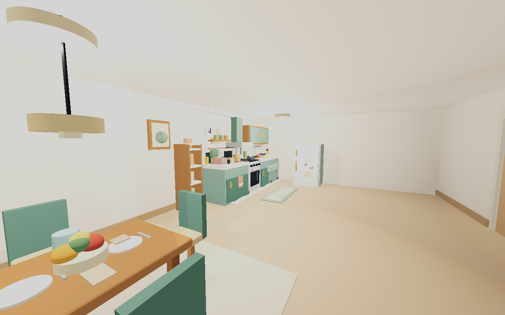
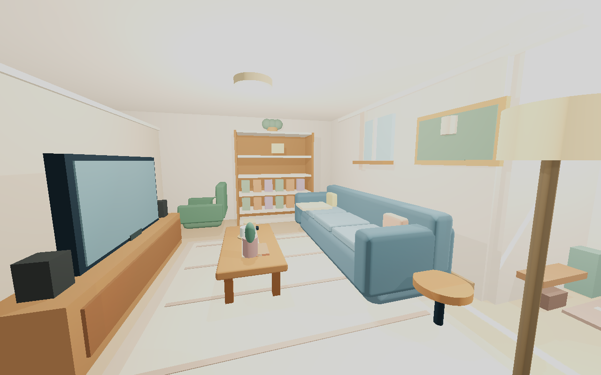
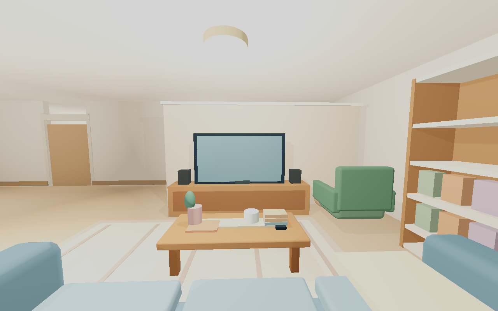
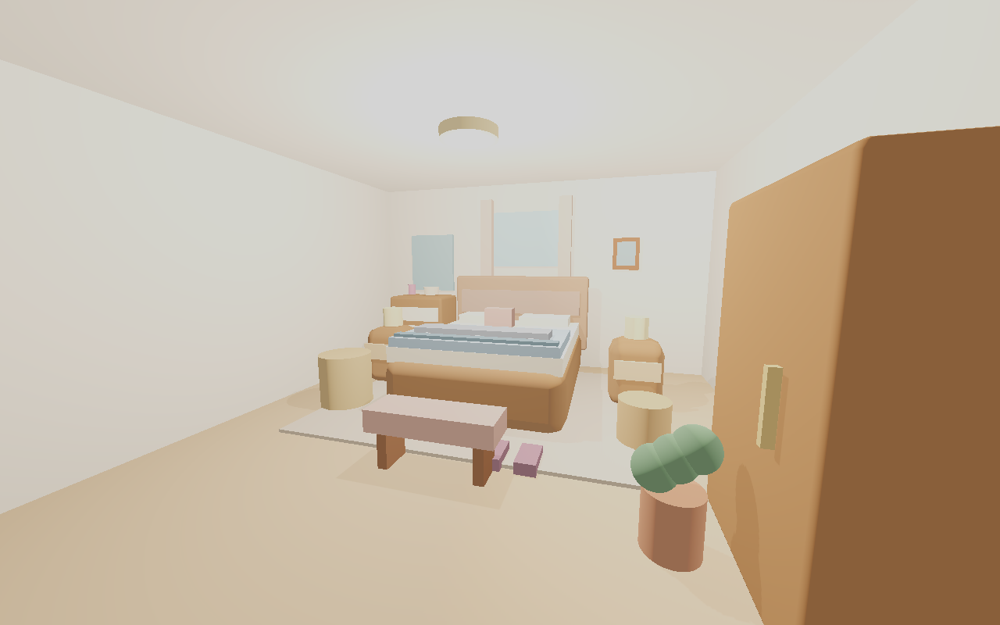
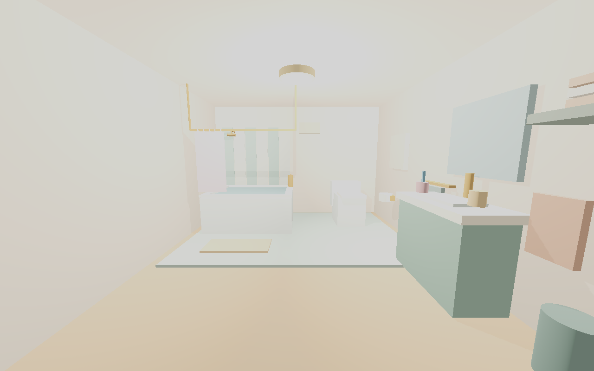
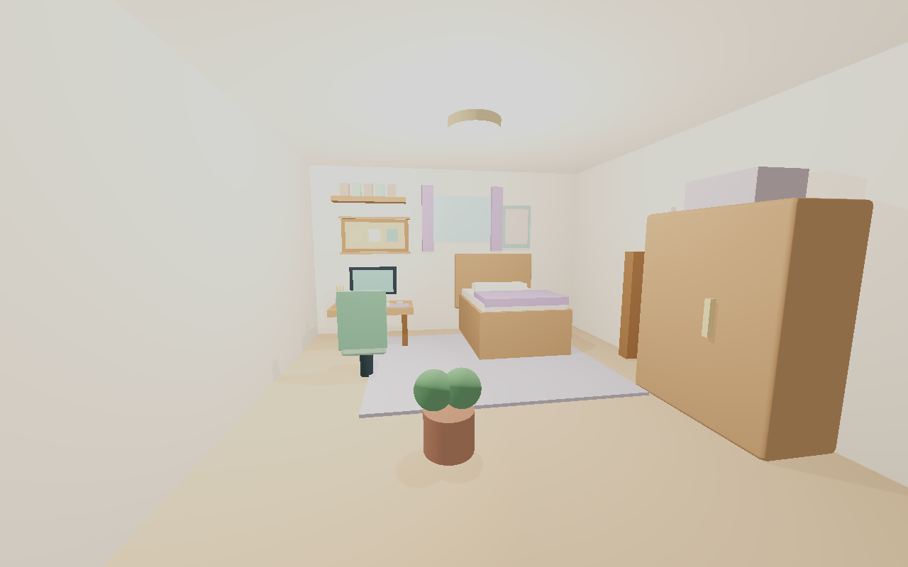
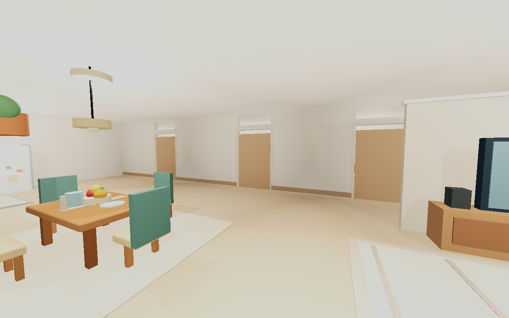
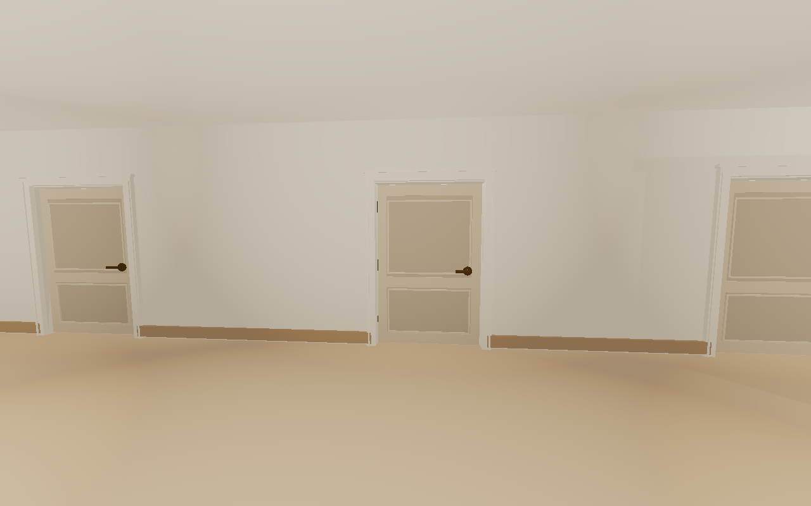
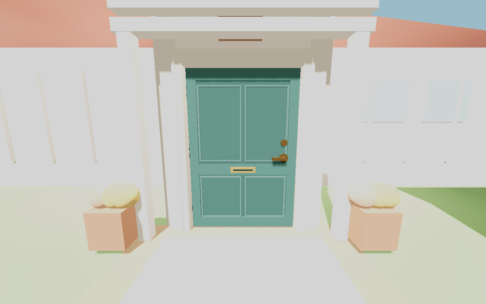

# House interior polish

> Historical implementation record. Use the [documentation map](../README.md)
> for current guides; positions, counts and test results below describe this snapshot.

Saved directly into this project. Run `scenes/main.tscn` to see the furnished house; furniture is generated by the scripts at runtime.

## Changes

- Fixed reversed triangle winding in rounded furniture. Seats, arms and surfaces render on the outside correctly.
- Preserved readable names for repeated furniture components so group placement includes every arm, cushion and trim piece.
- Restored house wall thickness to match collision shapes and removed an offset partition visual.
- Aligned kitchen work surfaces with the south wall; separated the microwave, toaster, coffee maker and preparation area. Raised cupboards clear of the faucet, removed the overlapping window, and built an open pantry with supporting shelves.
- Mounted the bathroom vanity and mirror against the east wall, moved accessories with them, opened the bath rim and shower curtain, and added rail supports.
- Attached bed accents to the translated bed, separated wardrobes and nightstands, and placed the dresser and mirror together at the north wall.
- Separated study pinboard, shelf, poster and window. Anchored wardrobe and calendar to the east wall.
- Removed duplicate decorations from the old house detail passes and floating upper units. Opened the living bookcase, corrected the television front, and removed overlapping art behind the sofa.
- Added supported pendant cords, complete dining chair legs, skirting with doorway gaps, and subdued interior shadows. Ceiling diffusers do not cast dark disks onto the ceiling.

## Verification

- All 10 application scripts pass Godot 4.7.2 parser checks.
- Project structure / resource / vocabulary checks: zero errors and warnings.
- Main scene instantiated and seven room views rendered and visually inspected with Godot OpenGL Compatibility on this laptop.
- `docs/evidence/town-checks/check_house.gd` passes: seven sampled capsule walking routes with doors open, four house doors, drawer slide origins, wall mesh/collision alignment, selected fixture positions and generated house vocabulary metadata.
- Walking-route tests sample specific routes; they do not exhaustively prove that every possible movement or camera angle is clear. Vocabulary UI and interaction animation were not manually played through.

Original changed files are preserved in `backups/house_before_interior_polish/` with `.bak` suffixes.

## Room previews

### Kitchen and dining

### Living room

### Television and bookcase

### Primary bedroom

### Bathroom

### Study bedroom

### Hall and circulation

## Door upgrade

All four house doors now have stepped recessed panels, molding, hinges and brass lever sets on both sides. Interior doors use warm wood tones and ivory casings. The front door uses teal paint, four panels, a deadbolt and a letter slot. Door headers close the gaps above the frames; the house plaque is clear of the trim.

Godot checks passed for all four doors: closed-door picking, animated opening and closing, colliders following the leaf, and handles on both faces. The seven sampled house walking routes also pass. Original door-related source files are in `backups/doors_before_polish/`.

