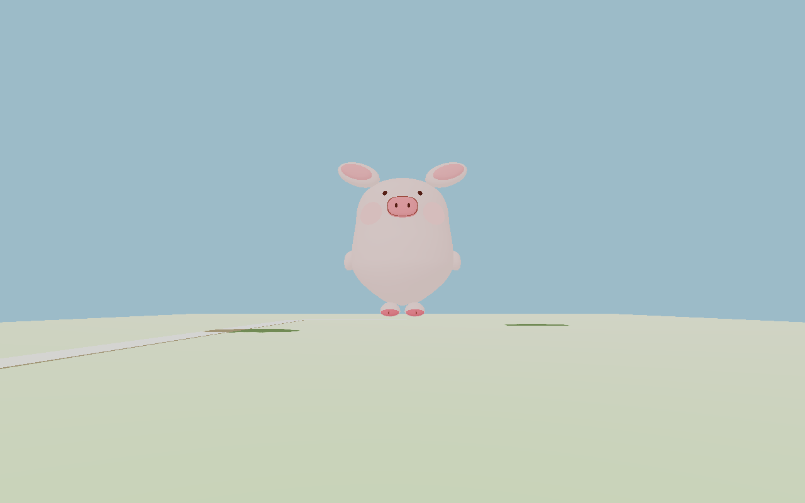
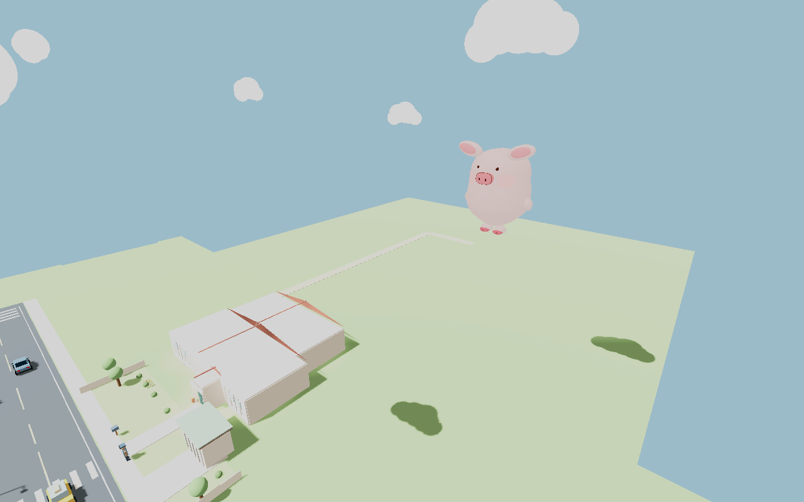
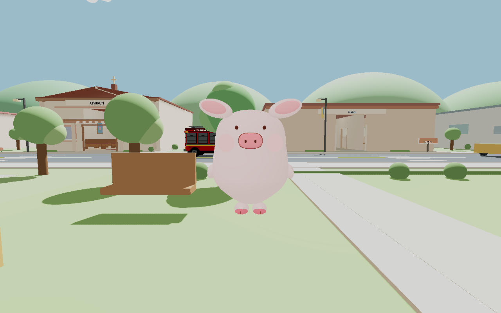

# Pig scene and giant landmark

> Historical implementation record. Use the [documentation map](../README.md)
> for current guides; positions, counts and test results below describe this snapshot.

- Renamed the custom `child.tscn` to `scenes/characters/pig.tscn` and extracted its embedded tool script into `scripts/characters/pig_sculpt.gd`.
- Preserved the custom sculpt, colors and normal pig size. Renamed root/vocabulary metadata and foot nodes; removed unused empty human placeholders.
- Updated the town instance to `Animals/Pig`. Historical child NPC generation and its vocabulary entry are retained as historical material; active scene references now use the pig.
- Added `pig` → `cerdo` in the Animals category.
- Added `scenes/characters/BonBon.tscn`, which inherits the regular pig so later model edits update both copies.
- The giant stands at town-local `(0, -0.023189, -81)`, facing +Z toward the house. The rear house wall is z=-9 and town blocks are spaced 36 units apart: the pig stands 72 units, or two blocks, behind that wall.
- Giant mesh height is 27.3 town units, exactly five times the house roof peak of 5.46. The main scene scale makes its world height approximately 35.49 units.
- Added solid rear meadow ground and an approach path around the west side of the house in `scenes/world/rear_meadow.tscn`. The giant has a solid capsule body and scaled vocabulary selection area.
- Updated room labels to identify the rear meadow instead of reporting it as a bathroom.

Godot 4.7.2 checks passed for both model bounds, five-house height ratio, two-block distance, feet resting on the ground, facing direction, pig metadata/translation, approach selection raycast and solid meadow ground. All resource/reference checks pass. Four live-rendered Godot previews were inspected.

Original files are backed up under `backups/pig_before_rename/`.

## Updated Soft Plush landmark

The giant now instances `pig_plush.tscn`, including its revised drooping arms and balanced cheeks. Its height is 43.68 town units (eight house roof heights, 56.784 world units), up from five houses. Its feet remain at ground level and it still faces the house from two blocks behind it. The inherited selection box is fitted to the plush proportions. Bounds and approach selection checks pass.

The supermarket pig moved from z=40.5 to 42.3, and the library pig from z=40.8 to 42.0. All six normal pigs pass mesh-clearance and selection checks. Backups are in `backups/pig_size_placement_before/`.

During verification, an unrelated parse error was found in `scenes/characters/driver.tscn:762`; this file was left untouched. The giant was also tested independently so its validation does not depend on that scene loading.
