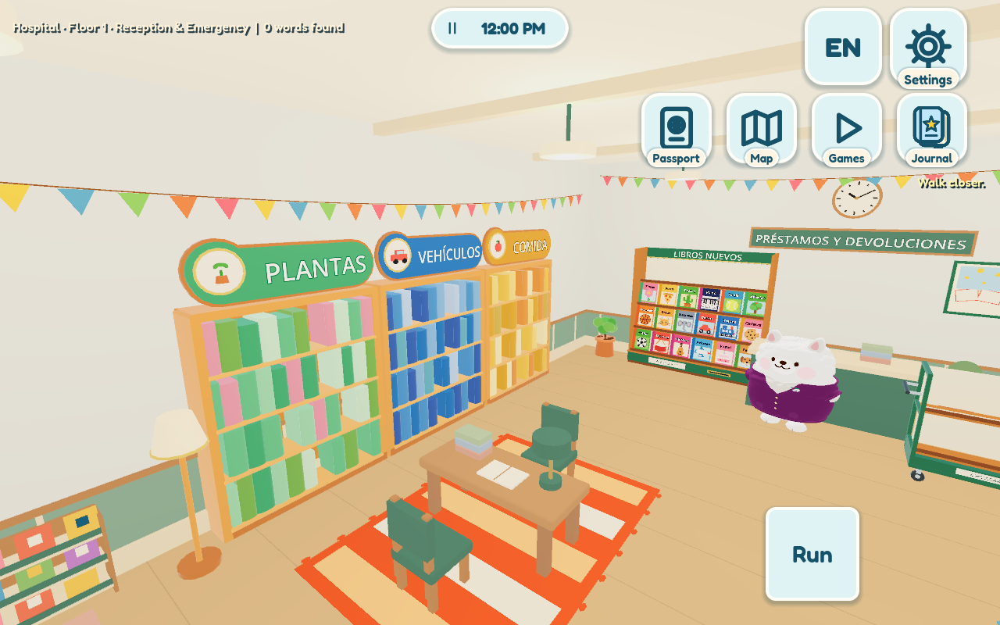
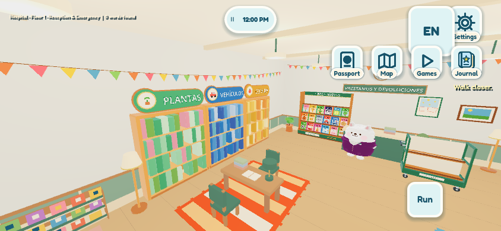

# Touch fixes (25 Nov 2026, improvement plan wave 3)

P3-05, P3-06, P3-07, P3-09 and P3-16 from the
[task tracker](../../guides/improvement-plan/TASK_TRACKER.md#p3-optional).

| Item | What changed | Code | Checked by |
| --- | --- | --- | --- |
| P3-05 | F9 / the games action during a running game opens no picker; the game asks its leave question (`request_leave()`, as Esc) | `main.gd` `_unhandled_input`, `game_launcher.gd` `toggle()` | `game_exits` |
| P3-06 | A tap or click on an interactable out of click reach, or on a word 8-40 m away, shows "Walk closer" (`toast.walk_closer`, es/en/zh) | `interaction_controller.gd` `click()`, `_too_far()`, `_far_word()` | `game_exits` (function level: no aimed click) |
| P3-07 | A closing hinged door whose leaf would hit the player opens again with the "doorway occupied" toast (also the heavy vault swing) | `door_animator.gd` `_blocked_closing()` | `game_exits` (a real room door, player in the doorway, then clear) |
| P3-09 | SceneTreeTimer lambdas check `is_inside_tree()` and the nodes they use | teller, zoo feeding, police detective, electrical box, cashier sessions | those games' checks |
| P3-16 | Name tags (cream pills) on the gear, journal, map, ▶ picker and Passport buttons for touch players; hidden on a keyboard, like the key hints the other way round | `vocabulary_hud.gd` `add_name_tag()` | `touch_controls` |

Renders (written by `../game-exits-20261125/verify.gd` with graphics): the toast and the name tags
at 1280 × 800 and at a landscape phone size (844 × 390).

## Results (26 Nov 2026, `dev_focus.txt` = all)

- `python3 tools/run_checks.py --only` touch_controls, language, minigame_launcher, zoo_feeding,
  bank_teller, police_detective, electrical_box, grocery_checkout, bank_rework: all PASS.
- `game_exits`: PASS headless (54 s); windowed render run (`--audio-driver Dummy`): 82 checks, 0 failures.
  Every Godot run ends with the known crash on exit after the summary.
- Not covered: an aimed tap in the rendered world (the toast is tested at function level); a real phone.

Follow-up (not fixed here): after the window shrinks from 1280 × 800 to 844 × 390 in one run, the
language peek button (EN) stays oversized (see the phone render); it looks like a resize layout bug
older than this work.
