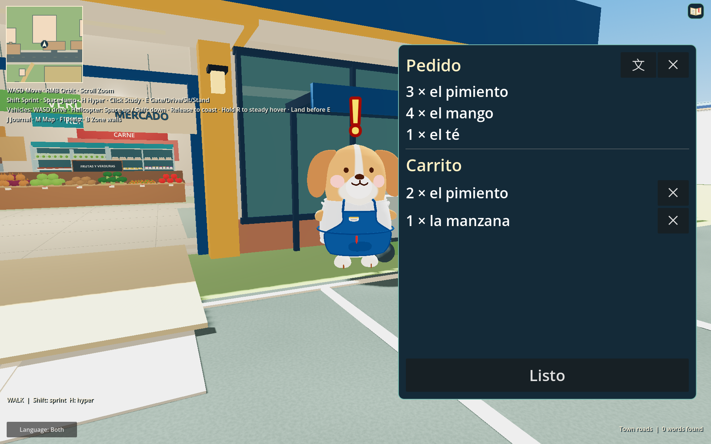
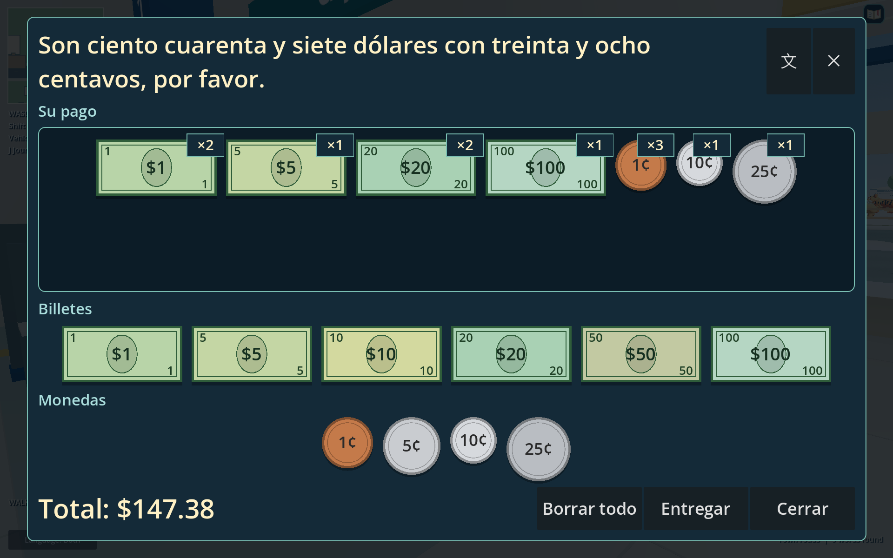
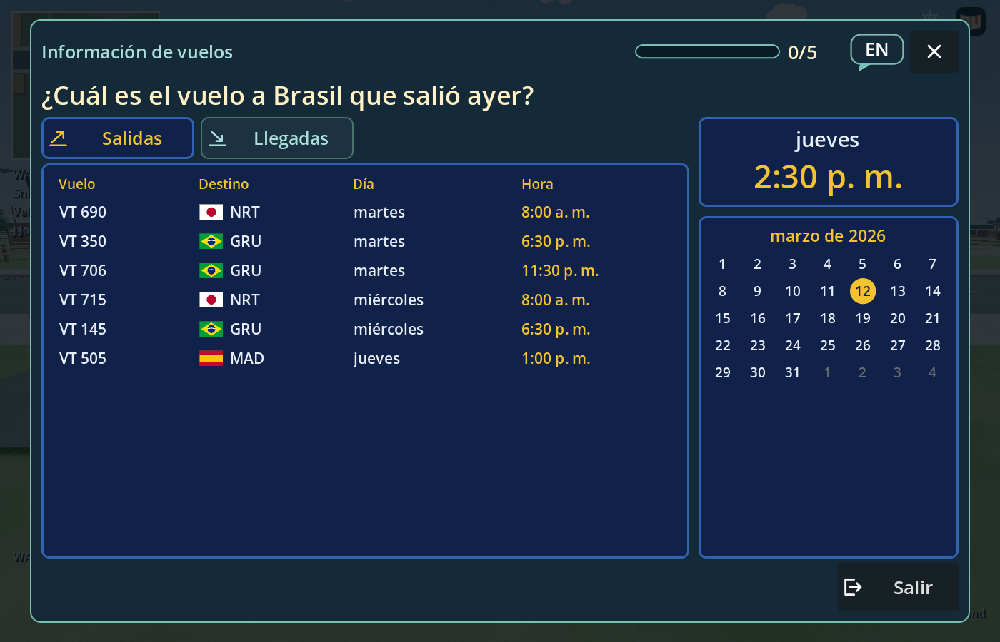
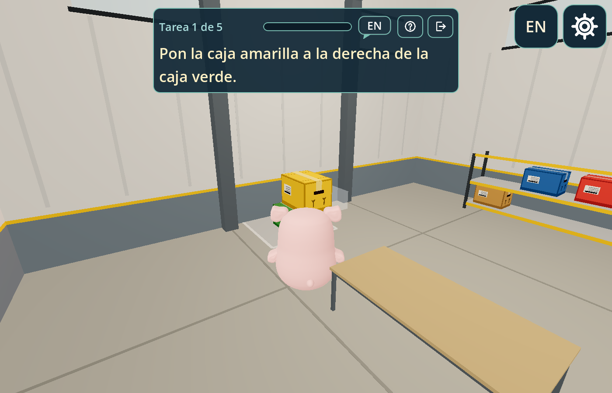
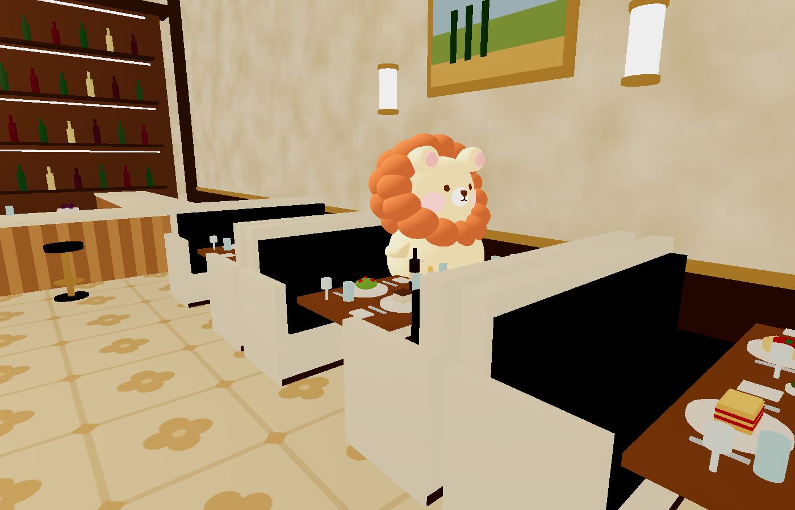
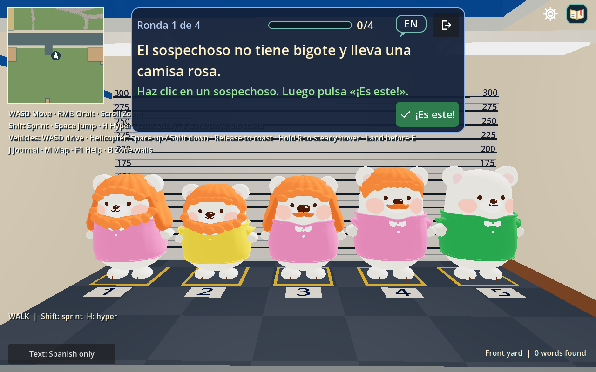
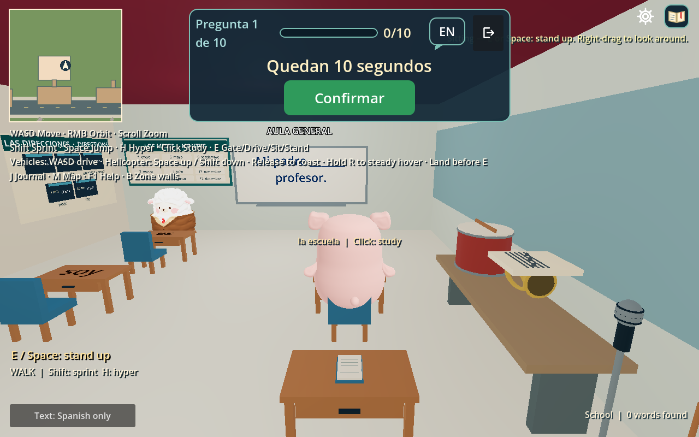

# Minigames

[← Game guide](README.md)

Fifteen minigames, each run by a plush character (or an object) somewhere in town. A gold "!"
over a character means it has a game to offer; talk to it with E, a click or a tap. Every game
can also be started straight away from the **minigame picker** (▶ button top right, or F9).

The game names come in all three languages (English · Chinese · Spanish). Game rules and
history live in each game's design record; the developer index with shared systems is
[MINIGAMES.md](../guides/MINIGAMES.md). Screenshot dates are in each caption.

**What this page owns** (user decision, 16 Nov 2026): each game's purpose and its **progression**
design (how it gets harder or changes as the player learns). Record new decisions on those here,
in the game's learning card, and keep the details of rules and code in the linked design record.
Word lists are **not** written here: [words.md](words.md) is generated from the game data by
`tools/vocabulary_report.gd -- --write`, and `data/words.json` stays the only word source.

## How games get harder

*Approved by the user on 18 Nov 2026; built for Pay Up! and Grocery Run, the other games are
designed but not built.* One shared system for every learning game; the code and data are
described in [MINIGAMES.md → Progression](../guides/MINIGAMES.md#progression).

- **Levels.** Each learning game has up to four levels. Level 1 is the easiest, often today's
  game. Each card's Progression row lists what changes from level to level.
- **Stars.** A finished session earns 1–3 stars from the share of rounds right the first time:
  every round right gives ★★★, at least 60% gives ★★, anything else ★. Grocery Run (one order)
  counts retries instead: right at the first Done ★★★, after one retry ★★, after two ★. A session
  left before the end earns nothing.
- **Unlocks.** ★★★ at your highest level unlocks the next one, and the next session uses it. You can
  go back to any unlocked level in the ▶ picker. A level never goes down by itself. A session
  with rounds changed in the picker still earns stars but unlocks nothing.
- **Where you see it.** The picker's tiles show the level and best stars at it, and its detail bar
  has a Level stepper. The NPC's greeting shows "Level 2 ☆☆☆" beside the speaker's name. A short star
  card at the top of the screen ends each session ("Level up! Level 3 unlocked").
- **Saved** per profile and per learned language; older saves start at level 1.
- **Not yet decided:** bringing weak words from the journal back more often; showing stars in the
  journal.

*Screenshots 18 Nov: the star card after a clean Pay Up! session; the level badge on a greeting.*

## Grocery Run

*買餸啦！ · ¡Al súper!* — **Beagle clerk, outside the supermarket door**

*Screenshot 3 Nov; orders shortened 14 Nov.*

The clerk asks for help and lists two basic fruits or vegetables (one or two of each). Find them
in the shop and bring them back. Teaches product names and quantities. Tracked.
[Design](../guides/TOWN_DESIGN_BRIEF.md#customer-order-minigame--3-november-2026) ·
[14 Nov update](../guides/TOWN_DESIGN_BRIEF.md#quicker-orders--14-november-2026)

| Learning card | |
| --- | --- |
| Purpose | Recognise fruit and vegetable names and simple quantities when someone asks for them, and find the real thing. |
| Words | [Generated list](words.md#grocery-run) |
| Tracked in the journal | Yes: each item ordered |
| Session | One order of 2 items, no progress bar |
| Progression | **Built 18 Nov.** L1 two fruit or vegetables, 1–2 each (today's game) · L2 three items, 1–3 each · L3 three items from all 80 supermarket products · L4 four items, 1–3 each, only one retry. Stars count retries |

## Pay Up!

*找數高手 · Cuentas claras* — **Samoyed cashier, at the supermarket till**

*Screenshot 4 Nov.*

The cashier says an amount (whole dollars up to $20 at level 1, up to $300 at level 4) in the language being learned; count it out from
bills and coins. Five rounds; a wrong answer can be retried or explained. Not tracked.
[Design](../guides/TOWN_DESIGN_BRIEF.md#cashier-money-minigame--4-november-2026)

| Learning card | |
| --- | --- |
| Purpose | Understand spoken prices and count out money. |
| Words | [Generated list](words.md#pay-up) |
| Tracked in the journal | No (amounts are generated language, not words) |
| Session | 5 amounts, first try counts |
| Progression | **Built 18 Nov.** L1 whole dollars up to $20 · L2 up to $50 in quarters · L3 up to $100, any cents · L4 up to $300 (the game before 18 Nov). A round paid wrong once is a miss |

## Who's Who?

*誰是誰？ · ¿Quién es quién?* — **Dr. Li (pig plush doctor), right of the hospital entrance**

*Screenshot 4 Nov.*

A family tree with names, ages and birthdays; answer 20 questions about relationships, months,
older and younger, before and after. The school's posters teach the words first. Tracked.
[Design](../guides/TOWN_DESIGN_BRIEF.md#hospital-family-game--4-november-2026)

| Learning card | |
| --- | --- |
| Purpose | Family relationships, ages, birthdays and months, by reading a family tree. |
| Words | [Generated list](words.md#whos-who) |
| Tracked in the journal | Yes: the relative in each relation question |
| Session | 20 questions, first try counts |
| Progression | Designed 18 Nov, not built: L1 relation questions only, 10 questions · L2 + ages, older and younger · L3 + birthdays, months, before and after, 20 questions (today) · L4 more yes/no traps |

## Flight Finder

*搵航班 · Busca tu vuelo* — **Capitán Bruno (bear pilot), airport information desk**

*Screenshot 8 Nov.*

Bruno describes a flight by its day, time, country and whether it leaves or arrives; find it on the departures or arrivals board, with near-miss flights as traps. Five questions.
Teaches time words (yesterday, the day after tomorrow, this morning, in two hours), weekdays,
clock times and countries. Tracked.
[Design](../guides/TOWN_DESIGN_BRIEF.md#airport-flight-game--5-november-2026)

| Learning card | |
| --- | --- |
| Purpose | Time expressions around today, weekdays, clock times and country names, by finding flights. |
| Words | [Generated list](words.md#flight-finder) |
| Tracked in the journal | Yes: the time word and the destination country |
| Session | 5 flights, first try counts |
| Progression | Designed 18 Nov, not built: L1 yesterday, today, tomorrow and weekdays, no near miss · L2 + clock times and a near miss (today) · L3 + anteayer, pasado mañana, hace / dentro de · L4 departures and arrivals mixed, more decoys |

## Stack & Pack

*搬搬抬抬 · Carga y descarga* — **Ramón (lion boss), at the warehouse**

*Screenshot 14 Nov.*

Five placing tasks in the warehouse hall: "Put the blue box on the table", "next to the green
box", "to the right of", "on the top shelf". Pick up the right coloured box and put it in the
right place; hints and "tell me" help when stuck. Teaches positions, colours and placing verbs.
Tracked. Simplified on 14 Nov (it used to have trolleys, weighing and measuring).
[Warehouse guide](../guides/WAREHOUSE.md#minigame-14-nov-2026)

| Learning card | |
| --- | --- |
| Purpose | Follow placing instructions: positions, colours, placing verbs. |
| Words | [Generated list](words.md#stack--pack) |
| Tracked in the journal | Yes: the box named in each task |
| Session | 5 tasks, a task counts when done |
| Progression | Designed 18 Nov, not built: L1 *on* and the top shelf · L2 + next to · L3 + to the right of (today) · L4 hints only after a wrong try |

## On the Menu

*今日餐牌 · Menú del día* — **Twinkle (beagle waiter), Alta Cocina host stand**

*Screenshot 11 Nov.*

Twinkle sends you to a seated customer, who orders two or three courses by taste, temperature,
intensity (*un poco*, *muy*) and ingredients. Choose the dishes on a tablet and send
them; the customer reacts and Twinkle reports back. A menu book on a table shows every dish.
Four fully right orders win. Tracked.
[Design](../guides/TOWN_DESIGN_BRIEF.md#alta-cocina-restaurant-game--6-november-2026) ·
[11 Nov flow](../guides/TOWN_DESIGN_BRIEF.md#restaurant-game-reception-tables-and-order-tablet--11-november-2026)

| Learning card | |
| --- | --- |
| Purpose | Dish names, courses and describing food (taste, temperature, intensity, ingredients). |
| Words | [Generated list](words.md#on-the-menu) |
| Tracked in the journal | Yes: the dish served |
| Session | One meal of 4 courses, a course counts when right |
| Progression | Designed 18 Nov, not built: L1 two courses, one need each · L2 + *un poco* / *muy* (today) · L3 three courses with a *no* / *sin* · L4 three needs per course |

## Spot the Suspect

*搵疑犯 · ¿Quién fue?* — **Officer Rocco (crocodile), police station lobby**

*Screenshot 6 Nov.*

Five bear suspects in a lineup; two clues (*no tiene bigote y lleva una camisa rosa*: no moustache, a pink shirt) point to
one. Four rounds. Teaches describing people: height, hair, beard, nose, clothes, and negation.
Not tracked yet.
[Design](../guides/TOWN_DESIGN_BRIEF.md#police-station-enlargement-and-detective-games--6-november-2026)

| Learning card | |
| --- | --- |
| Purpose | Describe people: height, hair, beard, nose, clothes and negation. |
| Words | [Generated list](words.md#spot-the-suspect) |
| Tracked in the journal | No: each round has two clue words and the answer is a suspect, so no single tested word (user decision, 7 Nov) |
| Session | 4 rounds, a round counts when solved |
| Progression | Designed 18 Nov, not built: L1 four suspects, two clues, no negation · L2 five suspects (today) · L3 + negation · L4 six suspects, three clues |

## Feel the Clues

*證物實驗室 · Pistas al tacto* — **Officer Mimi (cat), police evidence counter**

*Screenshot 8 Nov.*

Examine objects with three tools (squeeze, touch, lift) to find which is soft, rough or heavy,
or answer "is the stone hard or soft?". Four rounds. Teaches hard/soft, rough/smooth,
heavy/light with ten everyday objects. Tracked.
[Redesign](../guides/TOWN_DESIGN_BRIEF.md#police-evidence-game-redesign--8-november-2026)

| Learning card | |
| --- | --- |
| Purpose | Object properties and the ten object nouns, with agreement. |
| Words | [Generated list](words.md#feel-the-clues) |
| Tracked in the journal | Yes: the property word deciding each round |
| Session | 4 rounds, a round counts when solved |
| Progression | Designed 18 Nov, not built: L1 *find* rounds with three objects · L2 four objects (today) · L3 + *report* rounds with agreement · L4 mixed, more objects |

## Desk Dash

*搶位答題 · ¡A tu pupitre!* — **Lana (sheep teacher), school grammar classroom**

*Screenshot 6 Nov; board enlarged 14 Nov.*

A fill-in-the-blank sentence is on the board and the four answers lie on four desks: sit at the
right one within 10 seconds. Five questions, and each one missed comes back once at the end.
Grammar depends on the language: Spanish *ser*/*estar*, Chinese measure words, English
agreement and prepositions. Points only; Chinese measure words are tracked.
[Guide](../guides/GRAMMAR_CLASS.md)

| Learning card | |
| --- | --- |
| Purpose | Grammar of the language being learned (ser/estar, measure words, agreement and prepositions). |
| Words | [Generated list](words.md#desk-dash) |
| Tracked in the journal | Points only; the noun of Chinese measure-word questions is tracked |
| Session | 5 questions plus each miss once more (at most 10) |
| Progression | Designed 18 Nov, not built: L1 15 s per question · L2 10 s (today) · L3 harder questions (needs difficulty tags in the question bank) · L4 7 s |

## Mystery Doors

*神秘之門 · Puertas misteriosas* — **Madame Luna (cat fortune-teller), Mystery House**

*No screenshot in the docs yet.*

A clue names a colour, a shape or both; open the door that matches. A right door leads on through an endless hall of rooms; a wrong one turns you into a toad
for three seconds. Six doors, then a treasure chest. Teaches colours and shapes. Tracked.
[Design](../guides/TOWN_DESIGN_BRIEF.md#mystery-house-and-mystery-doors--9-november-2026)

| Learning card | |
| --- | --- |
| Purpose | Colours and shapes in a clue sentence. |
| Words | [Generated list](words.md#mystery-doors) |
| Tracked in the journal | Yes: the colour or shape a door's clue names |
| Session | 6 doors, first try counts |
| Progression | Designed 18 Nov, not built: L1 one clue type, 4 doors · L2 shape, colour and both (today) · L3 more colours · L4 8 doors, combined clues only |

## Mahjong Club

*雀友會 · Club de mahjong* — **Mei (cat host), table in front of the home**

*Screenshot 16 Nov: camera across to Awoo, larger discards in a pinwheel (status bar split to keep his face clear).*

One hand of Hong Kong mahjong against three plush players, with the calls, winds and hand names
in the language being learned. Two short lessons (Basics, Scoring) explain the rules. Not
tracked.
[Guide](../guides/MAHJONG.md)

| Learning card | |
| --- | --- |
| Purpose | Hear and use game language (calls, winds, hand names) while playing; a pastime. |
| Words | [Generated list](words.md#mahjong-club) |
| Tracked in the journal | No |
| Session | One hand |
| Progression | None (pastime; user approval 18 Nov) |

## Radar Patrol

*天空保衛戰 · Guardianes del cielo* — **No character: the radars in the airport control tower**

*Screenshot 9 Nov; taps made easier 15 Nov.*

An endless arcade game: tap UFOs before they reach the planes. Best score saved. A pastime with
no words to learn.
[Guide](../guides/RADAR_PATROL.md)

| Learning card | |
| --- | --- |
| Purpose | Fun only; no learning goal. |
| Words | [Generated list](words.md#radar-patrol) |
| Tracked in the journal | No |
| Session | Endless; best score saved |
| Progression | None (pastime; it keeps its best score) |

## Wire It Up!

*駁電線 · Cable a cable* — **No character: the electrical box on the home's garage wall**

*Screenshot 9 Nov.*

Open the box and connect the wires by colour. A pastime; the box itself teaches *electrical box*.
[Guide](../guides/ELECTRICAL_BOX.md)

| Learning card | |
| --- | --- |
| Purpose | Fun only; the box teaches *electrical box*. |
| Words | [Generated list](words.md#wire-it-up) |
| Tracked in the journal | No |
| Session | One puzzle per opening |
| Progression | Designed 18 Nov, not built: L1 fewer wires · L2 today · L3 more wires |

## Library Helper

*圖書館小幫手 · Ayudante de biblioteca* (named by the user 17 Nov; was Shelf Mission) — **Rosa (samoyed librarian), by
the NEW BOOKS display**

*Screenshot 17 Nov.*

Three to six books wait on the return cart. Take each one to a gap in the shelf for its category
(animals, sports, music, food, vehicles, plants): the right shelf sparkles, a wrong one wobbles the
book back into your hand. When every book is home Rosa thanks you and recalls one book's shelf; a
few minutes later the books are borrowed and a new cart arrives. Tracked: each book's first try.
[Design](../guides/TOWN_DESIGN_BRIEF.md#library-return-cart-and-book-sorting-game--13-november-2026)

| Learning card | |
| --- | --- |
| Purpose | Book topics (dogs, pizza, guitar…) and the six category words (animal, sport, music, food, vehicle, plant; 3 books each) by sorting returned books. |
| Words | [Generated list](words.md#library-helper) |
| Tracked in the journal | Yes (17 Nov): a book's first placement in a cart tests its topic word and its category word |
| Session | One cart of 3–6 books; the next cart about 5 minutes after a perfect one |
| Progression | Designed 18 Nov, not built: L1 3 books · L2 4–5 books · L3 6 books · L4 plain spines, so the colours no longer match the shelves (user idea, 17 Nov 2026) |

## Next, Please!

*下一位！ · ¡El siguiente!* (proposed name, 18 Nov; awaiting the user's choice) — **Bear banker,
bank reception; played at teller window 2**

*Screenshot 18 Nov.*

The regular teller is on a break, so the banker asks you to cover window 2. Plush customers walk
up from the queue, each with a story (a new bike, cakes for the grandchildren, a telescope…), and
ask for an amount in words. Check their account on the teller monitor, then count out the cash
with $5, $10, $50 and $100 bills, or tell them politely that there is not enough money. One
customer a session only wants change and must get no $100 bills back. Mistakes get an
in-character answer (what they received, in words) and a retry. Not tracked.
[Design](../guides/TOWN_DESIGN_BRIEF.md#bank-teller-game--18-november-2026)

| Learning card | |
| --- | --- |
| Purpose | Understand spoken amounts from 100 to 500 (cien … quinientos, ciento cincuenta, trescientos sesenta y cinco), compare them with a balance written in digits, and count them out in bills of 5, 10, 50 and 100. |
| Words | [Generated list](words.md#next-please) (amounts are generated language, not word-list words) |
| Tracked in the journal | No (amounts are generated language, like Pay Up!) |
| Session | 5 customers (`data/activities.json`); a customer counts when served right the first time (the exact cash, or a correct "not enough") |
| Progression | Within a session (user, 18 Nov 2026): first whole hundreds (cien … quinientos), then hundreds and fifty, then any multiple of 5 that needs the $10 and $5 bills; one customer is short of money (a balance a little under the request) and one wants change for whole hundreds. Not yet across sessions |
