# Minigames

[← Game guide](README.md)

Fifteen minigames, each run by a plush character (or an object) somewhere in town. A gold "!"
over a character means it has a game to offer; talk to it with E, a click or a tap. Every game
can also be started straight away from the **minigame picker** (▶ button top right, or F9).

The game names come in all three languages (English · Chinese · Spanish). Game rules and
history live in each game's design record; the developer index with shared systems is
[MINIGAMES.md](../guides/MINIGAMES.md). Screenshot dates are in each caption.

**What this page owns** (user decision, 16 Nov 2026): each game's purpose and its **progression**
design (how it gets harder or changes as the player learns). Record new decisions on those here,
in the game's learning card, and keep the details of rules and code in the linked design record.
Word lists are **not** written here: [words.md](words.md) is generated from the game data by
`tools/vocabulary_report.gd -- --write`, and `data/words.json` stays the only word source.

## After a game

*Since 21 Nov 2026 (user design).* When a learning game is finished (not left early), a results
card follows the character's thanks: a title for that game (*Case Closed!*, *Books Sorted!*…), one
line of what you did, the words you **practiced** and **discovered for the first time** (up to
four, new and tricky ones first, "See all" for the rest), and a town mission it completed with its
XP. No scores or percentages; a replay with no new words says *Great Practice!* instead of "0 new
words". Buttons: **Continue exploring** and **Play again**. Details:
[MINIGAMES.md → Results screen](../guides/MINIGAMES.md#results-screen).

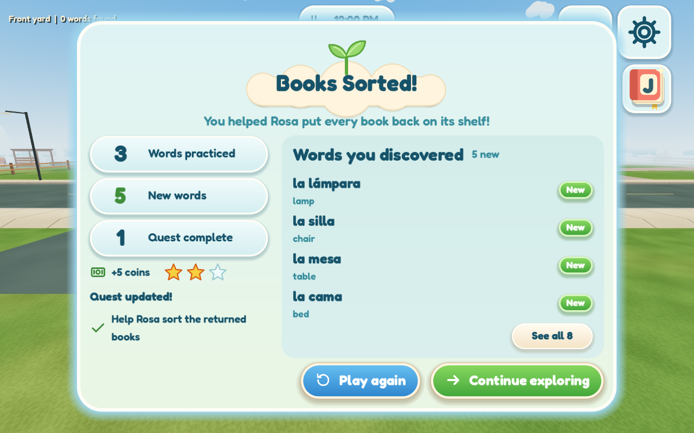

*Screenshot 21 Nov (a test card with every part shown).*

## How games get harder

*Approved by the user on 18 Nov 2026; built for Grocery Run (and Pay Up! until it became Grocery
Run's checkout on 21 Nov), the other games are designed but not built.* One shared system for every learning game; the code and data are
described in [MINIGAMES.md → Progression](../guides/MINIGAMES.md#progression).

- **Levels.** Each learning game has up to four levels. Level 1 is the easiest, often today's
  game. Each card's Progression row lists what changes from level to level.
- **Stars.** A finished session earns 1–3 stars from the share of rounds right the first time:
  every round right gives ★★★, at least 60% gives ★★, anything else ★. Grocery Run (one order)
  counts mistakes instead (since 21 Nov: a basket the till turns down or a wrong payment): none
  ★★★, one ★★, two or more ★. A session
  left before the end earns nothing.
- **Unlocks.** ★★★ at your highest level unlocks the next one, and the next session uses it. You can
  go back to any unlocked level in the ▶ picker. A level never goes down by itself. A session
  with rounds changed in the picker still earns stars but unlocks nothing.
- **Where you see it.** The picker's tiles show the level and best stars at it, and its detail bar
  has a Level stepper. The NPC's greeting shows "Level 2 ☆☆☆" beside the speaker's name. A short star
  card at the top of the screen ends each session ("Level up! Level 3 unlocked").
- **Saved** per profile and per learned language; older saves start at level 1.
- **Not yet decided:** bringing weak words from the journal back more often; showing stars in the
  journal.

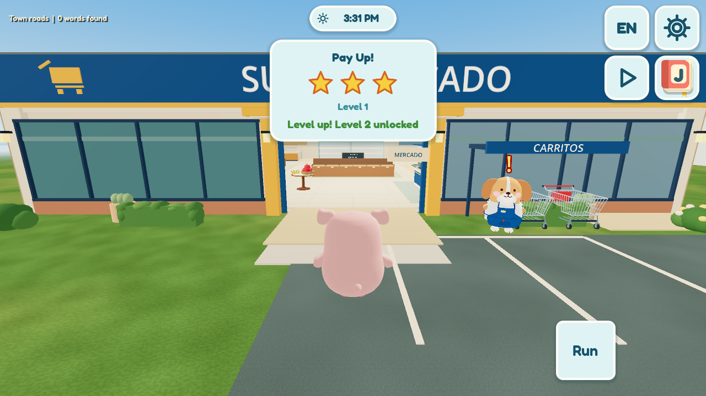
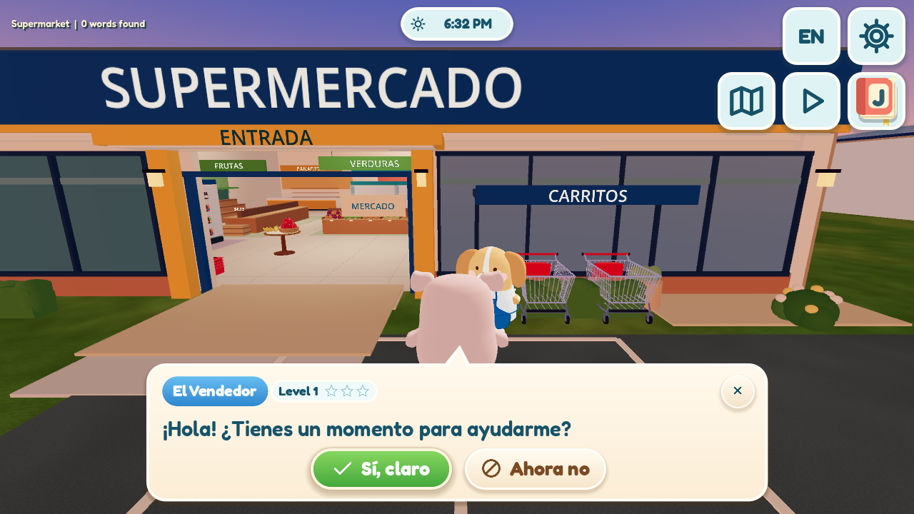

*Screenshots 18 Nov: the star card after a clean Pay Up! session; the level badge on a greeting.*

## Which words come up

*Built 24 Nov 2026 (user: "apply FSRS to each game … focus on the interval in gradually
increasing the new words … not on time").* One shared **word memory** decides which words every
learning game asks about, so a player keeps meeting new words as they play more rounds, and
reviews the ones they are about to forget. The code is in
[MINIGAMES.md → Word memory](../guides/MINIGAMES.md#word-memory).

- **Counted in questions, not days.** Every question answered in any game is one step. The
  memory uses the FSRS spaced-repetition model on those steps: each word has a stability (how
  long it is remembered) and a difficulty, and its recall chance drops as other questions pass.
  A right first answer makes the word last longer; a wrong one or a shown translation makes it
  come back soon.
- **New words come in gradually.** At most 3 at a time. After a new word, the next one waits 3
  questions, plus 1 for every 3 words still being learned; with 12 words still being learned no
  new word comes until some are known. A player who keeps getting words right meets new ones
  often; one who struggles reviews first.
- **Order of words in a round:** words about to be forgotten first, then the new words allowed
  now (lowest [word tier](#word-tiers) first), then known words least well remembered first,
  then the other new words (so a game always has enough).
- **Per game:** Grocery Run, Library Helper and On the Menu order their items by it; Stack & Pack
  picks the box; Desk Dash puts the wanted nouns' questions first; Feel the Clues picks the clue;
  Who's Who?, Flight Finder and Mystery Doors make a few rounds and keep the first whose words
  are wanted. Games without tracked words (pastimes, Spot the Suspect) are unchanged.
- **Saved** per profile and per learned language. A save from before starts from its practice
  record (each word once).
- Simulated learner (check, 24 Nov): about 21 new words per 100 questions, all 120 met by 600,
  86% right.
- **Not yet:** day-based review (time between sessions); showing a word's memory in the journal;
  tuning the numbers by play.

## Word tiers

*Draft 24 Nov 2026, for the user's review.* Since 24 Nov the [word memory](#which-words-come-up)
reads it for the order of new words; the per-game levels do not yet. Every word in
`data/words.json` has a `tier`: how early a learner meets it. It is the shared order behind the
planned per-game levels (each game's higher levels add higher-tier words) and the town-wide
vocabulary progress ("Tier 1: 48 of 164 known"). One number per word, or a map with a
`default` and per-language numbers when a word is clearly easier or harder in one language (an
English look-alike in Spanish); the draft has no per-language tiers yet.

| Tier | Meaning | Words (draft) | Examples |
| ---: | --- | ---: | --- |
| 1 | **Starter**: first-week words, very common, easy to picture | 164 | apple, dog, mother, red, today, door, hand, to go |
| 2 | **Everyday**: common words most learners know within a few months | 332 | cookie, rabbit, jacket, the months, next to, passport, to carry |
| 3 | **Wider**: less frequent, still general | 244 | avocado, nephew, thermometer, arrival, wheelbarrow, rough |
| 4 | **Specialist**: technical or place-specific | 59 | defibrillator, lectern, conveyor belt, metal detector, gazpacho |

Ranked by how common and useful the word is, how easily it is pictured, and how basic its
category is. Each game's word list ([words.md](words.md)) is sorted by tier and gives its
count per tier (for example Grocery Run 27 · 24 · 10 · 0, On the Menu 6 · 13 · 16 · 3).

**Decided 24 Nov (user):** Grocery Run's prices follow the word tiers, and tier 3 products get
any-cents prices ([Grocery Run](#grocery-run), Prices). 31 products moved by one price tier.

**To decide (user):**
- Whether to add per-language tiers now (Spanish look-alikes such as *chocolate*, *piano*, *hospital*).

## Grocery Run

*買餸啦！ · ¡Al súper!* — **Beagle clerk, outside the supermarket door; paid at the samoyed cashier's till**

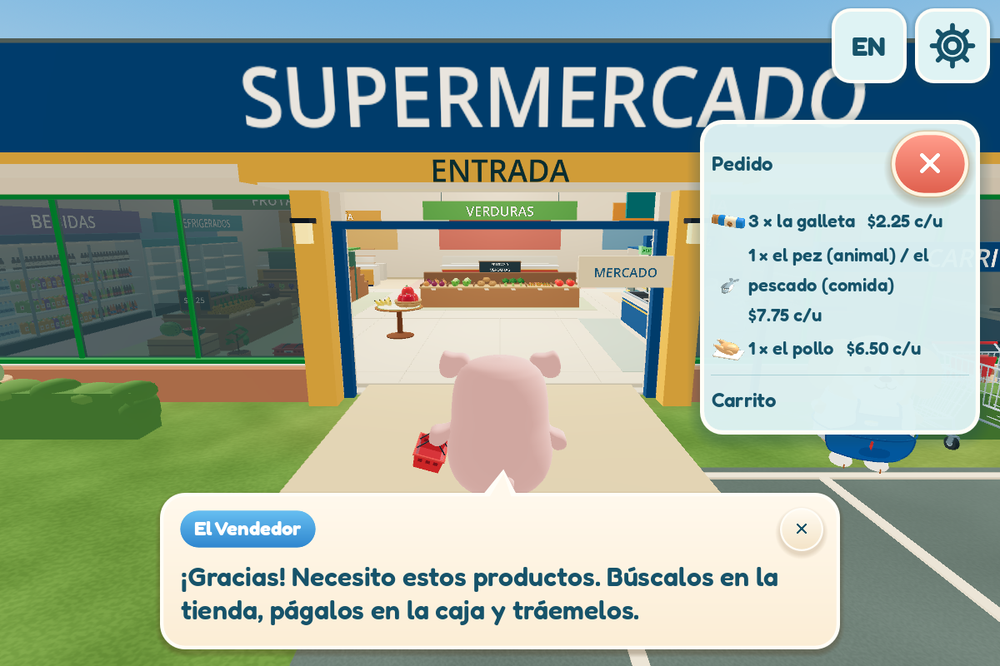
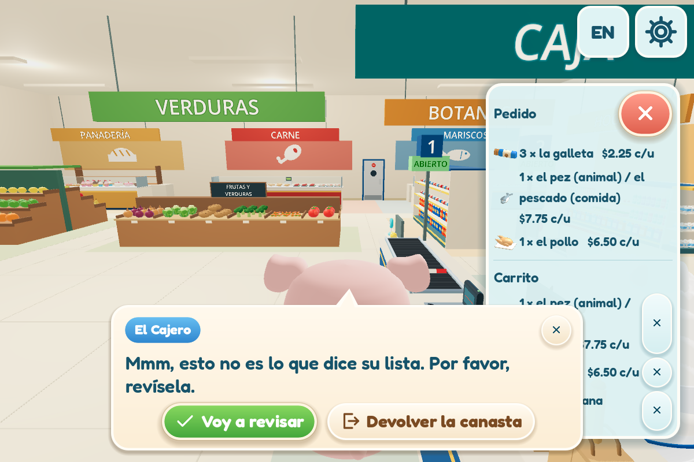

*Screenshots 21 Nov: the order with prices; the till turning down a wrong basket.*

The clerk asks for help, lists what he needs and hands you a basket. Find the products, pay for
them at the till, then bring the basket back to him. The cashier checks the basket against the
list first: a wrong basket is not charged ("please check your list"; the second time the cashier
says what is missing and what is not on the list). Then the cashier says the total in the language you are
learning and you count out exactly that. The shop door won't let you out with an unpaid basket
(the cashier's "pay first" line goes away a couple of seconds after you step back from the door; 23 Nov).
Walking off during an order, after paying too, puts you back and asks whether to quit; the
money screen leaves the top-right EN visible and clickable (23 Nov,
[screenshots](../evidence/ui-fixes-20261123/)).
Give the basket back to the cashier, or put it back empty on the stack by the door, to stop.
Teaches product names, quantities and prices. Tracked.
[Design](../guides/TOWN_DESIGN_BRIEF.md#customer-order-minigame--3-november-2026) ·
[14 Nov update](../guides/TOWN_DESIGN_BRIEF.md#quicker-orders--14-november-2026) ·
[21 Nov checkout](../guides/TOWN_DESIGN_BRIEF.md#grocery-checkout-and-free-shopping--21-november-2026)

**Free shopping** (21 Nov, not a game: no stars, nothing saved). Take a basket from the stack by the
door, click any product into it, and pay at the till. Same rules for the door and for stopping.

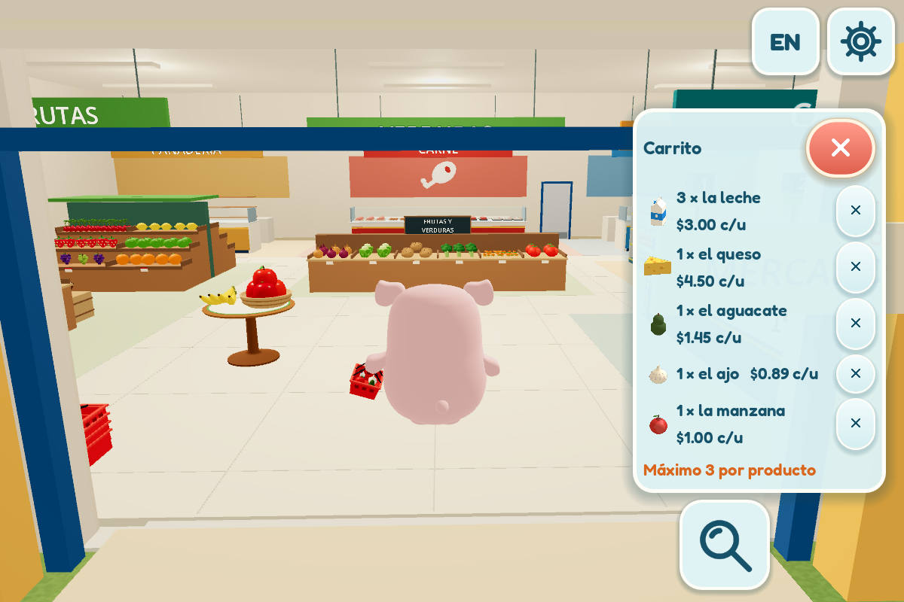

| Learning card | |
| --- | --- |
| Purpose | Recognise product names and simple quantities when someone asks for them, find the real thing, and pay for it: understand a spoken total and count it out (Pay Up!'s purpose, merged in on 21 Nov). |
| Words | [Generated list](words.md#grocery-run) |
| Tracked in the journal | Yes: each item ordered (right when the first basket at the till had none of it missing or extra) |
| Session | One order, paid and brought back; no progress bar |
| Prices | One price per product, by how hard its word is (user, 21 Nov). Since 24 Nov (user) a product's price follows its [word tier](#word-tiers): tier 1 whole dollars (27 products), tier 2 .25/.50/.75 (24), tier 3 any cents such as $0.79 (10); the quarters-with-dimes prices are gone. The list is in [data/shops.json](../../data/shops.json) `prices` |
| Progression | **Built 18 Nov; levels follow the price tiers since 21 Nov.** L1 two basic fruit or vegetables, 1–2 each (whole dollars) · L2 three items, 1–3 each, from tiers 1–2 · L3 three items from all products (tiers 1–3 since 24 Nov) · L4 four items, 1–3 each, from all products. Stars count mistakes at the till |

## Pay Up!

*找數高手 · Cuentas claras* — **Retired 21 Nov 2026 (user): it became Grocery Run's checkout.**

The cashier used to ask for random amounts (up to $300) to count out. Now the cashier charges what your
basket costs, with the same money screen, "Try again" and "What went wrong?". Its levels and stars
went with it. [Old design](../guides/TOWN_DESIGN_BRIEF.md#cashier-money-minigame--4-november-2026)

## Who's Who?

*誰是誰？ · ¿Quién es quién?* — **Dr. Li (pig plush doctor), right of the hospital entrance**

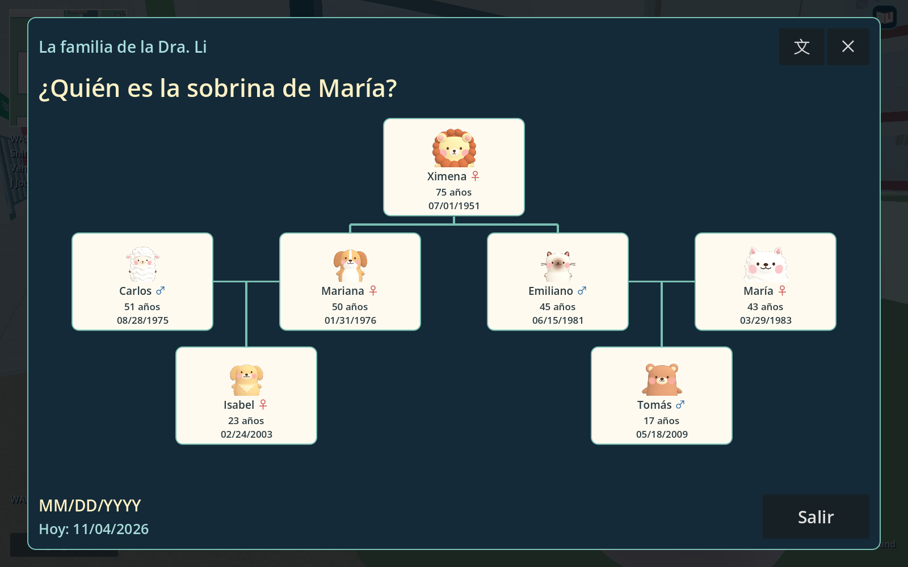

*Screenshot 4 Nov.*

A family tree with names, ages and birthdays; answer 20 questions about relationships, months,
older and younger, before and after. The school's posters teach the words first. Tracked.
[Design](../guides/TOWN_DESIGN_BRIEF.md#hospital-family-game--4-november-2026)

| Learning card | |
| --- | --- |
| Purpose | Family relationships, ages, birthdays and months, by reading a family tree. |
| Words | [Generated list](words.md#whos-who) |
| Tracked in the journal | Yes: the relative in each relation question |
| Session | 20 questions, first try counts |
| Progression | Designed 18 Nov, not built: L1 relation questions only, 10 questions · L2 + ages, older and younger · L3 + birthdays, months, before and after, 20 questions (today) · L4 more yes/no traps |

## Flight Finder

*搵航班 · Busca tu vuelo* — **Capitán Bruno (bear pilot), airport information desk**

*Screenshot 8 Nov.*

Bruno describes a flight by its day, time, country and whether it leaves or arrives; find it on the departures or arrivals board, with near-miss flights as traps. Five questions.
Teaches time words (yesterday, the day after tomorrow, this morning, in two hours), weekdays,
clock times and countries. Tracked.
[Design](../guides/TOWN_DESIGN_BRIEF.md#airport-flight-game--5-november-2026)

| Learning card | |
| --- | --- |
| Purpose | Time expressions around today, weekdays, clock times and country names, by finding flights. |
| Words | [Generated list](words.md#flight-finder) |
| Tracked in the journal | Yes: the time word and the destination country |
| Session | 5 flights, first try counts |
| Progression | Designed 18 Nov, not built: L1 yesterday, today, tomorrow and weekdays, no near miss · L2 + clock times and a near miss (today) · L3 + anteayer, pasado mañana, hace / dentro de · L4 departures and arrivals mixed, more decoys |

## Stack & Pack

*搬搬抬抬 · Carga y descarga* — **Ramón (lion boss), at the warehouse**

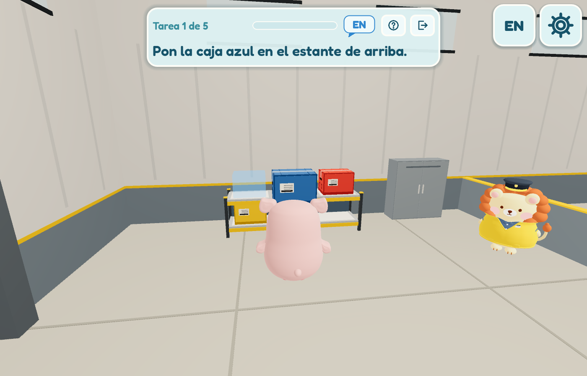

*Screenshot 21 Nov.*

Five placing tasks in the warehouse hall: "Put the blue box on the table", "next to the green
box", "to the right of", "on the top shelf". Pick up the right coloured box and put it in the
right place; hints and "tell me" help when stuck. Teaches positions, colours and placing verbs.
Tracked: colours and positions (25 Nov). Simplified on 14 Nov (it used to have trolleys, weighing and measuring). 21 Nov: four
coloured boxes (no cardboard box), a shelf with two clear levels, and a tap anywhere on a level
puts the box there ([details](../guides/WAREHOUSE.md#shelf-and-placing-21-nov-2026)).
[Warehouse guide](../guides/WAREHOUSE.md#minigame-14-nov-2026)

| Learning card | |
| --- | --- |
| Purpose | Follow placing instructions: positions, colours, placing verbs. |
| Words | [Generated list](words.md#stack--pack) |
| Tracked in the journal | Yes: the colour of the box and the position word of each task (on, next to, right, up), judged apart. A wrong box, or the hint that marks the box, misses the colour; the right box put down in a wrong place (the table, a shelf, the wrong side of the green box), or the hint that marks the place, misses the position word (25 Nov) |
| Session | 5 tasks, a task counts when done |
| Progression | Designed 18 Nov, not built: L1 *on* and the top shelf · L2 + next to · L3 + to the right of (today) · L4 hints only after a wrong try |

## On the Menu

*今日餐牌 · Menú del día* — **Twinkle (beagle waiter), Alta Cocina host stand**

*Screenshot 11 Nov.*

Twinkle sends you to a seated customer, who orders two or three courses by taste, temperature,
intensity (*un poco*, *muy*) and ingredients. Choose the dishes on a tablet and send
them; the customer reacts and Twinkle reports back. A menu book on a table shows every dish.
Four orders right at the first send win. Tracked. Since 23 Nov the tablet sits below the HUD's EN badge
(hold it, or L, for the translation) and keeps "Choose this dish" under every dish shown
([record](../guides/TOWN_DESIGN_BRIEF.md#restaurant-fixes--23-november-2026)). Since 24 Nov a
wrong order is sent back at once ("Can you try again?"): the tablet reopens with the right dishes
kept and each wrong dish marked ✗ and blocked; a fixed order does not count
([record](../guides/TOWN_DESIGN_BRIEF.md#on-the-menu-sent-back-orders--24-november-2026)).
[Design](../guides/TOWN_DESIGN_BRIEF.md#alta-cocina-restaurant-game--6-november-2026) ·
[11 Nov flow](../guides/TOWN_DESIGN_BRIEF.md#restaurant-game-reception-tables-and-order-tablet--11-november-2026)

| Learning card | |
| --- | --- |
| Purpose | Dish names, courses and describing food (taste, temperature, intensity, ingredients). |
| Words | [Generated list](words.md#on-the-menu) |
| Tracked in the journal | Yes: the dish served |
| Session | 4 orders of 2-3 courses; an order counts when every dish is right at the first send; a wrong order is sent back and retried (wrong dishes blocked) but does not count; only the first send is tracked |
| Progression | Designed 18 Nov, not built: L1 two courses, one need each · L2 + *un poco* / *muy* (today) · L3 three courses with a *no* / *sin* · L4 three needs per course |

## Spot the Suspect

*搵疑犯 · ¿Quién fue?* — **Officer Rocco (crocodile), police station lobby**

*Screenshot 6 Nov.*

Five bear suspects in a lineup; two clues (*no tiene bigote y lleva una camisa rosa*: no moustache, a pink shirt) point to
one. Four rounds. Teaches describing people: height, hair, beard, nose, clothes, and negation.
Not tracked yet.
[Design](../guides/TOWN_DESIGN_BRIEF.md#police-station-enlargement-and-detective-games--6-november-2026)

| Learning card | |
| --- | --- |
| Purpose | Describe people: height, hair, beard, nose, clothes and negation. |
| Words | [Generated list](words.md#spot-the-suspect) |
| Tracked in the journal | No: each round has two clue words and the answer is a suspect, so no single tested word (user decision, 7 Nov) |
| Session | 4 rounds, a round counts when solved |
| Progression | Designed 18 Nov, not built: L1 four suspects, two clues, no negation · L2 five suspects (today) · L3 + negation · L4 six suspects, three clues |

## Feel the Clues

*證物實驗室 · Pistas al tacto* — **Officer Mimi (cat), police evidence counter**

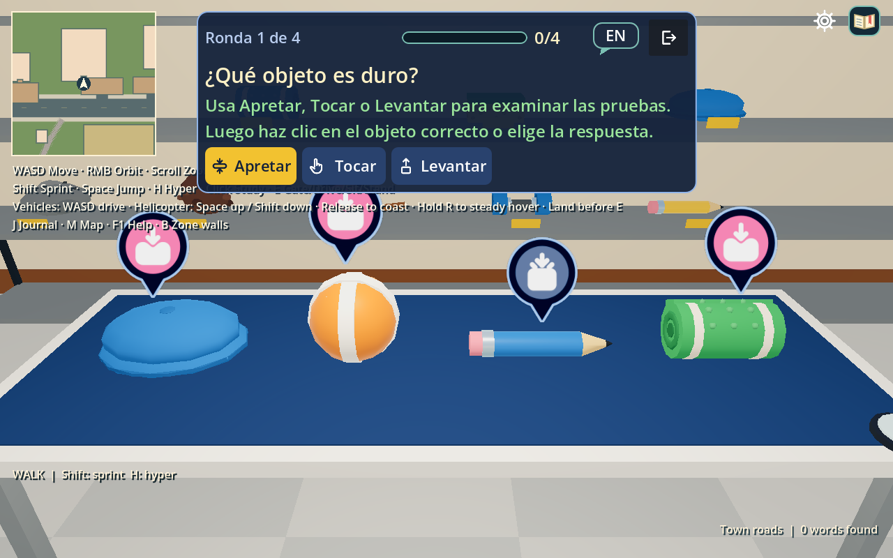

*Screenshot 8 Nov.*

Examine objects with three tools (squeeze, touch, lift) to find which is soft, rough or heavy,
or answer "is the stone hard or soft?". Four rounds. Teaches hard/soft, rough/smooth,
heavy/light with ten everyday objects. Tracked.
[Redesign](../guides/TOWN_DESIGN_BRIEF.md#police-evidence-game-redesign--8-november-2026)

| Learning card | |
| --- | --- |
| Purpose | Object properties and the ten object nouns, with agreement. |
| Words | [Generated list](words.md#feel-the-clues) |
| Tracked in the journal | Yes: the property word deciding each round |
| Session | 4 rounds, a round counts when solved |
| Progression | Designed 18 Nov, not built: L1 *find* rounds with three objects · L2 four objects (today) · L3 + *report* rounds with agreement · L4 mixed, more objects |

## Desk Dash

*搶位答題 · ¡A tu pupitre!* — **Lana (sheep teacher), school grammar classroom**

*Screenshot 6 Nov; board enlarged 14 Nov.*

A fill-in-the-blank sentence is on the board and the four answers lie on four desks: sit at the
right one within 10 seconds. Five questions, and each one missed comes back once at the end.
Grammar depends on the language: Spanish *ser*/*estar*, Chinese measure words, English
agreement and prepositions. Points only; Chinese measure words are tracked. Hold the top-right
EN button to translate the card and see the question's meaning (23 Nov; the card's own EN bubble is gone).
[Guide](../guides/GRAMMAR_CLASS.md)

| Learning card | |
| --- | --- |
| Purpose | Grammar of the language being learned (ser/estar, measure words, agreement and prepositions). |
| Words | [Generated list](words.md#desk-dash) |
| Tracked in the journal | Points only; the noun of Chinese measure-word questions is tracked |
| Session | 5 questions plus each miss once more (at most 10) |
| Progression | Designed 18 Nov, not built: L1 15 s per question · L2 10 s (today) · L3 harder questions (needs difficulty tags in the question bank) · L4 7 s |

## Mystery Doors

*神秘之門 · Puertas misteriosas* — **Madame Luna (cat fortune-teller), Mystery House**

*No screenshot in the docs yet.*

A clue names a colour, a shape or both; open the door that matches. A right door leads on through an endless hall of rooms; a wrong one turns you into a toad
for three seconds. Six doors, then a treasure chest. Teaches colours and shapes. Tracked.
A player who falls out of the hall is put back on its floor; one who ends up outside the house
mid-game ends the game and its card (23 Nov fix: a web player was respawned at the supermarket
with "Door 5 of 6" still showing; [evidence](../evidence/ui-fixes-20261123/verify.gd)).
[Design](../guides/TOWN_DESIGN_BRIEF.md#mystery-house-and-mystery-doors--9-november-2026)

| Learning card | |
| --- | --- |
| Purpose | Colours and shapes in a clue sentence. |
| Words | [Generated list](words.md#mystery-doors) |
| Tracked in the journal | Yes: the colour or shape a door's clue names |
| Session | 6 doors, first try counts |
| Progression | Designed 18 Nov, not built: L1 one clue type, 4 doors · L2 shape, colour and both (today) · L3 more colours · L4 8 doors, combined clues only |

## Mahjong Club

*雀友會 · Club de mahjong* — **Mei (cat host), table in front of the home**

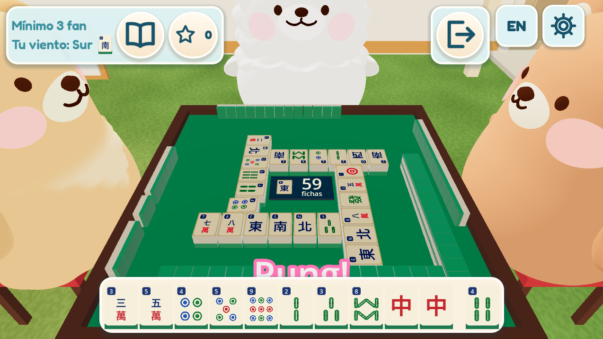

*Screenshot 16 Nov: camera across to Awoo, larger discards in a pinwheel (status bar split to keep his face clear).*

One hand of Hong Kong mahjong against three plush players, with the calls, winds and hand names
in the language being learned. Two short lessons (Basics, Scoring) explain the rules. Not
tracked. Mahjong! is still offered after punging the winning tile (23 Nov), and the only
language button is the HUD's EN, top right (23 Nov). Holding EN shows only the native text and
changes no button size; the journal and ▶ buttons hide under the lesson card (23 Nov,
[screenshots](../evidence/ui-fixes-20261123/)). Mei remembers an unfinished game: next time she
first asks whether to carry on, with the same hand and points (23 Nov,
[screenshots](../evidence/mahjong-memory-20261123/)). A pull tab on the hand tray slides it away to
see your own tiles on the table (24 Nov, [screenshots](../evidence/mahjong-hand-toggle-20261124/)).
UI polish (24 Nov): a smaller status card and soft call buttons with their tiles apart
([screenshots](../evidence/mahjong-ui-polish-20261124/); the nameplates and cream counter shown
there were removed again on 25 Nov).
[Guide](../guides/MAHJONG.md)

| Learning card | |
| --- | --- |
| Purpose | Hear and use game language (calls, winds, hand names) while playing; a pastime. |
| Words | [Generated list](words.md#mahjong-club) |
| Tracked in the journal | No |
| Session | One hand; an unfinished game and its points are kept to carry on later (user, 23 Nov) |
| Progression | None (pastime; user approval 18 Nov) |

## Radar Patrol

*天空保衛戰 · Guardianes del cielo* — **No character: the radars in the airport control tower**

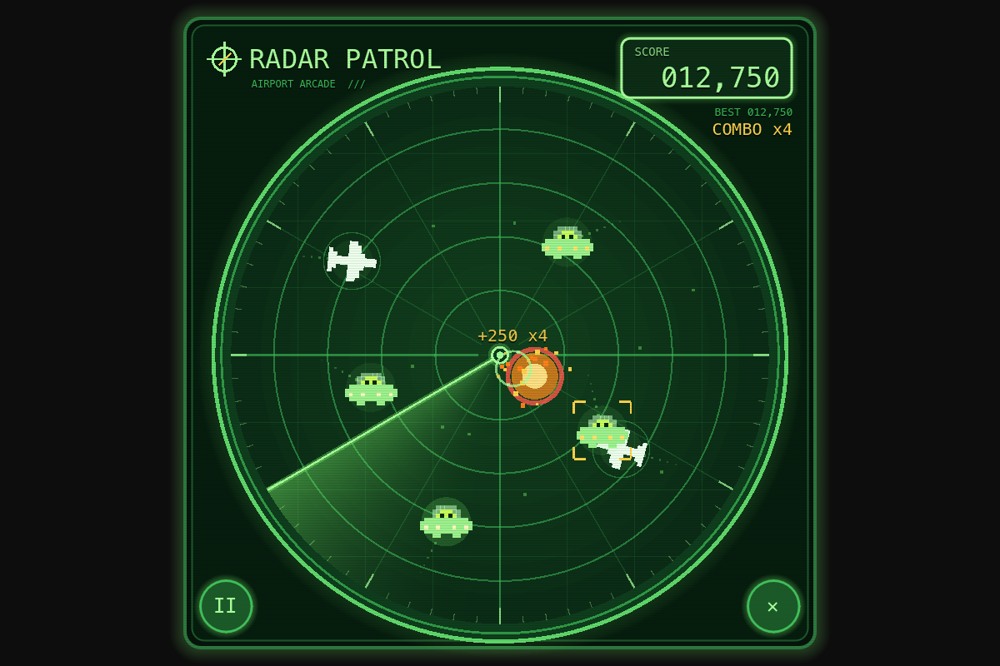

*Screenshot 9 Nov; taps made easier 15 Nov.*

An endless arcade game: tap UFOs before they reach the planes. Best score saved. A pastime with
no words to learn.
[Guide](../guides/RADAR_PATROL.md)

| Learning card | |
| --- | --- |
| Purpose | Fun only; no learning goal. |
| Words | [Generated list](words.md#radar-patrol) |
| Tracked in the journal | No |
| Session | Endless; best score saved |
| Progression | None (pastime; it keeps its best score) |

## Wire It Up!

*駁電線 · Cable a cable* — **No character: the electrical box on the home's garage wall**

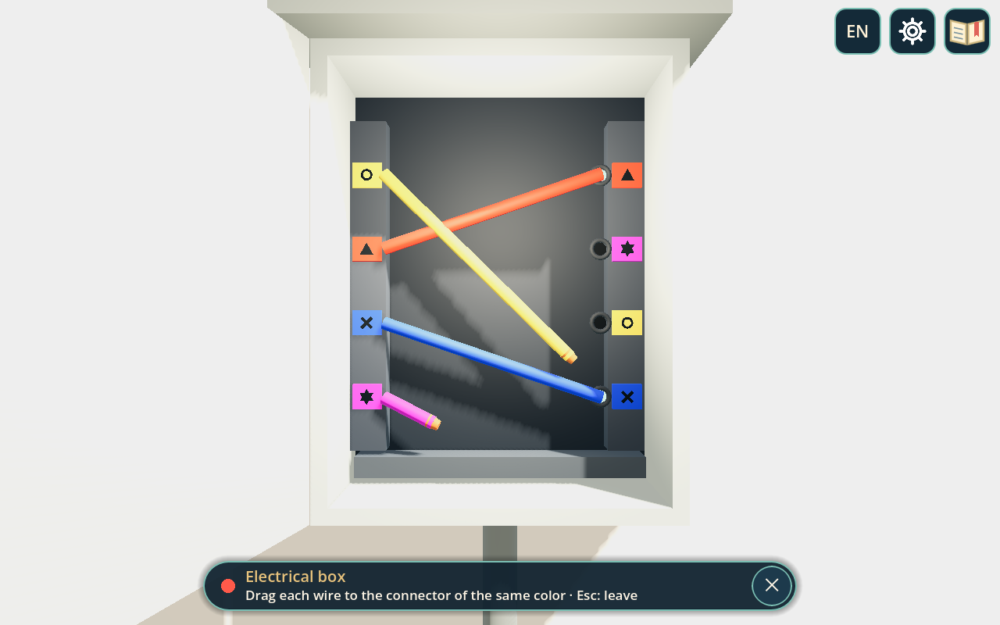

*Screenshot 9 Nov.*

Open the box and connect the wires by colour. A pastime; the box itself teaches *electrical box*.
[Guide](../guides/ELECTRICAL_BOX.md)

| Learning card | |
| --- | --- |
| Purpose | Fun only; the box teaches *electrical box*. |
| Words | [Generated list](words.md#wire-it-up) |
| Tracked in the journal | No |
| Session | One puzzle per opening |
| Progression | Designed 18 Nov, not built: L1 fewer wires · L2 today · L3 more wires |

## Library Helper

*圖書館小幫手 · Ayudante de biblioteca* (named by the user 17 Nov; was Shelf Mission) — **Rosa (samoyed librarian), by
the NEW BOOKS display**

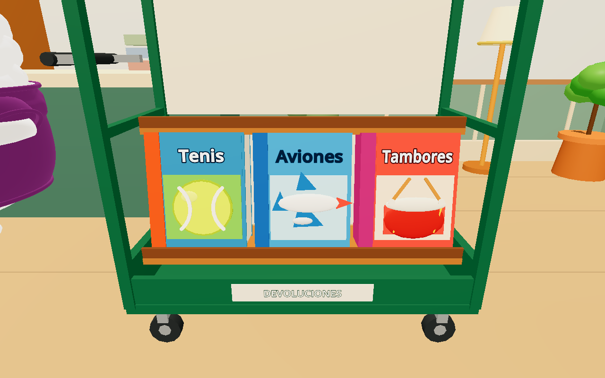

*Screenshot 17 Nov.*

Three to six books wait on the return cart. Take each one to a gap in the shelf for its category
(animals, sports, music, food, vehicles, plants): the right shelf sparkles with a marimba chime, a
wrong one wobbles the book back into your hand with two soft falling notes (sounds 25 Nov). Picking a book up zooms in on its cover (tap anywhere to close). When
every book is home the camera turns to Rosa, who thanks you, then the results card shows the words
practiced and discovered; once you have
walked away the books are borrowed and a new cart of 3–6 arrives. Tracked: each book's first try.
[Design](../guides/TOWN_DESIGN_BRIEF.md#library-return-cart-and-book-sorting-game--13-november-2026)

| Learning card | |
| --- | --- |
| Purpose | Book topics (dogs, pizza, guitar…) and the six category words (animal, sport, music, food, vehicle, plant; 3 books each) by sorting returned books. |
| Words | [Generated list](words.md#library-helper) |
| Tracked in the journal | Yes (17 Nov): a book's first placement in a cart tests its topic word and its category word |
| Session | One cart of 3–6 books; the next cart once the player has walked away from a perfect one (21 Nov) |
| Progression | Designed 18 Nov, not built: L1 3 books · L2 4–5 books · L3 6 books · L4 plain spines, so the colours no longer match the shelves (user idea, 17 Nov 2026) |

## Next, Please!

*下一位！ · ¡El siguiente!* (name approved by the user, 18 Nov) — **Bear banker,
bank reception; played at teller window 2**

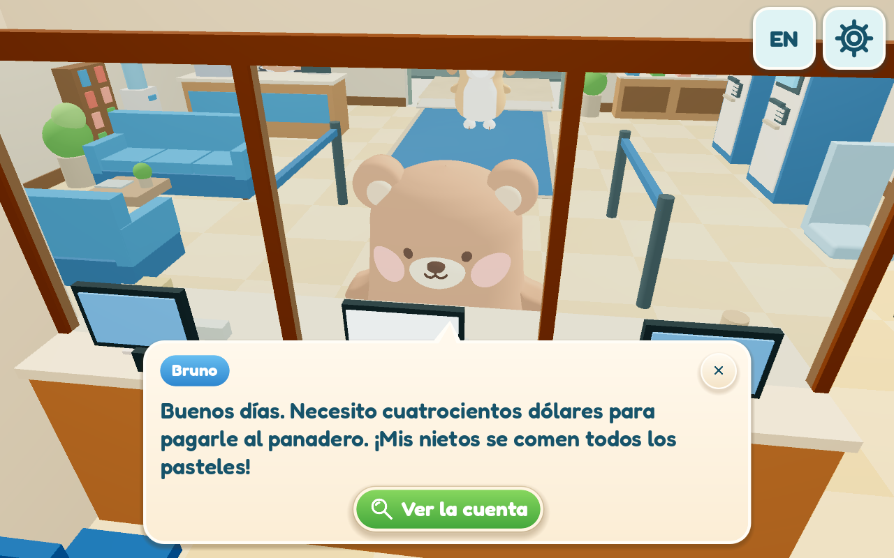

*Screenshot 18 Nov.*

The regular teller is on a break, so the banker asks you to cover window 2. Plush customers walk
up from the queue, each with a story (a new bike, cakes for the grandchildren, a telescope…), and
ask once for an amount in words while their account shows on the teller monitor; count out the
cash with $5, $10, $50 and $100 bills, or tell them politely that there is not enough money.
You sit on window 2's chair for the whole game, and a customer's thanks moves on to the next one
by itself (24 Nov; [screenshots](../evidence/bank-teller-polish-20261124/)). One
customer a session only wants change and must get no $100 bills back. Since 21 Nov the monitor
shows the account's name, balance and the owner's photo (its words follow EN); since 23 Nov it
stands beside the window, so one view shows the photo and the customer's face together
([screenshot](../evidence/bank-rework-20261123/teller-account-view.png)). Now and then an
impostor claims someone else's account (the photo is another animal): the **red alarm button** on
the counter, left of the keyboard (a hidden surprise since 24 Nov, no longer a reply button;
the banker's and the manager's warnings name it) brings a police officer ("Disculpe. Venga conmigo, por favor." "¿Qué pasa?" "Venga conmigo ahora, por
favor.") who escorts them out of the bank. Pay an impostor instead and the money is gone: the bank
manager (La jefa, a crocodile in a suit) walks out of her office to warn you
([screenshot](../evidence/bank-rework-20261123/manager-warns-2.png)); pay a second one in the same
session and she lets you go, with a "You've Been Let Go" card (23 Nov).
Saying "not enough" shows you telling them ("Lo siento, no tiene fondos suficientes."), and they
answer "¿Qué? ¡Eso es imposible!". About 70% of customers give a reason; the rest just ask and
say thanks. Mistakes get an in-character answer (what they received, in words) and a retry.
Lines are short and simple (21 Nov). Not tracked.
[Design](../guides/TOWN_DESIGN_BRIEF.md#bank-teller-game--18-november-2026)

| Learning card | |
| --- | --- |
| Purpose | Understand spoken amounts from 100 to 500 (cien … quinientos, ciento cincuenta, trescientos sesenta y cinco), compare them with a balance written in digits, and count them out in bills of 5, 10, 50 and 100. Check who is asking: the photo on the account must be the customer at the window (user, 21 Nov 2026); paying an impostor has a consequence: the manager's warning, then being let go (user, 23 Nov 2026). |
| Words | [Generated list](words.md#next-please) (amounts are generated language, not word-list words) |
| Tracked in the journal | No (amounts are generated language, like Pay Up!) |
| Session | 5 customers (`data/activities.json`); a customer counts when served right the first time (the exact cash, a correct "not enough", or the alarm for an impostor). A paid impostor does not count; a second one in a session ends it early (`payouts_to_fire`, `data/bank_teller.json`; no Play again, nothing saved) |
| Progression | Within a session (user, 18 Nov 2026): first whole hundreds (cien … quinientos), then hundreds and fifty, then any multiple of 5 that needs the $10 and $5 bills; one customer is short of money (a balance a little under the request) and one wants change for whole hundreds; in most sessions (`impostor_chance` 0.75, `data/bank_teller.json`) another withdrawal customer is an impostor whose account photo is a different animal (user, 21 Nov 2026); after a paid impostor and the manager's warning, another impostor comes later in the session (`impostor_again`, user 23 Nov 2026). Not yet across sessions |

## Feeding Time!

*餵食時間！ · ¡Hora de comer!* — **Nico (sheep zookeeper), at the food booth just inside the zoo gate**

*Designed 24 Nov 2026 with the user and built the same day.* Screenshots: [booth](../evidence/zoo-feeding-20261124/booth.png), [bag](../evidence/zoo-feeding-20261124/bag.png), [an elephant eating](../evidence/zoo-feeding-20261124/eating.png), [a lion refusing an apple](../evidence/zoo-feeding-20261124/refusing.png).

Nico runs a small food booth on the grass inside the ZOO arch, beside the path, in front of the
Wildlife Plains. He sells five animal foods: **meat, apple, fish, carrot and bamboo** (bamboo is a
new word). Every zoo animal eats at least one of them; the table is data
([zoo feeding data](../../data/zoo_feeding.json)):

| Food | Who eats it |
| --- | --- |
| meat | lion, tiger, snake, bear, bear cub |
| fish | flamingo, bear, bear cub |
| apple | elephant, giraffe, monkey, gorilla, zebra, deer, kangaroo, rhinoceros, capybara, bear, bear cub |
| carrot | elephant, giraffe, zebra, deer, kangaroo, rhinoceros, capybara |
| bamboo | panda, red panda |

**Free feeding** (not a game: no stars, nothing saved). Take a paper bag from the stack on the
counter, click the foods into it and pay Nico, the same way as free shopping at the supermarket
(the bag works like the shopping basket). Carry the bag into a zone and press E (or tap) on an
animal: it walks over to the food, eats it with its head down and a little hop, and the bag gets
lighter. An animal offered a food it does not eat sniffs it, shakes its head and walks off. The
bag goes away when it is empty or when you leave the zoo.

**The game.** Nico asks for help: "Can you feed the apple to the elephant?" in the language you
are learning, and hands you a bag with the food for the whole session (user, 24 Nov: the keeper
always hands the food over, so the game is only about the animal names). Find the named animal and
feed it; the next request follows at once. Feeding a different animal is a miss: it comes over and
sniffs, Nico says which animal that was and asks again. Walking out of the zoo on foot during
the game puts you back just inside, facing Nico, and asks whether to stop; Esc asks the same
(25 Nov).

| Learning card | |
| --- | --- |
| Purpose | Recognise the names of the zoo animals when someone asks for one, and find that animal in its zone. |
| Words | The 17 zoo animals ([generated list](words.md#feeding-time)); the five foods are shown, not tested |
| Tracked in the journal | Yes: the animal named in each request (right when the first animal fed was the named one) |
| Session | A number of requests per level; a request counts when the first animal fed is the right one |
| Progression | Built 24 Nov (user design). Animals by [word tier](#word-tiers): L1 3 requests, tier-2 animals (bear, elephant, giraffe, lion, monkey, panda, snake, tiger, zebra) · L2 5 requests, tier-2 animals · L3 5 requests, tiers 2–3 (adds bear cub, deer, flamingo, gorilla, kangaroo, red panda, rhinoceros) · L4 6 requests, every zoo animal (adds the tier-4 capybara). Nico always hands the food over. Stars from first-try requests |
| Results card | *Animals Fed!* "You helped Nico feed the hungry animals!" |
| Town mission | "Help Nico feed the hungry animals at the zoo!" |
