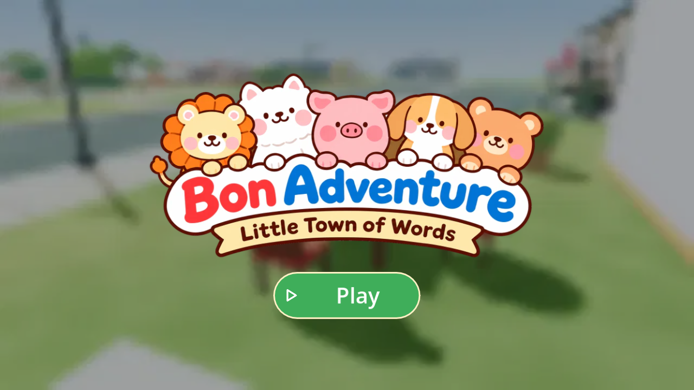
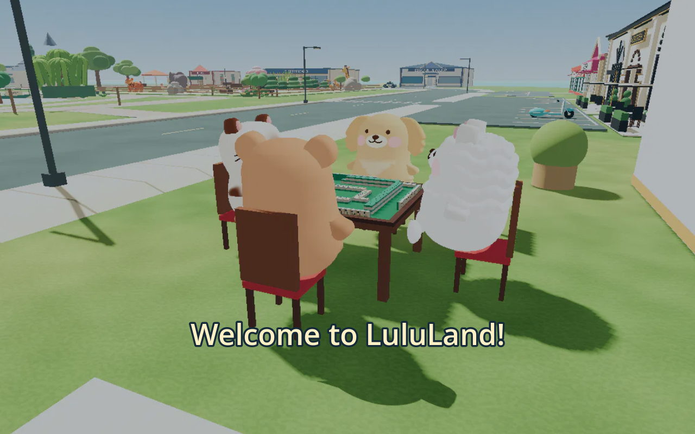
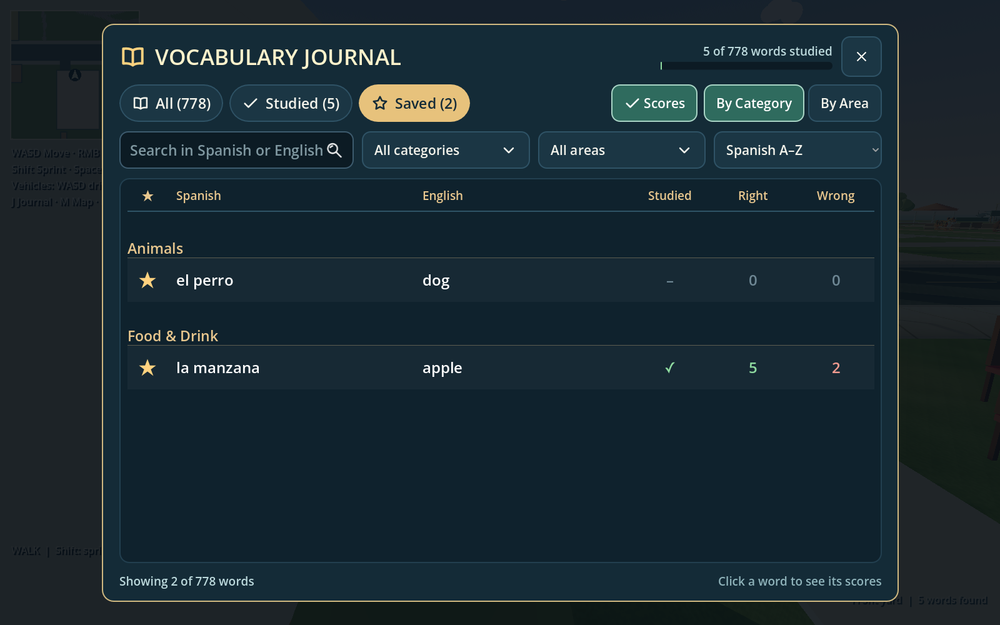
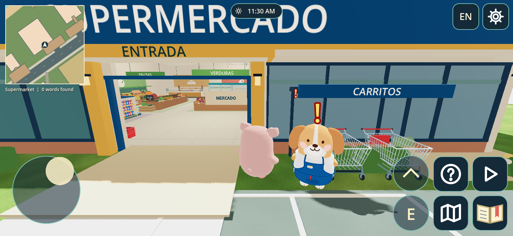

# Playing the game

[← Game guide](README.md)

How a player starts, learns, moves and gets around. The full key list is in the
[project README](../../README.md#controls-and-learning); details for developers are linked from
each section.

## Starting up

*Screenshot 16 Nov (title page); [profile screen](../evidence/app-flow-20261112/profiles.png) 12 Nov.*

A title screen with the **Bon Adventure: Little Town of Words** logo (16 Nov; it replaced
the text title) and Play, then a character screen with up to three profiles, each
with its own avatar (one of the house plushes) and its own saves. A new profile picks the
language it speaks and the one it wants to learn, then the town loads. Each profile remembers
where the player was and comes back at that building's entrance or on clear ground nearby
(14 Nov).
[Project README](../../README.md) (startup flow) ·
[recorded checks](../guides/FINAL_VERIFICATION.md) (search `app_flow`). There is no separate startup guide yet.

## Welcome tutorial

*Screenshot 12 Nov; home and shop steps changed 14 Nov.*

"Welcome to Bon Adventure" runs once for a new profile: wake up in bed, a tour of the house, find
the hiding friends, buy fruit at the supermarket, visit the statue, then open the journal. It
can be skipped, and replayed from Settings. No minigame offers appear while it runs.
[Tutorial guide](../guides/ARCHITECTURE_REVIEW_PART1.md#welcome-tutorial)

## Languages

Three languages: **English**, **Spanish** and **Chinese (Hong Kong)**. A player has a native
language and a language being learned, chosen for each profile and changeable in Settings.
Chinese shows pinyin under the text.
- **Native mode** (Settings checkbox) shows everything in the player's own language.
- **Hold L** (or tap the language badge) to see signs, building names and posters in the
  native language for a moment.
- The **translate bubble** in the dialogue box shows a line in the native language.

[Languages and words](../guides/ARCHITECTURE_REVIEW_PART1.md#vocabulary-data-procedure)

## Studying words and the journal

*Screenshot 8 Nov.*

Click or tap almost any object to see a **word card** with the word in both languages; that
counts as studying it. Some objects can be **picked up** (books, baskets) and inspected in
BonBon's hand. The **journal** (J, or the book button top right) lists every word, by category or
by area, with ★ saved words, ✓ studied words and the right and wrong answers from the tracked
minigames.
[Vocabulary book](../guides/ARCHITECTURE_REVIEW_PART1.md#vocabulary-book) ·
[holding things](../guides/HAND_HOLD.md)

## Moving and controls

- **Laptop:** WASD to walk, Space to jump, Shift or the Run button to run, E to use things
  (doors, seats, vehicles, toilets, faucets), drag or right-mouse to look around, wheel to zoom,
  Esc for Settings or to close the top window. F1 shows every key.
- **Camera follows me** (on by default since 14 Nov): walking sideways slowly turns the view,
  so one hand can steer.
- **Climb** ladders with W and S; **sit** on chairs, sofas and swings; swivel chairs turn with
  A and D.

[All controls](../../README.md#controls-and-learning)

## Touch and the web app

*Screenshot 12 Nov; button layout changed 14 Nov.*

The game also runs as an installable web app in landscape on phones and tablets. A floating
joystick appears where the left thumb touches; buttons on the right jump, use (E) and run; drag
to look, pinch to zoom, tap to use. A phone held upright shows the landscape game turned 90°.
New builds load automatically (15 Nov).
[Web app](../../README.md#web-app-pwa)

## Getting around

*Screenshot 29 Oct.*

- **Cars and trucks:** walk up and press E to open the door and get in; W/S/A/D to drive,
  Space to brake, R to recover. Parked cars and a motorcycle in every lot (14 Nov); the police
  car and the warehouse box truck can be driven too.
- **Scooter:** hop on and ride. [Scooter](../guides/ZOO_VEHICLE_IMPLEMENTATION.md#scooter-and-rider--9-november-2026)
- **Helicopter and plane:** easy flying by default (14 Nov): W to go, A/D to turn, let go and
  it levels or hovers; C switches to expert controls. A Reset button returns the plane to the
  runway. [Aircraft](../guides/aircraft.md#easy-flying)
- **Swan boats** on the pond and **swings** at the playground.

[Road vehicles](../guides/ZOO_VEHICLE_IMPLEMENTATION.md) ·
[helicopter](../guides/helicopter_inertia/README.md)

## Outfits

*Screenshot 9 Nov; picker paged for touch 14 Nov.*

In the clothing store's fitting rooms BonBon tries on outfits (shopkeeper, police, doctor, waiter,
driver, teacher, gardener, pilot, businessman, chef) and keeps one.
[Fitting room](../guides/TOWN_DESIGN_BRIEF.md#fitting-room-outfit-picker--9-november-2026)

## Day and night

A day lasts 20 minutes, with sun, moon, sky, street lamps and indoor lights. The clock at the
top centre can jump an hour forward or back.
[Day-night cycle](../guides/performance/README.md#day-night-cycle--9-november-2026)

## Characters

The town's people are plush animals: BonBon the pig (the player), the house friends, shop staff in
outfits, and the minigame hosts. They blink and make small gestures. Clicking a house friend
shows its name.
[Plush characters](../guides/COMPONENTS.md#plush-characters)

## Sound

Only a few sounds exist so far (toilets and faucets); the rest of the game is silent for now.
