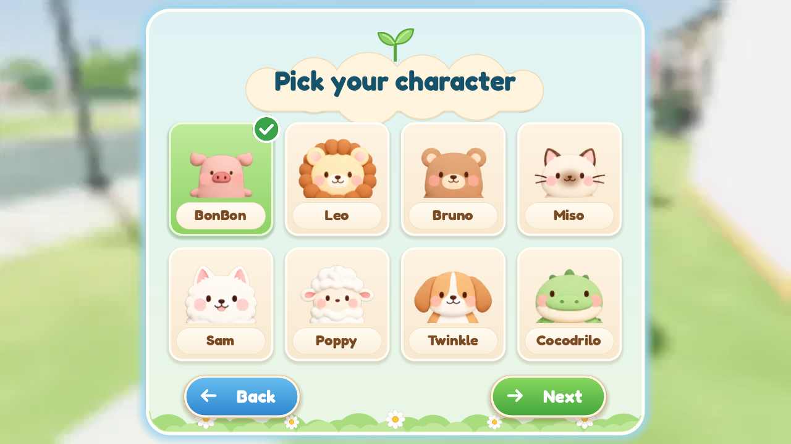
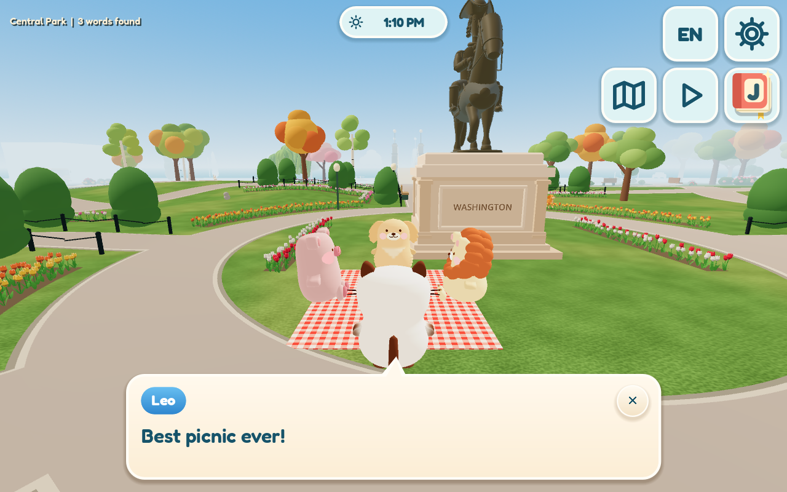
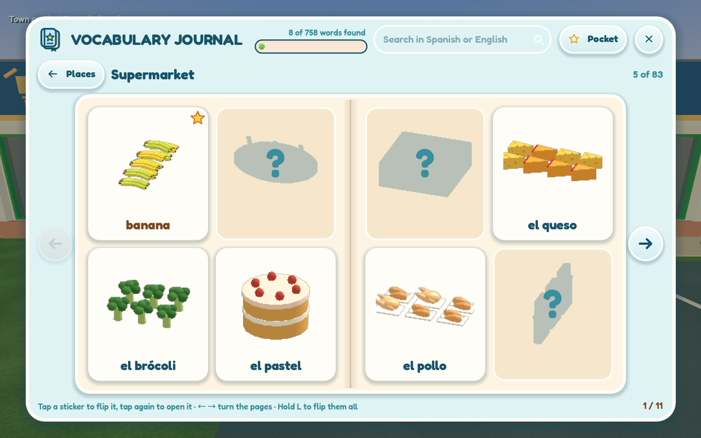
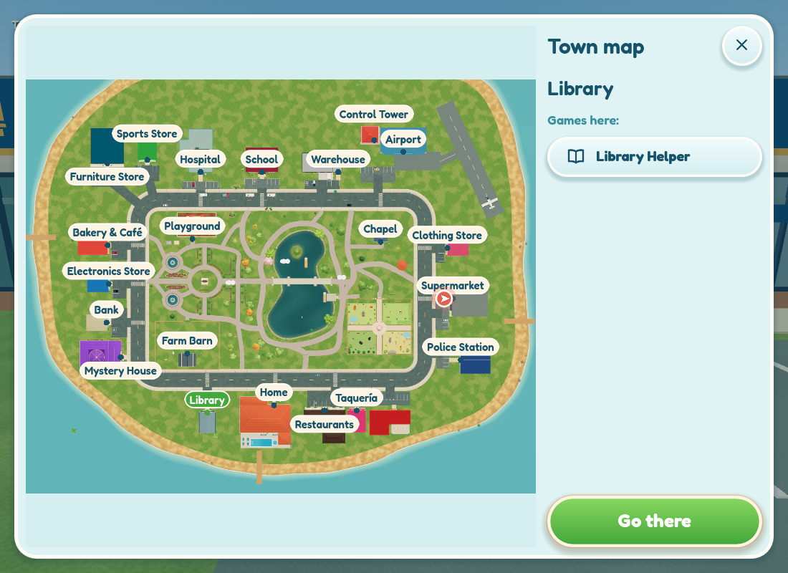
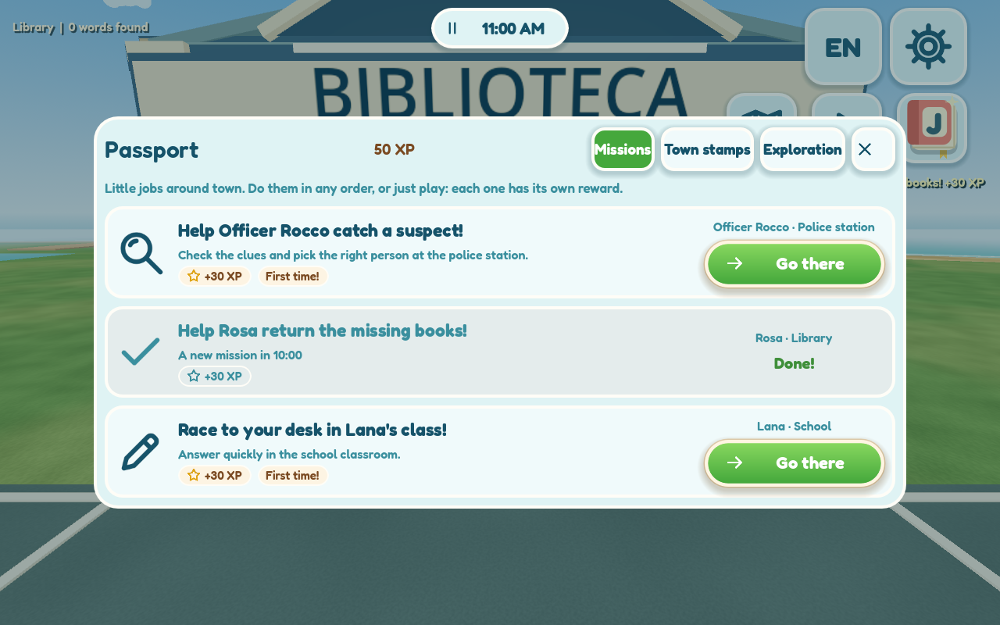
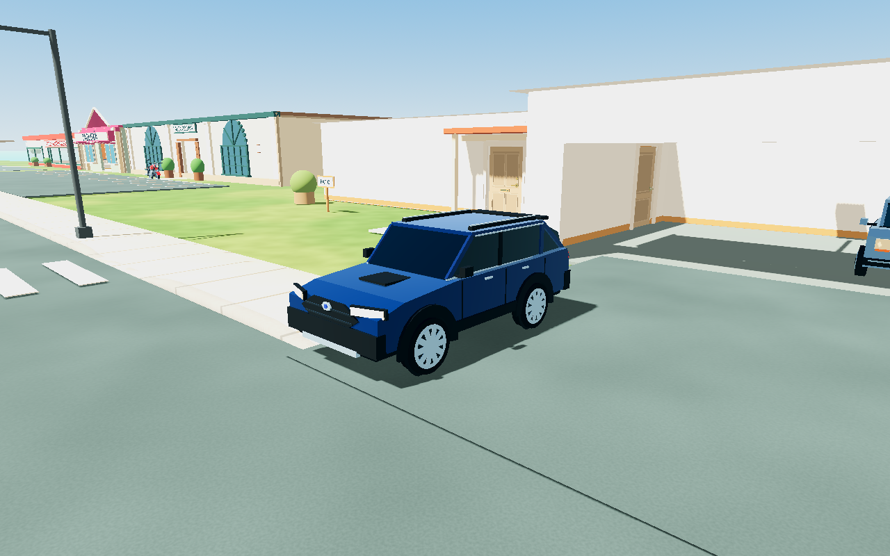
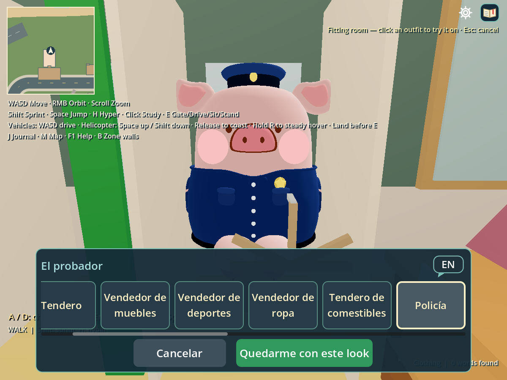

# Playing the game

[← Game guide](README.md)

How a player starts, learns, moves and gets around. The full key list is in the
[project README](../../README.md#controls-and-learning); details for developers are linked from
each section.

## Starting up

*Screenshot 23 Nov (character grid; [large window](../evidence/character-cutouts-20261123/avatar_large.png)); also [title page](../evidence/ui-style-20261118/splash.png),
[saved players](../evidence/character-cutouts-20261123/profiles.png),
[languages](../evidence/ui-style-20261118/languages.png),
[loading](../evidence/ui-style-20261118/loading.png) and
[dialogue box](../evidence/ui-style-20261118/dialogue.png).*

A title screen with the **Bon Adventure: Little Town of Words** logo (16 Nov; it replaced
the text title) and Play, then a character screen with up to three profiles, each
with its own avatar (one of the house plushes) and its own saves. A new profile picks the
language it speaks and the one it wants to learn, then the town loads. Each profile remembers
where the player was and comes back at that building's entrance or on clear ground nearby
(14 Nov). Since 18 Nov the screens follow the user's mockups ([UI art style](../guides/UI_STYLE.md)):
a saved player is picked (green, check mark) and played with Next; the character grid shows eight
plushes (not Sunny), whose headshots are cut from the mockup since 23 Nov (the 22 Nov vtracer traces looked pixelated); the language page has round flags and **Just explore!**, which starts the new
player with "Show everything in my language" on. Since 24 Nov the "I want to learn" row is greyed
out while Just explore! is ticked; tapping one of its languages turns exploring off
([screenshot](../evidence/explore-greyed-20261124/languages_explore.png)).
[Project README](../../README.md) (startup flow) ·
[recorded checks](../guides/FINAL_VERIFICATION.md) (search `app_flow`). There is no separate startup guide yet.

## Welcome tutorial

*Screenshot 21 Nov (after the tour the friends stay at the picnic to chat).*

"Welcome to Bon Adventure" runs once for a new profile: wake up in bed, a tour of the house, find
the hiding friends, buy fruit at the supermarket, visit the statue, then open the journal. It
can be skipped, and replayed from Settings. No minigame offers appear while it runs. Since 16 Nov
the rest of the town loads behind the title card after the house tour (with a progress bar), so
the house tour itself no longer stutters. Since 17 Nov the tour also starts behind the loading screen: the characters,
rooms and close-ups of the house tour are drawn there first, so the first lines in the house no
longer freeze on the web, and the loading bar moves with the real work all the way to the end.
Since 17 Nov it follows the user's script "Little Town of Words": lines move on by themselves
(a click or tap skips), a strip at the top says what to do, the controls unlock one at a time,
the two friends can be found in either order (drag the shower curtain open; ask BonBon for
hints), the shopping list is paid in $1 bills and quarters,
the statue card reads "statue of George Washington", and the tour ends with a picnic in the park
(placeholder lines). The journal's book button is cuter, with a clearer J. Since the user's review of
17 Nov: BonBon is shown close up while she talks; "Ready for an adventure?" waits for "Yes!" and
each friend's hello for "Hi! Nice to meet you!"; the view and walking steps wait for a real drag
and a longer walk; the shower curtain opens with E; only doors and BonBon can be used, and other
buildings' doors say it is not the right place; the EN button (hold it to read any line in your
language, now the only language toggle) and the journal button appear and pulse when they are
introduced, and the ▶ games button and the Run button stay hidden; the tour starts at noon and BonBon walks at your
speed; the town card can be skipped only once the whole town is loaded, so the market and park
parts no longer stutter. Since the second review of 17 Nov: in the house only the door where
Leo hides opens (the others stay shut and the guide says her friends wouldn't hide there); the
guide is shown close up when the friends are found and for "There's so much more...", and Sunny
for "we need some food first"; a player who picked BonBon is guided by another character; no
house character sits on the couch or naps on a bed during the tour; the friends no longer box
you in at the supermarket; the list is just 1 apple and 2 bananas; and a replay starts with
the house doors shut. Since 18 Nov (user's polish list): tighter timings ("have a look around"
1.8 s, a bigger drag then 2 s to look, a 10 m walk then 1 s, shorter "meet my friends" lines),
the front door opens by itself after "There's so much more...", the dialogue box has no ✕, the
clock is hidden and the Skip button steps aside while a strip shows, BonBon's short remarks go
after 2 s ("not on our shopping list" 1.5 s), the camera cuts straight from one face to the
next, the friends wait behind you at the supermarket without walking, the clerk and cashier are
named in your language and the cashier's price shows no digits (hold EN if unsure), "Let's go
pay!" is one line, the basket has no gaps and its handles vanish when you inspect it, and
walking out of the store anywhere ends the shop. Since 20 Nov (user's review; not yet checked in
the game): 1 s after the drag and 0.5 s after the walk; BonBon says "join me in the living room"
close up, pauses, then walks there a little slower; one line "Let's go outside! There's so much
more I want to show you!"; close-ups are closer and lower and the dialogue box has no tail; at
the market the friend's "Let's pick up some fruit for our picnic!" leads straight to the clerk,
and walking up to the fruit table zooms in on the apple with "Click on the apple to put it in
your basket!" until you pick something. Since 21 Nov: the camera pans between speakers, the
clerk stays in one close-up, your character no longer blocks a friend's close-up, a right item
hops with gold sparks (as in the library game), and a pointer shows on the apple if you don't
click it. Long sleeves now fit every plush's arm (the pig's paw showed through). Second review of 21 Nov (checked from the
market on, [views](../evidence/tutorial-review2-20261121/README.md)): the fruit costs $1.25 (the
produce price tag too); the cashier asks close up with the shopping list hidden, then
BonBon says "Let's meet outside!" close up; outside only "Everyone ready? Let's go to the park!"
and Leo's "Yay! Picnic time!"; the camera pans from Sunny to BonBon at the statue and between
every picnic line; BonBon names the statue 0.2 s after its card closes; one journal line; the
last line is "The whole town is now yours to explore. Have fun!"; after each camera pan the
box shows a moment later; and after a tour played to the
end, BonBon, Sunny and Leo stay seated round the picnic blanket (now 2.5 times bigger), each with a few friendly lines
when you talk to them (until you reload or replay).
[Tutorial guide](../guides/ARCHITECTURE_REVIEW_PART1.md#welcome-tutorial)

## Languages

Three languages: **English**, **Spanish** and **Chinese (Hong Kong)**. A player has a native
language and a language being learned, chosen for each profile and changeable in Settings.
Chinese shows pinyin under the text.
- **Native mode** (Settings checkbox) shows everything in the player's own language.
- **Hold L** (or hold the language badge, top right) to see signs, building names, posters and
  the open word card in the native language for a moment. The word card has no button of its
  own for this (21 Nov).
- Holding the same badge also shows every dialogue box and minigame card in the native language
  (one language button for the whole game since 23 Nov; no panel has its own EN bubble).

[Languages and words](../guides/ARCHITECTURE_REVIEW_PART1.md#vocabulary-data-procedure)

## Studying words and the journal

*Screenshot 25 Nov.*

Click or tap almost any object to see a **word card** with the word in both languages; that
counts as studying it (also while walking or jumping, since 23 Nov). A word on a **poster**
(school, airport, restaurants, warehouse, police, Mystery House) or a menu board opens a
**close-up of the whole poster** instead (24 Nov): tap a word on it for its card, tap beside it,
the ✕, Esc or E to go back ([view](../evidence/poster-closeup-20261124/restaurant-menu-board-closeup.png)). Some objects can be **picked up** (books, baskets) and inspected in
BonBon's hand. The **journal** (J, or the book button top right) is a **sticker album** since
25 Nov: a contents page of places (each with "12 of 28" found and a bar, plus Around town for
words found everywhere and the ★ Pocket of saved words) and, per place, spreads of 8 stickers.
A found word shows its picture and foreign word (tap: the native word; tap again: its page with
the speaker, ★, the places it is in and Details with the right and wrong answers from the
minigames); a word not found yet is a grey silhouette with "?". A word counts as found when
its card is opened or when you first answer it in a minigame. ← → turn the pages. The header counts
"N of 758 words found" (words no player can find are left out) and has a search that never gives
away a word not found ([views](../evidence/journal-sticker-book-20261125/)). Since 23 Nov each
noun has a picture of its object (also on the results card after a game,
[results](../evidence/word-pictures-20261123/results.png)); the word card in town stays text only.
Since 24 Nov a **speaker** on the word card and the journal's word page says the word in the
language you are learning. Still to come: drawn icons, growth stages, a review round and a
Topics tab ([design](../guides/JOURNAL.md)).
[Journal](../guides/JOURNAL.md) ·
[word pictures](../guides/ARCHITECTURE_REVIEW_PART1.md#word-pictures) ·
[holding things](../guides/HAND_HOLD.md)

## Moving and controls

- **Laptop:** WASD to walk, Space to jump, Shift or the Run button to run, E to use things
  (doors, seats, vehicles, toilets, faucets), drag or right-mouse to look around, wheel to zoom,
  Esc for Settings or to close the top window. F1 shows every key.
- **Camera follows me** (on by default since 14 Nov): walking sideways slowly turns the view,
  so one hand can steer.
- **Climb** ladders with W and S (or the stick toward / away from the wall); at the top of a
  ladder, walk into the hatch or hold S to climb down; **sit** on chairs, sofas and swings; swivel chairs turn with
  A and D.

[All controls](../../README.md#controls-and-learning)

## Touch and the web app

*Screenshot 12 Nov; button layout changed 14 Nov.*

The game also runs as an installable web app in landscape on phones and tablets. A floating
joystick appears where the left thumb touches; buttons on the right jump, use (E) and run; drag
to look, pinch to zoom, tap to use. A phone held upright shows the landscape game turned 90°.
New builds load automatically (15 Nov). There is one graphics setting for every device since
23 Nov: the phone-friendly look (no sun shadows, a fogged 130 m view that reaches up to 330 m
when flying high). On the web, a returning player's town
starts with the buildings near where they come back, and the others appear in the fog as they come
within about 150 m (further when flying high); a game in the ▶ picker whose building is not there yet builds it first
(17 Nov, not yet tried on a phone:
[nearby loading](../guides/performance/README.md#built--17-november-2026)).
[Web app](../../README.md#web-app-pwa)

## Finding places

*Screenshot 18 Nov; also [guide arrow](../evidence/wayfinding-20261118/guide.png),
[picker](../evidence/wayfinding-20261118/picker_go.png) and [phone](../evidence/wayfinding-20261118/map_phone.png).*

**M** or the map button (top right, left of ▶) opens a picture of the whole town, north up, with
every building's name and a coral "you are here" dot showing where you look. Tap a place: its
minigames are listed (tap one to be guided to that game) and **Go there** closes the map and shows
a small arrow card in the top left that points the way, with the metres left; it clears itself
when you arrive or with its ✕. The ▶ game picker has **Go there** next to Play, to walk to a game
instead of jumping to it. The picture is made once by a tool, not drawn live, so it costs nothing
while closed (18 Nov; [how it works](../guides/MINIGAMES.md#town-map-and-guide-arrow)).

## Passport: missions, stamps and achievements

*Screenshot 21 Nov; also [stamps](../evidence/stamps-page-20261122/stamps-1280x800.png) (22 Nov),
[exploration](../evidence/passport-missions-20261121/exploration.png),
[diary](../evidence/passport-missions-20261121/exploration-diary.png) and
[map stars](../evidence/passport-missions-20261121/map-mission-stars.png).*

The Passport button (top right, left of the map) opens three pages. **Missions**: three small jobs,
each a minigame asked for by its character ("Help Rosa return the missing books!") with its XP and
**Go there** (the guide arrow); a new player gets Spot the Suspect, Library Helper and Desk Dash. A
finished one turns grey and a new mission comes 10 minutes later. Active missions have a gold star on
the town map. Missions are optional and each rewards on its own. **Town stamps**: floating gold coins
hidden in 18 buildings ([where](../guides/ACHIEVEMENTS.md#where-the-coins-are)): some need a little
work, like opening the bank's safe, finding the supermarket's storage room or climbing the ladder up the
chapel's bell tower, where the bell rings when used ([picture](../evidence/stamp-places-20261121/chapel-belfry.png)). **Exploration**: every activity, minigame and mission
with a tick when done, plus a diary of the latest ones (21 Nov;
[how it works](../guides/ACHIEVEMENTS.md)).

## Getting around

*Screenshot 29 Oct.*

- **Cars and trucks:** walk up and press E to open the door and get in; W/S/A/D to drive,
  Space to brake, R to recover. Parked cars and a motorcycle in every lot (14 Nov); the police
  car and the warehouse box truck can be driven too. Since 21 Nov a held A/D keeps the car
  turning at any speed and the camera swings round behind it
  ([path steering](../guides/ZOO_VEHICLE_IMPLEMENTATION.md#path-steering-and-chase-camera--21-november-2026)).
- **Lights and sirens (21 Nov):** every car, truck, bus and bike has headlights (F or the
  Lights button; on by themselves when you get in at night). The police car, ambulance and
  fire truck also have a Siren button (Q): siren sound and flashing red and blue lights.
  [Vehicle lights](../guides/ZOO_VEHICLE_IMPLEMENTATION.md#headlights-siren-and-flashing-lights--21-november-2026) ·
  [night view](../evidence/vehicle-lights-20261121/night-red.png)
- **Scooter:** hop on and ride. [Scooter](../guides/ZOO_VEHICLE_IMPLEMENTATION.md#scooter-and-rider--9-november-2026)
- **Helicopter and plane:** one set of controls on every device (23 Nov): on-screen ▲ / ▼
  buttons (Space / Shift) go up and down, W/S faster and slower, A/D turn, let go and it flies
  level or hovers; on the runway W or ▲ takes off. The plane is a small, slow plane that flies
  steadily (rewritten 23 Nov). A Reset button returns either aircraft to its start.
  [Aircraft](../guides/aircraft.md#flying-controls)
- **Swan boats** on the pond and **swings** at the playground. The pond's fish swims under the
  water and the boats pass over it (23 Nov). [Evidence](../evidence/fish-under-water-20261123/boat_over_fish.png)

[Road vehicles](../guides/ZOO_VEHICLE_IMPLEMENTATION.md) ·
[helicopter](../guides/helicopter_inertia/README.md)

## Outfits

*Screenshot 9 Nov; picker paged for touch 14 Nov.*

In the clothing store's fitting rooms BonBon tries on outfits (shopkeeper, police, doctor, waiter,
driver, teacher, gardener, pilot, businessman, chef) and keeps one.
[Fitting room](../guides/TOWN_DESIGN_BRIEF.md#fitting-room-outfit-picker--9-november-2026)

## Day and night

A day lasts 20 minutes, with sun, moon, sky, street lamps and indoor lights. The clock at the
top centre can jump an hour forward or back.
[Day-night cycle](../guides/performance/README.md#day-night-cycle--9-november-2026)

## Characters

The town's people are plush animals: BonBon the pig (the player), the house friends, shop staff in
outfits, and the minigame hosts. They blink and make small gestures. Clicking a house friend
shows its name.
[Plush characters](../guides/COMPONENTS.md#plush-characters)

## Sound

Only a few sounds exist so far (toilets and faucets); the rest of the game is silent for now.
