# The town

[← Game guide](README.md)

One entry per building or outdoor area: what a player finds there, one screenshot (dated) and
links to the details. Every object you can click is a word. Building positions are fixed by the
[master design blueprint](../guides/TOWN_DESIGN_BRIEF.md#start-here-current-approved-design); each
building is its own scene ([modular town](../guides/MODULAR_TOWN.md)).

## Map

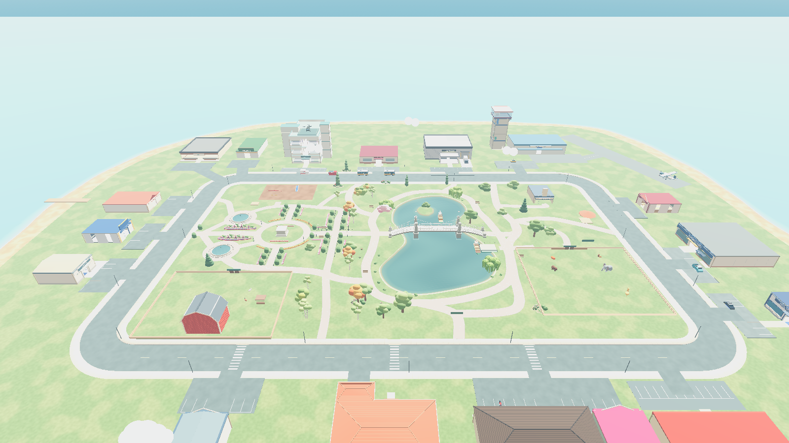

*Town view, 8 Nov. The [saved town map blueprint](../guides/design-references/town-map-blueprint.png) shows the
intended layout.*

A loop road with raised sidewalks rings a Boston-style public garden with a pond, bridge and
statue. Shops, restaurants and civic buildings line the road; the playground is to the
northwest, the chapel to the northeast, the zoo to the southeast and the farm to the southwest.
Beyond the shore is a small island. The in-game map
and minimap are hidden for now.

## Home

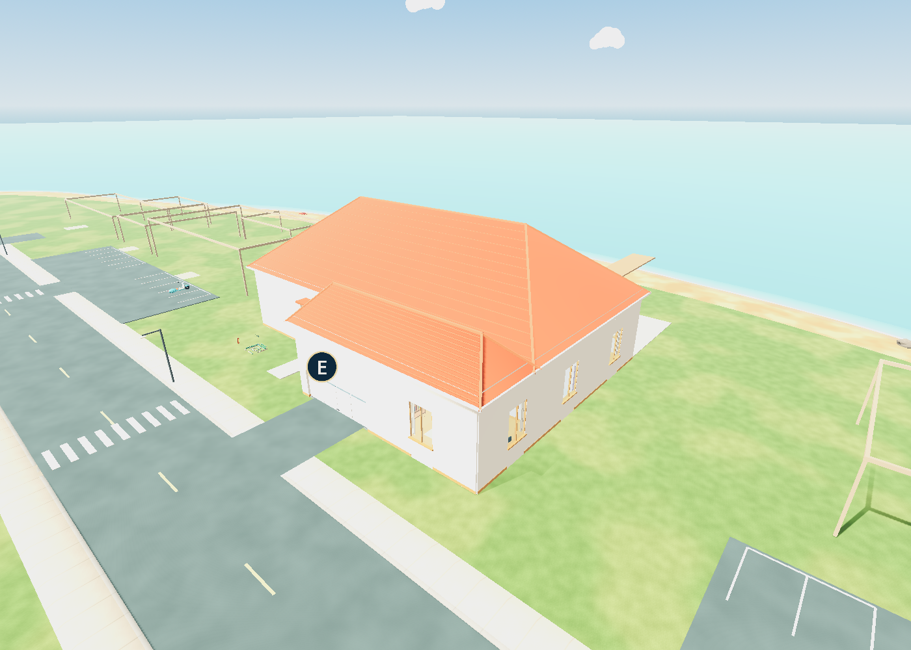

*Screenshot 12 Nov.*

BonBon's house, where a new player wakes up and the welcome tutorial starts: bedrooms, a family
bathroom with working toilet and faucets, living room, kitchen, garage, a sunken pool and a hot
tub. Outside are Mei's mahjong table and the electrical box for Wire It Up!. Since 14 Nov only
BonBon, Leo and Sunny live in the house, and the walkways were cleared. Since 23 Nov the garage
has no bicycle ([record](../guides/TOWN_DESIGN_BRIEF.md#civic-fixes-garage-school-police-lockers-warehouse-cabinet-zoo-gate--23-november-2026)).
[Reference home](../guides/REFERENCE_HOME.md) ·
[14 Nov change](../guides/REFERENCE_HOME.md#fewer-plushes-and-clear-walkways--14-november-2026)

## Supermarket

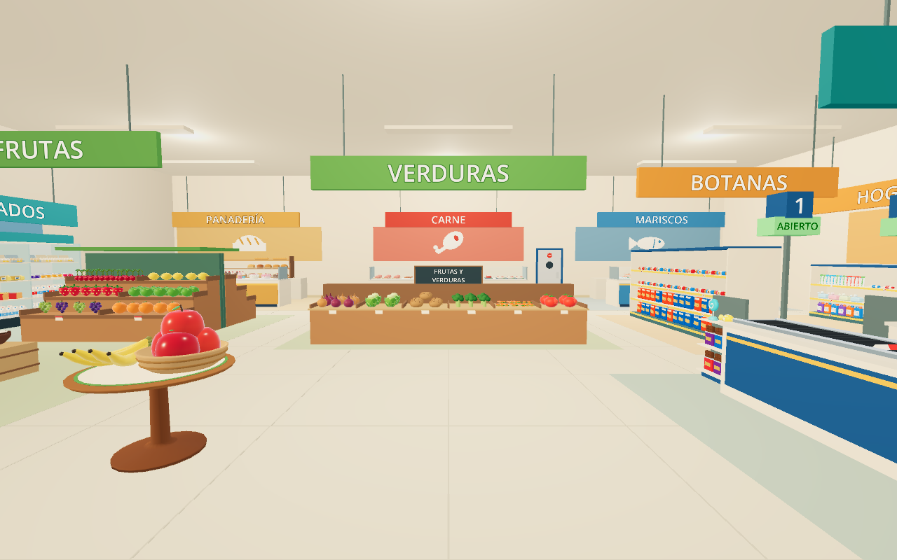

*Screenshot 18 Nov.*

One open floor with nine departments (fruit, vegetables, refrigerated, bakery, meat, seafood,
drinks & home, snacks, checkout); every product is a word with its own product art, and since
17 Nov each word is in one clearly named section ([sections](../guides/TOWN_DESIGN_BRIEF.md#supermarket-sections--17-november-2026)). A samoyed cashier at the till by the
door and a beagle clerk outside (Grocery Run, paid at the till). Since 21 Nov you can also take a
basket from the stack by the door, shop and pay; the door holds you back until you pay
([Grocery Run](minigames.md#grocery-run)). Since 16 Nov its signs are sized to be
read across the hall in every language ([before and after](../evidence/world-signs-20261116/)).
Since 18 Nov it is more compact: a staff wall shortens the floor, the fridges and drinks line the
left wall, snacks and home goods are two short aisles, and every product is at least coconut-sized
with 34 redrawn as clay toys ([compact redesign](../guides/TOWN_DESIGN_BRIEF.md#supermarket-compact-redesign--18-november-2026)).
The two front windows are real glass in green frames: you see the aisles from the car park and
the street from inside ([views](../evidence/real-windows-20261118/after-supermarket.png)).
[2 Nov refit](../guides/TOWN_DESIGN_BRIEF.md#supermarket-refit-fruit-checkout-by-the-door-and-clerks--2-november-2026) ·
[product art](../guides/TOWN_DESIGN_BRIEF.md#supermarket-product-art--8-november-2026) ·
[sign readability](../guides/BUILDING_DESIGN_BLUEPRINT.md#sign-readability)

## Library

*Screenshot 17 Nov.*

Six bookcases, one per category (animals, sports, music, food, vehicles, plants), a reference table with a dictionary and atlas, a NEW BOOKS display at the rear wall and a return cart. A cosy reading corner with rugs, floor cushions, plants and bunting (17 Nov); the computer desks are gone.
Larger shelf headers and wall signs that read across the room on a phone (17 Nov).
Rosa the librarian runs Library Helper.
[Category shelves](../guides/TOWN_DESIGN_BRIEF.md#library-category-shelves-and-return-shelf--11-november-2026) ·
[sorting game](../guides/TOWN_DESIGN_BRIEF.md#library-return-cart-and-book-sorting-game--13-november-2026) ·
[readable signs](../guides/TOWN_DESIGN_BRIEF.md#library-readable-signs--17-november-2026)

## Restaurants

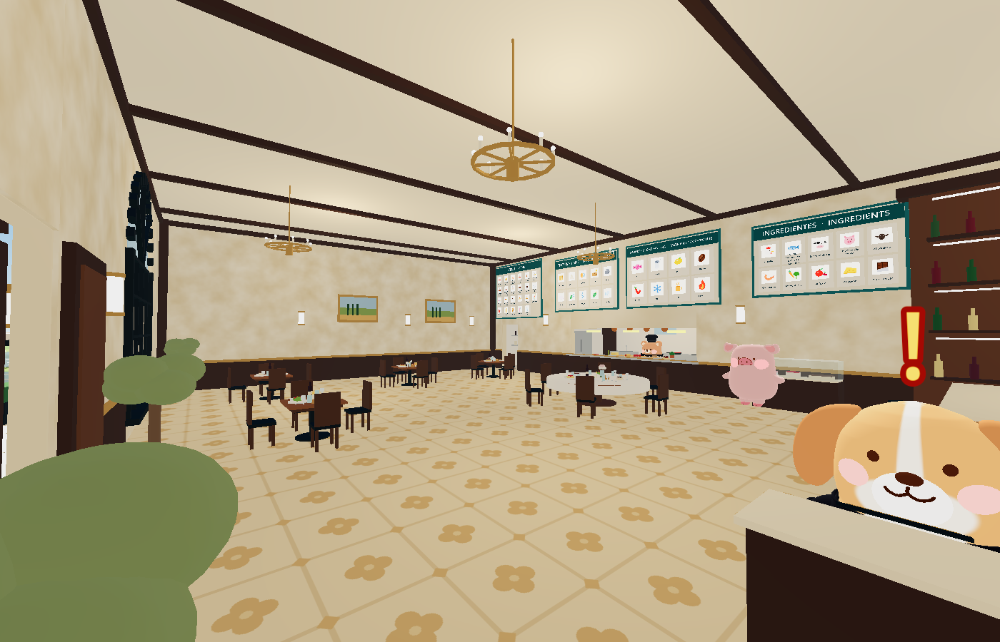

*Alta Cocina, 8 Nov.*

Three places to eat in one block:
- **Alta Cocina**, Italian fine dining with a kitchen wing and terrace; Twinkle runs On the Menu.
- **Pizza and Burger**, an L-shaped diner with booths and a drinks fridge (refitted 9 Nov).
- **Taquería**, a Mexican restaurant with a bar.

23 Nov: the Pizza and Burger and Taquería facade signs are taller with smaller lettering, the
Pizza and Burger entrance is a glass double door that opens with E, and the taquería waiter no
longer holds a tray in front of his face ([record](../guides/TOWN_DESIGN_BRIEF.md#restaurant-fixes--23-november-2026)).

[Alta Cocina](../guides/TOWN_DESIGN_BRIEF.md#alta-cocina-italian-remodel-and-plush-staff--1-november-2026) ·
[Pizza and Burger](../guides/TOWN_DESIGN_BRIEF.md#restaurants-and-police-relocation--28-october-2026) ·
[Taquería](../guides/TOWN_DESIGN_BRIEF.md#mexican-restaurant-taquería--28-october-2026)

## Bakery / Café

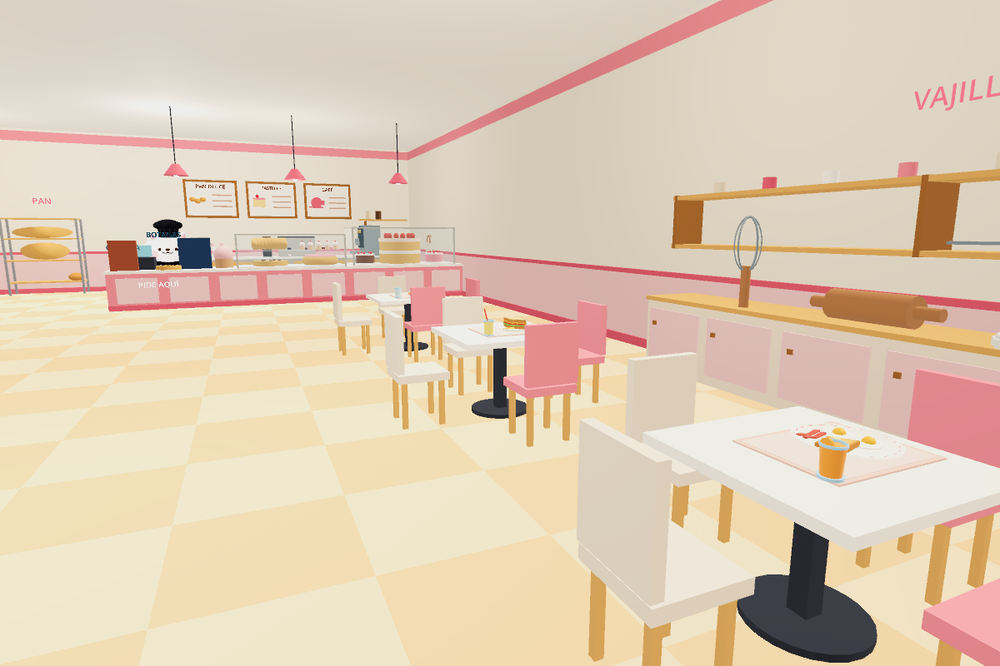

*Screenshot 23 Nov.*

A pink "Cafe & Cakes" bakery and café with a cake counter and seating, and a samoyed cook.
[Design record](../guides/TOWN_DESIGN_BRIEF.md#café-and-bakery-interior--28-october-2026)
Since 18 Nov its storefront is in the shared [shop-row look](../guides/TOWN_DESIGN_BRIEF.md#game-palette-and-shop-row--18-november-2026) (cream walls, coral accents; [outside view](../evidence/shop-row-20261118/after-bakery.png)).
Since 23 Nov the five table words (*breakfast*, *lunch*, *dinner*, *food*, *coffee*) are clay-style meals on placemats
([record](../guides/TOWN_DESIGN_BRIEF.md#café-table-meals--23-november-2026);
[counter, 28 Oct](../evidence/bakery-cafe-interior-20261028/counter.png)).

## Sports store

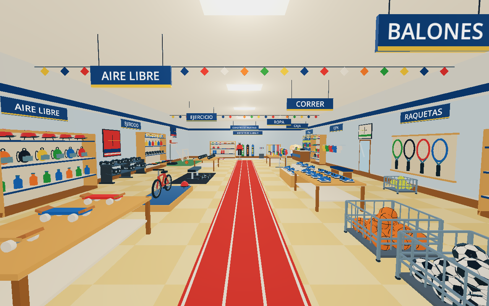

*Screenshot 9 Nov.*

Zoned departments, including winter sports, a running track and a checkout feature wall; every
sports item is clickable. Plush salespeople.
[Design record](../guides/TOWN_DESIGN_BRIEF.md#sports-store-interior--28-october-2026)
Since 18 Nov its storefront is in the shared [shop-row look](../guides/TOWN_DESIGN_BRIEF.md#game-palette-and-shop-row--18-november-2026) (cream walls, meadow green, with new striped window awnings accents; [outside view](../evidence/shop-row-20261118/after-sports.png)).

## Clothing store

*Screenshot 1 Nov.*

Racks, a checkout with a plush clerk, and fitting rooms where BonBon tries on outfits (police,
doctor, chef, pilot…) and keeps one.
[Design record](../guides/TOWN_DESIGN_BRIEF.md#clothing-store-clerk-and-refresh--1-november-2026) ·
[fitting room](../guides/TOWN_DESIGN_BRIEF.md#fitting-room-outfit-picker--9-november-2026)
Since 18 Nov its storefront is in the shared [shop-row look](../guides/TOWN_DESIGN_BRIEF.md#game-palette-and-shop-row--18-november-2026) (cream walls, rose pink accents; [outside view](../evidence/shop-row-20261118/after-clothing.png)).

## Electronics store

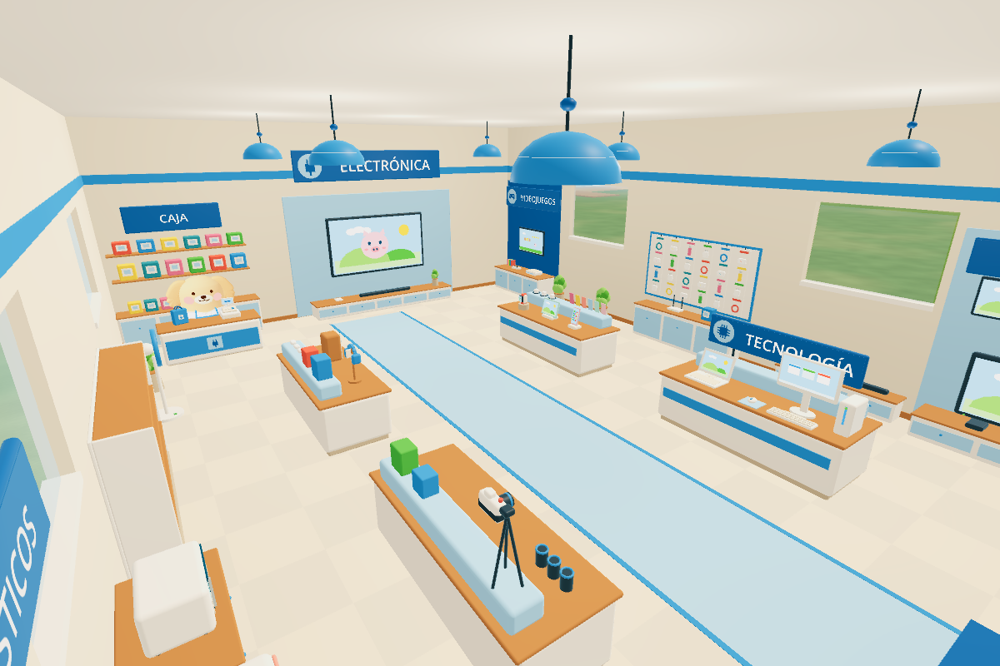

*Screenshot 18 Nov.*

A clay-toy electronics shop in cream and sky blue: computers, phones, cameras and audio on four
islands, a TV wall, a gaming corner, appliances, lit screens everywhere and a plush clerk at the
checkout (*salesperson*). Six signs, no prices; a clear spot in front of the counter is kept for a
future clerk game.
[Design record](../guides/TOWN_DESIGN_BRIEF.md#electronics-store-makeover--18-november-2026) ·
[before](../evidence/electronics-makeover-20261118/before-overview.png)
Since 18 Nov its storefront is in the shared [shop-row look](../guides/TOWN_DESIGN_BRIEF.md#game-palette-and-shop-row--18-november-2026) (cream walls, sky blue accents; [outside view](../evidence/shop-row-20261118/after-electronics.png)).
Since 23 Nov the small products are 20% bigger and the small appliances are words: *toaster*,
*kettle*, *blender* and *rice cooker* ([appliances](../evidence/shops-polish-20261123/after-electronics-appliances.png),
[record](../guides/TOWN_DESIGN_BRIEF.md#bigger-products-and-appliance-words--23-november-2026)).

## Furniture store

*Screenshot 9 Nov.*

A showroom with living-room, bedroom, dining, office and lighting departments; cushions, pillows
and blankets are clickable too.
[Design record](../guides/TOWN_DESIGN_BRIEF.md#furniture-showroom--29-october-2026)
Since 18 Nov its storefront is in the shared [shop-row look](../guides/TOWN_DESIGN_BRIEF.md#game-palette-and-shop-row--18-november-2026) (cream walls, teal accents; [outside view](../evidence/shop-row-20261118/after-furniture.png)).

## Bank

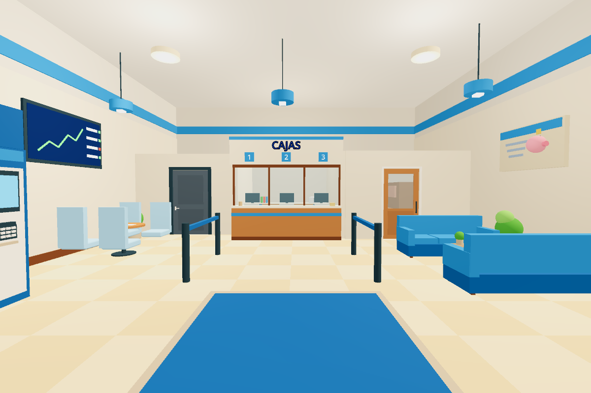

*Screenshot 18 Nov.*

Tellers, a waiting area, a consultation office, the vault and indoor ATMs; a bear banker, who
runs the teller game [Next, Please!](minigames.md#next-please) (18 Nov) at window 2.
Since 18 Nov the interior is in the game palette (cream walls, sky-blue accents), the office and
vault have the shared doors (no floating labels), and the ATMs and vault (round steel door,
safe-deposit lockers) were redrawn ([before/after views](../evidence/bank-refresh-20261118/)).
Since 23 Nov the bank reaches further back: the vault leads (through a slow, heavy door) into a
bigger vault room with the round safe and on into a safe-deposit room lined with small boxes; the
manager's office is bigger, the crocodile manager works there, and a staff door in it leads
behind the teller counter ([plan](../evidence/bank-rework-20261123/plan.png),
[deposit room](../evidence/bank-rework-20261123/deposit-room.png)).
[Design record](../guides/TOWN_DESIGN_BRIEF.md#bank-interior--28-october-2026),
[refresh](../guides/TOWN_DESIGN_BRIEF.md#bank-interior-refresh--18-november-2026),
[rework](../guides/TOWN_DESIGN_BRIEF.md#bank-rework--23-november-2026)

## Police station

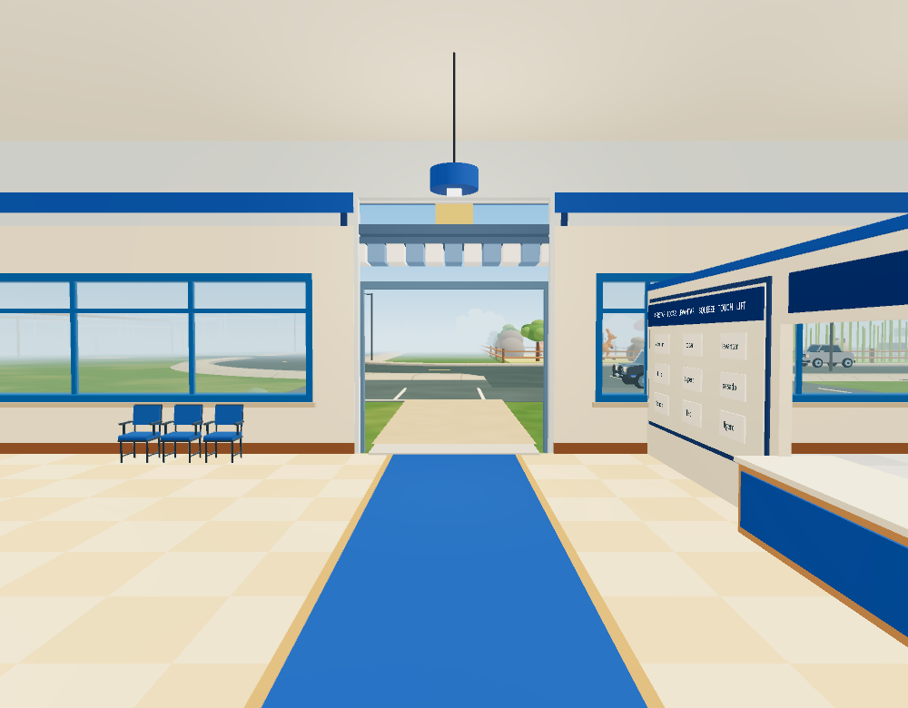

*Screenshot 18 Nov.*

A lobby, an office, an interview room, a holding cell, a suspect lineup room (Spot the Suspect)
and an evidence room (Feel the Clues). A crocodile officer by the entrance and a police car.
Since 18 Nov the lobby and the evidence room have real front windows: you see the street from
inside and the rooms from outside ([windows](../guides/WINDOWS.md#real-windows--18-november-2026)).
Since 23 Nov the two lockers by the records shelves are separate and each door opens with E or a
tap ([open](../evidence/civic-fixes-20261123/after-police-lockers-open.png)).
[Enlargement and games](../guides/TOWN_DESIGN_BRIEF.md#police-station-enlargement-and-detective-games--6-november-2026)

## Airport and control tower

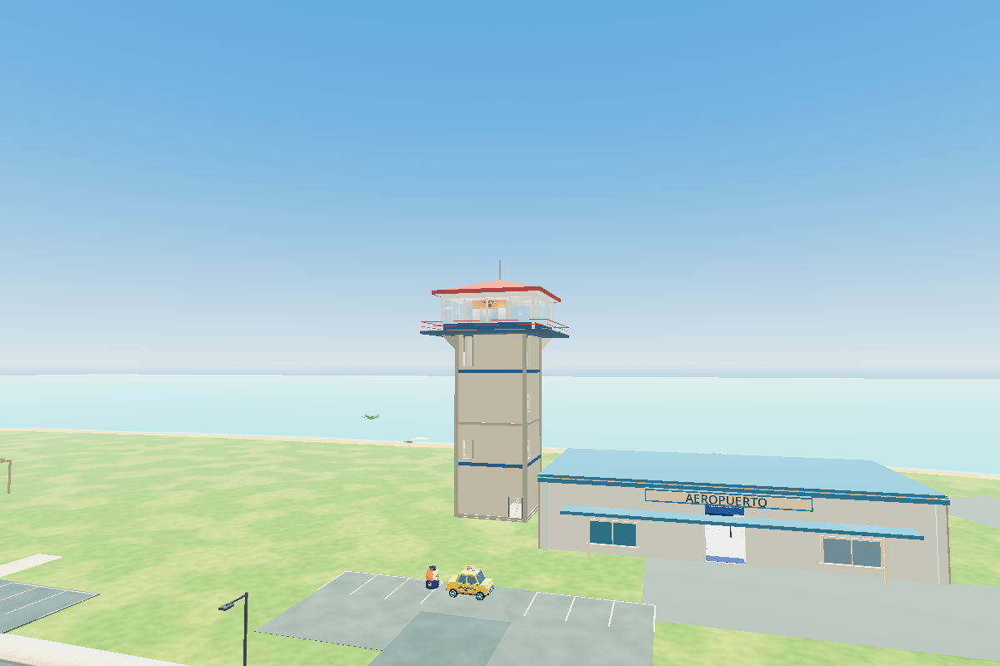

*Screenshot 12 Nov.*

The terminal has check-in, security, gates, baggage claim, a shop and café, and restrooms with
working toilets; Capitán Bruno's desk (Flight Finder) is just inside the door. The control tower
is walkable (lift and stairs, a ladder to the glass control room, a roof deck) and holds the
Radar Patrol radars. The airfield has the plane and the helicopter.
[Terminal](../guides/TOWN_DESIGN_BRIEF.md#airport-terminal-interior--28-october-2026) ·
[tower](../guides/TOWN_DESIGN_BRIEF.md#airport-control-tower--29-october-2026) ·
[tower deck](../guides/TOWN_DESIGN_BRIEF.md#control-tower-roof-and-observation-deck--12-november-2026) ·
[23 Nov fixes](../guides/TOWN_DESIGN_BRIEF.md#control-tower-deck-floor-hatch-and-stair-rails--23-november-2026)
(deck floor, ladder from the top, new stair rails)

## School

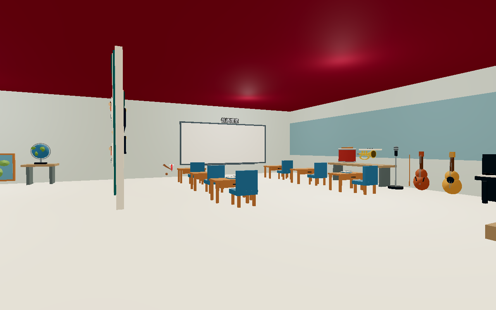

*Grammar classroom, 14 Nov.*

A single-storey school whose general classroom is Lana's grammar class (Desk Dash), with
teaching areas and posters (family tree, months) that prepare words for Who's Who?. Since 23 Nov
the science room (left of the entrance) has a framed mountain picture and a continent chart in
place of a bare wall triangle and a green blob, and its Biology and Geography plaques are named
([view](../evidence/civic-fixes-20261123/after-school-left-front-wall.png),
[record](../guides/TOWN_DESIGN_BRIEF.md#civic-fixes-garage-school-police-lockers-warehouse-cabinet-zoo-gate--23-november-2026)).
[Grammar Classroom](../guides/GRAMMAR_CLASS.md) ·
[floor plan](../guides/TOWN_DESIGN_BRIEF.md#school-single-divider-layout--26-october-2026)

## Hospital

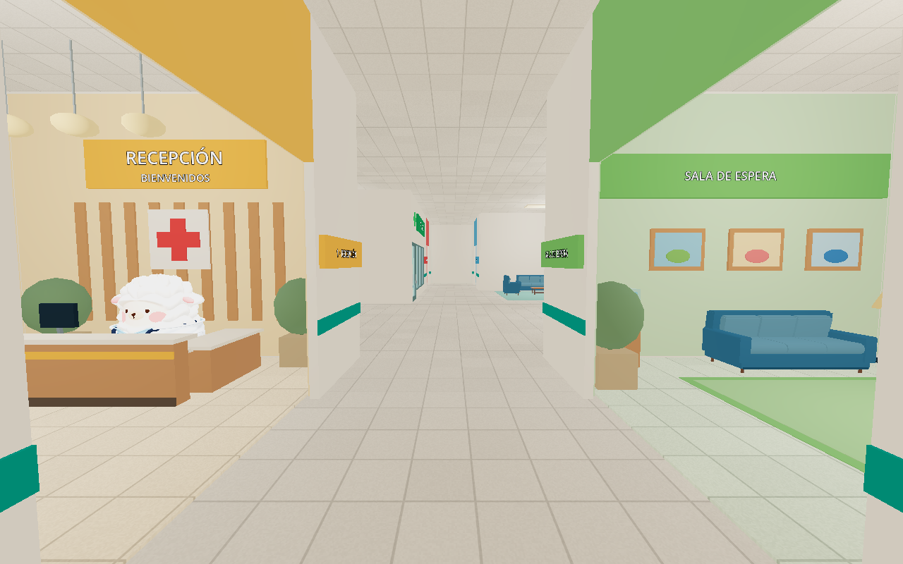

*Screenshot 9 Nov.*

Three floors of departments with signs and colours, wide stairs, an elevator with a big-button
floor picker (14 Nov), ward doctors (pig, cat, beagle), a sheep doctor at reception and a
helipad. Dr. Li runs Who's Who? outside the entrance.
[Hospital guide](../guides/HOSPITAL_THREE_FLOORS.md)

## Warehouse

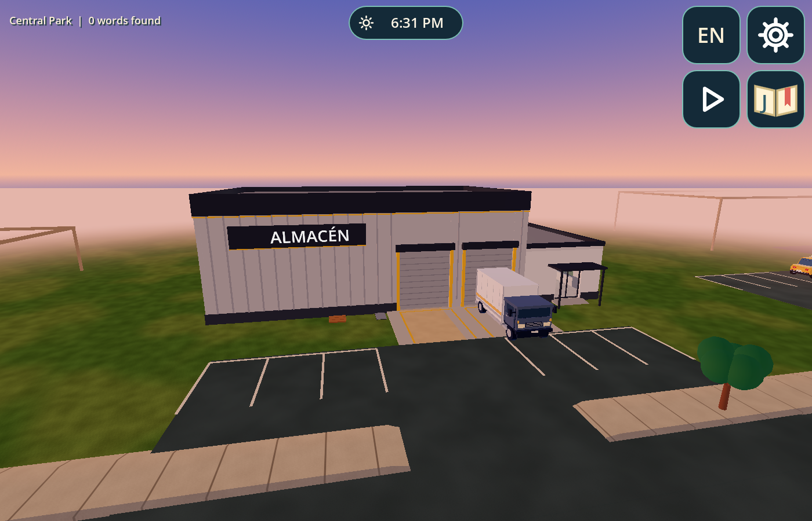

*Screenshot 14 Nov.*

A metal hall between the school and the airport with two truck-loading bays, a reception at the
east end and a hall with a shelf, a table and a cabinet. Ramón runs Stack & Pack. A box truck
is parked outside. Since 23 Nov the supply cabinet's doors open outside the game
([open](../evidence/civic-fixes-20261123/after-warehouse-cabinet-open.png)).
[Warehouse guide](../guides/WAREHOUSE.md#redesign-14-nov-2026)

## Mystery House

*No screenshot in the docs yet.*

*Casa de las Estrellas*, in the bottom-left corner of the map: cream stone, purple roofs with
gold trim, a dome with a crystal. Inside, a hall with shape and colour posters, a high starry
ceiling and the mystery room where Madame Luna runs Mystery Doors.
[Design record](../guides/TOWN_DESIGN_BRIEF.md#mystery-house-and-mystery-doors--9-november-2026)

## Chapel

*No screenshot of the rebuilt chapel in the docs yet.*

A small chapel with a slate roof, a belfry and spire, a rose window and stained glass; inside,
pews either side of a red runner and a raised chancel with the altar, candles and lectern.
Rebuilt 10–12 Nov; enlarged 21 Nov with a bell tower and a bell to ring. Since 23 Nov a doorway by
the entrance leads into the tower, where a ladder climbs through a hatch to the bell.
[Design record](../guides/TOWN_DESIGN_BRIEF.md#chapel-rebuild--1012-november-2026),
[ladder inside](../guides/TOWN_DESIGN_BRIEF.md#chapel-ladder-inside-the-tower--23-november-2026)

## Farm barn

*Screenshot 1 Nov.*

A red gambrel-roofed barn with a hayloft up a climbable ladder, tools, hay and supplies (no
animal stalls); farm animals graze outside. Tomás the farmer (a bear in overalls and a
straw hat) stands by the tool rack and chats about farm life (23 Nov, [NPCs](../guides/NPCS.md)).
[Design record](../guides/TOWN_DESIGN_BRIEF.md#farm-barn-gambrel-roof-hayloft-and-supplies-interior--1-november-2026)

**Hen house** (24 Nov): a little red coop beside the barn where six hens lay eggs over time
(about 3–4 after 15 minutes away, rarely up to 7; now and then a golden one). Pick an egg up
from a nest box or a straw nest and put it in the egg crate inside the barn door; carry it out
of the farm and you drop it. Just for fun for now (stars may come later).
[Views](../evidence/hen-house-20261124/), [record](../guides/TOWN_DESIGN_BRIEF.md#hen-house-and-eggs--24-november-2026)

## Playground

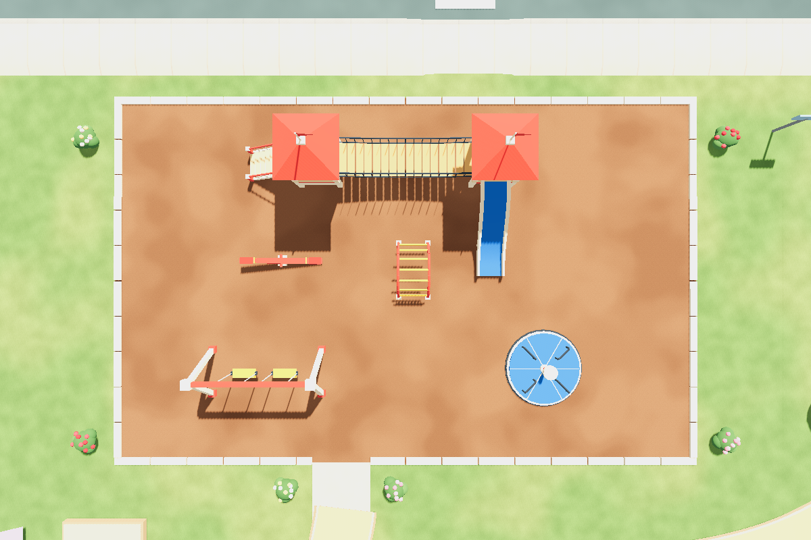

*Screenshot 1 Nov.*

Towers with a rope bridge, a slide, a seesaw, monkey bars, a merry-go-round and swings you can
ride (E to sit, W/S to kick).
[Design record](../guides/TOWN_DESIGN_BRIEF.md#playground-rebuild-and-rideable-swings--1-november-2026)

## Park, zoo and coast

*Zoo, 12 Nov.*

- **Public garden:** lawns, flower borders, fountains, a pond with swan boats and a bridge, and
  the horse-and-rider statue. [Garden guide](../guides/public-garden/README.md)
- **Zoo:** four fenced zones round a cherry-tree plaza: Savanna, Forest, Bamboo Grove and
  Wildlife Plains, with Spanish signs; since 23 Nov the gate opens away from you (inward from
  outside, outward from inside) and the green welcome board outside is gone; the clay-style animals were added 11–12 Nov. Since
  16 Nov the 17 clay animals walk with moving legs, breathe, look around and blink
  ([each one walking](../evidence/zoo-walk-20261116/walkers.png)); the 9 older piece-built
  animals (monkey, sheep and others) still glide. Since 17 Nov the zoo's tiger is the new
  clay tiger, a sleepy-eyed cub that walks and blinks like the others
  ([in the zoo](../evidence/tiger-anim-20261117/zoo-close.png),
  [walking](../evidence/tiger-anim-20261117/zoo-walk.png)), and the farm's horse is the new
  clay horse, which trots and blinks
  ([on the farm](../evidence/horse-anim-20261117/zoo-close.png),
  [walking](../evidence/horse-anim-20261117/zoo-walk.png)). Since 17 Nov a clay rooster stands
  on the farm lawn by the farm gate ([view](../evidence/rooster-clay-20261116/zoo-close.png)),
  since 18 Nov with a clay chick beside it
  ([view](../evidence/chick-clay-20261116/zoo-close.png)),
  and a clay capybara waddles and blinks in Wildlife Plains and teaches *capybara*
  ([view](../evidence/capybara-anim-20261117/zoo-close.png),
  [walking](../evidence/capybara-anim-20261117/zoo-walk.png)); just inside the zoo gate sits
  a clay baby monkey, in front of the Bamboo Grove
  ([view](../evidence/monkey-clay-20261117/zoo-close.png)); the rooster, the chick and the monkey
  are still displays with no word yet (the zoo's own piece-built monkey is unchanged).
  [Zoo zones](../guides/TOWN_DESIGN_BRIEF.md#zoo-zones--12-november-2026) ·
  [animal sizes and movement](../guides/ANIMAL_SYSTEM.md)
- **Coast:** a sandy beach with boulders and crabs, and a small deserted island.
  [Design record](../guides/TOWN_DESIGN_BRIEF.md#coast-deserted-island-boulders-and-crabs--29-october-2026)
