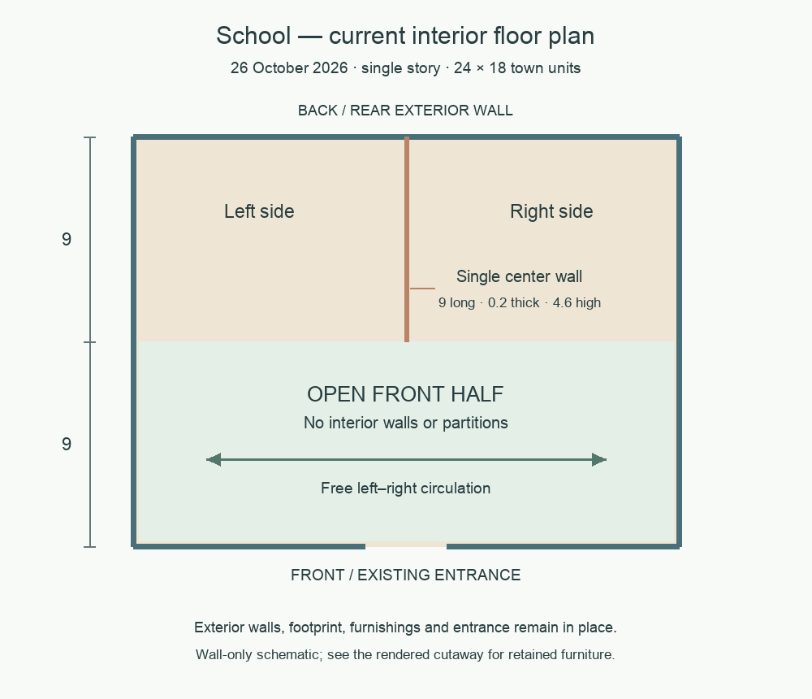

# Town master design blueprint

**Design authority:** user brief and follow-up decisions, 25–26 October 2026.  
**Stage:** school partition simplification implemented on 26 October 2026: one rear-half center divider and an open front half. The supermarket fit-out and other buildings remain as built.  
**Implementation evidence:** dated below; requirements are not claims of completion.

## Start here: current approved design

**Latest statue direction (8 November 2026):** the user’s sculptural portrait supersedes the earlier chunky character blueprint. Refine the horse/rider toward curved anatomy, flowing hair, warm aged bronze, uniform/tack detail and a cream carved pedestal, retaining the site and garden. Follow-ups: a less rounded, more angular rider head and visibly textured hair; then slightly wider/shorter facial proportions, hair covering the temples, and, on 9 November, a single bronze finish for the **entire horse and rider**, removing gold accents and all contrasting colour treatments. **9 November 2026 (user):** the statue must look and feel like the rest of the game: one plain, non-metallic bronze colour like every other prop (no textures, patina noise or metal sheen); `statue_town_bronze` supersedes the patina steps. See [implementation and limits](public-garden/README.md#sculptural-portrait-refinement--8-november-2026).

**Future AI agents: read this document first for design decisions.** It is the
master reference for what the town should become. Keep its existing filename
`TOWN_DESIGN_BRIEF.md` so links remain stable. The detailed building programs below
are part of this blueprint, not optional background reading for a building task.
**Minigames (user, 16 Nov 2026):** each game's purpose and progression design now lives in its
learning card in the [game guide](../game/minigames.md); the minigame records below stay as the
dated history of rules and implementation.

| Decision | Current approved direction | Implementation status / boundary |
| --- | --- | --- |
| Park grass | Textured lawn surfaces only (shader colour patches and fine blade grain). | 28 October 2026: the user kept the lawn texture and removed the standing grass clumps (trial and park-wide). Do not reintroduce blade geometry without a new request. See performance guide. |
| Park terrain | **4 November 2026: Boston Public Garden character with subtle, natural grades; no rolling hills around the monument and no uniformly flat park.** More pronounced but gentle northeast/northwest statue lawns, a quiet plaza and approach, a grass statue island and ring walk, straight cross-paths, narrow lawn-edge flower borders, two tapered entrance beds, clipped bushes and two entrance-side fountains following the user’s latest aerial. Preserve bridge, lagoon footprint and destination connections. | Implemented in the existing runtime terrain, trail-refresh and planting passes; validation is recorded in `FINAL_VERIFICATION.md`. See [current garden grading](public-garden/README.md#boston-inspired-garden--4-november-2026). **5 November 2026 (user request):** monument refined toward the same photographs: paved forecourt around the lens beds, 28 sheared yews, chain fences, layered tropical beds, low granite-sett fountains, classical pedestal moldings ([record](public-garden/README.md#washington-monument-refinement--5-november-2026)). Same day, from the user's trail drawing: walks circle both fountains, the bridge-side x≈−18 bends are removed and overlapping trails are untangled ([trail cleanup](public-garden/README.md#monument-trail-cleanup--5-november-2026)). **8 November 2026 (user reference image):** tulip lens beds with stone curbs and tulip borders, stone baluster fountains with spilling streams and a bronze child, a smooth bronze horse and rider with pedestal panels; layout unchanged ([record](public-garden/README.md#monument-plaza-art--8-november-2026)). Later the same day, from the user's character blueprint: the bronze is re-traced from the blueprint's side view (big rider, high-carried horse head, about 5.2 m hoof to hat) in olive bronze with gilt tack and trim, on a bronze plate and wide stone cap, with a warm cream pedestal ([record](public-garden/README.md#statue-from-the-character-blueprint--8-november-2026-later)). |
| Town layout | Keep current building positions and entrance locations; preserve pond/statue circles and attractions. Northwest playground retained. | Current layout exists. **One relocation approved and built 28 October 2026: the police station moved to the east side, south of the supermarket** ([record](#restaurants-and-police-relocation--28-october-2026)). **Second relocation approved and built 5 November 2026: the school moved 10 units west, toward the hospital, to make room for the warehouse** ([record](#warehouse-and-warehouse-worker-minigame--5-november-2026)). **New building approved and built 9 November 2026: the Mystery House on the empty plot south of the bank** ([record](#mystery-house-and-mystery-doors--9-november-2026)). No other relocation or map redesign approved. |
| School | **24 × 18 town units, single story**; general/science teaching areas with **one rear-half center dividing wall and an open front half**. | Shell and elementary-school exterior implemented: 4.6 clear height; single 9-unit rear divider implemented. Previous classroom-front/hall partitions and interior headers removed. Existing teaching furniture/content retained, with four wall displays remounted. Complete future furnishing program remains deferred. |
| Supermarket | **26 × 26 town units**; one open floor with nine departments and wide aisles. | Shell and supermarket exterior implemented; 5.71 clear height. Exterior color refinement implemented on 26 October: teal fascia, ochre entry and terracotta plinth; **superseded 1 November 2026 by navy fascia, gold entry and a cart icon** ([storefront redesign](#storefront-exterior-redesign--1-november-2026)). Existing learning roots retained in the nine-department fit-out implemented on 26 October. Front axis and delivery access preserved; see the interior review below. **2 November 2026:** refitted inside the same shell: frozen section removed and its words retired, fruit in its place, checkout lanes beside the door, every product a clickable word, a samoyed cashier and a beagle clerk ([record](#supermarket-refit-fruit-checkout-by-the-door-and-clerks--2-november-2026)). **8 November 2026:** every product redrawn in one shared style (recognisable silhouettes, front-of-pack pictures, three shared finishes), lighter fridge backs, shelf price tags and department pictograms; same words and pick areas ([record](#supermarket-product-art--8-november-2026)). **17 November 2026:** one word, one section: PANTRY became SNACKS, the produce stand holds only big fruit, the fridges only dairy and salad, the drinks cooler and home goods traded places and coffee moved to the cooler ([record](#supermarket-sections--17-november-2026)). **18 November 2026:** compact redesign: staff wall (shop floor 25.5 × 19.1), cold wall on the left, fruit island, one snack gondola and a home gondola on the right; every product at least the old coconut's size, coconut 1.4×, 34 products redrawn as clay toys ([record](#supermarket-compact-redesign--18-november-2026)). **21 November 2026:** the staff door opens and the back storage room is fitted out ([record](#stamp-places-storage-room-bank-safe-grand-chapel--21-november-2026)). |
| Furniture store | **24 × 26 town units** (was 17 × 29), same front wall line and entrance, flat roof with parapet (green until 1 November 2026, now slate with a timber band and corner cladding), glass shopfront and sign plaque; showroom with living, bedroom, dining, office and lighting departments (user's isometric design, approved 29 October 2026). | Implemented 29 October 2026 inside zone `furniture` (x 113–139, z 209–259) with no zoning change; eight words added. See [record](#furniture-showroom--29-october-2026). **1 November 2026:** plush staff added ([record](#shop-staff-bank-sports-store-furniture-showroom--1-november-2026)). **9 November 2026:** furniture models replaced with product-art versions, prefabs turned to face the room, every item clickable ([interiors polish](#interiors-polish--9-november-2026)). |
| Game palette and shop row | **18 November 2026 (user):** one colour palette for the whole game (2D and 3D), drawn from the app icon and the dialogue box: `scripts/core/game_palette.gd`. The five shops (bakery, clothing, electronics, sports, furniture) share one storefront look: cream walls, stone base bands, cream trim, iron lamps, wooden flower boxes, and **one accent family each** (coral, rose, sky, meadow, teal). Supersedes the shops' earlier colours (including the 25 Oct café colours and the furniture store's slate parapet). | Built 18 Nov 2026 (recolour by role, sports awnings added); other buildings not yet on the palette. [Record](#game-palette-and-shop-row--18-november-2026). |
| Real windows | **18 November 2026 (user):** the supermarket and police station get real windows (see-through both ways, the wall opened behind the glass) with the shared window component; frame presets (house, shopfront, civic, arched) in the building's accent or trim, with a sill. Accents for the windows: police `sky`, supermarket `meadow`. | Police built 18 Nov 2026 (two civic windows); supermarket step written, baked once its 18 Nov layout is committed. Hospital, home, chapel and Mystery House still have hand-built windows (not approved for change). [Record](#real-windows--18-november-2026), [windows guide](WINDOWS.md#real-windows--18-november-2026). |
| Other building dimensions | Retain existing dimensions. | Furniture shortening (the old optional 17 × 24 idea, superseded by the approved 24 × 26 above), airport height reduction and hospital-wing removal are **not approved**. |
| Hospital program | Three stories, approximately four rooms per floor, using the floor organization in the building-program table below. Preserve helicopter/helipad, bed design and complicated working features. | Interior remodel implemented 26 October: requested first-floor quadrants, compact left stairs and working right elevator. Rear learning wing, bed design and heli systems retained. 31 October: pharmacy enlarged on floor 1; the elevator moved to a side tower with a roof stop; the stairs reach the roof. See the current hospital guide. **1 November 2026:** three more plush doctors (pig, cat, beagle) on the three floors ([record](#hospital-ward-doctors--1-november-2026)). |
| Food venues | BakeryCafe remains combined bakery/café. **Fine dining** (merged old Pizza + Burger shells) and **Pizza and Burger** (the former Burger/pizza place, now L-shaped in the former police lot); restaurant Cafe shell → **Mexican restaurant (TAQUERÍA)**, replacing the earlier Chinese seafood plan (user decisions, 28 October 2026). | Taquería ([record](#mexican-restaurant-taquería--28-october-2026)), fine dining and Pizza and Burger ([record](#restaurants-and-police-relocation--28-october-2026)) all built 28 October 2026. Node names (`Restaurants/Pizza`, `/Burger`, `/Cafe`) remain unchanged. **1 November 2026:** fine dining became the Italian **Alta Cocina** with a rear kitchen wing and front terrace, and every cook-model figure became a plush character ([record](#alta-cocina-italian-remodel-and-plush-staff--1-november-2026)). Same day, revised from the user's isometric reference: clear entrance, reference booths, quatrefoil floor, 6.5 ceiling, hipped roof, motorcycle in a car stall ([revision](#alta-cocina-revision-entrance-booths-floor-ceiling-roof--1-november-2026)). **9 November 2026:** Pizza and Burger dining room refurnished (tables, booths, drinks fridge), every food and seat clickable ([interiors polish](#interiors-polish--9-november-2026)). |
| Sports store interior | Built from the user's isometric design, **inside the unchanged 14 × 24 shell** (no resize, zoning unchanged); revised the same day with a winter sports department and eight new words (user request). | Implemented 28 October 2026; see [record](#sports-store-interior--28-october-2026) and its [winter revision](#winter-sports-revision--28-october-2026). Clothing and electronics interiors follow one at a time, each awaiting approval. **1 November 2026:** plush staff added ([record](#shop-staff-bank-sports-store-furniture-showroom--1-november-2026)). **9 November 2026:** interior refitted into zoned fixtures, every sports item clickable; the 28 October layout is superseded ([interiors polish](#interiors-polish--9-november-2026)). |
| Clothing store interior | Built from the user's isometric design **inside the unchanged shell** (11 × 15 interior; no resize, zoning unchanged). | Implemented 28 October 2026; see [record](#clothing-store-interior--28-october-2026). Electronics follows after approval. **1 November 2026:** cashier.tscn deleted, plush clerk and shopper, checkout moved, refresh ([record](#clothing-store-clerk-and-refresh--1-november-2026)). |
| Electronics store interior | Built from the user's isometric design **inside the unchanged shell** (11.3 × 15.2 interior; no resize, zoning unchanged). | Implemented 28 October 2026; see [record](#electronics-store-interior--28-october-2026). Completes the three user-supplied interiors. **1 November 2026:** refitted as a real electronics shop in the same shell, no new words ([record](#electronics-store-refresh--1-november-2026)). **18 November 2026 (user):** clay makeover in the game palette, same shell and words, plush clerk, no prices; supersedes the 1 Nov fixtures ([record](#electronics-store-makeover--18-november-2026)). |
| Café and bakery interior | Built from the user's pink "Cafe & Cakes" isometric design **inside the unchanged 14 × 22 shell** (no resize, exterior unchanged). | Implemented 28 October 2026; see [record](#café-and-bakery-interior--28-october-2026). |
| Bank interior | Built from the user's isometric bank design **inside the unchanged 12 × 15 shell** (no resize, zoning unchanged); vault, manager office, their doors and the interior ATMs kept. **23 Nov 2026 (user):** the bank grows **backward only** (approval for this piece of work): a lower annex behind the old back wall (12 × 8.4) with a bigger vault room, a safe-deposit room and the extended manager's office; a staff door to the teller side; front, lobby and lobby things unchanged ([record](#bank-rework--23-november-2026)). | Implemented 28 October 2026; see [record](#bank-interior--28-october-2026). Outdoor ATMs from the design are not built (exterior work). **1 November 2026:** plush staff added ([record](#shop-staff-bank-sports-store-furniture-showroom--1-november-2026)). **18 November 2026:** interior refresh in the game palette (sky accent), shared doors for the office and vault, door labels removed, new ATM and vault art ([record](#bank-interior-refresh--18-november-2026)). **21 November 2026:** the vault's round door opens (wheel, then swing) onto a new safe drum ([record](#stamp-places-storage-room-bank-safe-grand-chapel--21-november-2026)). **23 November 2026:** rear annex (vault room with the safe moved to its back wall, safe-deposit room, office extension), staff door behind the counter, slow heavy vault door ([record](#bank-rework--23-november-2026)). |
| Police station interior | Built from the user's isometric police design **inside the unchanged 12 × 15 shell** at its relocated site; interview room, holding cell and both doors kept. **6 November 2026 (user decision): shell enlarged to 20 × 22, front fixed, with a suspect lineup room and an evidence room for two detective minigames** ([record](#police-station-enlargement-and-detective-games--6-november-2026)). | Implemented 28 October 2026; see [record](#police-station-interior--28-october-2026). **1 November 2026:** the blocky officer was retired and a crocodile plush police officer stands beside the entrance ([record](#police-officer-crocodile-plush-at-the-station-entrance--1-november-2026)). **6 November 2026:** enlarged and refitted; the crocodile works inside (lineup game) and a cat officer works the evidence counter. **8 November 2026:** the evidence game was redesigned (one property word a round, Apretar / Tocar / Levantar) and its poster changed ([record](#police-evidence-game-redesign--8-november-2026)). **9 November 2026:** light pass: evidence exhibits, riot helmets and lobby look-alikes clickable ([interiors polish](#interiors-polish--9-november-2026)). |
| Airport terminal interior | Built from the user's isometric airport design **inside the unchanged 34 × 18 terminal** (no resize; exterior, tower, airfield and aircraft untouched). | Implemented 28 October 2026; see [record](#airport-terminal-interior--28-october-2026). Adds a Travel word category. **8 November 2026 (user decision, built the same day):** the painted restroom doors became two real restrooms with working toilets and faucets, **inside the unchanged terminal from the baggage-claim area** (not an annex); the carousel moved 1.2 toward the front wall ([record](#bathroom-fixtures--8-november-2026)). |
| Airport control tower | **Redesigned and made walkable (user-approved: lift + stair, three levels, narrow shaft flaring only at the cabin).** Shaft 8.4 × 8.4 and 22 high, 360° glass control room 11.2 × 11.2 at the top, discreet side door; site, zone `control_tower` and terminal untouched. | Implemented 29 October 2026; see [record](#airport-control-tower--29-october-2026). No new words. Roof, wrap-around observation deck and west deck door added 12 November 2026 ([record](#control-tower-roof-and-observation-deck--12-november-2026)). |
| Storefront exteriors | Eight fronts restyled from the user's "Propuesta de rediseño exterior" sheet: per-shop palette, awnings, wall lamps, flower boxes, icon signs (user decisions, 1 November 2026: all eight shown, the sheet's palette also on approved fronts, decorative parapets allowed, no street furniture). | Implemented 1 November 2026, no resize or collision change; see [record](#storefront-exterior-redesign--1-november-2026). |
| Cashier money minigame | Supermarket cashier (samoyed, at the till) asks for $0.25–$300.00 in Spanish; the player counts it out from 10 bills and coins on a full-screen touch-friendly screen (user decisions, 4 November 2026). | Implemented 4 November 2026 for the supermarket cashier only; see [record](#cashier-money-minigame--4-november-2026). |
| Bank teller game | **Next, Please!**: the bear banker at reception asks the player to cover teller window 2; plush customers come up from the queue ropes and ask for $100–$500 in words; the teller checks the balance on the window's monitor, then counts out $5 / $10 / $50 / $100 bills or declines a short account; one customer a session wants change without $100 bills (user decisions, 18 Nov 2026). Since 21 Nov 2026 (user): the monitor shows the account holder's headshot, an impostor may claim another character's account, and a police officer escorts them out ([record](#impostors-and-the-police-escort--21-november-2026)); the dialogue is simpler. **No building change** until 23 Nov 2026. **23 Nov 2026 (user):** one view shows the monitor and the customer (no camera toggle); paying an impostor brings the **bank manager** (new character) out of her office to warn the player, a second payout in a session gets the player let go (results card, nothing saved) ([record](#bank-rework--23-november-2026)). | Built 18 Nov 2026; see [record](#bank-teller-game--18-november-2026). |
| Hospital family game | **Dr. Li** (a woman; pig plush in the doctor outfit) outside, right of the hospital entrance, runs a family-tree question game in a 2D overlay. Decisions (4 Nov 2026): 3–4 tree templates with randomized names (foreign-language names), genders and birthdays; a fixed reference date for ages; dates shown MM/DD/YYYY with an "MM/DD/YYYY" legend under them; a gender icon per person; portraits rendered once from the plush sculpts and cached; Spanish questions with the "show translation" toggle; version 1 uses 6–8 templates; coins deferred. Words are taught by **four school posters** (family tree + couples strip on the divider's Science face; months, before/after, older/younger on the General rear wall). | Stage 1 (language framework) and Stage 2 (words, names, posters, Dr. Li placed with a name card) built 4 Nov 2026; Stage 3 (question generator, validator, overlay, Dr. Li's "!" and dialogue) not built. See [record](#hospital-family-game--4-november-2026). |
| Airport flight game | **Capitán Bruno** (the house bear, a second copy in the pilot costume) at the information desk just right of the terminal door (moved 6 Nov 2026) gives a Spanish instruction; the player finds the one matching flight on the departure board (**board only since 7 Nov 2026**: the five-bookmark booklet was removed). Decisions (5 Nov 2026): 5 questions per session, progress counts only first-try finds, no coins; Bruno says what was wrong; leaving asks first; vocabulary summary at the end; destinations are **countries only**; MM/DD/YYYY dates, 24-hour times on :00 / :30 (no "y cuarto" / "menos cuarto"); one shared random "today" (2026–2027) also used by the family game; works with Chinese. | Built 5 Nov 2026; layout, flags and bilingual rows revised 6 Nov 2026; redesigned 7 Nov 2026 to test time expressions (board only, 4 countries, near-miss flights; [redesign](#board-only-redesign-time-expressions--7-november-2026)). See [record](#airport-flight-game--5-november-2026). |
| Alta Cocina restaurant game | **Twinkle** (waiter) at the host stand offers it; a random seated house-character customer orders one meal (starter, main, dessert, drink); the player inspects dishes by icons, bars and a thermometer only and serves the one match. Decisions (6 Nov 2026): one customer per session, 4 orders, 1–2 requirements with light intensity, negation off, a course counts once served, no coins, code-drawn art, four wall posters, all three languages. | Built 6 Nov 2026. **Flow redesigned 11 Nov 2026 (user):** Twinkle sends the player to one of two seated customers, the order is taken on an order tablet, the customer reacts and Twinkle reports back; textures and extras removed; a menu book on a table by the host stand. Same day, second request: 2–3 courses per customer, a door question instead of walking out, Twinkle names no customer. See [record](#alta-cocina-restaurant-game--6-november-2026) and [redesign](#restaurant-game-reception-tables-and-order-tablet--11-november-2026). |
| Customer order minigame | Supermarket clerk (outside, beside the door) shows a gold "!", asks for help, then lists products to fetch (since 14 Nov 2026: 2 basic fruits/vegetables, 1–2 each, [update](#quicker-orders--14-november-2026)); order list and cart rows with product pictures (user request 8 Nov 2026; text-only before); replaces the mission system (user decisions, 3 November 2026). | Implemented 3 November 2026 for the supermarket only; see [record](#customer-order-minigame--3-november-2026). |
| Warehouse and Warehouse Worker minigame | **Redesign approved 14 Nov 2026 (user): 30 × 14.5, reception inside at the east end, two loading bays, divider, one shelf / table / cabinet, five placing tasks** ([record](#warehouse-redesign--14-november-2026)). Original: **new building between the school and the airport** (user request, 5 Nov 2026): silver/light-gray metal hall 30 × 22 with a 12 × 7 reception annex (desk, seated receptionist), a second door into a large, high, empty hall; a supervisor (lion plush Ramón) offers a five-task minigame in a **separate copy** of the same architecture. Decisions: no coins, no first-try counting, tú, A1–A2 daily words only. | Phase 1 (site, school move, shell, reception) Phase 2 (50 words, three reception posters, Ramón outside) Phase 3 (racks A–C, tables, scale, cabinet, conveyor, IN/OUT areas, light stock, truck) Phase 4 (game frame: copy, fade, task card, leave question) and Phase 5 (physics goods, carrying, trolleys, task generator and checks, wrong-attempt help) built 5 Nov 2026; Phase 6 full suite run 5 Nov 2026. See [record](#warehouse-and-warehouse-worker-minigame--5-november-2026) and the [warehouse guide](WAREHOUSE.md). **14 Nov 2026 redesign built (uncommitted); the lot's car and motorcycle (base world) not built.** |
| Grammar Classroom | The school's general classroom becomes a grammar class (user brief, 6 Nov 2026): Lana (new sheep plush teacher) by one large rear-wall board; 6 desks in 2 columns × 3 rows, the front four are answer desks A–D; questions per learned language (Spanish ser/estar, Chinese shared measure words, English agreement and prepositions); points only, no coins. | Remodel baked into `school.scn` 7 Nov 2026 (`scripts/buildings/school.gd` step `grammar_classroom`). See [record](#grammar-classroom-remodel--6-november-2026) and the [guide](GRAMMAR_CLASS.md). |
| Mystery House and Mystery Doors | **New building, "Casa de las Estrellas"** (user brief and image, 9 Nov 2026): cream stone, purple tiled roofs with gold trim, a purple gold-ribbed dome with a crystal, arched purple entrance with a gold star, stained glass, lanterns, flowers and vines, carpeted steps, a sign post. **24 × 30** (school-like frontage, deeper), in the bottom-left corner of the map (south of the bank, facing the loop road). Hall with shape and colour posters; a high mysterious room under the dome with stars and the twelve zodiac constellations (decoration only); three locked coloured doors that open only in **Mystery Doors** (Madame Luna, cat plush fortune-teller): clues by shape, then colour, then both; a wrong door turns the player into a toad for 2 s. Door wall after the user's door reference (same day). | Built 9 Nov 2026 (`scenes/town/mystery.scn`, own script `scripts/buildings/mystery.gd`; map site base step `mystery_house_site`). See [record](#mystery-house-and-mystery-doors--9-november-2026). |
| Farm barn | **Taller gambrel barn on the unchanged 12 × 9 footprint** (user decisions, 1 November 2026, loose reference image): walls 5.0 → eave 6.0, gambrel ridge 10.5; door opening 3.4 × 4.0 (was 3.6 high) with open X-braced double doors; walkable hayloft reached by a climbable ladder; tools / hay / supplies interior with nine new words. Supplies only, no animal stalls. | Implemented 1 November 2026; see [record](#farm-barn-gambrel-roof-hayloft-and-supplies-interior--1-november-2026). Ladder turned to face the door and the paddock shelter and trough rebuilt the same day. A feed trough and the vegetable garden remain future items. |
| Zoo layout | **User design, 12 November 2026:** the wild-animal lawn (unchanged footprint, farm untouched, no north exit) is four fenced zones around a cross path and a cherry-tree plaza with lamps (its two benches removed, user, 23 Nov 2026): **Savanna** (giraffe, rhinoceros, deer, kangaroo, zebra), **Forest** (bear, bear cub, gorilla), **Bamboo Grove** (panda, red panda, monkey), **Wildlife Plains** (elephant, lion, tiger, flamingo, snake); Spanish zone signs (LA SABANA, EL BOSQUE, EL BAMBÚ, LAS LLANURAS) and a ZOO arch (EL ZOOLÓGICO) at the gate; full scenery kept lightweight. | Built 12 Nov 2026 (base step `zoo_zones`); see [record](#zoo-zones--12-november-2026). Each zone has a walk-in gap so every animal stays studiable. |
| Home pool and sidewalks | Sunken home pool with real depth; curbed, raised sidewalks along the loop road. | Implemented 28 October 2026; see [pool and sidewalks](#home-pool-depth-and-raised-sidewalks--28-october-2026). |
| Completed interiors | House and library remain as built. | Preserve rooms, furnishings, doors and learning content. |
| Remaining interiors | Follow each building's detailed program below. | Future stages, one building at a time; no wholesale interior construction in the exterior stage. |
| Vocabulary and saves | Keep every existing word learnable; preserve keys, aliases, categories/progress; one primary Mexican Spanish translation per word (28 October 2026, see [word audit](../archive/WORD_AUDIT.md#one-mexican-translation-per-word--28-october-2026)). | Keys, aliases and saves unchanged; Spanish values simplified on 28 October 2026. Physical props need not be removed because a word is taught elsewhere. Reorganized at the user's request on 28 October 2026: one word file `data/words.json`, 18 categories with written rules; the [word audit](../archive/WORD_AUDIT.md) decisions were applied the same day: 464 words, every one clickable. |
| Vehicles / police | Preserve working vehicle placement and controls. **5 November:** warehouse box-truck redesign and integrated entry/exit doors approved ([record](#warehouse-truck-and-integrated-vehicle-doors--5-november-2026)). | Police station remains (removal still not approved); relocated east, south of the supermarket, on 28 October 2026. |
| Additional buildings | No museum, hotel, bus/train station, fire station, standalone pharmacy or post office construction. | Not approved. Report useful existing related content before changing it. |

Dimensions are frontage × depth in **town units**; Apartment scales lengths by
1.3. Do not scale the player or whole furnished buildings to achieve them.
Approval of dimensions is not proof that geometry exists or that a furnished layout
has passed collision/camera checks. Do not ask the user to approve these same
school/supermarket targets again unless a measured conflict requires changing them.

### Supporting references and precedence

| Need | Read |
| --- | --- |
| Intended look, every building's rooms/equipment, restrictions | **This master blueprint**, especially [building programs](#building-programs-for-future-work) and [vocabulary rules](#future-vocabulary-rules). |
| Palette, materials, roofs, windows, signs, exterior quality gates | [Building design blueprint](BUILDING_DESIGN_BLUEPRINT.md): shared architectural standards, not a competing building-program document. |
| Current measurements, player scale, proposed space budgets, approval evidence | [Dimension review](BUILDING_DIMENSION_REVIEW.md): distinguish approved school/supermarket targets from unapproved options. |
| Scene/script ownership, transforms, interaction and data editing | [Architecture guide](ARCHITECTURE_REVIEW_PART1.md#current-editing-rules-parts-23). Inspect live Main to establish what is actually built. |
| Actual test outcomes, dated images and known limitations | [Verification record](FINAL_VERIFICATION.md). Historical passes do not certify later edits. |

Latest explicit user decisions take precedence over older design guidance. This
master blueprint records the current decisions; the supporting documents explain
implementation or evidence. If a later user instruction changes a decision, update
this summary and its detailed program together, then update affected supporting
references. Retain dated historical evidence as history, never as an active mandate.

### Execution order for the next agent

1. Read the relevant approved program here and inspect its actual runtime owner.
2. Preserve the implemented school/supermarket shells and entrance axes; see the
   [resize implementation](BUILDING_DIMENSION_REVIEW.md#implemented-resize--25-october-2026).
   Other dimensional options remain excluded. Detailed interiors are a later task.
3. Work within the specific implementation task the user requests; this master
   document alone is not an instruction to build every future room or venue.
4. Keep exterior work compatible with the agreed future interiors. Do not change
   complete house/library interiors or reorganize vocabulary as a side effect.
5. After implementation, update status from planned to implemented only with actual
   evidence. Record function checks and rendered inspection separately.

## Central garden terrain research — 4 November 2026

The user requested Boston Public Garden research, specifically rejecting rolling
hills around the monument, then approved the suggestions with the correction that
the park should retain subtle, realistic variation rather than become too flat.
The [Boston Landmarks Commission study, section 2.2](https://www.boston.gov/sites/default/files/embed/b/boston-public-garden-study-report.pdf)
describes an almost rectangular garden with less than five feet of elevation
variation, an irregular lagoon, a central bridge axis and otherwise asymmetrical
paths; shrubs and flower beds are more formal. The [city garden map](https://documents.boston.gov/images_documents/Public%20Garden%20Map_tcm3-30692.pdf)
is a layout reference, not a measured grading survey.

The first implementation replaced the 2.8-unit shoulder and five mounds with low
lawn grades, filled six existing beds and opened the monument sightline. The user
then found the terrain too subtle and supplied four Boston photographs/map views
plus an in-game comparison. **Approved revision:** increase the northeast and
northwest lawn relief; add clipped bushes and two entrance-side fountains; arrange
the flower beds more like those photographs. This supersedes the six-oval layout
and the earlier instruction to remove every fountain (the old pond fountain stays
removed). The reference images are retained in the [garden guide](public-garden/README.md#boston-inspired-garden--4-november-2026).

**Latest aerial correction:** the user supplied a clearer overhead photograph and
explicitly requested matching the flower beds and trail/road. It replaces the
four independent elongated-bed proposal with a grass statue island, surrounding
ring walk, straight cross-paths dividing lawn panels, narrow borders tracing those
panels and the island, and two tapered beds beside the entrance avenue between
the fountains. This authorizes changing the monument's former solid paved plaza
and oversized oval path; retain the statue position, external destinations, lagoon
and bridge. The newest [aerial reference](public-garden/boston-reference-aerial.png)
is the layout authority; the other images guide fountains and clipped bushes.

The implementation uses that ring/cross-path structure with warm gray paving,
twelve clipped shrubs and two low entrance fountains with bronze figures and
rippling water. Northern lawn rises remain more pronounced; fountain pads and
statue island stay level. Bushes reuse the existing shrub vocabulary; fountains
are decorative and add no keys. See [implementation and tuning](public-garden/README.md#boston-inspired-garden--4-november-2026)
and the dated verification entry for checks and rendered evidence.

**5 November 2026 review:** the user asked for the statue, bushes, beds and both
fountains to resemble the Boston photographs more closely, keeping the game's style
and leaving surrounding structures alone. Approved scope: that monument area only.
Statue position, ring, cross-paths, fountain centres, lagoon, bridge and buildings
are unchanged. The [refinement record](public-garden/README.md#washington-monument-refinement--5-november-2026)
lists what changed and why.

## School single-divider layout — 26 October 2026

The user explicitly replaced the earlier interior layout: **remove every existing
interior partition and use exactly one centered dividing wall extending from the
rear exterior wall to halfway through the building depth**. The front half stays
open for left–right movement. No additional partitions, wall returns, classroom
front walls or interior doorway headers are permitted. Existing exterior walls,
24 × 18 footprint, 4.6 height, entrance and roof remain unchanged.

### Current school floor plan

The divider is **9 long × 0.2 thick × 4.6 high town units**, centered on x=0.
In school-local coordinates the shell extends z=−12.2 (front) to +5.8 (rear),
so the divider spans z=−3.2..+5.8, meeting the rear wall. Its center is
(0, 2.3, 1.3). In final town coordinates it runs x=0, z=230..239;
the open front half is z=221..230. Apartment's 1.3 scale applies as usual.
The rear wall overlap joins the divider to the exterior without a gap.

General/science teaching areas retain their existing furniture and lesson objects;
these are connected areas, not two enclosed classrooms with a central hall.
The whiteboard, notice, biology plaque and mountain artwork are remounted on the
inside of the existing front exterior wall. General/science labels move to the
rear wall. No furnishing layout redesign, added doors, new vocabulary, mission
change or exterior alteration is included.

Owner: `world_refinements.gd::resize_school()` creates the sole divider under
`Buildings/School/ApprovedShell` in the existing guarded runtime pass. Restart
Main to see the change; the saved pre-refinement editor scene is not the current
floor plan. The [rendered cutaway](../evidence/school-partition-20261026/after/floor-plan.png)
shows actual retained furniture; [front interior](../evidence/school-partition-20261026/after/front-open.png)
and [crossing view](../evidence/school-partition-20261026/after/crossing.png) show the open half.
See [verification](FINAL_VERIFICATION.md#school-single-divider-layout--26-october-2026).
Earlier two-room schematics and dated renders remain historical evidence only.

## Grammar Classroom remodel — 6 November 2026

Approved by the user's Grammar Classroom brief (6 Nov 2026): "fewer desks in 2 columns, the
front 4 are the answer desks, the teacher stands by the board"; board placement, the single
large board and the teacher (Lana, a sheep plush) were left to Claude. Owner:
`scripts/buildings/school.gd` step `grammar_classroom` (constants there), baked into
`scenes/town/school.scn`. Game and rules: [GRAMMAR_CLASS.md](GRAMMAR_CLASS.md).

In school-local coordinates (general classroom, x < 0; +z is the rear wall):

| Element | Decision |
|---|---|
| Board | One board 4.8 × 2.0 centred (−6.8, 2.1) on the rear wall, word `whiteboard` (node name `Whiteboard` kept); the small front-wall whiteboard is removed. **Since 14 Nov 2026 (user; step `bigger_board`):** 6.0 × 2.6 centred (−6.5, 2.1), x −9.5..−3.5, y 0.8..3.4, brighter with a darker frame; the "General classroom" sign above it moved up to y 3.98. |
| Desks | 6 desk sets (was 8): columns x −8.6 and −3.4, rows z 2.4 (A B), −0.4 (C D), −3.2 (ordinary, two notebooks kept). Chairs 0.95 toward −z, turned to face the board. |
| Teacher | Lana at (−2.6, 4.25), right of the board, facing the class. |
| Music corner | Moved as one group from the rear wall to the left side wall, z −8.8…−0.2. |
| Posters | "Before and after" and "older and younger" moved from the rear wall to the front wall's left half (x −6.4, −9.4); the months poster stayed beside the board until 14 Nov 2026, when (user; step `bigger_board`) it moved to the **left side wall's front end**, centre (−11.68, 2.6, −9.6), z −11.5..−7.7, facing the room (+x), above the piano and clear of the music corner, to make room for the bigger board. The divider's General face is full (TIME and DIRECTIONS posters) and the front wall has no 3.84 m gap; the side wall's blue band there is a painted, opaque strip (no glass or opening). Its twelve month word objects (the hospital family game's words) are unchanged. |
| Start / exit | Class starts in the aisle between desks C and D at (−6, −0.4) facing the board (moved from (−6, −2), closer to the board, user 8 Nov 2026), and the player is walked back there after every answer (8 Nov 2026); leaving triggers just outside the entrance (z −12.95); "stay" returns to (0, −10.4). |

Renders (14 Nov 2026): [board from the start, Spanish](../evidence/grammar-class-20261114/board-es-from-start.png),
[Chinese with pinyin](../evidence/grammar-class-20261114/board-zh-from-start.png),
[months poster on the side wall](../evidence/grammar-class-20261114/months-side-wall.png),
[top](../evidence/grammar-class-20261114/room-top.png). Earlier: [top](../evidence/grammar-class-20261106/room-top.png),
[from the start point](../evidence/grammar-class-20261106/room-from-start.png),
[seated at C](../evidence/grammar-class-20261106/seat-C.png),
[front wall](../evidence/grammar-class-20261106/room-front-wall.png),
[music corner](../evidence/grammar-class-20261106/room-music-corner.png).

## Supermarket interior review — 26 October 2026

> **Superseded in layout on 2 November 2026** by the [supermarket refit](#supermarket-refit-fruit-checkout-by-the-door-and-clerks--2-november-2026): the frozen section, filler stock and old fixtures described below are gone. Kept as history.

The user authorized improving the supermarket interior according to this blueprint.
The nine open departments are now implemented for review within the existing
**26 × 26** shell. The colorful exterior, entrance axis, parking, carts, delivery
truck, other buildings and vocabulary dictionaries remain unchanged.

| Band | Implemented departments and fixtures |
| --- | --- |
| Front | Two reused checkout assemblies with registers, belts, scanners, receipts and payment props; produce islands on either side of the open entrance spine; drinks/household counter with water bottles and soap; shopping baskets beside entry. |
| Middle | Reused dry-goods gondolas with cereal, pasta and cans; separate open-front refrigerators for milk, cheese, eggs and salad; four reused freezer cabinets with frozen meals. |
| Rear | Seafood on ice-colored trays, meat/chicken counter, and bakery/bread counter. Seafood and meat have clear visual guards without picking collisions. |

Nine double-sided suspended signs, price labels, cream ceiling finish, four modest
shadowless lights and flush tile joints unify the floor. Main connecting aisles
follow the measured 2.8-unit circulation budget; the produce islands leave a
4.2-unit entrance spine. Shell roof underside stays 5.81; the new finished ceiling
underside is 5.74 (5.64 clear above the .10 floor), within the reviewed 5.6–5.8 target.
Sign bottoms are 3.325; luminaires start at 5.50. No enclosed departments or stockroom.
This is the documented compact learning supermarket, with representative inventory.

Existing learning roots and child mesh/picking geometry are retained. Anonymous
old display tables/supports and obsolete interior labels are removed at runtime;
food, payment props and the complete existing checkout/freezer/shelf assemblies
are reused. The oversized standalone leaf marker is reduced to a tabletop display
size; its original word root remains. The pig keeps its original scale and is moved
within the supermarket to the rear bakery edge, clear of customer aisles.
No word keys, translations, aliases, category assignments, save formats or mission
IDs change. Grocery mission coverage now uses the enlarged store center and a
19-town-unit radius so bread at the back still counts.

Owner: `library_market_interiors.gd::refine_market()`, called by
`world_refinements.gd` immediately after the approved resize and before the compact
site transform. Its `MarketInterior` guard requires a fresh Main run. Legacy
`build_market()` is an older generator, not this saved-world implementation.
See [architecture ownership](ARCHITECTURE_REVIEW_PART1.md#supermarket-interior-ownership--26-october-2026)
and [verification/limits](FINAL_VERIFICATION.md#supermarket-interior--26-october-2026).

Rendered Main views: [entry](../evidence/market-interior-20261026/after/entry.png),
[player height](../evidence/market-interior-20261026/after/player-height.png),
[fresh counters](../evidence/market-interior-20261026/after/fresh.png),
[aisles](../evidence/market-interior-20261026/after/aisles.png),
[checkout](../evidence/market-interior-20261026/after/checkout.png), and
[diagnostic roof-hidden plan](../evidence/market-interior-20261026/after/cutaway.png).
Other interiors remain separate work; this result awaits user review.

**Department accents and stocked shelves — 27 October 2026.** The user asked for
department accent colours and fuller shelves. Each of the nine departments now has
its own colour on its suspended sign board, a pale floor inlay under the department
and, where it backs onto a wall, a 1.6-tall wall band (pantry, frozen, drinks, and
seafood/meat/bakery on the rear wall). The pantry gondolas and both refrigerators
carry 205 decorative stock items (boxes, cans, cartons, bottles, cups). Layout,
fixtures, word roots, collisions, picking and circulation are unchanged; stock has no
collision or word and skips any spot occupied by a real vocabulary item. Owner:
`library_market_interiors.gd::dress_market()` / `stock_shelves()`, called at the end
of `refine_market()`. Evidence: [entry](../evidence/market-accents-20261027/after/entry.png),
[aisles](../evidence/market-accents-20261027/after/aisles.png),
[fresh counters](../evidence/market-accents-20261027/after/fresh.png); verification:
[FINAL_VERIFICATION](FINAL_VERIFICATION.md#supermarket-accents-and-stock--27-october-2026).

## Supermarket color refinement — 26 October 2026

The user requested a slightly more colorful supermarket exterior. `finish_market()`
now uses a brighter teal fascia/cart sign and teal framing, warm cream wall skins,
an ochre entrance canopy/portal, and muted terracotta plinth. Dark entrance lettering
preserves contrast on the ochre canopy. This supersedes the earlier restrained-blue
palette only; dimensions, geometry, site, interiors and learning content remain intact.
The color combination is implemented for user review, not recorded as user acceptance.

Actual Main renders: [street](../evidence/supermarket-color-20261026/after/street.png),
[front](../evidence/supermarket-color-20261026/after/front.png),
[context](../evidence/supermarket-color-20261026/after/context.png).
Matching before views and the pre-change baseline are in the same evidence folder.
See [checks and limitations](FINAL_VERIFICATION.md#supermarket-color-refinement--26-october-2026).

## Café and bank exterior review — 25 October 2026

User scope: improve **Buildings/BakeryCafe** (the combined café/bakery) and
**RelocatedSites/Bank** only. The restaurant-cluster Cafe was left unchanged (then planned
as Chinese seafood; now the taquería, 28 October 2026). No resizing, relocation, reorientation, interior
redesign or vocabulary reorganization was performed. This dated result supersedes
the earlier audit descriptions for these two exteriors; other audit rows are historical.

- **Café:** retained 14 × 22 town-unit footprint, existing roof and approximately
  4.58 clear height. Cream plaster, oak framing, wine-colored awnings, wider framed
  glazing, one CAFÉ & BAKERY sign and a smaller cup-emblem gable establish its identity.
  A shallow entry hood and two low decorative planters frame the existing approach.
  Entry trim clears the original 3.6 opening; hood underside is 3.43, above the
  original 3.4 lintel. Existing baking/food/tableware displays, baker and all lessons remain.
- **Bank:** retained 12 × 15 footprint, 5.8 shell height and existing roof geometry.
  Neutral stone, dark blue framing, broad glazing, one BANK sign and a flat entrance
  canopy replace the layered generic classical facade. Only obsolete non-learning,
  non-solid ornament meshes are hidden; original colliders and word roots remain.
  Teller glazing, waiting/reception, office, vault, NPCs and cash/ATM assets are intact.
  The two ATMs remain **inside**, accurately indicated by a small plaque. Outdoor ATM
  placement and the future consultation/screens program are separate interior/frontage work.

Both use opaque stylized glazing skins over existing walls, not new transparent
openings. No new solid obstacles or vocabulary keys were added. Current parking,
paths and neighboring buildings are preserved. Existing facade helpers/materials
and simple primitives are reused; no new asset dependency or facade framework.

Actual **Main** renders were inspected from matched street, elevated frontage and
shared town-context cameras, at 1200 × 900 with identical projection and lighting:

| View | Before | After |
| --- | --- | --- |
| Café street | [Before](../evidence/cafe-bank-exteriors-20261025/before/cafe-street.png) | [After](../evidence/cafe-bank-exteriors-20261025/after/cafe-street.png) |
| Café frontage | [Before](../evidence/cafe-bank-exteriors-20261025/before/cafe-front.png) | [After](../evidence/cafe-bank-exteriors-20261025/after/cafe-front.png) |
| Bank street | [Before](../evidence/cafe-bank-exteriors-20261025/before/bank-street.png) | [After](../evidence/cafe-bank-exteriors-20261025/after/bank-street.png) |
| Bank frontage | [Before](../evidence/cafe-bank-exteriors-20261025/before/bank-front.png) | [After](../evidence/cafe-bank-exteriors-20261025/after/bank-front.png) |
| Shared town context | [Before](../evidence/cafe-bank-exteriors-20261025/before/context.png) | [After](../evidence/cafe-bank-exteriors-20261025/after/context.png) |

See [verification](FINAL_VERIFICATION.md#café-and-bank-exteriors--25-october-2026)
for checks and limitations. Next step is user review, not another building.

## School exterior review — 25 October 2026

Historical exterior milestone: its interior arrangement below was superseded by the
[26 October single-divider layout](#school-single-divider-layout--26-october-2026).

The user explicitly selected **school only** as the next exterior task after the
supermarket. Implemented for review; stop here until the user reviews the result.
The **24 × 18 single-story shell, 4.6 clear height, site and orientation remain**.
The provisional general/science classroom arrangement, furniture, supplies,
learning keys, mission locations, door registry and NPCs remain exactly as before.

**Identity without the sign:** paired classroom window groups, warm brick base,
light plaster walls, a compact supported porch and small wall clock create a
welcoming elementary-school frontage. The former tall decorative clock feature
is replaced by the compact clock below the existing roofline. One centered SCHOOL
sign sits above the canopy. Green roof/fascia finishes distinguish it from the
medical frontage and the supermarket's blue retail fascia.

Front windows serve the existing entry band; three side-window groups on each
side align with the actual classroom walls behind it. Existing side glass is
retained and framed. New front glazing is stylized opaque glass over the original
wall, with no physical wall openings or collision changes. A shallow paved apron
covers the existing supported entrance route, with two low non-interactive planters
beside it. Existing hedges, flowers, mascot and buses remain in place.

Owner: `building_exteriors.gd::finish_school()` for the single-story school only.
Shared `building_part()` / `building_lettering()` reuse the supermarket's existing
coordinate-conversion helpers under generic names; supermarket appearance is
unchanged and checked against this task's before baseline. Primitive boxes,
spheres, cylinders and cached materials come from Main. Planting and apron opt out
of exterior picking and add no vocabulary targets or physical obstacles.

| Matching Main render | Before | After |
| --- | --- | --- |
| Street approach | [Before](../evidence/school-exterior-20261025/before/street.png) | [After](../evidence/school-exterior-20261025/after/street.png) |
| Wider context | [Before](../evidence/school-exterior-20261025/before/context.png) | [After](../evidence/school-exterior-20261025/after/context.png) |
| Elevated front / classroom side | [Before](../evidence/school-exterior-20261025/before/front.png) | [After](../evidence/school-exterior-20261025/after/front.png) |

[Checks and limits](FINAL_VERIFICATION.md#school-exterior--25-october-2026) separate
physics/preservation checks from actual rendered inspection. Future work is user
review, any requested school refinement, and a separately scoped interior fit-out.
No additional building work is authorized by this completed task.

## Supermarket exterior review — 25 October 2026

The user selected **supermarket only** as the first exterior task. It was implemented
for review. The subsequent explicit school request authorized the next task; the
supermarket is retained unchanged while the school result awaits review.
The older bakery/library pilot suggestion below is not the current work scope.

**Identity without the sign:** the wide flat retail frontage, two broad framed
window banks, a central public entrance canopy and sheltered existing carts read
as a supermarket. Warm neutral wall/plinth finishes, a restrained blue fascia,
matte slate roof/edge and shallow side-panel joints replace the small-shop striped
awning composition. One primary SUPERMARKET sign has smaller entrance/cart labels.
Existing planters, carts and the pedestrian/parking relationship are retained.

Owner: `building_exteriors.gd::finish_market()` within the existing guarded facade
pass. Main's geometry/material helpers are reused; other styles are unchanged.
This is an exterior skin: wide glazing is stylized opaque glass over existing
walls, with all physical wall/collision geometry preserved. It does not create
new walk-through window openings or redesign the interior. Obsolete non-learning
ornament meshes are hidden; their original nodes/colliders remain. Every existing
vocabulary root, display/fixture transform and interaction key remains intact.

Dimensions **26 × 26**, clear height **5.71**, site/orientation and **5.6-wide entry**
remain unchanged (world footprint 33.8 × 33.8; entry 7.28 wide; player capsule
1.52 wide × 2.2 high world). Trim fits within the existing roof/awning envelope.
No new physical obstacles or paths; the delivery truck remains parked in its bay.

Matching actual Godot captures, fixed cameras and settings:

| View | Before | After |
| --- | --- | --- |
| Street level | [Before](../evidence/supermarket-exterior-20261025/before/street.png) | [After](../evidence/supermarket-exterior-20261025/after/street.png) |
| Wider town context | [Before](../evidence/supermarket-exterior-20261025/before/context.png) | [After](../evidence/supermarket-exterior-20261025/after/context.png) |
| Elevated frontage | [Before](../evidence/supermarket-exterior-20261025/before/front.png) | [After](../evidence/supermarket-exterior-20261025/after/front.png) |

[Verification](FINAL_VERIFICATION.md#supermarket-exterior--25-october-2026) records
preservation, dimensions, collision, picking and resource checks. Future work is
the user's visual review, any requested exterior refinement, then a separately
scoped nine-department interior. No other exterior is authorized by this task.

## Dimension-review update — 25 October 2026

The user subsequently requested dimensional evaluation before exterior work.
The [measured capacity review](BUILDING_DIMENSION_REVIEW.md) now supplies current
footprints, heights, player-scale circulation budgets, site constraints and
proposed sizes. This supersedes the earlier sizing deferral. Positions remain
approved. The user approved only the school **24 × 18, single-story** and
supermarket **26 × 26** dimensional targets. Other dimensional changes remain
unapproved. The user then authorized implementation: both approved shells now run
in Main. See the review’s [implementation record](BUILDING_DIMENSION_REVIEW.md#implemented-resize--25-october-2026).

### Hospital interior remodel — 26 October 2026

The user authorized implementation of the three-floor program, with the first-floor
entrance at bottom center, Room 1 bottom left, Room 2 top left, Room 3 top right,
waiting bottom right, stairs middle left and an elevator middle right facing the
entrance. Left/right are viewed from the entrance, so hospital-local +X is left.
Rooms 1–3 use reception, emergency and examination respectively, following the
un-numbered program order. This supersedes the earlier department arrangement and
optional/deferred elevator status. The hospital dimensions and rear wing remain;
the compact stairs occupy the middle-left bay and the retained annex provides
learning-display/gallery space. No wing deletion, vocabulary removal or vehicle
change is part of this approval.

See [current hospital floor plans, mechanics, source license and verification](HOSPITAL_THREE_FLOORS.md)
for the implementation. Floors 2–3 follow the approved patient/ICU/operating and
imaging/laboratory/therapy/office program. The 26 October hospital tests and rendered
cutaways are recorded in the verification guide; historical floor tests use old routes.

## Authority and stage boundaries

This brief owns the town's intended purposes, building programs, preservation decisions and staged priorities. It supersedes older conflicting school, hospital, supermarket and restaurant design instructions. The [building blueprint](BUILDING_DESIGN_BLUEPRINT.md) continues to own shared materials, architectural quality and visual acceptance. The [architecture guide](ARCHITECTURE_REVIEW_PART1.md#current-editing-rules-parts-23) owns implementation, coordinates, interactions and data procedures. The live Main scene determines what is currently built. Historical reports preserve evidence, not competing design requirements.

House and library interiors are considered complete and must be preserved. The school resize consolidated existing learning content on one ground floor. The 26 October layout replaces the enclosed-room/hall arrangement with one rear-half center divider and an open front half; furnishing remains provisional. The supermarket now has its separately authorized nine-department fit-out, retaining existing learning objects in new department positions. The hospital interior was separately authorized and implemented on 26 October; see its current guide. Other interiors remain unchanged. Detailed school furnishing remains a later stage. Hospital rooms and arrangements may ultimately be removed/replaced to meet the new program; preserve complicated working features, explicitly the helicopter/helipad and hospital-bed design. Preserve vocabulary, progress, controls and useful reusable assets during any later conversion.

Do not move buildings, significantly alter the map, disturb the pond/statue circles, remove outdoor attractions, or delete the police station without explicit approval. Do not add future candidate buildings. Finish review, obtain approval of a concrete exterior scope, then work incrementally with functional and rendered verification.

## Town direction and confirmed decisions

- Offline Godot 4, stylized exploration and clickable Latin American Spanish vocabulary for A1–A2 everyday conversation. Architecture should identify a purpose without depending on signs.
- Welcoming Brookhaven-inspired town with coherent architecture, restrained colors, related materials, player-relative scale, readable objects and modest detail. Keep performance and maintainability practical.
- Compact, relatively wide rectangular town; logical roads, pedestrian paths, parking and building arrivals. **Current building positions are approved. Preserve them; no layout redesign or relocation proposal is needed. Only the school and supermarket dimensional targets are approved; retain other buildings’ dimensions.**
- Preserve Boston Public Garden-inspired pond, swan boats, pedestrian bridge, Washington equestrian statue, circular landmark paths/landscaping and existing attractions.
- **Confirmed:** retain the playground northwest; “upper-middle” in the initial brief is approximate. Chapel remains northeast, zoo southeast, farm southwest. Use actual town coordinates, not image assumptions.
- **Confirmed:** retain the existing flyable turboprop and boarding controls. Do not add a large commercial airplane or explorable airplane interior.
- **Confirmed future restaurant mapping:** `Restaurants/Pizza` → fine dining; `Restaurants/Burger` → burger restaurant; `Restaurants/Cafe` → Mexican restaurant / taquería (28 October 2026; supersedes Chinese seafood). `Buildings/BakeryCafe` remains the combined bakery/café. Only the taquería conversion is implemented; do not rename internal nodes or keys as a documentation side effect.
- **Confirmed:** the supermarket should meet the newly requested large American supermarket concept, superseding the older compact-grocery design target. The nine-department interior was separately authorized and implemented on 26 October 2026. The measured capacity review’s **26 × 26** footprint is retained; no building/site relocation occurred.

## Building programs for future work

These requirements preserve the user's intended contents without assigning new vocabulary keys or claiming assets exist. Shared exterior standards belong to the blueprint. Current implementation and differences are recorded in the audit below.

| Building | Intended program and exterior constraints |
| --- | --- |
| House | Interior complete: preserve rooms, furniture, garage and outdoor features. Recognizable residential exterior; preserve the current home design. |
| Library | Interior complete: retain bookshelves, reading areas, furniture and learning objects. Welcoming entrance and suitable reading windows. The user authorized the 1 November 2026 refresh ([reference table, wall finish and story ledge](#library-refresh-reference-table-dictionary-and-atlas--1-november-2026)) and the 11 November 2026 [category shelves, return shelf, 24 picture books and Rosa the librarian](#library-category-shelves-and-return-shelf--11-november-2026) and the 12 November 2026 [50 % larger books with new cover pictures, four-row bookcases, four-tier return rack and reusable book scene](#library-books-50--larger--12-november-2026), and on 17 November 2026 [new categories and titles, the computer desks removed, the NEW BOOKS display at the rear wall and a cosy interior refresh](#library-return-cart-and-book-sorting-game--13-november-2026) (second round); no other interior changes are approved. The shelving mission's mechanics are not designed yet (the user will describe them). |
| School | Compact **general/science teaching areas on one floor**. Latest wall requirement: exactly one center divider from the rear wall to the depth midpoint, with the entire front half open; no other interior walls or partitions. This supersedes the enclosed two-classroom/central-hall layout. General classroom: student desks/chairs, teacher desk, whiteboard, clock, bookshelves, stationery/supplies, subject books including geography, biology, chemistry, history, mathematics and economics, globe, maps and educational displays. Science classroom: laboratory tables, microscope, human skeleton, anatomy models/posters, periodic table and basic science equipment/displays. No separate classroom per subject. Exterior must read as a school with clear entry, windows and signage. The single-story shell and single rear divider now exist; detailed equipment/furnishing is still future work. Retained art/music/geography props are interim content-preservation placements, not new permanent vocabulary assignments. |
| Hospital | **Three stories, approximately four rooms per floor.** First: reception, emergency care, examination rooms, waiting. Second: patient rooms, intensive care, operating room. Third: imaging, laboratory, physical therapy, doctors' offices. Functional three-floor elevator required by the 26 October remodel request; no basement. This program supersedes the older department arrangement and rear-wing design requirement. Preserve helicopter, functional landing/access envelope and hospital-bed design; retain/reuse other complicated working features unless a scoped decision explicitly replaces them. Clear medical entrance/signage and emergency vehicle access. |
| Bank | Several exterior ATMs; reception/waiting, glass-partition teller counters, private consultation offices, stocks/bonds/market information screens, banker and businessperson NPCs. Everyday banking/basic finance; preserve useful vault. Modest modern bank with prominent entry. |
| Café / bakery | One combined venue: coffee counter and preparation equipment, glass pastry cases, cakes/pastries, baskets of bread/baguettes, small tables/seating, common drinks and tableware. Inviting storefront and large windows; optional small awning/outdoor seating subject to clear routes. |
| Fine dining | Compact, elegant tables/chairs, tablecloths and complete settings, host/reception area, menus, decorative lighting and waiter NPCs. More sophisticated than burger restaurant; keep small/simple. **Superseded 28 October 2026 by the user's final design:** one 30 × 16 rectangular room (the old Pizza and Burger shells merged) with a U-shaped bar, lit bottle shelves, booths, round table, tables and two tall arched windows — built; see the [record](#restaurants-and-police-relocation--28-october-2026). **Updated 1 November 2026 (user):** high-end Italian restaurant, classic black/brown/cream palette (no green), open kitchen wing, front terrace and Italian food on every table — [record](#alta-cocina-italian-remodel-and-plush-staff--1-november-2026). |
| Burger restaurant → **Pizza and Burger** | Casual fast-food concept: ordering counter, menu boards, burgers/fries/drinks, preparation counter and casual tables/chairs. **Superseded 28 October 2026:** the user's final design is "Pizza and Burger", an L-shaped single-storey red-and-cream building with a glass-front dining wing, pizza oven, glass pizza display, menu boards, fridges, register and shelving; built in the former police lot — see the [record](#restaurants-and-police-relocation--28-october-2026). |
| Mexican restaurant (taquería) | Replaces the earlier Chinese seafood plan (user, 28 October 2026). Colourful casual taquería in the restaurant-cluster Cafe shell: terracotta floor, Talavera tiles, papel picado, piñata, cacti; tiled taco bar with salsas, guacamole, avocados, limes, onions, corn and tortillas; kitchen with comal, beans, rice and aguas frescas; menu board; six tables with oilcloth tablecloths, painted chairs and Mexican dishes; cook and waiter. Mexican food words added as vocabulary. Implemented 28 October 2026. |
| Supermarket | Large American/Walmart-like supermarket: **one open floor, wide aisles, nine open departments, not nine enclosed rooms**. Produce; seafood counter; meat counter; dry food/snacks/cans; refrigerated; frozen; bakery/bread; beverages/household essentials; checkout. Carts, baskets, shelves, price labels, refrigerators/freezers. Large storefront and convenient parking. Approved dimensional target: **26 × 26 town units**; retain the existing position and entrance axis. The shell and nine-department interior are implemented for review; see the 26 October interior record below. |
| Clothing | Compact modern boutique with large display windows; mannequins near storefront, racks/displays in about four sections, central glass accessories case, belts/handbags/scarves/basic accessories and checkout. Clear walking paths; no elaborate enlargement. |
| Furniture | Small IKEA-like **single open room**, four naturally furnished areas: living (sofa, armchair, coffee table, rug, TV stand, lamps); bedroom (bed, mattress, nightstand, dresser, wardrobe); dining/office (dining table/chairs, desk/office chair, bookshelf/cabinet); lighting/accessories (lamps, mirrors, shelves, curtains and common accessories). No checkout required. |
| Sports | Five equipment departments. Ball sports: basketball, soccer ball, baseball, bat, glove. Racket: tennis racket/ball, badminton racket, net. Fitness: dumbbells, weights, yoga mat, jump rope, treadmill. Outdoor: bicycle, helmet, backpack, tent, sleeping bag, water bottle. Snow: skis, snowboards, poles, ski jackets/boots, goggles/helmets. **No snowmobile**; limit clothing because boutique covers it. |
| Electronics/appliances | Small Best Buy-like showroom; separately recognizable, interactive products in five sections. Large: washer, dryer, refrigerator, oven, stove, dishwasher. Small: microwave, blender, toaster, coffee maker, vacuum. Computing/mobile: desktop, laptop, tablet, smartphone, monitor, keyboard, mouse, printer. Entertainment: TV, console/controller, headphones, speakers, camera. Accessories: chargers, cables, USB drives, smartwatch, router. Modern retail exterior. |
| Chapel | Small traditional chapel, pitched roof, small bell tower, welcoming entrance. One open sanctuary with wooden pews, central aisle, altar, cross, stained glass, candles, flowers and lectern/podium. No specialized extra rooms. **21 Nov 2026 (user):** enlarged to 12.6 × 15; a ground-standing bell tower with a climbable ladder and a ringable bell ([record](#stamp-places-storage-room-bank-safe-grand-chapel--21-november-2026)). **23 Nov 2026 (user):** the ladder moved inside the tower, reached by a doorway from the nave; the two pew rows by the door removed ([record](#chapel-ladder-inside-the-tower--23-november-2026)). |
| Airport | Compact modern single-story terminal: check-in, security, waiting, boarding gate and baggage claim. Passports, tickets, boarding passes, suitcases, luggage carts, security equipment, flight displays and baggage conveyor. Runway/control tower/access areas may remain. Preserve existing aircraft; no new large aircraft/interior. |
| Barn/farm | Traditional red wooden barn, white trim, pitched roof, large double doors. Inside: hay, feed storage, crates/barrels, rake, shovel, broom, lawn mower, wheelbarrow, water buckets/basic supplies. Outside fenced roaming cows, horses, pigs, sheep, chickens and ducks; wooden fences, feeding/water troughs, small vegetable garden. No complicated machinery or additional farm buildings. Barn primarily tools/hay/supplies, not animal housing. |
| Police station | Removal is under consideration only. Audit vocabulary, assets, NPCs and interactions before requesting removal approval. Retain police car somewhere in town. No deletion authorized. **Relocation (not removal) approved and built 28 October 2026** to the east side south of the supermarket; interior, doors and word keys unchanged. |

Museum, hotel, bus/train station, fire station, pharmacy and post office are not approved construction projects. Existing content with related names must be reported rather than automatically deleted. A hospital pharmacy plaque, fire truck and transport displays do not constitute new standalone buildings.

## Future vocabulary rules

Never delete existing entries, canonical keys or progress. Every current word must remain learnable. Since 28 October 2026 each word has one primary Mexican Spanish translation (regional alternatives were removed at the user's request; gender pairs and `fish` keep two forms): `data/words.json` is authoritative and [WORD_AUDIT.md](../archive/WORD_AUDIT.md#one-mexican-translation-per-word--28-october-2026) records every change. Minimize unnecessary repeated lessons while allowing repeated physical furniture/props for realism. Vocabulary categories and physical teaching locations are distinct. A future primary-location assignment must inventory **all** existing words and ask about ambiguous assignments; do not infer unique locations from this brief.

User examples are provisional: sofa→furniture; desk→school or furniture; microscope→science classroom; basketball→sports; bread→café or supermarket; live fish→seafood; cow→farm; lion→zoo; slide→playground; tree→park; ATM→bank; washer→electronics; suitcase→airport. No vocabulary-data or primary-location reorganization is approved. Existing school props were moved within that same site as required by the approved resize, retaining every original school-area key and mission. Future room removal must likewise preserve learnability.

## Current-state audit — 25 October 2026

**Pre-resize evidence:** the original audit below describes the earlier school and supermarket. Their current implementation is recorded in the [dimension review](BUILDING_DIMENSION_REVIEW.md#implemented-resize--25-october-2026); do not treat these older measurements or sizing deferrals as current instructions.

### Evidence and project structure

Source inspection covered Main's active construction branch, current layout/refinement/facade scripts, relevant building/layout prefabs, targeted saved-world nodes, learning bindings and the documentation map. Fresh Godot 4.7.2 Compatibility renders covered the overview, park, side shops, southern frontage, 19 building/gazebo contexts and 19 entrance-level views. Views are **inspection cameras**, not player walk-throughs. Some doorway views remain outside or are partly occluded; they do not certify all rooms, upper floors, side/rear elevations or door clearances.

Evidence: [current overview](../evidence/exterior-audit-20261025/overview.png), exterior contact sheets [1](../evidence/exterior-audit-20261025/contact-1.jpg), [2](../evidence/exterior-audit-20261025/contact-2.jpg), [3](../evidence/exterior-audit-20261025/contact-3.jpg), [4](../evidence/exterior-audit-20261025/contact-4.jpg), and entrance sheets [1](../evidence/exterior-audit-20261025/inside-1.jpg), [2](../evidence/exterior-audit-20261025/inside-2.jpg), [3](../evidence/exterior-audit-20261025/inside-3.jpg), [4](../evidence/exterior-audit-20261025/inside-4.jpg). Individual PNGs and the scoped [runtime inventory](../evidence/exterior-audit-20261025/inventory.json) accompany them. Inventory bounds are town-local descendant bounds, **not measured usable floor area**, and omit separate facade roots. Word lists cover the sampled subtree, not all related siblings or a complete vocabulary inventory.

| Owner | Actual implementation and editing implication |
| --- | --- |
| Entry | `scenes/main.tscn` → `scripts/core/main.gd`; since 6 Nov 2026 the [modular town](MODULAR_TOWN.md) (`scenes/town/base.scn` plus one scene per building; before that the saved `town_public_garden.tscn`) under Apartment ×1.3. Preserve application/save identity. |
| Active construction | Baked reference branch restores doors and binds layout; garden/home and guarded `world_refinements.gd` follow, then UI/vehicle registration/batching. Do not run older town builders or bakers to change a front. |
| Prefab-backed buildings | School, hospital, furniture, sports, bakery, clothing and electronics live in `scenes/buildings/`; saved instance overrides matter. School/hospital include floor/wing scenes. Supermarket displays also have a prefab, separate from its baked shell. |
| Baked procedural sites | Bank, library, police, chapel, gazebo and supermarket shell are stored under `RelocatedSites` in the active snapshot. Earlier construction belongs to TownBuilder and related passes; editing those generators alone need not change Main. |
| Layout shells | Airport terminal/tower, three restaurants and barn are prefab-backed saved instances from `scenes/layout/airport_shell.tscn`, `restaurant_shells.tscn`, `farm_barn.tscn`. They are not merely hypothetical future sites. |
| Runtime home | `reference_home.gd` owns the current home, replacing the old saved home geometry. Current home has eight doors, garage and pool terrace. |
| Runtime appearance | `building_exteriors.gd::decorate()` adds 20 groups: 17 fronts, home, gazebo, tower; outline/material/landscape work belongs to `world_refinements.gd`. Compact relocations happen after decorations. Restart Main; do not reset guards on a modified tree. |
| Learning and control | Existing interaction controller, door registry, vocabulary dictionaries/aliases/catalog, quests, minimap, gate/vehicle controllers. Keep keys and site mappings stable when future uses change. |

Technical risks: multiple saved/runtime owners can mask edits; generators can overwrite authored work; facade geometry is a sibling of its building; bounds and metadata may be in pre-relocation coordinates. Main is large but that does not justify a new architecture layer. Reuse its geometry/material helpers, existing prefabs and landscape ribbons. Decorative blue “glazing” is often opaque surface geometry, not a cut-out view into the room. Changing it into real glazing requires checking wall/opening ownership and camera/learning visibility.

Documentation corrections: older reports name `town_complete.tscn` and old positions; the current map already labels those historical. The blueprint had stale ten-door references despite the current eight-door home, and older requirements to retain all civic wings/grocery arrangements indefinitely. These are corrected/superseded here and in active guidance. The component catalog is a candidate framework, not a finished asset inventory. The old map image remains a style reference, not current coordinates. The facade check also has a stale-coordinate assumption; see verification.

### Layout, outdoors, scale and performance

The current loop is **215 × 135 town units** (279.5 × 175.5 scaled world units); the inner park is about 199 × 119 town units. This is already a wide loop. The island's overall silhouette is less horizontal because north civic wings/airfield and the southern home extend beyond it. Do not equate loop dimensions with whole-map dimensions or shorten those extensions during facade work.

The fresh overview shows concentrated inward-facing side shops, northern civic buildings, southern home/library/restaurants/police, clear pond/statue compositions, and preserved bridge. The pond reads vertically within the wide park; this is not a request to reshape it. Parking fronts and crossings provide a repeatable arrival pattern. There are 13 parking areas; some shops still read as isolated boxes behind broad hardstanding, with sparse planting. Improve local arrival edges after preserving driveway and delivery clearances. Crosswalks are visible; these images do not prove every driving turn or player route is clear.

The playground is northwest (confirmed retained), chapel northeast, gazebo east, wildlife southeast and farm southwest. Animals are already outside the barn in fenced habitat space. Preserve animal wandering origins, species sizes and functioning gates. Barn furnishings were built 1 November 2026 ([record](#farm-barn-gambrel-roof-hayloft-and-supplies-interior--1-november-2026)); troughs and vegetable garden are future program items, not certified complete. Park trails, statue planting, swan boats and bridge are existing assets; leave their circles intact. Home has garage/driveway and decorative pool/terrace; no swimming system is implemented. Coastal paths, transport displays, trees and mascot pigs are useful additional content.

Visual observations: warm paving/muted grass provide consistency, but broad empty lawns and blank shop side walls remain. School/hospital have dominant tall volumes and deep rear wings; retail fronts are low and similar. Roof planes occupy much of aerial views. Strong blue electronics and red/yellow restaurant accents are more saturated than the requested restrained family. Lighting is bright and readable in these captures; no global lighting change is warranted by this audit. Add purpose-specific entrance depth and coherent roof/window treatment before more ornamental detail.

No new proportion target is a measured clearance. Before any accepted exterior task, measure player, doors, approach, window sill/head and relevant furniture/vehicle envelope in final world coordinates. The user now requests dimensional approval before exterior improvements. Use the measured capacity review to decide school/supermarket and optional changes; do not resize anything during review.

Runtime reported **1,986 meshes in 196 garden spatial batches**; this is not an FPS or draw-call budget. Facades are not automatically covered by garden batching. More unique materials, small mesh trim, transparent seafood tanks and interior objects can add cost. Measure same-camera frame time/draw calls on target hardware before/after detail-heavy work; keep current rendering controls and interior lighting intact.

### Exterior audit by building

For all rows, current front/context renders and runtime content were inspected. Side/rear windows, precise thresholds and all-room traversal remain unverified. Common recommendation: preserve current road/parking connections, apply the blueprint's palette and material ownership rules, and measure openings before altering them. “Future” changes below are recommendations requiring a scoped implementation approval.

| Existing building | Current condition: silhouette, roof, openings, signs, finishes and context | Difference / recommended exterior work | Preserve / interior constraint |
| --- | --- | --- | --- |
| House | Broad residential hip roof in terracotta; pale walls, porch/posts, framed entry, garage driveway. Pool terrace is beyond the front view. | Already reads residential; low priority. Inspect roof/porch joins and garden edges only after higher-priority shops. | Complete interior, eight operating doors, roof-lift behavior, garage/car, pool and furniture. Entrance capture is outside, not a full interior inspection. |
| Library | Compact cream/stone-column front with pediment, blue framed windows, pale pitched roof and LIBRARY fascia; parking approach aligned to door. | Welcoming but very similar to bank/police. Pilot a reading-window treatment, restrained sign and side-wall finish compatible with existing rooms. | Finished oak/green reading interior, shelves, computers, borrowing desk, children's corner and clear aisles. |
| School | Tall three-story gridded front, brick bands, clock feature, green main roof, pale long rear wing; directory/entry and bus/fire-truck frontage. | Fundamentally larger than two-classroom target. Plan modest exterior improvements at its approved position and current size; resolve resizing and retained floors/wings later. Do not remove now. | Current stairs, doors, useful props and mission words until replacement plan; no permanent requirement to keep old extra rooms. |
| Hospital | Three-story pale/blue front, medical cross, red emergency canopy, rooftop helicopter; large rear wing and visible side volume. Entry directory and ambulance arrival. | Height matches three-story target; floor use differs. Improve facade rhythm/wayfinding only against the new program; assess elevator and wing decisions later. Blank side/wing faces merit a later compatible treatment. | Helicopter, helipad/approach, hospital-bed design and useful complex systems. Existing circulation stays operational during this stage. |
| Bank | Cream/blue classical portico and pitched roof; side wall largely plain; framed windows and centered BANK sign. ATMs seen inside. | More classical than modest modern target; exterior ATM placement and sheltered access need a measured proposal. Modernize locally without rebuilding teller/vault interior. | Teller glazing, queue/waiting, manager office and vault doors, cash/ATM assets, NPCs. Stocks/bonds screens and requested NPC roles are not certified complete. |
| BakeryCafe | Warm orange roof, small front gable, cream frames, striped awnings and readable combined sign; parking directly in front. Long interior displays/baker visible. | Good pilot for richer bakery identity: display transparency/opening assessment, entrance detail, restrained awning and optional seating away from routes. Current learning displays do not equal complete coffee/pastry café program. | Existing bread, pastry, baking/tableware and meal vocabulary, NPC, door and approach. |
| Pizza → fine dining | Red roof, applied gable, striped awnings, generic paired windows, PIZZERIA fascia; empty shell, shared restaurant parking and nearby motorcycle. | Approved future identity conversion. Propose quieter palette, elegant entry/lighting and differentiated windows before implementation; no interior now. | Shell location, collisions, shared access and motorcycle; do not lose pizza vocabulary elsewhere. |
| Burger | Yellow/gold roof and same gable/awning/window pattern, generic RESTAURANT sign; empty shell. | Needs burger/fast-food-specific architecture and sign, not another color variant. Coordinate planned ordering sightline without building counters now. | Current shell/parking/entrance; future compact dining/service program. |
| Cafe → Mexican restaurant | (25 Oct audit) Green roof and nearly identical restaurant facade, CAFE sign; empty shell. | **Implemented 28 October 2026:** TAQUERÍA sign, Mexican-pink roof/awnings, warm plaster, full interior. The Chinese seafood target was dropped by the user. | Shell position, entry/circulation and shared parking. |
| Supermarket | Compact red-trimmed roof/fascia with awnings and paired windows; entrance, carts and delivery truck; existing stocked open grocery inside. | Looks like a small shop, not a large supermarket. Size/capacity planning is deferred; exterior planning can use the current footprint at its approved position. Potential overlapping overhead strips/signs deserve a close view before edits. | Current aisles, checkouts, cold cases, produce and every word during this stage; delivery access. New nine-department program supersedes old compact-grocery design. |
| Clothing | Small pale boutique, dark roof and front gable, framed blue windows, centered sign, short parking approach. Displays/clothing and shopkeeper visible inside. | Compatible compact scale; improve true display-window visibility and mannequin view after checking existing wall geometry. No enlargement needed merely for identity. | Fitting-room/door bindings, clothing vocabulary, checkout, clear central aisle; glass accessory case remains a later program requirement. |
| Furniture | Deep low rectangular shop, slate roof, small front gable and FURNITURE fascia; broad plain sides and stocked furniture along interior edges. | Front reads generic retail; show furnished window vignettes when interior work is authorized. Exterior pilot can improve opening rhythm and arrival without rearranging stock. | Existing furniture/keys; future four furnished mini-rooms in one open room, no checkout mandate. |
| Sports | Green roof, large SPORTS pediment above a second SPORTS sign, paired framed windows; long low shell and parking. | Repeated signage and generic display windows weaken identity. Propose one sign and equipment-led window presentation; fit all five future departments before any resizing. | Current balls, racket, bicycle, helmet, weights, jump rope, skateboard/volleyball/goal and other useful existing items; no snowmobile. |
| Electronics | Strong blue roof/crown, yellow screen emblem, pale walls, paired blue windows and centered sign. Interior has appliances, computers/audio and layered signs. | Modern identity partly present; reduce saturation selectively and improve display glazing/sign hierarchy. Do not mutate shared materials globally. | Existing products/interactive roots, doors, aisles; full five-section assortment is later work. |
| Chapel | Small pale shell, flat main roof with applied front gable, tall narrow tower/faceted spire, portico and blue windows. CHAPEL lettering is partly obstructed in captured angle. (Superseded: [rebuilt 10–12 Nov 2026](#chapel-rebuild--1012-november-2026).) | Tower gives identity, but pitched main roof, bell articulation and stained-glass treatment remain gaps. First reproduce sign obstruction at walking view; check tree/entry clearance without moving attraction. | Open sanctuary, pews, altar, aisle, candles, lectern, donation box and existing path. |
| Airport | Broad single-story flat blue-roof terminal, small framed windows, thin canopy, AIRPORT sign and nearby tall control tower; road/drop-off and airfield present. Terminal interior is empty. | Good size-class baseline; more convincing modern glazing/entrance and later gate/landside separation. Do not enlarge into a commercial hub. | Runway, taxi/driver, transport displays, tower, turboprop/boarding/recovery and vehicle approaches. |
| Barn | Small red shell, gray flat roof with front gable, large open central gap and blue window panels with white braces; outdoor farm visible. Inside is empty/grass-colored. | Needs genuine barn roof silhouette, wood treatment and large double-door design; current braces read as window decoration. Plan functional gate/door clearances before geometry. | Outdoor farm animals/fence/gate, plot and approach; future supplies-only interior. *Superseded 1 November 2026 by the [gambrel barn](#farm-barn-gambrel-roof-hayloft-and-supplies-interior--1-november-2026).* |
| Police station | Blue/pale classical front, pitched roof, columns, framed windows and prominent sign; police car and human figure outside, pig inside. Useful reception/offices and rooms exist. | Freeze investment pending explicit retention/removal decision. No automatic deletion; if removed later, inventory learnability and reuse assets first. | Police car, NPCs/pig, interview/holding-cell door interactions, office/records/first-aid props and words. |
| Gazebo | Open posts, bench, terracotta faceted roof; curved path connection. Dark slivers visible around roof edge in capture. | Preserve attraction; inspect roof overlap/faceting from a close matched camera before proposing a small repair. | Bench learning target, open circulation and location. |
| Control tower | **Superseded 29 October 2026:** solid 5 × 5 × 18 shaft with 8 × 8 × 3 cabin (the older description). Now a walkable three-level tower, see [record](#airport-control-tower--29-october-2026). | Keep inside zone `control_tower` (12 × 12). | Airfield sightlines/access; entrance faces the road side (local −Z). |

### Useful content outside the brief

| Existing feature | Recommendation and consequence |
| --- | --- |
| School's three floors plus science/art/music/geography wing | **Modify later** to approved two-classroom target. Preserve reusable equipment and ensure all words/missions remain learnable; no removal now. |
| Hospital pediatrics/cardiology, rehabilitation and rear emergency/examination/imaging wing | **Modify later** under new three-floor program. Old department plan is no longer a design requirement. Preserve complex systems/bed/aircraft; assess reusable equipment before removing rooms. |
| Police reception, interview room, holding cell, records/equipment, people and pig | **Consider removing station only after approval**; preserve or relocate useful assets/lessons in a separate plan. No relocation performed. |
| Vault and manager office at bank | **Preserve**, useful everyday setting and working doors. |
| Gazebo, coastal paths, meadow pets/aquatic animals, mascot pigs | **Preserve** attractions and interactions not fully enumerated in brief. |
| Helicopter, turboprop, fire truck, bus, taxi/driver, ambulance, police car, delivery truck, motorcycle, home car | **Preserve** vehicle systems and access envelopes. Fire truck is not evidence of a fire-station building. **9 November 2026 (user):** the motorcycle's model became a toy-like scooter that BonBon rides visibly, same place and word ([record](ZOO_VEHICLE_IMPLEMENTATION.md#scooter-and-rider--9-november-2026)). |
| Hospital `RelocatedSites/Hospital/Pharmacy plaque` | **Preserve pending later vocabulary plan**. Existing pharmacy learning content, not a separately discovered pharmacy building; do not delete its key due to future-building exclusion. |
| Home decorative pool, garage, roof-lift system; library story/computer/borrowing areas | **Preserve**; complete interiors and useful complex behavior. |
| Quests, journal, minimap, bilingual cards, aliases and saves | **Preserve**. Future room/site conversion needs mission/location migration, not just geometry changes. |

Targeted active-site/source review found no standalone museum, hotel, bus/train station, fire station, pharmacy or post office. This is a site audit, not proof that these terms never occur in the complete vocabulary. No new construction is proposed for them.

### Decisions still needed and prioritized implementation plan

Confirmed decisions above resolve restaurant mapping, school/hospital design precedence, supermarket direction, aircraft preservation and playground position. Remaining decisions are **not** assumed:

1. **P0 — review the implemented school exterior.** The user selected school after the supermarket. Matching Main views are above. Stop at this result; subsequent buildings require a new scope. Both completed exteriors retain their approved dimensions and interiors.
2. **Completed — school/supermarket dimensions.** The approved shells are implemented and checked; preserve them during exterior work. See the [implementation record](BUILDING_DIMENSION_REVIEW.md#implemented-resize--25-october-2026). All other dimensional changes remain unapproved.
3. **Remaining verification issues.** The facade ray test now follows compact transforms and passes; its original failure evidence remains historical. Cached metadata and legacy vehicle issues remain unresolved; do not claim broad acceptance.
4. **P1 — pilot implementation after approval.** Local roof-edge/window/sign/entrance polish using existing helpers. Take matching V1–V4 views, verify routes/doors/picking, and compare performance if adding substantial detail.
5. **P1 — compatible retail rollout.** Clothing, electronics, sports, furniture: identity, one clear sign, believable openings, supported trim, limited planting. Keep displays and interiors untouched. Avoid blindly copying the pilot's whole facade.
6. **P1 — restaurant exterior concepts.** Fine dining/burger now have approved site identities; the taquería is built (28 October 2026). Approve the two remaining elevations before construction; their interiors remain a later task.
7. **P2 — hospital and airport.** Hospital exterior must fit the new floor program while protecting bed/heli systems; clarify which additional complex features need preservation during its future brief. Airport approach/glazing work must protect airfield/vehicle operations. The elevator was subsequently authorized and implemented in the 26 October hospital remodel.
8. **P2 — barn and chapel.** (Barn roof, doors and interior done 1 November 2026, [record](#farm-barn-gambrel-roof-hayloft-and-supplies-interior--1-november-2026).) Establish actual pitched-roof/door proposals, preserve farm/gates/sanctuary, and resolve chapel sign obstruction. Furnishing farm/terminal/restaurant shells waits for interior stages.
9. **P3 — landscape and remaining elevations.** Review hardstanding edges, blank sides/rears, gazebo roof, home finishes and walking-camera scale. No landmark-circle or attraction redesign.
10. **Separate decision — police.** Retain unchanged for now. User must explicitly authorize deletion after reviewing asset/lesson/interaction retention plan.

Each accepted task must name owners, exact surfaces, preserved routes/keys, measured clearances, before/after views and targeted tests. A future interior redesign is not authorization to remove vocabulary or player progress. See [verification record](FINAL_VERIFICATION.md#exterior-audit--25-october-2026) for exact checks, limitations and the original facade failure.

### Hospital surface and stair repair — 26 October 2026

The user authorized replacing the cramped switchbacks and repairing interior/exterior
surfaces. The implemented straight stairs have front and rear approaches on every
floor. See the [current hospital guide](HOSPITAL_THREE_FLOORS.md) for dimensions, facade ownership,
normal-control tests and screenshots. This supersedes earlier switchback guidance.

### Hospital colours, floor signs and elevator facing — 27 October 2026

Approved by the user: keep the current layout and exterior; turn the elevator so
its doors face the main central hall instead of the small side corridor; replace
the mint/teal scheme with a modern, colourful, welcoming palette that tells rooms
and departments apart; add clear floor signs, especially at the elevator and
stairs; restyle the staircase to look nicer and be easier to follow. Implemented
with an identity colour per floor (1 teal, 2 blue, 3 orange), a distinct colour per
room, floor signs at the elevator, stairs and hall, and an oak/colour-coded stair
finish on the unchanged stair geometry. Details and colour table:
[hospital guide](HOSPITAL_THREE_FLOORS.md#colours-floor-signs-and-elevator-orientation--27-october-2026).

### Hospital rear extension removed — 27 October 2026

Approved by the user: remove the single-storey extension behind the hospital's
ground floor (it duplicated Emergency, Examination, Imaging and Rehabilitation) from
the game and documentation, keeping its content in the main rooms. Done as step 1 of
a four-step hospital plan; the next step, approved in the same conversation, makes
all three floors one room deeper so their footprints match, with an open lounge
behind the stairs and elevator. Details:
[hospital guide](HOSPITAL_THREE_FLOORS.md#department-displays-from-the-former-rear-extension--27-october-2026).

### Hospital one room deeper — 27 October 2026

Step 2 of the plan, approved by the user: all three floors extend 7.7 to the rear
(18 × 32.1), back rooms move to the new back row, and the band behind the stairs and
elevator becomes an open lounge with seating on every floor. Exterior style, stairs,
elevator and room programs are unchanged. Details:
[hospital guide](HOSPITAL_THREE_FLOORS.md#one-room-deeper-with-a-lounge-on-every-floor--27-october-2026).

### Hospital sign clean-up — 27 October 2026

Step 3, approved by the user: no signs hanging over corridors; directions on walls
(door plaques, matching stair signs, elevator header, stair arrival number, alcove
directory). The CLÍNICA plaque was removed at the user's request, which removes the
only **clinic** object in town; restoring that word elsewhere is an open choice.
Details: [hospital guide](HOSPITAL_THREE_FLOORS.md#colours-floor-signs-and-elevator-orientation--27-october-2026).

### Hospital reception and final polish — 27 October 2026

Step 4, approved by the user, completes the four-step hospital plan: a redesigned
reception desk, feature wall and single sign, the receptionist placed behind the
counter, warm top-floor ceilings and a walkthrough of all floors. Details:
[hospital guide](HOSPITAL_THREE_FLOORS.md#reception-and-final-polish--27-october-2026).

### Hospital pharmacy, side-tower elevator and roof access — 31 October 2026

Approved by the user:
- Remove the coloured facade bars and add a roof parapet as the exterior
  improvement.
- Remove the lounge–annex wall on floors 2–3.
- On floor 1, enlarge the pharmacy into that space (the +X lounge couches are
  removed), with a counter, an improved interior and a door from the main hall.
- Move the elevator into a side tower on the −X side, with a fourth stop on the
  roof.
- Extend the stairs to the roof through a stair house.

The helicopter, helipad and bed design are preserved. This is a widening of the
hospital's footprint by the tower only; it does not approve other building resizes.
Details: [hospital guide](HOSPITAL_THREE_FLOORS.md#pharmacy-side-tower-elevator-and-roof-access--31-october-2026).

## Vegetation scope — 27 October 2026

The user requested natural, varied lawns, about eight ornamental tree species
while retaining apple/orange trees, and about four bush types, with matching
vocabulary. Preserve building positions, interiors, access, vehicles and existing
word keys; no gameplay features or saved-world rebake. The cumulative performance
budget is approximately +2 ms median versus the new Phase 0 benchmark.

**Authorized stage: Phase 0 audit and plan only.** Species assignments, materials
and placements remain proposals pending approval. See the
[vegetation audit and plan](performance/README.md#vegetation-audit-and-proposed-phases--27-october-2026)
for source ownership, counts, species/Spanish names, zone plan and vocabulary work.
No vegetation implementation is claimed.

### Phase 1 approval — 27 October 2026

The user approved the proposed vegetation plan and authorized beginning Phase 1
(grass). The shared grass surface material is implemented and verified;
tree/bush implementation remains a later phase. Commit approval is separate.

Phase 1 uses one shared subtle grass material on the five live lawn surfaces.
Targeted checks pass and paired benchmarks show no measured median regression.
See [Phase 1 evidence](FINAL_VERIFICATION.md#vegetation-phase-1-grass--27-october-2026).

### Phase 2 trees — 27 October 2026

The user approved Claude Code continuing Codex's plan with Phase 2. Eight species
scenes replace the generic garden trees, assembled willows and old maples at their
existing positions; apple and orange trees remain and now teach el manzano / el
naranjo. Placement rules, ownership and tuning: [tree species guide](performance/README.md#tree-species--phase-2-27-october-2026).
Evidence: [Phase 2 verification](FINAL_VERIFICATION.md#vegetation-phase-2-tree-species--27-october-2026).
Bushes (Phase 3) remain to be done.

### Phase 3 bushes — 27 October 2026

The user approved Phase 3. Shrub, hedge, rose bush and fern scenes replace the
statue borders, perennial-bed clumps, entrance hedges and facade planter shrubs in
place, plus 16 new groups by the willows and walks; this supersedes "Bushes (Phase 3)
remain to be done" above. The user also approved raising the rendering check's
garden batch bound from 250 to 400. Details: [bush guide](performance/README.md#bushes--phase-3-27-october-2026);
evidence: [Phase 3 verification](FINAL_VERIFICATION.md#vegetation-phase-3-bushes--27-october-2026).
Foundation planting followed the same day: six clumps at the blank front-wall ends
of the school, hospital and supermarket; library, bank and police fronts have no
blank ends. See [foundation planting](performance/README.md#foundation-planting--27-october-2026).

### Lawn texture and static park grass — 27 October 2026

Approved by the user: textured lawns everywhere and short, static grass across the
park, dense near the camera and fading with distance, within about +1 ms. No grass
motion, collision or shadows. Details:
[performance guide](performance/README.md#lawn-texture-and-park-wide-static-grass--27-october-2026).

**Superseded 28 October 2026:** the user liked the lawn texture but asked to remove
the standing grass clumps to free up the park. Only the textured lawn shader remains;
see [grass clumps removed](performance/README.md#grass-clumps-removed--28-october-2026).

## Mexican restaurant (taquería) — 28 October 2026

User decision: the restaurant-cluster Cafe shell becomes a **Mexican restaurant**
instead of the earlier Chinese seafood concept; sign **TAQUERÍA** (same in both
languages); add the Mexican food words. Built by `scripts/world/restaurant_interiors.gd`
inside `Restaurants/Cafe` (node names unchanged); facade colours/sign in
`building_exteriors.gd` (warm plaster `efd3a2`, Mexican-pink accent `b83a6e`).

- **Room:** two-tone terracotta floor, Talavera wainscot with cobalt/yellow borders,
  orange walls, turquoise kitchen wall, wooden ceiling beams, four rows of papel
  picado, a star piñata over the aisle, potted saguaros by the door, guitar, serape,
  two paintings, tin pendant lamps and four warm interior lights.
- **Kitchen and taco bar:** prep counter with comal and tortillas, pots of beans and
  rice, three aguas frescas jars, menu board and a ristra of dried chiles; a tiled
  taco bar with red/green salsa, guacamole, avocados, limes, onions, elotes, a taco
  plate and a small cactus. A cook (cook prefab) and a waiter (cook prefab, no hat,
  dark shirt, `word_key` waiter) with a tray.
- **Dining:** six tables in two rows either side of a clear central aisle, oilcloth
  tablecloths, hand-painted chairs, plates, forks, napkins, glasses, hot sauce and
  salsa; each table shows tacos, burritos, quesadillas, nachos or guacamole.
- **New words (19):** restaurant, waiter, taco, tortilla, burrito, quesadilla, nachos,
  guacamole, salsa, avocado, lime, beans, corn, chili pepper, onion, cactus, piñata,
  tablecloth, swimming pool (the last for the home pool). Every one except
  restaurant (the facade) and swimming pool (the home) is placed in the taquería.
  Existing words reused: plate, fork, glass, napkin, table, chair, menu, counter,
  stove, pot, rice, jar, bottle, tray, guitar, painting, lamp, cook, tile, ceiling.

## Restaurants and police relocation — 28 October 2026

User decisions (answered in chat): move the **police station** to the east side of the map
south of the supermarket; put **Pizza and Burger** where the police station stood; build
**fine dining** across the old Pizza and Burger shells; the taquería stays. Both
designs follow the user's two isometric references.

**Police station.** Moved rigidly (`data/reference_layout.json` → `compact_layout.sites.Police`
= source (−77, 70) → town (−146.5, 80), rotated −90°, so the door faces the east loop
road like the supermarket). Footprint X −154.3…−135.3, Z 73.7…86.3; pad X −130.5…−120.5
(meets the sidewalk) Z 73.5…96.5; the supermarket delivery lot starts at Z 102.5. The
interior (144 child nodes), signs, police car, parking pad, drive and entrance walk travel
with the site; only the pose changed. Sign remains ESTACIÓN DE POLICÍA.

**Fine dining** (`Restaurants/Pizza`; built by `scripts/world/restaurant_venues.gd`, deleted 6 Nov 2026, now `scripts/buildings/restaurants.gd`;
facade in `building_exteriors.gd` style `finedining`): group-local x −8, 30 × 16, door at
x 0 (3.6 wide), cream plaster, teal cornice and pilasters, wood door leaves, two 4 × 4.3
dark-teal arched grid windows with painted park/bridge views inside, sconces, patterned
tan floor, **U-shaped cream-top bar with wood-slat front**, lit bottle shelves, green bar
stools, three green/cream booths with slat dividers, a round table with six red/green
chairs, five square tables, host stand with menu, bartender and waiter. Entrance aisle
|x| < 1.9 stays clear. Sign FINE DINING / ALTA COCINA.
*Stale from 1 November 2026: the teal/green palette, tan floor, green stools/booths, red/green chairs and the cook-model bartender and waiter were replaced; see the [Alta Cocina record](#alta-cocina-italian-remodel-and-plush-staff--1-november-2026).*

**Pizza and Burger** (`Restaurants/Burger`, group-local x +41): L-shaped, dining wing
30 × 10 (glass front and east side, door at x +3, red cornice, sign "PIZZA AND BURGER" /
PIZZA Y HAMBURGUESAS with pizza and burger icons) and kitchen wing 14 × 8 behind it; the
notch is a paved patio with two tables. Inside: checker floor, service counter with glass
pizza display, cash register and cashier, hanging menu boards, terracotta dome oven,
stainless fridges, prep table, grill/fryer, sink, shelving with pizza boxes, green back
door, drinks fridge, red booths, six square tables with red/green chairs, cook. Its own
parking pad (30 × 10) and drive replace the police lot's role.

**Taquería** unchanged. **Words added (5):** pizza, hamburger, french fries, wine, soda
(all `Food & Drink`; one Mexican translation each). Existing words reused: table, chair,
plate, fork, knife, glass, napkin, candle, tablecloth, menu, bottle, stool, bench, lamp,
tray, waiter, cook (cashier), cashier, painting, counter, shelf, oven, stove, refrigerator,
cash register, ceiling. New signs: PIZZA AND BURGER, FINE DINING (`data/sign_translations.json`).
Zones (`data/zones.json`): `police` moved; `fine_dining` X −53…−20; `burger` (display
"Pizza and Burger") X −106…−70; the Motorcycle override now belongs to `fine_dining`.
Checks: `docs/evidence/restaurants-20261028/verify.gd`; evidence and limits in
[Final verification](FINAL_VERIFICATION.md#restaurants-and-police-relocation--28-october-2026).
Stale: earlier statements that the police station stands in the south row (X −106…−79),
that fine dining is a 13 × 16 Pizza shell, or that Burger is a 13 × 16 shell, describe
the pre-28 October layout.

## Home pool depth and raised sidewalks — 28 October 2026

User requests: give the pool depth so it looks realistic, and give the pedestrian
walk height. Both implemented; see the verification record.

- **Pool:** `reference_home.gd::pool()` replaces the flat painted slab and rim with a
  sunken tiled basin (same 16 × 5.8 opening): shallow end 0.95 deep with six entry
  steps and handrails, a smooth slope to a 1.75-deep end with a ladder, waterline
  tile band, lane line, depth-tinted tiles and translucent water. Flush coping lets
  the player walk to the edge; the steps lead back out. `ground_openings.gd` cuts the
  matching hole through the island ground layers after compact layout.
- **Sidewalks:** the loop road's sidewalks used to lie flat *below* the road surface.
  They are now curbed and raised 0.13 town units (≈0.17 world) above the road, with
  a grey curb and a short bevel down to the lawn; the player steps on and off without
  jumping. Three parked vehicles that straddled the new curb (bus, ambulance, fire
  truck) were moved clear of it; entrance walks and driveways pass under the
  continuous sidewalk.

## Zone inspection scope — 28 October 2026

The user authorized Stage 1: editable zones over the current town and a nonblocking
inspection overlay. Use B (no function keys), default off and remappable. Twenty-five
zones are implemented for review; these boundaries are **not yet user-approved**.
No town relocation or journal/category reorganization was authorized for this stage.
See the [zone inventory and rationale](ARCHITECTURE_REVIEW_PART1.md#zone-boundaries--stage-1-inspection-28-october-2026), including shared restaurant parking and other provisional edges.
Stop for layout approval before Stage 2.

## Zone approval and journal implementation — 28 October 2026

The user approved proceeding to Stage 2. Stage 1 polygon boundaries remain unchanged.
The journal now separates type categories from approved areas; all discovery/save
and mission-location behavior is retained. See the [Stage 2 implementation guide](ARCHITECTURE_REVIEW_PART1.md#category-and-area-journal--stage-2-28-october-2026) for the full category inventory, object-derived area counts, overrides and verification.
This supersedes the previous “stop for layout approval” status.

## Streets polish — 28 October 2026

User request (with screenshots): fix roads that ran past their edges and white strips
sticking into the road, keep curbed sidewalks on both sides with smooth transitions,
add subtle road/sidewalk textures, remove floating objects, make every streetlight a
clickable word and drop badly placed ones, and improve driving. Layout unchanged.

- **Edges:** driveways now start at the road edge and entrance walks at the sidewalk
  edge (`off_road()`); before, both started on the road's centreline.
- **Curbs:** the loop sidewalks stay raised on both sides; they dip under every
  driveway (dropped curb) and ramp flush to the road at all 11 crosswalks, easing
  back up over 1.2 units.
- **Textures:** world-space asphalt grain and faint wear on the road, driveways and
  parking (`shaders/road.gdshader`); concrete grain with control joints every 1.8
  units on sidewalks and curbs, plain grain on walks (`shaders/paving.gdshader`).
- **Floating objects removed:** the loose streetlight poles/arms/lanterns, two lamp
  banners, a hovering traffic-light head and a spare tire off the island edge.
- **Streetlights:** 17 complete streetlights (pole, arm over the road, lamp) on the
  sidewalks about every 34 units, alternating sides and clear of drives, walks,
  crossings, bus stops and vehicles; each teaches *streetlight*. One traffic light
  with a pole now stands at a crosswalk (*traffic light*).
- **Driving:** faster acceleration, quicker steering, curb climbing; see the
  [vehicle guide](ZOO_VEHICLE_IMPLEMENTATION.md#ownership-and-tuning).

## Lagoon Bridge likeness — 28 October 2026

User request with three reference photos: make the park bridge look like the Boston
Public Garden Lagoon Bridge. Implemented: near-level deck with short ramps, rusticated
granite piers in the water, tall panelled granite towers and short end posts with
globe lamps on slender posts, sagging suspension chains with hangers, brown-grey
girder face and white lattice railing. Walkability and path connections preserved.
Details: [public garden guide](public-garden/README.md#lagoon-bridge-likeness--28-october-2026).

## Sports store interior — 28 October 2026

The user supplied an isometric interior design (and the clothing and electronics ones, to be built one building at a time, each after approval). The sports store keeps its exterior, entrance and **14 × 24 footprint** (shell x=±7, z=±12 around site (96, 242); roof underside 4.61). The design's wide room was fitted into the long shell as a central spine with departments down both sides, so **no expansion and no zoning change** were needed: zone `sports` (x 85–107, z 208–256) and the 14–17 unit gaps to the hospital and furniture store are untouched.

| Area | Contents |
| --- | --- |
| Floor / ceiling | Two-tone warm checker floor (one textured plane), cream ceiling with light panels, navy band and wood skirting; navy entry mat. |
| Left wall, front to rear | RUNNING shoe wall; APPAREL (folded tops, caps, backpacks); mirror and bench; RACKETS wall with the existing tennis racket on a plinth; CHECKOUT counter with register in the rear-left corner. |
| Right wall, front to rear | Bicycle by the door; OUTDOOR bays (backpacks, water bottles, sleeping bags); FITNESS wall (yoga mats, kettlebells, plates, jump rope); basketball hoop and goal. |
| Rear wall | SNOW wall (skis, snowboards, poles, snow pants, goggles shelf) and a CAMPING corner with a tent. |
| Islands | Left: balls (basketball, soccer ball, volleyball) and baseball (glove, bat, ball, tennis ball). Right: outdoor (skateboard, helmet), jacket rails, fitness (dumbbell, barbell). Hanging signs in blue/orange/green. |
| Entry | Clear 3.6-unit door gap, planters and two jacket mannequins flank the doorway; 4.8-unit centre aisle, ≥2-unit side aisles. |

All 16 existing roots are kept (positions only moved onto the new fixtures); five of them (tennis ball, baseball, glove, bat, barbell) are props whose words the 28 October word audit removed, so they remain non-learnable decor. Skis, snowboards, poles, tent and similar snow/camping items are decorative; no vocabulary was added (new words would need the data procedure and an explicit request). Backpack, water bottle, mirror, bench, checkout counter, cash register are tagged with existing words. Nine new sign texts were added to `data/sign_translations.json` (CORRER, ROPA, RAQUETAS, BALONES, BÉISBOL, AIRE LIBRE, EJERCICIO, NIEVE, CAMPING). Old display tables and lights were replaced.

Owner: `scripts/world/sports_interior.gd::build()`, called by `world_refinements.gd` after the restaurant interiors; guarded by the `Interior` node. Check: `docs/evidence/sports-interior-20261028/verify.gd`. Renders: [plan](../evidence/sports-interior-20261028/top.png), [doorway](../evidence/sports-interior-20261028/door.png), [from the rear](../evidence/sports-interior-20261028/rear.png), [cutaway](../evidence/sports-interior-20261028/iso.png).

### Winter sports revision — 28 October 2026

The user asked for skis, ski poles, helmet, snowboards, ski boots and jacket as vocabulary and an improved sports interior. Helmet (`el casco`) and jacket (`la chamarra`) already existed; eight words were added to `data/words.json`: **skis** (los esquís), **ski poles** (los bastones de esquí), **snowboard** (la tabla de snowboard), **ski goggles** (los goggles), **sled** (el trineo) in Sports & Play and **ski boots** (las botas de esquí), **gloves** (los guantes), **winter hat** (el gorro) in Clothing. Shell, footprint, zoning and all 16 original roots' word keys are unchanged; the earlier SNOW wall (decor only) is superseded.

| Area | Change |
| --- | --- |
| Rear wall | WINTER SPORTS department (DEPORTES DE INVIERNO): snow floor with drifts; ski rack (first pair = *skis*); pole bin (*ski poles*); snowboard wall (second board = *snowboard*); solid accessory shelves with *ski boots*, *gloves*, *winter hat*, *ski goggles* and decor ski helmets; dressed skier mannequin (its jacket = *jacket*, its helmet = *helmet*); *sled* on the snow. Each word prop is one root with one picking box. |
| Camping | Tent moved forward to (−3.3, 7.3) beside the baseball table; its CAMPING label became a hanging sign. |
| Whole room | Sky-blue wall paint under the navy band; red running-track runner with lane lines down the centre aisle (floor-level, no collision); three pennant strings across the aisle. |

Owner unchanged (`sports_interior.gd`: `rear_wall()`, `prop()`, `track_and_bunting()`). Check: the same `verify.gd`, extended. Renders: [plan](../evidence/sports-interior-20261028/winter/top.png), [doorway](../evidence/sports-interior-20261028/winter/door.png), [winter department](../evidence/sports-interior-20261028/winter/winter.png), [from the rear](../evidence/sports-interior-20261028/winter/rear.png), [cutaway](../evidence/sports-interior-20261028/winter/iso.png).

## Clothing store interior — 28 October 2026

Second of the three user-supplied interior designs (sports done; electronics next, after approval). The clothing shell keeps its exterior, door and footprint (11 × 15 interior, site (−137, 164), side windows and gable roof untouched), so **no expansion and no zoning change**: zone `clothing` (x −148..−117.4, z 152..177) is unchanged and the store stays clear of the bakery and electronics shells.

| Area | Contents |
| --- | --- |
| Floor / trim | Warm yellow floor over the existing finish, coral entry mat, wood skirting; the central runner and old try-on bench were removed. |
| Side walls | Hung garment rails at both ends of each wall; a mannequin stage under each of the four windows so the mannequins read from outside; between the windows a left wall unit (folded tops, bags, caps) and a right wall unit (scarves, bags, caps); a shoe wall at the right front. |
| Centre | Two long wooden tables carry the existing clothing roots (left) and shoe/hat/accessory roots (right); a **central glass accessories case** (belts, scarves, sunglasses) on the centre line; hanging coral signs. |
| Rear | Three curtained **fitting rooms** (one curtain carries the word "fitting room") behind the open central aisle, with the existing LA ROPA wall and mirrors, NEW/SALE panels; **checkout** counter with register and shopping bags in the right-rear corner (moved and rebuilt 1 Nov 2026, [record](#clothing-store-clerk-and-refresh--1-november-2026)). |
| Entry | Door gap unchanged (3.6 wide); planters and two mannequins on small stages flank it. |

All 17 existing learning roots are kept as the same nodes and only slid sideways (x ±3.75 → ±2.7) onto the new tables, at their original heights; word keys, aliases, saves and mission data are unchanged. Old display tables and the two section labels were replaced. Seven sign texts were added to `data/sign_translations.json` (ROPA, ZAPATOS, ACCESORIOS, ZAPATOS Y SOMBREROS, PROBADORES, NUEVO, OFERTA). Handbag, scarf and other words remain only where they were; tagging new fixtures reuses existing words (fitting room, checkout counter, cash register, shopping bag).

Owner: `scripts/world/clothing_interior.gd::build()`, called by `world_refinements.gd` after the sports interior and the guarded civic pass that created `InteriorDetails`; guarded by the `Interior` node. Check: `docs/evidence/clothing-interior-20261028/verify.gd`. Renders: [plan](../evidence/clothing-interior-20261028/top.png), [doorway](../evidence/clothing-interior-20261028/door.png), [cutaway](../evidence/clothing-interior-20261028/iso.png).

## Electronics store interior — 28 October 2026

Third and last of the user-supplied interior designs. The electronics shell keeps its exterior, door, side windows and flat roof (site (133, 137); about 11.3 × 15.2 inside), so **no expansion and no zoning change**: zone `electronics` (x 108.4–144, z 125–149) is unchanged and the store stays clear of the bakery and clothing buildings.

| Area | Contents |
| --- | --- |
| Floor / trim | Cream checker floor (one textured plane over the existing finish), blue wall bands, wood skirting, navy entry mat, ceiling light panels and cool white lights. |
| Left wall | Television corner: the existing television beside a console, two lit wall TVs and a soundbar; audio shelves (boxed speakers, headsets) between the windows; accessories wall (chargers, cables, USB drives, routers) at the rear. |
| Right wall | Appliance wall: washing machine, dryer and refrigerator at their original rows; microwave on a counter block; small-appliance shelf unit (toasters, blenders, kettles, coffee makers); vacuum cleaner; the fan at the rear. |
| Rear wall | Home-theatre wall of three lit screens above a cabinet with game consoles. |
| Centre | Left island of computers, phone, tablet, keyboard, mouse and game controller (existing roots); right island of headphones, speaker and camera; hanging signs; clear 4.4-unit centre aisle. |
| Checkout / entry | Counter with register and shopping bag in the right-rear corner; door gap unchanged with planters flanking it. |

All 16 existing learning roots are kept as the same nodes, slid sideways only (original rows and heights unchanged); word keys, aliases, saves and missions are unchanged. Old display tables and section labels were replaced. Seven sign texts were added to `data/sign_translations.json` (TELEVISORES, AUDIO, CINE EN CASA, ELECTRODOMÉSTICOS, ELECTRODOMÉSTICOS PEQUEÑOS, COMPUTADORAS Y CELULARES, AUDIO Y CÁMARAS). Chargers, USB drives, routers, toasters, blenders, kettles, coffee makers, wall TVs, game consoles and the vacuum are decor; no vocabulary was added.

Owner: `scripts/world/electronics_interior.gd::build()`, called by `world_refinements.gd` after the clothing interior; guarded by the `Interior` node. Check: `docs/evidence/electronics-interior-20261028/verify.gd`. Renders: [plan](../evidence/electronics-interior-20261028/top.png), [doorway](../evidence/electronics-interior-20261028/door.png), [from the rear](../evidence/electronics-interior-20261028/rear.png), [cutaway](../evidence/electronics-interior-20261028/iso.png).

*Superseded 1 November 2026 by the [refresh](#electronics-store-refresh--1-november-2026); the layout above and the 28 October check's fixture assertions (gondolas, TV console) no longer describe the store.*

## Electronics store refresh — 1 November 2026

User request: make the electronics interior look like a real electronics shop, keep every assigned word present and pickable, with player-sized routes from the door. Same shell, door, footprint and zone; **no vocabulary keys added, renamed or removed**; no staff exist in this store (the 1 November shop staff are in the bank, sports and furniture stores) and none were added.

**Audit before the change** ([before renders](../evidence/electronics-interior-20261101/before-entrance.png)). 24 word roots belong to the store: 16 `LearningDisplays` prefabs (television, computer, laptop, smartphone, tablet, keyboard, mouse, game controller, washing machine, dryer, refrigerator, microwave, headphones, speaker, camera, fan), checkout counter, cash register and shopping bag under `Interior`, and five roots under `RelocatedSites/Electronics` that sit inside the store (*electronics*, *tech*, *gaming* plaques; *smartwatch*; *game console*). Problems: the three plaques were blank cream boards hanging mid-air just inside the door with their lettering facing outwards; *smartwatch* was a plain grey slab floating 1.1 high in the right-hand lane; *game console* was a plain slab half sunk into the computer gondola; the fan clipped into the checkout counter; the television stood inside its own console; the camera and controller floated about 0.15 above the gondola top; hanging-sign lettering showed mirrored through the sign; untagged look-alikes (decor game consoles, headsets, coffee makers) sat next to real words; products were mostly coloured blocks. Other *Electronics & Appliances* words (coffee maker, monitor, screen, headset, microphone, radio, phone, oven, stove, freezer) live elsewhere and were not tagged here.

All numbers are store-local town units (scale 1.3 in town; BonBon's 0.76 m capsule radius is 0.58 here). +X is on the left on entering.

| Area | Contents |
| --- | --- |
| Floor, walls, light | Polished pale-grey tiles with a blue-grey "racetrack" runner and navy edge lines from the door (aisle 2.6 wide inside a 4.2-wide clear centre); navy entry mat; graphite skirting, blue band at 4.05; white ceiling under the blue roof deck; six emissive LED panels with omni lights plus three aisle downlights. The prefab's cream entry plaque (*sign*) is recoloured navy with white lettering. |
| Centre islands | Four light-oak display tables (1.0 × 3.2–3.4, top 0.9) with header cards and shelf-edge price tags: **Computers** (computer, keyboard, mouse, laptop), **Phones and tablets** (smartphone and tablet on risers, smartwatch on its stand, demo phones), **Audio** (headphones, speaker, Bluetooth speakers, earbud cases), **Cameras** (camera, lenses, tripod, camera bag, memory cards). Hanging signs: the *tech* plaque over the left-hand pair, AUDIO AND CAMERAS over the right. |
| Right wall (−X) | TV wall: dark feature panel, media console with the television, two lit wall screens, TELEVISIONS sign; soundbar bench under the first window; ACCESSORIES pegboard (24 blister packs: cables, chargers, USB drives, earbud cases) over a router cabinet; gaming bay in the rear corner: purple panel, lit cabinet, screen with a platform game, *game console* and *game controller*, game cases, *gaming* plaque as its sign. |
| Left wall (+X) | Refrigerator, washer and dryer on a white plinth under APPLIANCES; microwave on its counter; SMALL APPLIANCES unit (toasters, blenders, kettles, air fryers); vacuum and the fan under the rear window. |
| Rear | Home-theatre wall: three lit screens, soundbar, subwoofers, streaming box on a low cabinet; the *electronics* plaque as the store sign above. Checkout in the left rear corner: navy counter facing the room with register, card reader, shopping bag and impulse stand; staff space and stock wall (back counter, two shelves of boxed products) behind; CHECKOUT sign. |

Word roots: the 16 prefab roots are the same nodes, turned to face the aisle and set on the new fixtures by their mesh bounds. The three plaques, *smartwatch* and *game console* keep their nodes, keys and pick areas under `RelocatedSites/Electronics`; their meshes are rebuilt (framed signs with a plug, microchip and controller icon; a display-sized watch on a stand; a low console with a light strip) and each Area3D is refitted to the new model. The plaques' existing labels move with them. No decor imitates a word object any more except TVs/screens, which were already decor here. Price tags are numeric labels (`$…`) and are not translated. Three sign texts added to `data/sign_translations.json`: COMPUTERS (COMPUTADORAS), PHONES AND TABLETS (CELULARES Y TABLETS), CAMERAS (CÁMARAS); HOME THEATRE, SMALL APPLIANCES and the other earlier texts are reused or retired.

Owner: `scripts/world/electronics_interior.gd` (`build()`, `place_roots()`, `site_roots()`), same call and `Interior` guard. Check: `docs/evidence/electronics-interior-20261101/verify.gd` (flood-fills BonBon-sized standing spots from the door; every root must be resting/mounted, inside, reachable within 1.3 units and resolved by `vocabulary_target` from a reachable eye ray). Renders and `capture.gd` in the same folder: [entrance](../evidence/electronics-interior-20261101/entrance.png), [front](../evidence/electronics-interior-20261101/front.png), [overview](../evidence/electronics-interior-20261101/overview.png), [from the rear](../evidence/electronics-interior-20261101/overview-rear.png), [left](../evidence/electronics-interior-20261101/left.png), [right](../evidence/electronics-interior-20261101/right.png), [gaming bay](../evidence/electronics-interior-20261101/gaming.png), [phones](../evidence/electronics-interior-20261101/phones.png), [appliances](../evidence/electronics-interior-20261101/appliances.png), [checkout](../evidence/electronics-interior-20261101/counter.png); `before-*.png` show the previous state. Verification: [final verification](FINAL_VERIFICATION.md#electronics-store-refresh--1-november-2026).

*Superseded 18 November 2026 by the [makeover](#electronics-store-makeover--18-november-2026): the fixtures, signs and price tags above are gone; the word roots are the same nodes.*

## Electronics store makeover — 18 November 2026

**User request:** the electronics interior "needs a huge makeover" (18 Nov audit: grey and navy slabs
out of step with the cream/meadow clay-toy look, a bare floor and low tables, blocky products with
dark screens, ELECTRÓNICA three times, a sign on the laptop table and one in front of the TV wall,
English-comma prices such as $8,999, no staff). Design proposed in chat and approved by the user.

**Kept:** shell, door, windows, footprint, zone and the exterior (the 18 Nov shop-row storefront);
all 24 word roots as the same nodes with the same names and keys (16 `LearningDisplays`, checkout
counter, cash register and shopping bag under `Interior`, and the *electronics*, *tech*, *gaming*
plaques, *smartwatch* and *game console* under `RelocatedSites/Electronics`); the shell's
`RoomPlaque` (*sign*). No words added, renamed or removed.

**Built** (store-local units, scale 1.3; +X is on the left on entering):

| Area | Contents |
| --- | --- |
| Room | Cream checker floor (`CREAM_DEEP` / `WALL_CREAM`), a sky walkway with sky edges and a deep-sky mat from the door, sky band at 3.95, wood skirting, cream ceiling, six sky pendant lamps with six omni lights (no shadows, as before) |
| Centre | Four rounded cream islands (1.1 wide, top 0.99, wood tops, sky band on the aisle face, a raised sky step on the wall side): computers (computer, keyboard, mouse, laptop; the TECNOLOGÍA plaque stands on its step), phones (smartphone, tablet, smartwatch; phone cases, chargers), cameras (camera, lenses, tripod, boxes), audio (headphones, speaker, earbud cases, boxes) |
| Right wall (−X) | TV wall: sky panel, console with the television, two lit screens, TELEVISORES board; soundbar bench; accessories pegboard (24 cards) over a cabinet with a router; two plants; gaming corner: deep-sky panel, lit game screen, cabinet with the game console and controller, VIDEOJUEGOS plaque |
| Left wall (+X) | Refrigerator, washing machine and dryer on a stone plinth under ELECTRODOMÉSTICOS; microwave counter; open small-appliances unit (toasters, kettles, blenders, air fryers; since 23 Nov rice cookers instead of air fryers, all four words: [below](#bigger-products-and-appliance-words--23-november-2026)); fan and a plant |
| Rear | Home theatre (sky panel, big screen with BonBon in a meadow, cabinet, soundbar) under the ELECTRÓNICA plaque; checkout: lower rounded counter (top 0.905) with register and shopping bag, the plush clerk behind it, back counter and two shelves of boxed products, CAJA sign (the `RoomPlaque`) |

- **Products:** rounded clay-like models (`scripts/buildings/electronics_products.gd`, which extends the
  supermarket's product builder with `rbox()` and an unshaded GLOW finish for screens), palette
  colours by name, sensible sizes (small devices drawn 1.15–1.3× so they read from the aisle).
  Each word root has one `Model` mesh; its pick area is refitted to it (the checkout counter's solid
  body exactly). Screens are lit pictures (landscape, apps, a platform game, BonBon).
- **Signs:** six world signs (`world_sign.gd`), cream on deep sky: ELECTRÓNICA, TECNOLOGÍA,
  VIDEOJUEGOS (the three plaques), TELEVISORES, ELECTRODOMÉSTICOS and CAJA (the `RoomPlaque`; its
  old ELECTRÓNICA label is gone). No new sign texts. **No prices** (the 20 `$…` tags are gone).
- **Clerk:** a golden retriever plush (`house_characters.worker()`, word *salesperson*, new outfit
  `electronics_shopkeeper`: sky apron, sun name-tag stripe, ink pen) behind the counter, facing the room.
- **Kept for a clerk minigame** (not built here; another session designs shop games): `Interior/ClerkGameSpot`
  (Marker3D at (3.7, 0.085, 4.3), metas `clear_size` 2 × 2, `clerk`, `counter`): clear, reachable
  floor in front of the counter.
- **Weight:** 57k vertices in the unit's meshes (rounding drops to one step on small parts and is
  skipped on thin ones); `electronics.scn` 211 KB → 1.4 MB, mostly the plush clerk's sculpt.

Owner: `scripts/buildings/electronics_makeover.gd`, run by the step `clay_makeover` in
`electronics.gd` and baked with `tools/bake_unit.gd -- electronics`. Check:
`docs/evidence/electronics-makeover-20261118/verify.gd` (adapted from the 1 Nov check: every root
kept, inside, supported, reachable within 1.3 and pickable; routes; solid fixtures; the clerk; the
clear game spot; no prices; six translated world signs; no old navy/graphite): 332 checks, 0
failures (full town). `run_checks.py` quick suite: runtime resources, part2, public garden, profiles,
activity lifecycle PASS; `language` (zh readings for 便 逛) and `compact_layout` (vehicle count) NEW,
in data this change does not touch; `world_signs` PASS. Views (noon; `capture.gd`, `before-*.png`,
`after-*.png`): [entrance](../evidence/electronics-makeover-20261118/after-entrance.png),
[overview](../evidence/electronics-makeover-20261118/after-overview.png),
[from the rear](../evidence/electronics-makeover-20261118/after-overview-rear.png),
[left](../evidence/electronics-makeover-20261118/after-left.png),
[right](../evidence/electronics-makeover-20261118/after-right.png),
[checkout](../evidence/electronics-makeover-20261118/after-counter.png),
[phones](../evidence/electronics-makeover-20261118/after-phones.png),
[rear](../evidence/electronics-makeover-20261118/after-rear.png). Not checked: night views, a phone
or the web build.

### Bigger products and appliance words — 23 November 2026

**User request:** make all the small items/products 20% bigger, keeping the design, and make the
rice cookers, toasters and blenders words. Step `bigger_products` (`electronics.gd`), code
`electronics_makeover.gd` `bigger()`:

- **Bigger:** the 15 small word roots (`BIGGER`: computer, keyboard, mouse, laptop, smartphone,
  tablet, smartwatch, camera, headphones, speaker, microwave, game console, game controller, cash
  register, shopping bag) get their model at `SMALL` = 1.2 (`model_of(word, extra)`), pick areas
  refitted; computer, keyboard, mouse and laptop are nudged (`NUDGE`) to stay clear of each other
  and of the computers island's riser. The islands' decor (dummy phones, chargers, lenses, boxes,
  earbud cases) is rebuilt at 1.2. Not grown: the floor and wall items (television, refrigerator,
  washing machine, dryer, fan, checkout counter), the pegboard cards (their rows already touch) and
  the rear stock boxes.
- **New words** (`data/words.json`, Electronics & Appliances): *toaster* (el tostador; Spain la
  tostadora), *kettle* (la tetera eléctrica; Spain el hervidor), *blender* (la licuadora), *rice
  cooker* (la arrocera). The small appliances unit now holds 12 word roots under
  `LearningDisplays` (three of each, `SHELF_WORDS`; blenders, the tallest, are off the low bottom
  shelf, where one used to touch the shelf above), drawn by `electronics_products.gd` `appliance()`;
  the rice cooker replaces the unit's air fryer (not an A1–A2 word). The unit's blocker is on
  `FIGURE_LAYER` so the pointer reaches the appliances. Skipped as too niche: router, lenses,
  tripod, earbud cases, pegboard accessories.
- **Check:** `docs/evidence/shops-polish-20261123/verify.gd` (grown sizes, no clipping between
  grown roots, island tops and risers, appliances on and under their shelves, pickable with the
  pointer's mask; café meals below): 301 checks, 0 failures (full town, 23 Nov);
  `electronics-makeover-20261118/verify.gd` 332 / 0. The computer's box is not tested against the
  keyboard and mouse (they sit under its monitor by design). Views `before-electronics-*.png` /
  `after-electronics-*.png` in that folder. Not checked: night views, a phone or the web build.

## Café and bakery interior — 28 October 2026

Built from the user's pink "Cafe & Cakes" isometric reference. `Buildings/BakeryCafe` keeps its exterior, door, roof and footprint (site (137, 166); about 13.8 × 21.8 inside, 4.6 clear), so **no expansion and no zoning change**. The user allowed a resize, but the existing room already holds the full program.

| Area | Contents |
| --- | --- |
| Finish | Warm cream/caramel checker floor, cream walls and ceiling, blush wainscot with pink dado rail, skirting and frieze, pink entry mat, warm lights. |
| Service counter | Pink panelled counter across the rear-left third with a tall glass cake case (cake between two layer cakes) and a two-deck pastry case (donut and cookie below; croissant, cupcakes and mini donuts on the glass shelf), then the register end (cash register, menu, bill, cupcake, snack, napkins). A 1.2-unit staff gap leads behind it; three pink pendant lamps hang over it. |
| Rear wall | Back counter with espresso machine, grinder, coffee maker, takeaway cup stacks and syrups; three framed menu boards (PAN DULCE, PASTELES, CAFÉ) with croissant, cake and cup pictures; jar shelf. Apron on a peg in the work area; the cook now stands behind the register instead of in the doorway. |
| Customer rear | Bread rack (bread, baguette), glowing drinks fridge (juice, water, milk), self-serve coffee/tea station on the right wall with sink, teapot, cup, sugar, tea tins, trailing plant and sconces. |
| Seating | Five square café tables with pink and cream chairs (20 sittable seats) holding the breakfast, lunch, dinner, food and coffee sets; two pink booths on the right wall (4 sittable benches) with soup and cups; framed cup and cake pictures. |
| Left wall / entry | Tableware hutch (bowl, plate, rolling pin, whisk on top; spoon and knife on the shelf; decorative mugs) and potted plants either side of the door under a hanging CAFÉ Y PASTELES sign. |

All 23 learning roots under `BakeryCafe` are kept as the same nodes with unchanged word keys; they are only moved (some turned 90°) onto the new fixtures. The floating `RelocatedSites/Bakery` items (bowl with soup, cupcake, snack with its BOTANAS sign) are set on fixtures, and `People/Cook` is moved behind the register. The 14 old display tables, the two high vocabulary shelves and the PAN Y CAFÉ / VAJILLA Y REPOSTERÍA labels were removed. New fixtures are tagged only with existing words (counter, cash register, napkin, cupcake, refrigerator, juice, water, milk, sink, table, chair, bench, plant); no vocabulary was added. Eight sign texts were added to `data/sign_translations.json` (CAFÉ, PASTELES, PAN DULCE, PAN, BEBIDAS, VAJILLA, PIDE AQUÍ, CAFÉ Y PASTELES). The entry sign hangs 2.6 inside the front wall because `building_exteriors.gd` hides labels near the café façade.

Owner: `scripts/world/bakery_cafe_interior.gd::build()`, called by `world_refinements.gd` after the electronics interior; guarded by the `Interior` node. Check: `docs/evidence/bakery-cafe-interior-20261028/verify.gd`. Renders: [cutaway](../evidence/bakery-cafe-interior-20261028/iso.png), [plan](../evidence/bakery-cafe-interior-20261028/top.png), [doorway](../evidence/bakery-cafe-interior-20261028/door.png), [counter](../evidence/bakery-cafe-interior-20261028/counter.png), [seating](../evidence/bakery-cafe-interior-20261028/seating.png), [behind the counter](../evidence/bakery-cafe-interior-20261028/rear.png).

### Café table meals — 23 November 2026

**User request:** make the food on the café tables more appealing, game-style low poly. Bakery step
`table_meals` (`bakery.gd`), art `scripts/buildings/cafe_meals.gd` (the shared product kit:
supermarket parts, the electronics kit's rounded boxes, and the grocery fruit and vegetable models
reused). The five meal roots (`Everyday_Breakfast`, `_Lunch`, `_Dinner`, `_Food`, `_Coffee`; same
names, word keys and table positions) were vocabulary prefab instances: a plate 0.9 across on a
1.05 table and a pick box larger than the table. Each is now one merged model with a fitted pick
area, standing on the table top (0.815): a coral placemat, a 0.44 plate with a coral rim line and a
drink at the far corner. Breakfast: fried eggs, toast with butter, bacon, orange juice. Lunch: a
sandwich cut in two triangles, crisps, salad, lemonade with a straw. Dinner: grilled steak, mashed
potato with butter, peas, carrots, broccoli, water. Food: a wooden board with a crusty roll, cheese,
apple, tomato and grapes. Coffee: a latte with a foam heart on its saucer, a spoon and a croissant
on a side plate. The shared prefabs in `scenes/props/vocabulary/` are not touched. Check:
`docs/evidence/shops-polish-20261123/verify.gd` (on and within the table top, fitted pick area,
pickable from the aisle); `bakery-cafe-interior-20261028/verify.gd` 174 / 0. Views
`before-cafe-*.png` / `after-cafe-*.png`.

## Bank interior — 28 October 2026

Built from the user's isometric bank design. The bank shell keeps its exterior, door, peaked roof and **12 × 15 footprint** (`RelocatedSites/Bank`, children in the old town frame: hall x 19.12–30.88, z 37.62–52.38), so **no expansion and no zoning change**. The design's outdoor ATMs were not built: the two ATMs stay inside, as before (outdoor placement remains separate exterior work). The vault, manager office and both working doors are unchanged, as this brief requires.

| Area | Contents |
| --- | --- |
| Floor / walls | Warm beige tiles over the existing stone floor, navy entry runner, cream walls with wood skirting and a blue band, cream ceiling, pale framed front windows on the inside face, blue pendant lamps. |
| Teller line | Three-window counter in the rear alcove between the office and the vault: glass screen with wood mullions, numbered windows 1-2-3, the existing CAJAS lettering on a fascia, monitors, keyboards, teller chairs (not sittable), back counter with cash drawers, printer, binders and a clock. The existing queue ropes lead straight to it. |
| Reception | Desk parallel to the front wall with monitor and the existing phone; the RECEPCIÓN label hangs above it. The mascot **PigBank** now stands behind the desk facing the lobby (position and facing only; scale untouched; compact layout still moves it with the bank). Water cooler, brochure rack and a blue BANK emblem panel on the left wall. |
| Waiting | Two blue three-seat sofas (sittable) facing each other across the existing coffee table and brochure; plants; the informational poster moved onto the left wall with a savings graphic. |
| Consultation | Round table with the four existing waiting chairs (moved, still sittable) beside a market screen (rising chart and ticker) on the right wall, near the vault door. |
| Front | Brochure shelf under the right window, plants in the corners. |

The three old teller counters (counter, top, trim, glass, hatch, computer, pen cup, bell) were replaced by the new teller line, which carries the same words (teller counter, counter, glass, service window, computer, bell, pencil holder); quest words ATM, vault and computer remain. New props reuse existing words (desk, sofa, table, screen, shelf, brochure, plant); no vocabulary or sign text was added. The 25 October `check_cafe_bank_exteriors.gd` snapshot no longer applies to the bank interior (it reports the replaced and moved nodes).

Owner: `scripts/world/bank_interior.gd::build()`, called by `world_refinements.gd` after the electronics interior; guarded by the `Interior` node. Check: `docs/evidence/bank-interior-20261028/verify.gd`. Renders: [plan](../evidence/bank-interior-20261028/top.png), [doorway](../evidence/bank-interior-20261028/door.png), [tellers](../evidence/bank-interior-20261028/tellers.png), [waiting](../evidence/bank-interior-20261028/waiting.png), [consultation](../evidence/bank-interior-20261028/consultation.png), [from the tellers](../evidence/bank-interior-20261028/rear.png), [cutaway](../evidence/bank-interior-20261028/iso.png).

## Police station interior — 28 October 2026

*Stale since 6 Nov 2026: the shell is now 20 × 22 and the rooms were rearranged; see [Police station enlargement and detective games](#police-station-enlargement-and-detective-games--6-november-2026).* Built from the user's isometric police design. The relocated station keeps its exterior, door, roof, site and **12 × 15 footprint** (`RelocatedSites/Police`, children in the old town frame: hall x 37.12–48.88, z 37.62–52.38), so **no expansion and no zoning change**. All 144 original children stay (the restaurants check now ignores the added `Interior` node when counting them); the interview room, holding cell and both working doors are unchanged. The design's separate left office and four-room rear were fitted to the existing three rear rooms.

| Area | Contents |
| --- | --- |
| Floor / walls | Warm beige lobby tiles, blue entry runner, cream walls with skirting and a blue band, cream ceiling, framed front windows inside, blue pendant lamps; wall fillers close the gaps beside the interview door; blue caps on the corridor walls. |
| Reception | The existing desk clad in wood with a blue front and gold badge, hanging RECEPCIÓN sign; mascot **PigPoliceStation** now stands behind it facing the door (position only, scale untouched). |
| Offices | Left officer desk slid to the left wall under a town **map** (with OFICINAS above); right desk unchanged; coffee counter with **coffee maker** and **cup** behind it. |
| Waiting | The three existing waiting chairs lined up along the right wall facing reception, under the bulletin board; plants. |
| Equipment / records | The rear centre corridor becomes the EQUIPO / ARCHIVOS room: the three records cabinets (moved from the interview room), steel **shelf** unit with boxes, traffic cone, toolbox and helmets, two lockers carrying the existing locker labels, the badge above. |
| Interview room | Table with one chair each side (the near chair now faces the table), evidence board moved fully inside, hanging lamp, notepad, observation mirror. |
| Holding cell | Grille over the door, barred high window, blanket and pillow on the bench, **toilet**. |

No vocabulary or sign text was added; new props reuse existing words (map, coffee maker, cup, shelf, toilet). Locker props are untagged because "locker" is a removed word.

Owner (deleted 6 Nov 2026; now baked in `scenes/town/police.scn`, changed by steps in `scripts/buildings/police.gd`): formerly `scripts/world/police_interior.gd::build()`, called by `world_refinements.gd` after the bank interior; guarded by the `Interior` node. Check: `docs/evidence/police-interior-20261028/verify.gd`. Renders: [plan](../evidence/police-interior-20261028/top.png), [doorway](../evidence/police-interior-20261028/door.png), [left](../evidence/police-interior-20261028/left.png), [right](../evidence/police-interior-20261028/right.png), [rear rooms](../evidence/police-interior-20261028/back.png), [from the rear](../evidence/police-interior-20261028/rear.png), [cutaway](../evidence/police-interior-20261028/iso.png).

## Airport terminal interior — 28 October 2026

Built from the user's isometric airport design, following this brief's airport program (check-in, security, waiting, boarding gate, baggage claim). The terminal (`Airport/Terminal`, local x ±16.87, z −8.87 front/landside to 8.87 rear/airfield, 7 high, door gap x ±1.7) was empty; its shell, exterior, control tower, airfield, turboprop and vehicles are unchanged, so **no resize and no zoning change**. The design's outdoor apron, jet bridge and tower were not rebuilt.

| Area | Contents |
| --- | --- |
| Shell finish | Light tiles with zone-tinted floors, cream walls, skirting, blue band, ceiling with light panels, AIRPORT emblem over the door inside, airfield windows on the rear wall. |
| Travel shop (front left) | Wall shelving (snacks, travel pillows, shirts), suitcases and caps, display table with suitcases and a backpack, sunglasses stand, counter and cash register. |
| Café (left) | Counter with pastry case, espresso machine, cups and menu board; two round tables with sittable chairs. |
| Check-in (rear left) | Three numbered counters in front of a baggage belt, bag scales with readouts, screens, passport and boarding pass on the counter, queue ropes, two kiosks. |
| Concourse (centre) | Free-standing DEPARTURES flight board facing the door; six rows of five sittable seats facing it; plants. |
| Security (rear centre) | Queue ropes, bin table with trays, x-ray machine with belt and screen, walk-through metal detector; rails make the lane the only way to the gate. |
| Gate A1 (rear right) | Glass partition with the single gap after the detector; boarding door, A1 plaque, gate desk with boarding pass, gate screen, four seat rows facing the airfield windows. |
| Baggage claim (front right) | Oval carousel with suitcases, claim screen, three luggage carts, restroom doors and RESTROOMS sign. |

New words (`data/words.json`, user request "build the airport" with this brief's program): a **Travel** category ("Trips and airports: travel documents, luggage, and the counters, checkpoints and displays of an airport") with passport, boarding pass, suitcase, luggage cart, check-in counter, metal detector and flight board; airport and baggage claim in Places & Rooms. The existing hospital word x ray machine is reused for the scanner (same Spanish). Seven sign texts were added (DOCUMENTACIÓN, SEGURIDAD, SALA A1, RECLAMO DE EQUIPAJE, TIENDA DE VIAJE, BAÑOS, SALIDAS).

Owner (deleted 6 Nov 2026; now baked in `scenes/town/airport.scn`, changed by steps in `scripts/buildings/airport.gd`): formerly `scripts/world/airport_interior.gd::build()`, called by `world_refinements.gd` after the police interior; guarded by the `Interior` node. Check: `docs/evidence/airport-interior-20261028/verify.gd`. Renders: [plan](../evidence/airport-interior-20261028/top.png), [doorway](../evidence/airport-interior-20261028/door.png), [check-in](../evidence/airport-interior-20261028/checkin.png), [security](../evidence/airport-interior-20261028/security.png), [gate](../evidence/airport-interior-20261028/gate.png), [baggage claim](../evidence/airport-interior-20261028/claim.png), [shop and café](../evidence/airport-interior-20261028/shop_cafe.png), [cutaway](../evidence/airport-interior-20261028/iso.png).

## Furniture showroom — 29 October 2026

The user supplied an isometric design (green-trimmed flat-roofed shop, glass front, living/bedroom/dining/lamp vignettes), approved eight new words and approved enlarging the building. Brief of record: use only existing vocabulary, ask before adding words, keep the pointer-based word system, no decorative clutter that teaches nothing.

**Shell.** Interior 24 × 26 (wall centre lines x = ±12, front z = −14.5 unchanged so the street entrance and parking buffer stay as they were, rear z = +11.5), site (126, 242) unchanged; roof underside 4.61. Shell bounds x ≈ 113.8–138.2, z ≈ 227.4–257 world, inside zone `furniture`; about 10.7 units clear of the sports shell (x ≤ 103.15). Cream walls, low sill walls and a glass front (thin collision) with green mullions, a 3.6-unit door gap framed by two posts, a green sign band, thick green parapet and a grey flat roof. The cream plaque carries the existing **FURNITURE** lettering (MUEBLES) and a small sofa icon; two topiary planters flank the door. The rooftop air conditioner in the reference was left out: it is not vocabulary. The old slate gable and the generated facade (`building_exteriors.gd`, style `furniture`) no longer apply.

| Area | Contents |
| --- | --- |
| Living room (front, one side) | Rug, TV stand with the existing television, sofa facing it, coffee table, two armchairs, two side tables, floor lamp, bookshelf, plant, painting on the divider, cushions. |
| Bedroom (middle, same side) | Bed with two pillows and a blanket, two nightstands with lamps, wardrobe, dresser, mirror, rug, painting; divider walls with a 3-unit opening. |
| Dining (rear, same side) and front-other-side | Two dining sets: table with four chairs, pendant light and sideboard at the rear; table with six chairs, two pendants, sideboard, lamps and painting at the front. |
| Office (middle, other side) | Two desks with computer, monitor, keyboard and mouse; two office chairs; two bookshelves; rug. |
| Lighting (rear, other side) | Two display counters (*display*) with nine table lamps, the original lamp, four floor lamps along the wall and a row of pendant lights. |
| Centre | Free spine from the door to the rear (never narrower than 3.6); armchairs with a side table, ottomans, stool and bench as islands; hanging signs LIVING ROOM, BEDROOM, DINING, OFFICE, LIGHTING. |

**Words.** Eight added to `data/words.json`: **rug** (la alfombra) and **floor lamp** (la lámpara de pie) in Around the House; **TV stand** (el mueble para la televisión), **side table** (la mesa auxiliar), **ottoman** (el puf), **office chair** (la silla de oficina) and **sideboard** (el aparador) in Furniture; **monitor** (el monitor) in Electronics & Appliances. *rug* had been retired by the 28 October word audit (shared Spanish with *carpet*): it was taken off `removed_with_objects`, and `world_refinements.gd::apply_word_list` still frees every rug-tagged object outside the furniture store, so the older runners and mats in the home, library, bank and police station remain removed. *carpet* stays retired. Existing words reused for the room: the 16 original roots, *television, computer, keyboard, mouse, painting, plant, planter, cushion, blanket, pillow, ceiling light, divider, display*. Repeated furniture is tagged with the same word (dining chairs, armchairs, etc.); no word was invented beyond the approved eight.

**Signs.** Three sign texts added to `data/sign_translations.json`: DINING → COMEDOR, OFFICE → OFICINA, LIGHTING → ILUMINACIÓN (signs only). The existing BEDROOM sign reads DORMITORIO, while the word *bedroom* is **la recámara**; left unchanged because the same sign is used elsewhere. FURNITURE → MUEBLES existed.

Owner: `scripts/world/furniture_interior.gd::build()`, called by `world_refinements.gd` after the electronics interior; guarded by the `Interior` node. It reshapes the prefab's own shell nodes at runtime (`Floor_2`, `Rear_5`, `Left_7`, `Right_9`, `FrontLeft_11`, `FrontRight_13`, `Lintel_15`, `Roof_18`) and keeps names, bodies and `exterior_word` tags; the prefab `scenes/buildings/furniture_store.tscn` and the saved world are untouched. Prefab models face local +Z (the bed's headboard is its +Z end). Check: `docs/evidence/furniture-interior-20261029/verify.gd`; renders and `capture.gd` in the same folder.

## Airport control tower — 29 October 2026

The user asked for a recognisable air-traffic-control tower with a real interior in the game's simple style, and approved: **elevator plus stair**, **three levels** and, after the first render, **a thinner bottom that is wide only at the top**. Vocabulary rule of record: the user then approved four new words (**radar**, **headset**, **stairs**, **elevator**) and said no control desk or walkie-talkie is wanted; no other word was added (see Words). The user then asked for **a taller tower, no filled intermediate floors (only stairs and hidden spaces) and a discreet entrance, not a welcoming lobby**; that revision supersedes the earlier lobby/radar-deck description. There is no tower sign text.

**Shape.** The old solid shaft (5 × 5 × 18) and cabin (8 × 8 × 3) boxes at the control-tower site (zone `control_tower`, x −77..−65, z 243..255, centre (−71, 249)) are replaced; their nodes (`Airport/ControlTower`, `Airport/TowerCabin`) stay, with no mesh and no collision, so layout/compaction code that names them still works. New geometry hangs under `ControlTower/Interior`.

| Part | Dimensions (town units) |
| --- | --- |
| Shaft | 8.4 × 8.4 outer, walls 0.3, **22 high** (stair landings at y 0, 5.5, 11, 16.5, 22; slabs 0.4). One small side door (1.5 wide × 2.6 high, x −3.8..−2.3 on local −Z, dark steel frame, no canopy, sign or lobby) beside the stair foot; stone and blue bands; slit windows with real openings at each landing. |
| Flare | Square frustum, 2.0 high, from 8.4 up to the 11.3-wide cabin floor. |
| Control-room cabin | 11.2 × 11.2 × 4.4 high: 0.9 blue parapet, glass on all four sides with white mullions, outside ledge and red rail, flat white roof, red four-sided cap, mast, antenna and beacon. Total height ≈ 32. |
| Stair | **(Revised 30 Oct 2026: three switchbacks, up to 16.5 only, walled; see the record at the end of this file.)** Four stacked U-shaped switchbacks (one per 5.5 storey) in the west part of the shaft, two flights 1.4 wide (10 steps, rise 0.275, tread 0.42, about 33°), mid-landing at +2.75, handrails; opening in each slab with invisible safety walls (south side is the entrance). Sloped convex wedges carry the player. |
| Elevator | The **hospital elevator script, reused** (`scripts/world/hospital_elevator.gd`, now parametrised with exports `floor_ys`, `shaft_w`, `shaft_d`, `leaf`, `door_h`, `top_wall_h`; defaults reproduce the hospital): 2.8 × 2.8 cabin at x 2.3, z 2.3, shaft 3 × 3, doors 1.8 wide facing −Z, three stops (0, 11, 22). Same controls as the hospital: click numbered buttons or press **1/2/3** inside, **E** or click the landing button outside; doors close before moving; obstruction reverses closing. Shared improvement (hospital too): each landing has a framed outer door, a threshold plate and a call lamp that lights while the car is called or queued. Hospital floors, sizes, positions and door metadata are unchanged. **10 Nov 2026 (user: "make the elevator in the watchtower wider so it fills the gap"):** the shaft is now 4.24 × 3 at x 1.68 (centre moved 0.62 west), filling its alcove to the stair wall; doors 2.2 wide; floors at 16.5 and 22 cut back to it, the two control-room wall displays moved with its west face, and the invisible void guard beside the lift (now in front of the filled alcove, blocking the call button) removed (airport steps `widen_tower_elevator`, `remove_tower_void_guard`; [hospital guide](HOSPITAL_THREE_FLOORS.md#elevator-call-buttons-and-departure-delay--910-november-2026)). |

| Level | Contents (existing/approved words only) |
| --- | --- |
| 0 · ground | Bare concrete floor, the stair foot beside the side door and the lift; nothing else. |
| 5.5 (and 16.5 before 30 Oct 2026) | Narrow landing strip (stair top and arrival only); the rest of the shaft is open void, guarded by invisible walls at the stair opening and beside the lift. |
| 11 · hidden radar room | Lift stop and landing strip, plus a closed 2.7 × 2.7 room with one door: radar scope (*radar*), flight board, world map, small desk with computer, keyboard, phone, lamp and an office chair. |
| 22 · control room | Full-width cabin floor. Long south workstation desk (the existing *desk*, not a new "control desk" word) with four stations (computer, keyboard, mouse, *headset*, microphone, office chair each), communication panels (decor), phones, radio, notebooks, clipboard, cup and lamps; east desk (two stations) and north desk (two stations) with *headphones*; west communication cabinet with radios, phone and panels; wall *radar* display and flight board on the lift booth. |

**Words.** Four added to `data/words.json` with the user's approval (data procedure followed; `tools/word_data.py` valid): **stairs** = las escaleras and **elevator** = el elevador (Building Parts; the existing *step* is el escalón, *door* untouched), **radar** = el radar (Travel), **headset** = los audífonos con micrófono (Electronics & Appliances; distinct Spanish from *headphones* = los audífonos). Mexican *elevador* chosen over *ascensor*. Each is a single word root (`stairs` on each of the four stair flight pairs, `elevator` on the lift with one layer-2 box that rides with the car, `radar` on the scope and the wall display, `headset` on the south-desk stations). Other existing words used: computer, keyboard, mouse, headphones, microphone, phone (alias telephone), radio, notebook, clipboard, lamp, cup, desk, office chair, flight board, world map. No control desk or walkie-talkie. Communication panels are untagged decor. Not added: control tower (la torre de control) — still only a sign.

Owner: `scripts/world/tower_interior.gd::build()` (called from `world_refinements.gd` after the airport interior, guarded by the `Interior` node) and the shared `hospital_elevator.gd`; `building_exteriors.gd::decorate()` skips its old glass/cap for the tower when the cabin mesh is gone. Never name parts containing "roof" with a `BoxMesh` here: `building_outlines()` would add tall corner posts around them. Prefabs face +Z; the check is `docs/evidence/control-tower-20261029/verify.gd` (renders via `capture.gd`).

## Control tower deck floor, hatch and stair rails — 23 November 2026

User report (23 Nov 2026, screenshots): no floor on the outside deck; the ladder could not be taken
from the top (it bounced the player off); the control-room "floor" covered the ladder hatch; the
Radar Patrol dot showed from far away; the stair rails "look horrible" and must not visually block
where the player walks (rebuilding the stairs was allowed). Built by airport steps
`tower_deck_floors`, `tower_hatch_carpet`, `tower_stair_rails` and two script changes.

| Part | Built state |
| --- | --- |
| Deck floor | The saved scene had the deck slab and light floor only on the south and east sides (the north and west ones had gone missing after the 12 Nov bake; their collision was still there, so the player walked on an invisible floor). Added again as `Observation deck slab/floor north/west`, same sizes and materials |
| Hatch | The control-room carpet (one 10.7 sheet at y 22.0–22.02, no collision) lay over the hatch; it is now four pieces round the 1.3 × 1.3 opening. The hatch's north rail gained the collision the south one had (`Hatch guard collision north`) |
| Ladder from the top | `player_controller.gd::update_ladder`: standing on the floor at a ladder's head (within 2.4 of the wall, in line with it), walking toward the ladder or holding S takes it and climbs down; the push that took it means "down" until it is let go, so it cannot bounce the player back up, and at the foot it does not climb again while still held. Stepping off at the top turns the view to face away from the hatch (a W still held walks on, not back in). A move-stick or move-key push toward the wall now counts as W and away as S, so touch players can climb (there was no climb control on touch). Ladders with `ladder_exit` "forward" (barn; the chapel until 23 Nov 2026) are unchanged |
| Radar dots | `interaction_controller.gd::_station_near`: a STATION dot (radars, electrical boxes) shows only within `discover_distance` in 3D, between 1.5 below and 4.5 above the feet, and in sight (a ray from head height; walls, floors and the cabin glass hide it). Before, only the flat distance counted, so the radar-room and control-room dots showed from the ground and the deck |
| Stair rails | All old rail parts removed (posts standing on the treads, mid rails, a rail across the middle of each landing, rails along the walls and the empty level's guard: 164 parts). New `Stair balustrades` (105 parts): one per flight on its inner edge, standing in the 0.4 gap between the two flights so nothing stands on a tread or the landing; oak handrail (0.075 × 0.06, 0.88 above the nosing line), white balusters every ~0.42, a white base rail on the stringer line and white newels, joined round the inside of each landing turn. The last flight's handrail ends at the underside of the empty level's floor (which covers the gap there); the empty level's guard round the stair opening is rebuilt in the same style (its `Opening guard` collision unchanged). Treads, stringers, landings and stair collision unchanged |

Records: [verification](FINAL_VERIFICATION.md#control-tower-deck-floor-hatch-ladder-dots-and-stair-rails--23-november-2026),
check and renders `docs/evidence/tower-fixes-20261123/`.

## Control tower roof and observation deck — 12 November 2026

User request (12 Nov 2026): keep the tower's look; a cleaner, slightly overhanging roof of one
thickness with refined edges; remove the flicker along the roof trim, window frames and balcony
railing by removing overlapping/coplanar faces; a working door on the west side of the control
room onto a walkable deck all round the tower, with a solid floor, collision and simple railings;
same materials and proportions; simple geometry. Built by step `tower_deck` in
`scripts/buildings/airport.gd` (Interior-local coordinates, +X west, control-room floor y 22.0).

| Part | Built state |
| --- | --- |
| Flicker causes | The red top fascia's underside lay on the white top slab's underside, and the 5 cm red rail posts' outer faces lay on the grey ledge edge (`coplanar_gaps` had set some faces 5 mm apart, too little at tower distance with the web renderer's depth buffer). Old ledge, rail, 20 posts, top slab, fascia and cap removed; new pieces only meet face to face or overlap by 2 cm or more. Tower coplanar scan afterwards: one older pair inside the shaft (two wall faces at room x 4.2, y 16.3; not visible from outside) plus the older headphone ear-cup pads |
| Roof | One 0.4 white slab (y 26.4–26.8, the old thickness) to ±6.5: 0.85 past the cabin header face. Red fascia band 0.08 deep round it, 0.04 proud above and below. Low red hip cap from ±6.2 to the mast at the old apex (y 28.7, about 18°; solid, walkable). Corner lamps moved to the new corners; mast, radar antenna and beacon unchanged |
| Observation deck | Ring from the cabin slab edge (±5.6) to ±7.6, 0.4 thick (dark slab as the cabin floor, light grey 6 cm surface), top level with the control-room floor. Clear walk 1.7 (2.2 m) between the cabin corner posts and the railing; the player capsule (0.76 m radius) walks the whole lap |
| Railing | Red, as before but thicker: posts 0.08 every 2.5, top rail 0.10 × 0.06 at 1.05 (1.37 m), mid rail 0.05; one invisible solid guard per side 1.4 high |
| West door | Sliding glazed door (white frame, cabin glass) on the outside of the west wall between z 0.08 and 1.68 (opening 1.44 clear, 2.5 high), reached past the elevator from the open floor north of the west desk. E opens it (shared door system, `door_state` slide, safe-slide), it slides 1.5 south outside the next pane on a white track. Word: door. The parapet, sill, pane and glass-wall collision are split around it; a jamb pair, head, transom pane and one new mullion close it |
| Footprint | The deck and roof overhang zone `control_tower` (12 × 12) at control-room height (deck 15.2 × 15.2 town units). The ground footprint is unchanged; the deck's air space holds nothing of another building (checked) |

Not changed: shaft, stairs, elevator, radar room, control-room furniture and words, other cabin
panes. Records: [verification](FINAL_VERIFICATION.md#control-tower-roof-and-observation-deck--12-november-2026),
check `docs/evidence/tower-deck-20261112/verify.gd`.

## Coast, deserted island, boulders and crabs — 29 October 2026

The user asked for a small deserted island off the right-side coast, a better beach (sand texture, natural shoreline, large boulders) and crabs. Questions were put to the user before building; **answers of record:** island on the **east coast** (screen right of the north-up map, beside the airport side), mid-height level with the park; **about 14 m across**; shoreline change **mostly the sand/water edge**; boulders and crabs on **all beaches, denser on the east**. Only the word *crab* was pre-approved; no other word was added.

| Part | Built state |
| --- | --- |
| Shoreline | The sand and shallows are rebuilt from the final `Natural town terrain` and `Island beaches` outlines (every third vertex, about 1.8 m apart). The sand edge moves **outward only**, by 0 to 4.2 m (three sine scales: broad bays, headlands, ripples), so every pier, the beach walk and the runway end that touched sand still do and the grass edge, roads and buildings do not move. Beach width now 6.6 to 12.2 m (was a near-constant band; no sample is narrower than before). Sand slopes from the grass edge (−0.07) to −0.37 at the waterline; shallows fade from pale turquoise to the sea colour while sinking to the sea plane; a thin ragged foam line marks the edge. |
| Sand | New `shaders/sand.gdshader` / `sand.tres` (opaque, world-space, Compatibility-safe, one 256² noise): dune tint patches, wind ripples, grain that fades with distance, rare pebble flecks, wet sand toward the water from vertex colour red. Grass, paving and road shaders are unchanged. |
| Boulders | 14 on the beaches (8 on the east side) plus 3 on the island, radius about 1.3–2.3 m (clusters of one large stone with one or two small ones). Each is one `rock` word root (word key `rock`, existing word) holding one faceted flat-shaded mesh and one convex `StaticBody3D`, about a third sunk in the sand. Kept at least 10 m from piers, runway, aircraft and beach-walk vertices and 8 m from trees. |
| Crabs | `scenes/animals/crab.tscn` + `scripts/world/crab.gd`: a new word root `crab` (el cangrejo), one shared vertex-coloured mesh (carapace, eye stalks, two claws, six legs) so each costs one draw call, about 0.6 m across, one picking Area3D. It scuttles sideways along the shoreline on a ±0.7 m run around its `home`, like the other wandering animals. 8 on the beaches (at least 28 m apart) and 2 on the island. |
| Island | Centre about 16 m beyond the east shallows (data-driven from the shoreline sample nearest z = 130), roughly 13 m of sand with a 4.5 m shallow halo, peak +0.42, wobbly outline, two coconut palms (the existing `palm tree` species at 5.8 and 5.0 height), three boulders, two crabs, foam ring. It has trimesh collision so a landed helicopter or plane can stand on it; there is no walkable route from the mainland (the sea has no floor collision) — a causeway, boat or swimming is not designed and was not asked for. |

Owner (deleted 6 Nov 2026; now baked in `scenes/town/base.scn`, changed by steps in `scripts/buildings/base.gd`): formerly `scripts/world/coast.gd::build()`, called by `world_refinements.gd` after `ground_openings` and before `apply_word_list`/`standable_tree_crowns`; guarded by the `coast_pass` metadata and the `Coast` node (holder of boulders, crabs, island and shore metadata). Tunables are constants at the top of the script. The minimap and atlas do not draw the island: it lies outside `reference_map_bounds` (x ≥ −204). Check: `docs/evidence/coast-20261029/verify.gd`; renders: `docs/evidence/coast-20261029/`. Not designed or approved: swimming, boats for the island, shell/starfish/driftwood words, coconut as a word.

## Tower stair walls and ladder, flush lift doors, swivel seats, standable bridge — 30 October 2026

User requests of record (answers to my questions in the same session): walls around the tower stairs; the lift door must not stick out of its shaft (applied to the shared script, so the hospital lift too); stairs end one level below the top with a **ladder through a hatch** to the control room and the level below left **empty**; tower chairs sittable, plus **swivel** for office/desk chairs and bar stools; bridge **rails, suspension chains and lamp globes** standable.

| Part | Built state |
| --- | --- |
| Tower stair | Three flight pairs (0 → 5.5 → 11 → 16.5). The fourth flight is gone. Solid stone walls close the stair's open **east** (x = −0.7, to a parapet 1.1 above the 16.5 floor) and **north** (fills the gap to the shaft wall, keeping the slit windows open) sides; the south stays open to the landings and the west is the shaft wall. The old invisible full-height safety walls are removed. |
| Level 16.5 | A **full-width floor** (cut only for the last flight, x −2.1..−0.7, and the lift shaft), lit by one ceiling panel, otherwise **empty on purpose for a future program**. Rail and invisible guard along the west and north edges of the stair opening. |
| Ladder and hatch | Steel ladder (rails, rungs, brackets, no vocabulary tag) on the west shaft wall at z = −0.5, rising from 16.5 to the control-room floor through a 1.3 × 1.3 hatch (x −3.9..−2.6, z −1.15..0.15). The rest of the control-room floor is unchanged; the north desk and chairs did not move. |
| Climbing | `player_controller.gd::update_ladder`: any node in group `ladders` with meta `ladder_height` (its +Z points away from the wall). Stand in front and hold **W** to grab, **W/S** climb at 3 units/s, **Space** lets go and hops off, reaching the top steps you onto the floor clear of the hatch, **S** at the foot lets go. HUD hint through the seating hint label. **Since 23 Nov 2026** the ladder can also be taken from the top and a stick push climbs ([record](#control-tower-deck-floor-hatch-and-stair-rails--23-november-2026)). |
| Lift doors | In `hospital_elevator.gd`: landing frame trim 3 cm proud of the shaft face (was 14), threshold plate flush in the doorway (was 27 cm proud), call button 6 cm deep and call lamp 4 cm (was 15 and 6), floor labels on the face. Hospital behaviour, sizes and sequences are otherwise unchanged. |
| Swivel seats | `seating_controller.gd`: a seat node with meta `swivel` turns about its own axis with **A / D** while seated (2.2 rad/s), the player follows; HUD hint "E: stand up · A / D: swivel". Set on the tower's office chairs (now sittable: `sit_enabled`, `sit_position`, `sit_forward`), the furniture showroom's office chairs and the **eight bar stools** of the fine-dining bar (now sittable, each facing the bar). Other chairs, stools and sofas are unchanged and do not swivel. |
| Bridge | In `public_garden.gd::bridge()` (rebuilt at runtime): invisible 0.42-wide walking strips on both handrails (top 1.27 above the deck; the old 1.5-high rail wall was cut to 1.3 so it does not sit above them), 0.34-wide strips along every suspension-chain segment, and a flat pad inside the top of each of the eight lamp globes. Standing on chains steeper than the player's floor angle will slide. The towers' stone tops were not requested and are unchanged. |

No words were added. Owners: `scripts/world/tower_interior.gd` (`slabs`, `stair_walls`, `ladder`), `scripts/world/hospital_elevator.gd`, `scripts/player/seating_controller.gd`, `scripts/player/player_controller.gd`, `scripts/world/restaurant_venues.gd`, `scripts/world/furniture_interior.gd`, `scripts/world/public_garden.gd`. Check: `docs/evidence/tower-bridge-seats-20261030/verify.gd`; renders in the same folder.

## People, vehicles, classroom posters and pizza entrance — 31 October 2026

User-requested changes, built and checked (see [FINAL_VERIFICATION](FINAL_VERIFICATION.md#people-vehicles-posters-and-pizza-entrance--31-october-2026)).
No building was resized or moved.

- **People removed** with their words: Firefighter, Teacher ("woman"), Student ("child") and the old Driver
  ("man"), plus the old driver's steering wheel. `world_refinements.retire_people()` frees them by scene path;
  `data/words.json` lists the words in `removed_with_objects`. The older snapshot scenes
  (`town_reference`, `town_editable`, `town_complete`, saved `town_public_garden`) still instance them and were not rebaked.
- **Lion driver** (`LionDriver`, word `driver`) stands beside the Taxi in a driver costume; Leo is unchanged.
- **Pilot Awoo** (`PilotAwoo`, new word `pilot` = "el piloto / la piloto", People) sits in an airport waiting seat in a
  pilot costume. It carries no `character_name`; the home Awoo is unchanged. **Moved 7 Nov 2026 (user):** she
  now sits on the floor at the end of the middle waiting row (terminal-local x 0.3, z −3.95), so the two seats
  she covered are usable ([record](FINAL_VERIFICATION.md#pilot-awoo-moved-off-the-waiting-seats--7-november-2026)).
- **Vehicles parallel to the street**: `world_refinements.park_parallel()` aligns Bus, the school's SchoolBus and
  Fire_Truck with the nearest road segment and spaces neighbours by their lengths. ~~The fire truck keeps its lawn
  position beside the school.~~ Superseded 2 Nov 2026: all three now sit in the road's outer lane, see
  [airfield and school-street vehicles](#airfield-roads-and-school-street-vehicles--2-november-2026).
- **Posters**: the two outdoor airport boards are gone. "EL TIEMPO · TIME" (8 words) and "LAS DIRECCIONES · DIRECTIONS"
  (5 words) hang on the General classroom side of the school divider wall with the English word under each
  (`world_refinements.classroom_posters()`). Placards keep their word keys; Train, Station and Ticket stay in the airport hub.
- **Pizza entrance** (`restaurant_venues.finish_pizza_burger`): the opaque door leaves are now clear glass doors in
  green frames, with a striped canopy, step, mat and two lanterns. Exterior only.

## Alta Cocina Italian remodel and plush staff — 1 November 2026

User requests (answered in chat): make fine dining a **high-end Italian restaurant**, inside
and out, keeping the bar and booth design; put basic food on the tables with vocabulary
(pasta, wine…); enlarge it with **both** a rear kitchen wing and a front terrace; exterior
**classic elegant in black/brown, no green**, inside too; delete the cook model
(`scenes/characters/cook.tscn`) and replace **every** figure built from it with a main
character in costume. Sign text unchanged (FINE DINING / ALTA COCINA).

| Area | Built (owner `scripts/world/restaurant_venues.gd` unless noted; deleted 6 Nov 2026, now `scripts/buildings/restaurants.gd`) |
| --- | --- |
| Dining room | Same 30 × 16 room and layout (U-bar, three booths, round table, five square tables, slat dividers, host stand). Cream marble floor with small black diamonds and brass dots; walnut wainscot with brass rail; walnut beams; **black leather** booth seats and bar stools (brass posts); walnut chairs with black seats; black window frames; walnut bottle cabinet whose bottles are now visible (they were hidden inside the cabinet); four brass chandeliers; gilt Tuscan landscape paintings; potted olive trees; dessert case (tiramisu, cake, gelato). |
| Food | Every place setting has an Italian course (pasta, spaghetti and meatballs, lasagna, pizza, steak, salad, soup, tiramisu, gelato), water glass and red wine; tables carry candle, bread basket, olives and a wine bottle; cheese board and grapes on the bar. |
| Kitchen wing | Shell-local x −1.25…15, z 7.9…16 (town X ≈ −52…−36, Z ≈ 17.7…26), own roof (`KitchenRoof`, height 4.2), opened to the dining room by a **pass** (x 2.5…8.5, sill 1.15, head 2.45, heat lamps, finished plates) and a doorway (x 12.4…13.8). Wood-fired pizza oven, range with pot and pan under a hood, prep island with garlic, basil, mushrooms, tomatoes, fresh pasta and parmesan, refrigerator, sink, shelves of pasta jars and wine, copper pans, rear windows and back door. The building stays 30.6 wide; `building_outlines()` traces the wing from its own roof. |
| Exterior and terrace | `finish_fine_dining()` / `fine_terrace()`: cream stone pilasters, black cornice with a brass line, dark stone plinth, black arched window frames with flower boxes, walnut door with brass handles, black entrance canopy on brass poles, black sign with brass lettering, brass lanterns, topiary in black planters; roof `4a3b30` (`building_exteriors.gd`). Terrace: 2.3-deep stone strips on both sides of the door aisle (\|x\| < 2.4 clear; parking starts 2.7 from the facade; motorcycle untouched), four marble bistro tables with black chairs (sittable), cream umbrellas, espresso and wine, boxwood planters. |
| Plush staff | `house_characters.gd::worker()` places a BonBon-sized (world scale 1) costumed plush on the floor facing its work, with `word_key`. **Alta Cocina:** Twinkle the beagle (waiter outfit) at the host stand (`BeagleWaiter`) and behind the bar (`BeagleBartender`), both *el mesero / la mesera*; Bruno the bear (chef) in the kitchen (`BearChef`, *cook*). **Taquería** (`restaurant_interiors.gd`): Cocodrilo (chef, `CrocodileCook`), Miso the cat (waiter, `CatWaiter`). **Pizza and Burger:** Leo the lion (chef, `LionChef`), Sunny the golden retriever (shopkeeper, `GoldenCashier`, *cashier*). **Bakery** (`bakery_cafe_interior.gd`): Awoo the samoyed (chef, `People/SamoyedCook`, site `Bakery`) behind the register. `cook.tscn` is deleted and its saved `People/Cook` instance removed from `town_public_garden.tscn`, `town_reference.tscn`, `town_complete.tscn` and `town_editable.tscn`. |

**Words added (8, Food & Drink):** lasagna (la lasaña), meatballs (las albóndigas),
ice cream (el helado), dessert (el postre), olive (la aceituna), garlic (el ajo),
mushroom (el champiñón), basil (la albahaca). Reused in the restaurant: pasta, wine,
pizza, steak, salad, soup, bread, cheese, grapes, tomato, oil, cake, coffee (terrace),
basket, bowl, jar, oven, stove, pot, refrigerator, sink, plant, flower, waiter, cook and
the table words. Each word is taught by the first object built with it (`once()`).
**Zone:** `fine_dining` now starts at Z 17 (was 23) to include the wing.
Check: `docs/evidence/alta-cocina-20261101/verify.gd`; renders: `docs/evidence/alta-cocina-20261101/capture.gd`
(PNGs in the same folder); results in [Final verification](FINAL_VERIFICATION.md#alta-cocina-italian-remodel-and-plush-staff--1-november-2026).
*Partly stale from the same day's [revision](#alta-cocina-revision-entrance-booths-floor-ceiling-roof--1-november-2026):
the marble floor, slat dividers, booth/table design, tablecloths on square tables, 5.0 room
height, flat roof and motorcycle position above were replaced.*

## Alta Cocina revision: entrance, booths, floor, ceiling, roof — 1 November 2026

User request with an isometric reference image (bar and bottle wall, cream booths, sand
quatrefoil tiles, tall arched windows). Answers in chat: keep **black leather / walnut**
upholstery (no green, as before); ceiling **6.5**; **low hipped dark-tile roof**; motorcycle in
a **regular car stall**. Owner `scripts/world/restaurant_venues.gd` unless noted (deleted 6 Nov 2026, now `scripts/buildings/restaurants.gd`).

| Area | Built |
| --- | --- |
| Entrance | Removed the two free-standing slat screens (one stood in the line of sight from the door). The inner front plaster now stops at the doorway (it ran across the opening and looked like a wall from the street); the facade plinth no longer crosses the threshold; the walnut leaves swing flat against the inner wall. |
| Booths and tables | Three booths now run across the left wall, back to back (`booth()` yaw π/2): high cream shell around each bench's back and aisle end, black leather seat and back cushions, plain wood table on a black pedestal; no slat dividers. Square tables are plain wood on black pedestals (cloths removed); the round table keeps its cloth and now teaches *tablecloth*. **Later the same day (user request):** booths enlarged so each bench seats two (2.4 long, 2.56 across, table 1.0 × 2.2, four place settings; centres z −6.3, −3.6, −0.9 at x −13.4), and the outer (aisle-end) place on every bench is sittable, facing the table (`sit_enabled`, `sit_position`, `sit_forward` on each `Booth seat`). The inner place by the wall is not a seat. |
| Floor | `quatrefoil_floor()`: one textured plane, 1 × 1 sand tiles with a tan four-petal motif and corner diamonds (replaces the marble with black diamonds). |
| Height | `FINE_H = 6.5` (was 5.0): walls, rear-wall pieces, door header, ceiling and beams, roof slab. Arched windows spring at 3.9 (was 2.9); bottle wall has four tiers; chandeliers hang at 4.7; dining lights at 5.0–5.2. The kitchen wing stays 4.2. |
| Exterior | Facade pilasters, cornice and brass line follow the new height; sign moved up to 5.45. `hip_roof()` adds low hipped roofs in dark brown tile courses with ridge and hip caps on the flat slabs (dining rise 3.0, kitchen 1.5), in the `Map facades/FINE DINING` facade so the building width stays 30.6. East-wall paintings moved off the sconces. |
| Motorcycle | `world_refinements.gd` (before the compact vehicle move): pre-compact (−162.5, 0.1, 71.5), turned lengthwise into the restaurant lot's stall between the stripes at x −161 and −164; zone override still `fine_dining`. |

No words added or removed. Check: `docs/evidence/alta-cocina-revision-20261101/verify.gd`; renders:
`docs/evidence/alta-cocina-revision-20261101/capture.gd`; results in [Final verification](FINAL_VERIFICATION.md#alta-cocina-revision--1-november-2026).

## Storefront exterior redesign — 1 November 2026

User request with a concept sheet ("Propuesta de rediseño exterior — zona comercial"). Answers
in chat: restyle **all eight buildings shown** (clothing, electronics, café/bakery, furniture,
sports, school, supermarket, police; the control tower was skipped as already redesigned);
**use the sheet's palette** on the approved fronts too; **facade and front details only** (no
new street lamps or benches); **decorative parapets/gables above the roofline** are allowed.
Shell dimensions, doors, collisions, interiors and words are unchanged. Owner
`scripts/world/building_exteriors.gd`.

| Building | Built |
| --- | --- |
| Shared kit | `awning()` striped, sloping toward the street; `wall_lamp()` with a warm emissive glass; `flower_box()` (non-solid, opts out of picking); `triangle()` and `kit_bar()` for icons. `building` null = facade coordinates, else that building's frame. |
| Clothing, electronics, sports, police | `finish_storefront()` with the `STOREFRONTS` palette replaces the generic `finish_front()`. A coloured skin, plinth, framed windows, lamps and flower boxes; the middle ±2 units stay open for the 3.6-wide doors. Clothing: wine/dusty red, red–cream awnings, gable with a hanger. Electronics: navy with yellow pilasters, blue–white awnings, raised navy parapet with a monitor icon. Sports: green parapet with a yellow mountain and the only DEPORTES sign (the old duplicate band is gone), yellow entrance canopy. Police: grey and navy, gable with a gold shield; old non-solid ornament hidden as at the bank; the solid canopy, braces and awning top are kept and recoloured slate; the old sign panel (a *police station* word root) is kept, navy, behind the new band. |
| Supermarket | Teal → navy fascia and frames, ochre → gold entry, gold band under the fascia, cart icon on the viewer's left, four wall lamps. No flower boxes: the cart shelter occupies the left frontage. |
| School | Green → burgundy fascia, canopy, sign and clock; roof burgundy; open-book icon; lamps on the entrance piers; flower boxes under the front windows. |
| Café and bakery | Wine → coral red; the solid awnings became red–cream striped awnings; corner lamps; flower boxes; roof coral. |
| Furniture | `finish_furniture()` recolours `furniture_interior.gd`'s green frame in place (parapet, mullions, door frame → slate; underline, sign border, front lintel → timber), adds timber cladding over the corner piers, lamps and flower boxes. |

Icons sit on the viewer's left, which is **+X** in these building frames (fronts face −Z).
Check: `docs/evidence/exterior-redesign-20261101/verify.gd`; renders: `capture.gd -- --before` / without
the flag, in `before/` and `after/`. Results in
[Final verification](FINAL_VERIFICATION.md#storefront-exterior-redesign--1-november-2026).

## Playground rebuild and rideable swings — 1 November 2026

User request with a reference image (two red-roofed towers joined by a rope bridge, stairs,
blue slide, seesaw, two-seat swing set, arch climbing bars, merry-go-round on a brown
safety surface with a cream border): rebuild the playground from the ground up after the
image, **slightly expand the area**, keep the red / tan / blue palette in the storefront
style, and make the swings genuinely rideable. Position unchanged (northwest playground,
site `RelocatedSites/Playground`, moved only by `compact_town`). Owner
`scripts/world/playground.gd` (called in `world_refinements.gd` after
`restaurant_venues.gd`); pendulum `scripts/world/playground_swing.gd`; seating hooks in
`scripts/player/seating_controller.gd`.

The builder works in **world metres**: its `Playground equipment` holder sits at the old
oval centre (site-local 12, 79) with scale 1/1.3. +X west, +Z north; the towers back onto
the road, the entrance faces the south garden walk.

| Item | Built |
| --- | --- |
| Pad | 38 × 24 rubber-mulch rectangle (912 m²; the old oval was 42 × 26, 851 m²), town X 44.4…73.6, Z 172.2…190.7, inside the `playground` zone. Mulch = the beach sand shader recoloured brown, no ripples. Still named `Playground safety surface` (minimap fill). Cream paver curb (0.18 high, decorative, no collision) open to a 3.8-wide entrance walk on the south; six rose bushes at the corners and entrance |
| Towers | Two 2.8-square towers at x ±5.5, z 6.8 (*playground*): cream posts, deck at 2.2, red railing panels with cream rails on the closed sides, cream eave, red hipped roof, cap, flag pole and red pennant. Stair tower base: cream slats; slide tower base: red walls with a dark crawl arch |
| Stairs | West of the west tower (*stairs*): eight tan treads, cream stringers and balusters, red handrails and newel posts; one smooth 34.5° collision ramp under the treads, invisible side guards |
| Rope bridge | Deck to deck, 8.2 long (*bridge*): 16 sagging planks 2.0 wide (0.3 sag), dark hand and edge ropes with hangers tied just inside the tower corner posts; walkway collision follows the sag; invisible side guards 2.1 apart (widened 1 Nov from 1.54, which left BonBon's 1.52 body ~1 cm) |
| Slide | South off the east tower (*slide*): swept blue bed and cream sides, 32° maximum, level run-out; trimesh collision |
| Seesaw | (*seesaw*) red 5.2 board tilted 0.15 rad on a cream stand, dark-red seat pads, yellow grips |
| Monkey bars | Arch climber (*monkey bars*): two red arches, seven yellow rungs, cream feet; solid |
| Swing set | (*swing*) red beam at 4.15, cream A-frame legs, red feet; two swings 2.6 apart with white ropes (3.2 long) and yellow seats (*seat*, kept from the old swing) |
| Merry-go-round | (*merry-go-round*) blue deck, cream rim and seams, red centre pole with cream cap, four dark grips; static, standable |

Removed: the old safety oval, play tower, slide and single swing. Kept: sandbox, sand, play
tent, tent slope and ball south-west of the pad. New words (Sports & Play): *swing* (el
columpio), *seesaw* (el subibaja), *merry-go-round* (el carrusel), *monkey bars* (el
pasamanos).

**Swing controls.** Walk up to a swing: “E: sit on swing”. Seated, **W** kicks forward and
**S** kicks backward (Up / Down also work); each press is one smooth push (0.44 s), so holding a
key gives one kick, not a lean. A kick in the direction the seat is already moving adds
energy, against it removes energy: pressing W as the seat starts forward and S as it starts
back builds height over several swings. The pendulum (`g/L`, L = 3.2 m) has light linear and
air damping, so an unpushed swing slows to rest; kicks fade approaching 1.2 rad so it never
loops. BonBon is placed from the seat's transform in the same physics step that moves it (no
lag), tilting with the ropes; the camera follows halfway between BonBon and the seat's rest
point. **E** on a moving swing drags the feet (strong extra damping) and stands once it has
nearly stopped (about 2 s from a high swing); at rest E stands at once, in front of the seat.
Swings stay unbatched (they physics-process).

**Swing pace (user follow-up, 1 Nov).** The swing felt too slow: gravity in the pendulum is
scaled by `PACE` 1.9, so a full back-and-forth takes ~2.6 s instead of 3.6 s with the same
3.2 m ropes. Kick strength/duration (now 0.44 s), damping, braking and the settle speed are
scaled with it, so height still builds over about the same number of swings (the user chose
a faster rhythm, not faster build-up).

Check: `docs/evidence/playground-20261101/verify.gd`; renders: `capture.gd -- --before` / without the
flag, in `before/` and `after/`. Results in
[Final verification](FINAL_VERIFICATION.md#playground-rebuild-and-rideable-swings--1-november-2026).

## Shop staff: bank, sports store, furniture showroom — 1 November 2026

User request: one of the nine plush characters inside each of the furniture store, bank
and sports store, in a fitting costume (a businessman at the bank, shopkeepers in the
shops). User decisions: casting Bear / Sheep / Golden; two new People words; the banker
at the reception desk; each shopkeeper's apron in its store's colour. No building,
fixture, door or existing word root moved.

| Building | Character | Outfit | Word | Spot (building-local floor) |
| --- | --- | --- | --- | --- |
| Bank (`bank_interior.gd::reception`) | Bear, node `BearBanker` | `businessman` (dark suit, blue tie, pocket square) | *banker* (el banquero / la banquera) | Behind the middle of the reception desk on the window side, between phone and monitor (21.1, 38.9), facing the lobby (+Z) |
| Sports store (`sports_interior.gd::left_wall`) | Golden, node `GoldenSalesperson` | `sports_shopkeeper` (navy apron, orange name-tag stripe, red pen) | *salesperson* (el vendedor / la vendedora) | Rear end of the checkout counter (−6.1, 11.15), turned toward the shop floor. The 0.45-unit gap behind the counter is narrower than a plush, so it does not stand there |
| Furniture showroom (`furniture_interior.gd::islands`) | Sheep, node `SheepSalesperson` | `furniture_shopkeeper` (store-green apron, timber name-tag stripe, brown pen) | *salesperson* | Right of the centre aisle by the bench island (1.7, −6.4), facing the door; the showroom has no checkout |

Each is a `house_characters.gd::worker()` under the building's `Interior` node (built once,
guarded like the rest of the interior), at BonBon size with no collision, clickable through
its StudyArea. The two apron variants are new entries in `data/plush_costumes.json`
beside `shopkeeper` (unchanged, still worn by the Pizza and Burger cashier). *banker* and
*salesperson* were added to `data/words.json` (People) and to the gender-pair allowance
in `docs/evidence/town-checks/check_vocabulary_translations.py`.

Check: `docs/evidence/shop-staff-20261101/verify.gd`; renders: `capture.gd` in the same folder.
Results in [Final verification](FINAL_VERIFICATION.md#shop-staff-bank-sports-store-furniture-showroom--1-november-2026).

## Library refresh: reference table, dictionary and atlas — 1 November 2026

User request: improve the look of the library's dictionary and atlas, place them on a table
next to a wall, and improve the library overall. Before this, both words were flat cream slabs
floating at 1.1 in the centre aisle, the book bin hovered over a reading chair and the map
stood on a reading table. Owner `library_market_interiors.gd::refine_library()`, called in
`world_refinements.gd` right after `refine_market()`; guarded by the `LibraryRefresh` node.
Coordinates are the library's source frame (inner walls x −20.885 / −9.115, rear z 52.385,
glazed front z 37.7, door x −15; the site is scaled 1.3 and turned in town).

| Item | Built |
| --- | --- |
| Reference table | 2.8 × 0.75 oak table (*table*), top 0.87, against the west wall (left on entering) at z 38.8…41.6, between the front glazing and the first west bookcase. Lower shelf with a 21-volume encyclopedia set; green banker's lamp; desk globe (existing *globe* prefab). REFERENCE board above (sign_language: CONSULTA). The corner planter moved 1 m toward the front |
| Dictionary | Saved `Dictionary` root (*dictionary*) rebuilt: burgundy thumb-indexed dictionary open on a sloped oak stand, printed columns with headwords, red ribbon. Cream placard on the table edge carries the saved DICTIONARY label (DICCIONARIO) |
| Atlas | Saved `Atlas` root (*atlas*) rebuilt: wide navy atlas lying open on a two-page map spread (ocean, continents, grid). Placard with the saved ATLAS label |
| Map | Saved `World_Map` (*map*) hung on the wall above the table at 0.85 scale; its easel stand and floor footprint removed. MAP label above the frame |
| Returns bin | The five `Book Bin` parts (*book bin*) moved as one onto the floor beside the borrowing desk (−13.1, 50.55), wood with a green front, returned books inside, RETURNS label (DEVOLUCIONES). **Superseded 11 Nov 2026** by the [return shelf](#library-category-shelves-and-return-shelf--11-november-2026); the old bookcases, FICTION/DISCOVER signs and side-bookcase vines were removed too, so `docs/evidence/library-refresh-20261101/verify.gd` now fails on the bin (historical) |
| Room finish | Sage wainscot with oak chair rail and pale stiles on the side and rear walls; two framed prints (*painting*); wall clock above the borrowing desk (decorative); trailing plants on two side bookcases; low picture-book ledge (*shelf*) on the east wall of the story corner |

Words and keys unchanged: the dictionary, atlas, map and book-bin roots keep their names,
`word_key` values and pick areas (re-fitted to the new models). New sign translations only:
REFERENCE, RETURNS. Not changed: shelves, reading/computer tables, borrowing desk, story
seats, lights, shell, exterior.
Check: `docs/evidence/library-refresh-20261101/verify.gd`; renders: `docs/evidence/library-refresh-20261101/capture.gd`
(`before-*.png` and current views). Verification:
[final verification](FINAL_VERIFICATION.md#library-refresh--1-november-2026).

## Farm barn: gambrel roof, hayloft and supplies interior — 1 November 2026

User request with a cut-away reference image (red gambrel barn, cream trim, timber frame,
loft with railing and centre ladder, hay bales, crates, barrels, tool rack, shelf with
watering can and bucket, wheelbarrow, pendant lamps), treated as a loose reference: improve
the interior and make the barn taller. User decisions: gambrel roof about 10.5 high; walkable
loft with a working ladder; add the barn props as new vocabulary now; taller opening with open
doors. Footprint (12 × 9), position, farm animals, fences and gates unchanged. Owner
`scripts/world/barn_interior.gd`, called in `world_refinements.gd` after `playground.gd` and
before `building_outlines()` / `building_exteriors.decorate()`; `decorate()` skips its generic
front for the barn (`spec[5]=="barn"`) and keeps the `Map facades/FARM BARN` entry, found
through the new `MainRoof`.

All numbers are **town units** in the barn's own frame (door on local −Z; Apartment scale
1.3 applies), so they survive the compact layout's rigid move.

| Item | Built |
| --- | --- |
| Shell | Old 5-high walls, door header, flat roof and the two tilted slabs freed at load; new solid walls to the 6.0 eave, gable ends to the gambrel profile (knee x ±4.3 at 8.7, ridge 10.5), red board-and-batten siding, cream corner boards. Slate `MainRoof` (one trimesh-collision mesh, 0.45 overhang) with cream fascia, eave boards and knee bands, dark ridge cap. Inside: warm board lining, rafters, knee purlins, ridge beam |
| Front | Opening 3.4 wide × 4.0 high (was 3.6); cream frame and lintel; two red X-braced leaves standing open flat on the facade (decorative, no collision); "FARM BARN" board over the doors (sign_language: GRANERO; the old floating FARM label is hidden); braced windows either side; hayloft door, hay hood and pulley in the gable |
| Windows | Decorative panels on both faces (no openings): two per side wall (ground and loft level), one in the rear gable |
| Floor and frame | Plank floor, top 0.16, raised above the farm lawn slab (`LA GRANJA lawn`, top 0.12) that runs under the barn and used to show through; wall posts, top plates, knee braces, two tie beams |
| Hayloft | Deck top 3.0 over the rear band (z 0.6…4.375, full width); ladder notch x ±0.7, z 0.6…2.1 (was …1.8 until the ladder was turned, below). Front edge beam, joists, four posts with knee braces (posts x ±1.0 and ±3.6). Railing with invisible guards on the front edge and both notch sides; the notch's north side (the ladder head) is open for the step-off and the drop back down |
| Ladder | *ladder*. `ladders` group, `ladder_height` 2.84 (player_controller contract). **Turned 1 November 2026 (user request):** it stands at the back of the notch (origin z 1.85, rails z 1.90) facing the door, its +Z pointing south into the notch, with meta `ladder_exit` "forward". Walk in from the door and hold W: BonBon climbs facing the loft (her body stays inside the notch) and steps off forward over the top onto the loft north of the notch, a lane kept clear (x ±0.9); walking back (S) into the notch drops to the floor. Previously it stood on the loft's front edge and was climbed from behind, back to the loft |
| Ground floor | Under the loft: hay stack (*hay*), shelf (*shelf*) with watering can (*watering can*), bucket (*bucket*) and storage boxes, two barrels (*barrel*). Front half: peg rack on the −X wall with rake (*rake*), shovel (*shovel*) and broom (*broom*); two crates (*crate*); a hay bale; wheelbarrow (*wheelbarrow*). The 3.4-wide route from the door to the ladder stays clear |
| Loft | Two hay stacks, a crate, a shelf with jars and a toolbox, a bucket |
| Lamps | Four pendant lamps on the tie beams (*lamp* on one), each with a warm shadowless OmniLight (range 7) |

New words: *hay* (la paja; Nature), *rake* (el rastrillo), *shovel* (la pala), *broom* (la
escoba), *wheelbarrow* (la carretilla), *bucket* (la cubeta), *barrel* (el barril), *watering
can* (la regadera), *ladder* (la escalera), all Around the House except *hay*. Existing words
reused: *crate*, *shelf*, *lamp*.

**Paddock shelter and trough (1 November 2026, user request).** `relocate_zoo` spread the
saved farm props 4 × 3.6 apart, leaving the *shelter* roof (`ParkZoo/Shelter roof`, 3.6 × 2.6
at y 2.7) floating with its two posts 12 apart and the water trough flat on the grass.
`barn_interior.gd::yard()` rebuilds them in ParkZoo's saved frame before `compact_town`:
four 2.7 posts under the roof corners (x ±1.6, z ±1.1; the two saved posts plus two
duplicates), eave beams, a four-plank back wall on the side away from the trough, and the
trough and its water surface raised 0.15 on two skids. The roof keeps its word root; animals,
fences, gates and the bench are unchanged.

Not built from the brief's program: lawn mower, feed sacks, a feed trough and the vegetable
garden (the existing water trough is now on skids).
Check: `docs/evidence/barn-20261101/verify.gd`; renders: `docs/evidence/barn-20261101/capture.gd` → `turned/`
(the first build's views are kept in `after/`).
Verification: [final verification](FINAL_VERIFICATION.md#farm-barn-rebuild--1-november-2026).

## Hospital ward doctors — 1 November 2026

User request: three more plush characters in doctors' uniforms around the hospital; one
must be BonBon's pig, the other two different species, none a sheep (the sheep is already
the reception doctor). Casting: pig, cat, beagle. No room, fixture, bed, door, stair,
elevator, helipad or existing word root moved; no new word keys.

| Floor · room | Character | Spot (room-local floor, town units) | Facing |
| --- | --- | --- | --- |
| 1 · Room3 *Exámenes* | Pig (BonBon's plush), node `BonBonDoctor` | (1.9, −1.0): beside the examination bed, between the bedside cabinet and the exam counter | the bed |
| 2 · Room3 *Cuidados intensivos* | Cat, node `CatDoctor` | (−2.05, 1.7): at the bed head by the medical monitor | the bed, turned a little toward the door |
| 3 · Room1 *Imágenes* | Beagle, node `BeagleDoctor` | (1.9, 1.0): beside the X-ray machine, clear of the MRI scanner | the X-ray machine |

All wear the existing `doctor` outfit (scrubs, white coat, stethoscope, pens, name tag;
unchanged in `data/plush_costumes.json`) and teach the existing *doctor* word, like
`Floor1/Room1/SheepDoctor`. They are `house_characters.gd::worker()` plushes added at the
end of `world_refinements.gd::remodel_hospital_displays()`, children of their rooms so
`compact_town()` moves them with the hospital: world scale 1 (BonBon-sized), no collision,
clickable through their StudyArea. Each stays out of its room's doorway lane (local
x −3.5, |z| < 0.9) and off the furniture.

Check: `docs/evidence/hospital-doctors-20261101/verify.gd`; renders: `capture.gd` in the same folder.
Results in [Final verification](FINAL_VERIFICATION.md#hospital-ward-doctors--1-november-2026).

## Police officer: crocodile plush at the station entrance — 1 November 2026

User request: remove the old police officer ("police.tscn") and place one character in a
police uniform in front of the police station. User decisions: the target is
`scenes/characters/police_officer.tscn` (the blocky officer, not the police car); retire it
at runtime instead of deleting the file; cast the **Crocodile** plush. No vocabulary key was
added or removed; no building, door, walk, parking bay or vehicle moved.

- **Retired:** `police_officer.tscn` joins `RETIRED_PEOPLE` in `world_refinements.gd`
  (same mechanism as the firefighter/teacher/student/driver on 31 October), so every
  `People/Police_Officer` copy is freed at startup. The `.tscn` stays because the saved
  world and the three snapshot scenes (`town_reference`, `town_complete`, `town_editable`)
  still instance it. It stood on the door axis about 2.7 units out, on the entrance walk.
  Its child *badge* word root goes with it; *badge* stays learnable on the station's
  other badge roots.
- **New officer:** `world_refinements.gd::police_officer()` places node
  `People/CrocodilePoliceOfficer` with `house_characters.gd::worker()` in the existing
  `police` outfit of `data/plush_costumes.json` (navy shirt with pockets and buttons, belt,
  gold star badge, navy cap with gold badge; the cap hides the head spikes). It teaches
  *police officer* (el policía / la policía), carries `reference_site = "Police"` and is
  placed before `compact_town()`, which moves it with the station.
- **Spot:** station-local (model) `POLICE_OFFICER_SPOT` (46.6, 0, 35.6): 3.6 units to the side
  of the door axis (door gap x 41.25–44.75), 1.9 in front of the facade (z 37.5), on the
  lawn by the planter, facing the street. BonBon-sized (world scale 1), no collision.

Check: `docs/evidence/police-officer-20261101/verify.gd`; renders: `capture.gd` in the same folder.
Results in [Final verification](FINAL_VERIFICATION.md#police-officer-crocodile-plush-at-the-station-entrance--1-november-2026).

## Police-side floating beams removed — 1 November 2026

User request: remove the bare tan timber frame (long beams, thin posts) standing on the grass
and beach south of the police station. It was not a lost canopy but the **burger restaurant's
roof outline**: `world_refinements.gd::building_outlines()` traces every flat roof with
"Building outline" eaves and corner posts, and `compact_town()` then moved each free-standing
trim piece with the *nearest* site in the old snapshot frame. Seven pieces of the 39.78 × 13.78
burger roof (eaves 58–60, 62; corners 59, 60, 63, 64) fell nearer the Police site and were
carried, turned 90°, to world x −199…−223, z 45…85. No vocabulary key, building, door,
parking, vehicle or tree changed.

- **Fix:** each outline piece now records `outline_source` (its roof's town path), and
  `compact_town()` moves it with that roof's site via `compact_site_for()` (the same path → site
  rule the map facades already used, now shared). Nearest-site matching stays only as the
  fallback for trim without a source. The burger restaurant keeps all its eaves and posts;
  `corner18` (also misplaced, near x 143, z 303) returned to its roof too.
- **Unresolved (low):** a separate outline set 41–44 (13.65 × 16.25) still stands at world
  x −96…−109, z 220…235 with no flat roof beneath it; not part of this request, not changed.

Renders: `docs/evidence/police-beams-20261101/` (`capture.gd`, before/ and after/). Results in
[Final verification](FINAL_VERIFICATION.md#police-side-floating-beams-removed--1-november-2026).

## Clothing store clerk and refresh — 1 November 2026

User request: remove `cashier.tscn` from the clothing store and replace it with one of the
characters in a store-clerk uniform; improve the store's interior. Shell, footprint,
door, zoning and the 17 learning roots are unchanged.

- **Deleted:** `scenes/characters/cashier.tscn` and every instance (as `cook.tscn` was):
  `People/Cashier` (*cashier*, store-local (1.7, −4.2), in the centre lane) and an
  unnamed `People/@Node3D@5516` shopper (*person*, (4.2, −4.2), in the right lane) from
  `town_public_garden.tscn` and `town_reference.tscn`, plus the snapshot copies in
  `town_complete.tscn` and `town_editable.tscn`.
- **Clerk:** cat plush `Interior/CatCashier` (`house_characters.gd::worker()`) in the new
  `clothing_shopkeeper` outfit (white shirt, wine apron matching the storefront, coral
  name-tag stripe, navy pen) behind the counter at (3.4, 6.3), facing the door; teaches
  *cashier* (el cajero / la cajera).
- **Shopper:** plain lion plush `Interior/LionShopper` (no outfit; `worker()` now skips
  dressing for an empty outfit) browsing the clothes table at (−1.55, −2.1); keeps
  *person* placed. Neither plush has collision.
- **Checkout:** the old counter stood inside the right rear garment rail. That rail is
  gone; a 2.2 × 0.7 counter at (3.4, 5.25) faces the right-side lane with a coral front
  panel, register (screen toward the clerk), card reader, tissue paper, shopping bags and a
  hanging CHECKOUT/CAJA sign; a back counter with gift boxes stands on the rear wall; the
  staff way in is the x 4.5–5.27 gap at the wall; a planter at the lane end. The right
  table now ends at z 4.5.
- **Floor:** table tops carry only the roots plus white price cards on the aisle edge
  (the coloured stock slabs that crowded the roots are gone); lower shelves hold folded
  clothes (left) and lidded shoe boxes (right); cabin stools became round poufs with
  mirror hooks.
- **Old site layer (`RelocatedSites/Clothing`), at runtime in `tidy_site_strays()`:** the
  RACK / CLOTHES RACK captions are freed (their racks are retired words, freed by
  `apply_word_list()`); a stray 2× sleeve copy floating in the entry lane is freed
  (`Shirt/Sleeve_3` still teaches *sleeve*); the *fitting room* plaque and caption move
  from above the checkout to the left wall beside the cabins; a hook holds the hangers.

Owner: `scripts/world/clothing_interior.gd`. Check: `docs/evidence/clothing-clerk-20261101/verify.gd`;
renders: `capture.gd` in the same folder (before-*.png and after). Results in
[Final verification](FINAL_VERIFICATION.md#clothing-store-clerk-and-refresh--1-november-2026).

## Lot entrance strips removed — 2 November 2026

User request (screenshot of the restaurant street): the cream strips that once joined each
store to the main road no longer serve a purpose now that nearly every building has its own
car park; remove the unused ones, keep a short stub where a lot stops short of the door.

- **Cause:** `compact_town()` built a road-to-door `compact_walk("… entrance connection")` for
  all 11 buildings and 3 restaurants. Each lot's asphalt drive and pad already link the road
  to the door, so those walks lay under the pad (hidden), across it (the Burger lot, hospital,
  school, police and supermarket lots) or ran beside the drive (furniture, sports).
- **Now:** `world_refinements.gd::lot_stub()` builds each walk from the nearest lot's edge to
  the door only (0.4 into the lot so there is no seam). A building with no lot within 12
  world units keeps the full road-to-door walk, and a lot touching the door (< 1) gets none.
  Measured in world space because the town root is scaled 1.3. Names are unchanged
  (`Hospital entrance connection`, `Restaurant entrance connection` ×3, …).
- **Removed standalone walks** (user's choice): `West beach access` (was a `compact_walk`),
  `East beach access` (it crossed the supermarket lot) and `Airport transport walkway`, freed
  in `compact_town()` with the other old access ribbons. The East and West piers stay and now
  start on open sand; `coast.gd` still keeps boulders off the old routes.
- **Left alone:** the loop-road sidewalk (its building-side pieces between lot openings are
  the "strips beside the road"; the user had no preference, so they stay — see the
  [28 October streets polish](#streets-polish--28-october-2026)), driveways and parking
  pads, the airport terminal entrance, the home path and the garden/park paths.
- **Not rebaked:** the saved worlds still contain the old ribbons; they are freed at runtime.

Owner: `world_refinements.gd` (`compact_town`, `lot_stub`). Evidence: `docs/evidence/lot-strips-20261102/`
(`capture.gd`, before-/after- PNGs). Results in
[Final verification](FINAL_VERIFICATION.md#lot-entrance-strips-removed--2-november-2026).

## Supermarket refit: fruit, checkout by the door and clerks — 2 November 2026

User request: better-designed objects and a better interior overall; remove the frozen
section and move the fruit there; bring the checkout closer to the entrance; show every
suitable word as an item and remove objects that teach no word; two plush clerks in
store-clerk outfits, one behind the checkout and one in the store. User decisions: add
new grocery words; retire the frozen words; replace filler stock with real clickable
products; Awoo (samoyed) and Twinkle (beagle). Shell (26 × 26), door, exterior, carts
outside, tile floor and grocery mission are unchanged.

| Area (on entering) | Now |
| --- | --- |
| Front right, beside the door | Two checkout lanes running front-to-back with a shared staff aisle; each has *checkout counter*, *conveyor belt*, *scanner*, *cash register*, *screen*, *card reader*, *receipt*, *shopping bag* and a sweets rack (*candy*, *chocolate*); lane poles with number and OPEN lamp; *queue* stanchions; service desk (*cashier counter*) with *money* and *credit card* on the right wall |
| Front left | *basket* stacks, a *flowerpot* whose plant teaches *leaf*; a three-door glass drinks cooler (*refrigerator*: *water bottle*, *juice*, *soda*); household gondola (*soap*, *sponge*, *detergent*, *toothbrush*, *toothpaste*, *shampoo*) with a *toilet paper* end cap |
| Left middle (old frozen section) | FRUIT: stepped wall *display* and an island (*produce stand*) with all fifteen fruits, *price tag* cards, a *scale*, a *price* board and *watermelon* / *coconut* *crate*s |
| Centre | VEGETABLES island on the entrance axis (twelve vegetables, *produce* sign); behind it two open *refrigerator*s: *milk*, *yogurt*, *eggs*, *cheese*, *butter*, *ham*, *sausage*, *salad*, *chicken* |
| Right middle | PANTRY: two gondolas (*shelf*) with *cereal*, *honey*, *jam*, *coffee*, *tea*, *sugar*, *flour*, *oil*, *salt*, *pepper*, *rice*, *beans*, *pasta*, *tortilla*, *cookie*, *can*, *tuna*, *soup*, *olive*, *salsa*; end caps *snack* and *jar* |
| Rear | Glass service cases: seafood (*counter*: *fish*, *shrimp*), meat (*deli counter*: *steak*, *meat*, *chicken*, *sausage*, *ham*, *scale*), bakery (*bakery*: *cake*, *cupcake*, *donut*, *croissant*; bread rack with *bread*, *baguette*) |

- **Words:** 23 added to `data/words.json` (Food & Drink: strawberry, pineapple, mango,
  peach, cherry, coconut, cucumber, bell pepper, yogurt, butter, ham, sausage, shrimp,
  sugar, flour, honey, jam, tuna, chocolate, candy; Health & Body: toothpaste; Around the
  House: detergent, sponge). *freezer*, *frozen food* and *frozen section* were removed and
  listed in `removed_with_objects`. 550 words. The store shows 112 words.
- **Staff:** `MarketInterior/SamoyedCashier` (*cashier*) in the staff aisle behind lane 1,
  facing the door-side lane; `MarketInterior/BeagleClerk` (*salesperson*) in the rear
  aisle by the fruit, facing the front. Both wear the new `grocery_shopkeeper` outfit
  (navy apron matching the fascia, gold name-tag stripe, red pen) in
  `data/plush_costumes.json`; BonBon-sized, placed by `house_characters.gd::worker()`.
- **Removed:** the four freezers and their frozen meals, the 205 MultiMesh filler items,
  the old checkout, gondolas, refrigerators, crates, bags, display, cashier counter,
  produce stand and stray leaf (rebuilt with the same words), and the 26 MarketDisplays
  prefabs (fruit, vegetables, dairy, bread and payment items, rebuilt at shop scale).
  Only fixtures (counters, shelves, cases, signs, floor accents) carry no word, and most
  fixtures are words themselves.
- **Signs:** FRUIT (FRUTAS), VEGETABLES (VERDURAS) and OPEN (ABIERTO) added to
  `data/sign_translations.json`.
- **Clicking:** each shelf row, bin or tray is one word root with its own pick area. The
  fridges' open fronts and the cooler glass are solid, and the goods' pick areas reach in
  front of them.

Owner: `library_market_interiors.gd::refine_market()` and its helpers. Check:
`docs/evidence/supermarket-20261102/verify.gd`; renders: `capture.gd` in the same folder
(`before-*.png` and after). Results in
[Final verification](FINAL_VERIFICATION.md#supermarket-refit--2-november-2026).

## Supermarket product art — 8 November 2026

User request: review and improve every item in the grocery store (products, shelves, displays,
decorations) into one cohesive, colourful, slightly stylised look; each item recognisable for
vocabulary; believable scale and placement; lightweight for web; keep every item, word, collision
and interaction. Implemented for review; not yet accepted by the user. Layout, fixtures' positions,
words, pick areas, clerks and the shell are those of the [2 Nov refit](#supermarket-refit-fruit-checkout-by-the-door-and-clerks--2-november-2026).

**Inspection (before).** Products were 5,795 separate primitive meshes in 179 flat colours, all one
matte finish. Packaged goods were two-tone blocks: rice, flour, sugar and coffee differed only by
a band colour; nothing showed what was inside. Meat read as red puddles, croissants as lumps,
soap as tiny pastel tiles; fridge backs were dark teal, so dairy sat in a gloomy box; the rear
department wall bands were blank colour blocks. Fruit and vegetables were the strongest part.

**Style guide (applies to grocery products and future shop goods).**

| Rule | Standard |
| --- | --- |
| Construction | One merged mesh per product unit, built from low-poly primitives (round parts 8–12 sides) with vertex colours; all units of a kind and variant share one cached mesh. No textures. |
| Finishes | Three shared materials only: **matte** (roughness .85: paper, card, bread, meat, frosting), **satin** (.5: fruit skins, plastic, glass, wrappers), **metal** (.32, metallic .45: lids, cans, foil). Dark colours stay matte (satin reflects the ambient light blue-grey in the Compatibility renderer). |
| Silhouette first | Each word gets its own outline: gable-top carton (milk, juice), beehive jar (honey), shaker vs grinder (salt vs pepper), wedge vs red-wax wheel (cheese), T-bone on a dark tray (steak), drumsticks on a white tray (chicken), crescent (croissant), halved coconut / melon / avocado as variants. |
| Front picture | Packages show their contents on the front (-Z): cereal bowl, bean window, wheat ear on flour, sugar cubes, coffee bean, fish on tuna, fruit on juice and jam, bubbles on detergent. Label panels are cream/white so the picture reads. |
| Colour | Produce in natural hues with a lighter highlight lobe; brands are saturated mid-tones (red, blue, green, yellow, orange, purple) with 2–4 variants per kind; the store navy and gold stay on fixtures. |
| Scale and placement | The 2 Nov footprints (`FOOT`) and readability enlargement (`goods_scale`, ×1.4–1.9) are kept, so units fit their pick areas. Produce is piled with a small random turn, size and offset; packaged goods stand in neat front-facing rows (one row on shelves, two in fridges, the cooler and service cases). Small groups show every variant. |
| Decor | Department pictograms in cream on the wall bands (apple, jar, fish, drumstick, bread); white shelf-edge price tags on the gondola channels; lighter fridge backs (`#DCE9EA`). |

**Prioritised plan and status.**
1. P1 — recognisable products (all 79 grocery kinds, 2–4 variants where brands vary): **done**.
2. P1 — performance: one node per unit, three materials, shared meshes: **done** (numbers below).
3. P2 — fixture finish: fridge backs, shelf price tags: **done**; counters, gondolas, cooler,
   produce stands and checkout kept as built (they already matched the store palette).
4. P2 — decorations: department pictograms: **done**.
5. P3 — carts, baskets and checkout props remodelled, crushed ice in the seafood case, the
   models reused in the Bakery / Café and as product pictures in the customer-order list and
   cart ([customer order](#customer-order-minigame--3-november-2026) deferred item 1): **done
   8 Nov 2026, second batch** (below).

**Implementation.** Own script `scripts/buildings/supermarket.gd`, baked steps `product_models`
and `fixture_finish`; shared model library `scripts/buildings/supermarket_products.gd` (models,
style constants, `restock()`, `shelf_tags()`, `pictogram()`). `restock()` reads each group's
footprint back from its pick `Area3D`, frees only that group's product meshes and places new units;
root names, `word_key`, transforms and pick areas are untouched. 195 groups restocked; the
candy-rack frames are left alone.

| Measure (store interior, `stats.gd`) | Before | After |
| --- | --- | --- |
| Mesh instances | 5,795 | about 2,380 (1,798 product units) |
| Override materials | 179 | 66 (+3 product materials on the meshes) |
| Product vertices (saved meshes) | about 330,000 | about 460,000 |
| Town static batches, supermarket focus | 608 | 524 |
| Word roots / words / pick bodies | 280 / 111 / 299 | 280 / 111 / 299 (same word list) |
| `supermarket.scn` | 0.89 MB | 1.6 MB (embedded meshes, compressed attributes) |

Evidence (1200 × 800, `docs/evidence/supermarket-visual-20261108/capture.gd`, `before-*` and `after-*`):
[entrance](../evidence/supermarket-visual-20261108/after-entrance.png),
[pantry aisle](../evidence/supermarket-visual-20261108/after-pantry.png),
[fruit](../evidence/supermarket-visual-20261108/after-fruit.png),
[rear counters](../evidence/supermarket-visual-20261108/after-rear.png), close-ups of
[pantry](../evidence/supermarket-visual-20261108/after-close-pantry.png),
[dairy](../evidence/supermarket-visual-20261108/after-close-dairy.png),
[meat](../evidence/supermarket-visual-20261108/after-close-meat.png),
[bakery](../evidence/supermarket-visual-20261108/after-close-bakery.png),
[household](../evidence/supermarket-visual-20261108/after-close-home.png) and
[vegetables](../evidence/supermarket-visual-20261108/after-close-veg.png) (before:
[pantry](../evidence/supermarket-visual-20261108/before-close-pantry.png),
[meat](../evidence/supermarket-visual-20261108/before-close-meat.png)). Model sheets without the town:
`models.gd` → `models-*.png`. Checks: [verification](FINAL_VERIFICATION.md#supermarket-product-art--8-november-2026).

**Second batch (8 Nov 2026, user request: carts, baskets, checkout props, seafood ice, reuse).**
- *Store fittings* in the same library (`fitting(kind, side)`, one merged mesh per word root in
  the root's own frame, same three finishes; `side` = the x direction of a lane's customers):
  wire shopping cart with chassis, child seat and red handle (`Shopping cart basket`/`2`,
  outside the door), swivel casters (`Cart wheel`…`8`, tyre on the ground), four nested red
  baskets with slots, folded handles and a label, a ribbed belt with steel rails, rollers and a
  red-white divider, a flatbed scanner with tower and laser lines, a cash register with drawer
  and sloped keypad, the cashier's monitor (order list, total) on a neck and the customer
  display on its own pole down to the counter, a card terminal with keys and screen, a printed
  receipt, kraft carrier bags with rope handles and a leaf logo (a baguette in one), chrome queue
  stanchions with a red belt and footprint stickers, a cash tray with notes and coins, and a
  payment card with chip. Step `checkout_props` (29 roots); each root keeps its name,
  `word_key`, transform and pick/collision body, only its meshes change. Counters, candy racks
  and the cashier counter are kept as built.
- *Seafood ice*: step `seafood_ice` lays a flat-shaded crushed-ice surface (jittered 3.8 cm grid,
  six white-to-blue tones, rising toward the back) with lemon halves and parsley along the
  front on both slabs; decoration (`market_fitting`), the fish and shrimp sit bedded in it.
- *Reuse in another shop*: new own script `scripts/buildings/bakery.gd`, step `shop_products`:
  the café fridge's 20 plain cylinders become milk cartons, juice cartons, soda and water
  bottles (the `milk`, `juice` and `water` word roots get the matching model), and the three
  ball loaves on the bread rack become loaves. Only meshes change; the shared vocabulary
  prefabs in `scenes/props/vocabulary/` are untouched.
- *Product pictures*: `scripts/ui/product_pictures.gd` draws each supermarket product's model
  once at runtime into a 128 px transparent picture (orthographic, front-left view) and keeps it
  for the session; `shop_order_panel.gd` shows it at the start of every order and cart row whose
  key is a product (all 80 `sold_in` supermarket words have a model). No image files ship;
  headless runs draw nothing and the rows stay text.

Evidence (`capture.gd -- props <views>`, `cart_pictures.gd`):
[checkout lane 1](../evidence/supermarket-visual-20261108/props-close-checkout.png),
[lane 2](../evidence/supermarket-visual-20261108/props-close-lane2.png),
[baskets](../evidence/supermarket-visual-20261108/props-close-baskets.png),
[cash tray and card](../evidence/supermarket-visual-20261108/props-close-cashier.png),
[carts](../evidence/supermarket-visual-20261108/props-carts.png),
[seafood ice](../evidence/supermarket-visual-20261108/props-close-seafood.png),
[café fridge](../evidence/supermarket-visual-20261108/props-bakery-fridge.png),
[café bread rack](../evidence/supermarket-visual-20261108/props-bakery-rack.png),
[order list and cart with pictures](../evidence/supermarket-visual-20261108/props-cart.png).

**Flicker fix (8 Nov 2026, user report: flickering on the fridge backs and the deli counters).**
Cause: z-fighting between differently coloured boxes whose faces lay exactly in one plane (not
shadow acne, and not depth precision: the camera near plane is 0.08 and the sun is the only shadow
light). On both refrigerators the lighter back panel (`fixture_finish`) shared the rear plane
z 50.6 with the dark plinth, the canopy and the end posts (the plinth also shared the front plane
with the posts). On the meat, seafood and bakery counters the dark kick strip shared the counter
front at z 56.15. Step `surface_gaps` moves only box transforms: the fridge back panel ends 5 mm
short of the rear, the plinth fits between the end posts, the posts stop under the canopy
(2.425), and each kick strip stands 4 mm proud of its counter. Gondola shelves, price channels and
the shelf price tags were checked and do not fight (gaps of 4–5 mm); the 2 mm counter trims show
no flicker. Evidence: `flicker.gd` draws each view at six camera positions 0.2 mm apart and
marks the pixels that change colour in magenta. Changed pixels, before → after: fridge back near
72,431 → 225, far 18,232 → 1,086; deli counter near 97 → 97, far 6,011 → 919; gondola near
9,135 → 9,134, far 5,750 → 5,749 (edge anti-aliasing only)
([before](../evidence/supermarket-visual-20261108/before-flicker-fridge-far.png),
[after](../evidence/supermarket-visual-20261108/after-flicker-fridge-far.png); `*-flicker-deli-far.png`,
`*-flicker-gondola-near.png` alongside). `docs/evidence/supermarket-20261102/verify.gd`: 538 checks,
0 failures, run once with `VT_FOCUS=supermarket`.

## Tutorial fruit table — 13 November 2026

User request: "move the apple and banana to spots where they're really easy to see, make them a
bit bigger, and make them look better (nicer shape and material). Keep their word keys and
pick-up behaviour." Supermarket step `tutorial_fruit` (`scripts/buildings/supermarket.gd`) puts a
round pedestal table with a cream cloth just inside the door (interior (-30.2, 0.1, 38.4), right
of the walk in from the entrance), in view from the doorway. On it: `Featured apples` (word
apple), a wicker basket of four apples 0.34 across (shelf apples 0.26), smooth lathed with a stem
and a leaf in a glossy finish; and `Featured bananas` (word banana), a fanned bunch of four
ridged bananas 0.72 long (shelf 0.48). Each is a word root with one pick area, like the shelf
groups, so the tutorial's cart and the shop game pick them the same way. They are new roots: the
fruit wall and produce stand keep their own apples and bananas (no empty bins). Models:
`supermarket_products.gd` "Featured fruit" (indexed, compressed meshes; about 57 KB in
`supermarket.scn`). The welcome tutorial's order is now one apple and one banana
([guide](ARCHITECTURE_REVIEW_PART1.md#welcome-tutorial)). Evidence:
`docs/evidence/home-tutorial-20261113/after-fruit-door.png`, `after-fruit-table.png`.

## Supermarket sections — 17 November 2026

User decision: "narrow the focus and make sure the player can easily find the object they are
looking for as long as they know the word, so the section name should be clear." Rule: **one
word, one section** (the checkout candy racks and the tutorial's fruit table by the door are
the accepted exceptions). Supermarket step `clear_sections` (`scripts/buildings/supermarket.gd`);
fixtures, pick areas and the shell are reused, only goods, two fixtures' places and one sign change.

| Section | Change |
| --- | --- |
| PANTRY → **SNACKS** | Pantry goods leave the store. Each gondola face holds one snack: by the left wall *chocolate* (wall face) and *candy* (aisle face); by the vegetables *cookie* (aisle face) and the new word *cracker* (vegetable face); end caps *chocolate* and *cookie*. The chip bags (*snack*) are gone too. Band sign SNACKS (BOTANAS, 零食) with a wrapped-sweet pictogram. |
| FRUIT | The produce stand keeps only the big fruit: *watermelon*, *pineapple*, *coconut* (its mango, apple, orange, banana and peach bins were refilled with these). The small fruit stays on the fruit wall. |
| REFRIGERATED | The second fridge's *ham*, *sausage* and *chicken* (also at the meat & deli counter) became *yogurt*, *butter*, *milk* and *eggs*. Sign unchanged. |
| DRINKS & HOME | The drinks cooler and the home goods gondola traded places: the cooler stands mid-floor facing the store; the gondola stands against the right wall (x -20.1) with all six home goods on its open face (top: toothbrush, toothpaste, shampoo; middle: soap, sponge, shampoo; bottom: detergent; the wall face's groups were removed) and its toilet paper end cap. **Coffee** (now an iced-coffee bottle) fills the cooler's top shelf. Sign unchanged. |

- **Words** (`data/words.json`): deleted *cereal*, *honey*, *jam*, *sugar*, *flour*, *can*, *tuna*
  (no object left in town); *tea*, *oil*, *salt*, *pepper*, *rice*, *beans*, *pasta*, *tortilla*,
  *soup*, *olive*, *salsa*, *jar* and *snack* stay as words (they are in the home, bakery or
  restaurants) but are no longer `sold_in` the supermarket; added *cracker* (la galleta salada,
  梳打餅). *chips* was proposed and dropped by the user. The unused `scenes/props/vocabulary/cereal.tscn`,
  `can.tscn` and `scenes/props/home/cereal.tscn` prefabs (not placed in town) lost their word tags
  and stay as decoration; `tools/build_learning_assets.py` / `build_home_assets.py` would tag them again.
- **Pick areas:** a group whose product changed got a pick box of the new product's height
  (`_fit_pick`), so crackers, milk and detergent are not shrunk to the old tins and trays.
- Grocery Run's order words (fruit and vegetables) are unchanged.
- Checks (17 Nov 2026, `tools/run_checks.py --only`, full town): runtime_resources, language,
  vocabulary_categories, vocabulary_translations, vocabulary_report (files refreshed), signs,
  world_signs, shop_basket and building_access all PASS. Not run: the rest of the full suite.
- Evidence: `docs/evidence/supermarket-snacks-20261117/` (`capture.gd`, nine views); the
  before state is `docs/evidence/supermarket-sections-20261117/` (items by section).

## Supermarket compact redesign — 18 November 2026

User request: the SNACKS section was far too big for its four words, REFRIGERATED stood mid-floor
instead of at the side, the store could shrink to read more clearly, several products looked
outdated, and "nothing should be smaller than the current coconut, and the coconut should be
bigger". **User decisions (18 Nov 2026):** shrink with a staff wall (exterior, lot, door, clerks
and tutorial spots unchanged); a cold wall on the left side; coconut 1.4×; outdated products
redrawn in a soft clay-toy look to sit beside the clay animals. Supersedes the floor plan of the
[17 Nov sections](#supermarket-sections--17-november-2026) (its one-word-one-section rule stays) and
extends the [product art](#supermarket-product-art--8-november-2026) style guide.

**Layout** (step `compact_layout`, `scripts/buildings/supermarket.gd`; interior-local coordinates, seen from the door):

| Area | Now |
| --- | --- |
| Shop floor | x -45.75..-20.25, z 34.2..53.3 (25.5 × 19.1; was 26 × 26). A staff wall with a closed staff door (x -37.7, no interaction) closes the back; the 26 × 26 shell and exterior are unchanged. |
| Back | Seafood, meat and bakery counters, benches, signs and bands moved 6.45 forward (counters z 49.67..50.83), same order, 1.62 staff gap kept. |
| Left wall (cold wall) | Drinks cooler (z 35.2..41.2), then the two REFRIGERATED fridges (z 41.3..47.4) against the wall, facing the store. |
| Middle | Vegetable stand unchanged; the fruit wall is a two-faced island (x -27..-23.5, z 43.4..47); the big-fruit produce stand keeps its two middle bays (z 36.7..40.3). |
| Right side | One SNACKS gondola (x -40..-38.8, z 43..47.5: chocolate above candy, cookies above crackers) and the HOME gondola with its toilet-paper end cap against the right wall (new HOME sign: HOGAR, 家居). DRINKS & HOME now reads DRINKS. |
| Front | Checkouts, cashier counter, queue, baskets, entrance and tutorial fruit table unchanged. |

81 duplicate roots were removed (fruit-wall bay 5, the stand's outer bays, the second snack gondola
and its end caps); all 92 word keys remain.

**Products** (step `clay_products` → `supermarket_products.gd` `restock_all()`): `goods_scale()` now
gives every kind a displayed longest side of at least 0.30 (51 of 79 were under the old coconut's
0.283) and the coconut 0.42. 34 kinds redrawn as soft clay toys with three new parts (bevelled box,
lathe, curved tube), same three materials and one cached mesh per kind and variant: ham, sausage,
chicken (+drumstick variant), meat, steak, fish, shrimp; bread, baguette, croissant, donut, cupcake,
cake; butter, cheese, yogurt, eggs; soap, sponge, toothbrush, toothpaste, shampoo, detergent,
toilet paper; candy, chocolate, cookie, cracker; cherry, strawberry, garlic, lime, mushroom, chili
pepper. Bigger units mean fewer per group: 115 groups, 962 units; 57 pick boxes grew to hold them.
Product vertices about +7% for 26% fewer units (measured before the layout trimmed groups).
The bakery/café reuses the bread model only when it is re-baked; basket and order pictures show
the new looks at once.

- **Checks** (18 Nov 2026, `tools/run_checks.py --only`, full town): runtime_resources, signs,
  world_signs, shop_basket, building_access, tutorial and interaction all PASS. building_access's
  market routes and world_signs' supermarket label count (35 → 37) were updated for this layout.
  Not run: the rest of the full suite.
- **Evidence:** layout views `docs/evidence/supermarket-layout-20261118/` (`capture.gd`, plans and
  nine views, final merged state); product gallery and size table
  `docs/evidence/supermarket-products-20261118/` (before/after pages, close-ups, `sizes.txt`).
- **Open:** no pictogram on the cold-wall band (plain blue) or the home band (P3).

## Airfield roads and school-street vehicles — 2 November 2026

User request: the roads near the airport are ugly (screenshot of the terminal, apron and runway),
and the fire truck and school bus should sit on the road, not beside it.

- **Before:** the apron was a three-point ribbon that kinked into a jagged polygon, the taxiway a
  paler 7-wide slab whose end overran the runway edge, and the terminal entrance walk a curve that
  stopped on the apron; neither paved piece matched the runway surface.
- **Now** (`world_refinements.gd::airfield_surfaces()`, called from `compact_town()` after the
  airport has moved): one rectangular **Airport apron** (14 deep, 28 west of the terminal centre,
  reaching the car park's west edge) paved against the terminal front, so the door opens onto it;
  a straight 7-wide **Airport taxiway** at right angles to the runway from its centreline to the
  apron's west edge; both in the runway's colour (697878) with a thin yellow **Taxiway center
  marking**. Positions are derived from the runway's `reference_road_points`, the Airport node and
  the car park bounds, so they follow the compact layout. The saved-world apron, taxiway and
  **Airport terminal entrance** ribbons are freed at runtime; the entrance walk is retired (this
  supersedes "the airport terminal entrance" in the left-alone list of the section above). The
  apron and taxiway keep road metadata and trimesh collision.
- **Vehicles:** `park_on_road()` (after `park_off_sidewalks()`) slides Bus, SchoolBus and Fire_Truck
  along the road normal until their outermost wheel is 0.35 inside the kerb, keeping heading and
  position along the road and re-spacing neighbours. Vehicles already in the lane are untouched.
  The fire truck therefore no longer waits on the school lawn.
- **Not changed:** the straight access drive into the airport car park (it overlaps the pad like
  every other lot drive), the runway, markings and aircraft, the loop road.

Evidence: [runway/apron before](../evidence/airfield-20261102/air_wide_before.png) and
[after](../evidence/airfield-20261102/air_wide_after.png), [oblique before](../evidence/airfield-20261102/air_obl_before.png) and
[after](../evidence/airfield-20261102/air_obl_after.png), [school street top-down](../evidence/airfield-20261102/school_top_after.png) and
[oblique](../evidence/airfield-20261102/school_obl_after.png). Results in
[Final verification](FINAL_VERIFICATION.md#airfield-roads-and-school-street-vehicles--2-november-2026).

## Customer order minigame — 3 November 2026

**Purpose.** Give the game something to *do* besides discovery. Missions were removed because they added little;
a shop clerk now asks the player to fetch items, so the player has to recognise Spanish words and find the
matching objects. Built for the supermarket first and reusable for the clothing and furniture stores (not done).

**Flow (user-approved).**
1. The clerk (BeagleClerk, now **outside, left of the door**) shows a bobbing gold "!" and hops while he needs help. The "!" returns each time the player re-enters the store's zone; it clears after an order. `needs_help_chance` is 1.0 for now (tunable in `data/shop_dialogue.json`, since 4 Nov 2026 `data/shops.json`; since UI Stage 2, 4 Nov 2026, the `shop_supermarket` chance in `data/activities.json`). If he does not need help he says so. An order is one round, so it has no progress bar (user decision, 4 Nov 2026).
2. Click or **E** on him starts the talk (like doors). Yes → an order of 2–5 unique items, 1–5 each, drawn from words whose `sold_in` has the store id (80 supermarket products).
3. Cart mode: clicking a product *in the store's zone* adds one to the cart (never opens a word card, never counts as study). Cart rows `N × word` with ✕ (removes one); max 10 per item; **Listo** (Done); ✕ on the card or Esc asks "quit shopping?".
4. Done (**Listo**): the cart closes and the clerk says "Por favor, vuelve con el vendedor" (role from his `word_key`); the "!" returns and the player walks back and clicks/E's him to get the verdict. Nothing missing → thanks (extras named: "No necesito X"). Missing → the clerk keeps the correct items and asks to try again for what is missing; at most 2 retries; the third failed check reveals `manzana = apple` and thanks. Leaving the zone mid-order → goodbye line.
5. The clerk speaks the foreign language (`es`); a "Ver traducción" toggle shows the native line (`en`). Both come from `data/shop_dialogue.json`; fixed phrases only (24). *(4 Nov 2026: text moved to `data/phrases.json` and the shared Lexicon, rules to `data/shops.json`; see the [vocabulary data procedure](ARCHITECTURE_REVIEW_PART1.md#vocabulary-data-procedure).)*
6. **Presentation (second batch, user-approved).** While talking, a separate `TalkCamera` tweens to the clerk's face (`FACE_DISTANCE` 3.4, `FACE_FOV` 55) and back afterwards; the player's camera is never moved. The dialogue box is 80% wide × ~27% high at the bottom. The cart opens only after the dialogue closes, centre-right (≈42% × 80% of the screen) with large text.
8. **Spawn and text scale.** The player now starts (and respawns after falling) on the entrance walk just outside the supermarket door, facing it (`Main.spawn_position()` / `spawn_yaw()`, market-local (-33, 0.1, 27.5)); the evidence is [spawn view](../evidence/customer-order-20261103/spawn-view.png). Dialogue and cart text, buttons and card margins scale with the window height (`shop_order_panel.gd`, designed at 800 px high), so text stays proportionate to the 80%-wide box at any resolution.
7. **Bigger products.** Supermarket goods are scaled per size class by `library_market_interiors.gd::goods_scale` (small ×1.9, medium ×1.7, large ×1.4, capped so depth stays ≤ 0.4). In fridges/coolers only the outer frame resolves to the refrigerator; the invisible front glass/curtain are non-word `Pick blocker` bodies, so hovering inside shows only the item.

**Text only for now.** Cart rows and the order list are words, not pictures. 2D product thumbnails are deferred (see below). *(8 Nov 2026: done — each row now starts with the product's picture, drawn at runtime from its 3D model; see [product art, second batch](#supermarket-product-art--8-november-2026).)*

**Deferred / unresolved (priority order).**
1. ~~P2: 2D product images in the order list and cart (needs generated thumbnails per word).~~ Done 8 Nov 2026 (`product_pictures.gd`).
2. P2: clothing and furniture store versions (add `sold_in` ids, a `stores` entry and a clerk node).
3. P3: Spanish plurals (rows read "2 × la manzana" because words.json only has singulars).
4. P3: `needs_help_chance` below 1.0 and clerk animation beyond the hop.
5. P3: `words.json` holds one foreign language; a second one means extending `word_in()` and the data.
6. P3: the goodbye line only plays when the player leaves mid-order or with an unanswered question.
7. Placement note: keep doors and clerks apart (a click/E near both triggers both).

**Rule change during build.** Nothing missing but extras in the cart completes the order (the clerk names the extras) instead of a retry with nothing to fetch.

**Evidence.** [clerk with "!"](../evidence/customer-order-20261103/clerk-needs-help.png), [question](../evidence/customer-order-20261103/dialogue-question.png), [translated](../evidence/customer-order-20261103/dialogue-translated.png), [cart](../evidence/customer-order-20261103/cart.png), [cart translated](../evidence/customer-order-20261103/cart-translated.png), [quit prompt](../evidence/customer-order-20261103/quit-prompt.png), [retry offer](../evidence/customer-order-20261103/retry-offer.png), [return to clerk](../evidence/customer-order-20261103/return-to-clerk.png), bigger items: [fruit](../evidence/customer-order-20261103/bigger-fruit.png), [vegetables](../evidence/customer-order-20261103/bigger-vegetables.png), [pantry](../evidence/customer-order-20261103/bigger-pantry.png), [fridge](../evidence/customer-order-20261103/bigger-fridge.png), [cooler](../evidence/customer-order-20261103/bigger-cooler.png). The renders drive the session directly with its per-frame update off, so the "!" stays visible in the cart shots; in play it hides during an order. Results in [Final verification](FINAL_VERIFICATION.md#customer-order-minigame--3-november-2026).

The supermarket records above are otherwise unchanged except: the clerk moved from the rear aisle to the front, and the Q mission panel no longer exists.

### Quicker orders — 14 November 2026

User decisions (supersede steps 2, 3 and 6 above where they differ):

- **Only basic fruit and vegetables.** `data/shops.json` `stores.supermarket.order_words` lists the
  16 words the clerk may order (apple, banana, orange, grapes, strawberry, watermelon, pear, lemon,
  tomato, carrot, potato, onion, lettuce, broccoli, cucumber, corn); `shop_order.gd build_pool()`
  keeps a word only when it is also `sold_in` the store (a listed word that is not is left out with
  a warning). Only these count as picks during an order. All 16 are sold there and pickable (check below).
- **Smaller orders.** Exactly 2 different items, 1–2 of each (`unique_items` [2, 2],
  `quantity_each` [1, 2]); at most 3 of one item in the cart (`cart_max_each` 3), so buying too
  many is still possible.
- **No wait.** On Yes the cart opens and the basket is handed over at once; the clerk's order line
  (`shop.order_intro`) shows in the dialogue box at the same time and closes by itself, with its ✕
  or on the first pick (`shop_session.gd _start_order()`). Retries ("Yes, again") reopen the cart
  as before.
- **Cart card.** No scroll bar: it is as tall as its rows, hanging from the top right
  (`shop_order_panel.gd _fit_cards()`), and moves up only if it would leave the screen. Its ✕ (quit
  the order) is about 1.7 × the other ✕ buttons, with the Leave button's coral edge. On a phone
  in landscape, touch E / jump buttons under the cart hide meanwhile (`touch_controls.gd`).
- **Basket close-up from above.** Inspecting the carried basket shows it from nearly straight
  above (tilt 80°, filling the view) so the goods inside read ([HAND_HOLD](HAND_HOLD.md#inspecting)).

Evidence: `docs/evidence/run-button-shop-20261114/` (`order_start.png`, `order_phone.png`,
`basket_inspect.png`); results in [Final verification](FINAL_VERIFICATION.md).

### Grocery checkout and free shopping — 21 November 2026

User decisions (supersede the Done button and retries above, and retire the
[cashier money minigame](#cashier-money-minigame--4-november-2026) as a game of its own):

- **One mission: prompt, pick, pay, bring it back.** The clerk's order line says to pay at the till
  and bring the items back. The cart has no Done button. At the till the cashier checks the basket:
  only a basket that is exactly the list is charged; otherwise "please check your list" (from the
  second wrong basket on, what is missing and what is not on the list), with "I'll check" and "Give
  back the basket". Paid, the clerk outside takes the basket and thanks the player.
- **Prices.** One price per product (`data/shops.json` `stores.supermarket.prices`), in four tiers
  of words ordered easy to hard: whole dollars; .25/.50/.75; quarters with dimes (5-cent steps
  other than .05 and .15); any cents. The list and the basket show each price ("$1.75 c/u"); the
  cashier says the total in the language being learned and takes only the exact amount ("Try
  again", "What went wrong?"). No change is given.
- **Levels follow the tiers** (`order_tiers` in `data/activities.json`): L1 the 16 basic fruit and
  vegetables (all whole dollars), L2 the first two tiers, L3 three, L4 all products. `retries` is
  gone. Stars count mistakes: each basket turned down (the same basket again is not counted twice)
  and each wrong payment.
- **Free shopping.** The basket stacks by the door (`basket_racks`) are Interactables: E takes a
  basket; any priced product of the store goes into it (3 of one, 12 in all), and the till charges
  it. Paid, the cashier keeps the basket. Nothing is saved or scored.
- **Calling it off.** "Give back the basket" at the till, putting the basket back EMPTY on a stack
  (a full one must be emptied first with the cart's ✕ buttons) or the cart's ✕ end the shopping
  unpaid.
- **The door.** While the player carries an unpaid basket, an invisible wall fills the shop door
  (`door`, the same doorway as the welcome tutorial's) and the cashier calls "please pay at the
  till" ("please put the basket back" for an empty one); the cashier's "!" shows while a basket with
  items waits to be paid.

Owner: `scripts/learning/cashier_session.gd` (the till, free shopping, the door, the racks),
`shop_session.gd` (the order: `check_cart()`, `paid()`, `abort()`), `shop_order.gd` (prices,
`compare()`). Evidence: `docs/evidence/grocery-checkout-20261121/`.

## Cashier money minigame — 4 November 2026

*Retired 21 Nov 2026 (user): the cashier no longer asks for random amounts; the money screen is the
[Grocery Run checkout](#grocery-checkout-and-free-shopping--21-november-2026). Kept as a record.*

**Approved decisions (user).** A cashier asks for a random amount in Spanish (usted register, five random phrasings such as "Son…", "Serían…", "Su total es…", "Me debe…"); the player counts it out from bills and coins. The request shows Spanish only, with the same translate toggle as the clerk (the English line shows the amount in dollars). Range **$0.25–$300.00** for now, weighted: 10% up to $10, 30% $10–30, 30% $30–50, 20% $50–100, 10% $100–300 (`REQUEST_BUCKETS` in `currency.gd`; raise `MAX_CENTS` and the last bucket for more). Ten denominations: bills $1, $5, $10, $20, $50, $100 and coins 1¢, 5¢, 10¢, 25¢ (the $500 note was dropped: nothing needs it at $300). Any exact combination is accepted, not only the fewest pieces. No rewards or difficulty levels. Money screen: full-screen, mouse/touch only (every key is swallowed while open and the player's controls are off), request on top, payment tray (one stack per denomination with a ×N badge; click a stack to remove one piece), bills and coins to click, bottom bar with the live total, Entregar (submit), Borrar todo, Cerrar; ✕ or Cerrar asks "¿Seguro?" in the dialogue (yes ends the round with a goodbye, no returns to the screen with the tray intact). Submit returns to the dialogue: correct → "Otro cobro" / "Adiós"; wrong → "Intentar de nuevo" (selection kept) or "¿Qué salió mal?" (what was given, then short or over, both spoken as Spanish amounts). **The UI should be easy to click** (large targets, scales with the window). The target is a laptop window; smaller screens come later, and a vertical (portrait) layout is not needed. The narrow 800 × 1400 renders in this record were an over-reading of "mobile", kept only as evidence. Project rule in `AGENTS.md`.

**Built 4 November 2026.** Components, all independent of the cashier so the bank can reuse them: `scripts/learning/currency.gd` (integer cents, denominations, weighted request, validation, `spanish_amount()` with apocope: un / veintiún / ciento un, cien, mil; since 4 Nov 2026 `rules_es.gd::money_words()`), `scripts/ui/money_panel.gd` + `money_piece.gd` (screen and drawn notes/coins), `scripts/learning/cashier_session.gd` (flow; one per entry in `data/shop_dialogue.json` "cashiers", `{zone, npc}`), and the **shared dialogue box** from `shop_order_panel.gd` (speaker, foreign/native line, choice buttons, translate toggle, ✕), documented in the customer-order record. A bank adds a `cashiers` entry and its own phrases; phrases are the `cashier_*` and `money_*` keys. Not done: face close-up for the cashier, bank hookup, plural-aware "falta" phrasing (the verdict uses "Todavía debe …" and "… de más" to avoid verb agreement).

**Progress and offers (user decisions, 4 Nov 2026, UI Stage 2).** A session (from talking to the cashier until goodbye) has a progress bar of **5** rounds; only a round paid exactly on the first hand-over counts. At 5/5 the cashier says "¡Bien hecho! Gracias por su ayuda." and the session ends; he offers rounds again on the next visit to the store. Whether he offers rounds is rolled on entering the store (`cashier_supermarket` in `data/activities.json`, 100 % for testing). While a grocery order is running he asks the player to finish it first. See [activity board](ARCHITECTURE_REVIEW_PART1.md#shared-dialogue-popups-and-settings--4-november-2026).

## Hospital family game — 4 November 2026

**Approved by the user (4 Nov 2026).** A family-relationships minigame for A1–A2 words
(family, ages, birthdays, numbers, comparisons). Its NPC is **Dr. Li**, a new pig plush in
the doctor outfit, a woman ("la Dra. Li"), standing outside the hospital to the **right of
the entrance as you face it**. In Stage 3 she shows the clerks' gold "!" and opens the game.
Questions are fixed bilingual templates with variables (no AI text), each validated to have
exactly one answer; the player taps a person or Yes/No; wrong answers allow retries.

| Decision | Choice |
| --- | --- |
| Trees | 3–4 tree templates of **7 people** each (user decision, 4 Nov 2026; 9 were too many choices); names, genders and birthdays randomized per round |
| Names | Foreign-language names (Spanish now), from `data/names.json` |
| Ages | Computed from a reference date. **Superseded 5 Nov 2026:** the date is the shared random "today" (`scripts/learning/game_clock.gd`, 2026–2027, one per launch), the same one the [airport flight game](#airport-flight-game--5-november-2026) uses |
| Dates | MM/DD/YYYY on each card, with a small "MM/DD/YYYY" legend underneath |
| Gender | Each person shows a gender icon |
| Portraits | Head icons rendered once from the plush sculpts and cached |
| Highlight (user, 4 Nov 2026) | The people the question names stand out on the tree (pale gold card, gold border, a soft glow; softened after the user found the first glow too strong), so the learner finds them at once and attends to the language: the subject of a relation question, both people of an older/younger or before/after question. Questions that name nobody (age, month, year, oldest/youngest) highlight nobody, since that would point at the answer. A right/wrong mark still colours the border ([views](../evidence/family-highlight-20261104/pair.png)). A photo next to each name in the question is **not decided**: the user asked; Claude advised against it for now (the highlight already finds the people, and the question line should stay text to read) |
| Translation | Spanish question, "show translation" toggle as in the shop |
| Version 1 | 6–8 templates (relationships, ages, birthday month, older/younger, one Yes/No) |
| Rewards | Coins deferred |
| Progress (UI Stage 2) | **20** questions per session; only a question answered right on the first tap counts; at 20/20 Dr. Li says "¡Bien hecho! Gracias por tu ayuda." and the panel closes (user decisions, 4 Nov 2026). Her offer is rolled when the player comes near (`family_dr_li` in `data/activities.json`, 100 % for testing); while another activity runs she asks the player to finish it first |
| Language | Everything through the [language framework](ARCHITECTURE_REVIEW_PART1.md#vocabulary-data-procedure), so native/foreign can change |

**Word objects.** Every taught word needs an object in town, so the family, month and
comparison words live on four posters inside the school (user choice; the school is next
to the hospital). Numbers, dates and money amounts are generated language and need no
object. Partner words can't share the "yo"-centred tree (yo cannot have both a wife and a
girlfriend), so the tree has a separate couples strip (user choice).

| Poster | Place (school-local) | Words |
| --- | --- | --- |
| La familia: tree + couples strip | Centre divider, Science face (x +0.16), z −3.0..5.4 | grandparents, parents, uncle/aunt, cousins, brother/sister, son/daughter, nephew/niece, grandchildren; husband/wife, boyfriend/girlfriend |
| Los meses | General rear wall (z 5.49), x −0.4..−4.2; **since 14 Nov 2026** the left side wall's front end (x −11.68, z −11.5..−7.7, facing +x; [Grammar Classroom](#grammar-classroom-remodel--6-november-2026)) | the twelve months, "1  enero" … |
| Antes y después | General rear wall, x −4.4..−7.1 | before, after (two dated cakes on a time arrow) |
| Mayor y menor | General rear wall, x −7.5..−10.0 | older, younger (a father of 40 and his son of 8) |

The divider's General face keeps the 31 Oct TIME and DIRECTIONS posters. The school's left
wall was the first choice for the last three, but it is mostly windows, so the user moved
them to the General rear wall, between the music props and the AULA GENERAL label. "yo" is
a plain card, not a word. Labels use each word's `label` form ("el primo", "la prima"). All
poster text follows the L language toggle (user request, 4 Nov 2026): English mode shows
English ("cousin", "5  May", "FAMILY  ·  LA FAMILIA"), Spanish and Both show Spanish; the
title shows the shown language first. See
[world labels](ARCHITECTURE_REVIEW_PART1.md#vocabulary-data-procedure).

**Stages.** 1, the language framework, is [built](ARCHITECTURE_REVIEW_PART1.md#vocabulary-data-procedure).
2, built 4 Nov 2026: 35 words (new **Family** category; months and before/after in Time &
Directions) with Spanish grammar forms, `data/names.json`, the posters
(`scripts/world/school_posters.gd`, deleted 6 Nov 2026 (posters saved in the school unit), called from `world_refinements.gd::resize_school()`), and
Dr. Li (`world_refinements.gd::remodel_hospital_displays()`, node `Buildings/Hospital/DrLi`,
hospital-local (−3.7, 0, −13.9), id `dr_li`, name from `hospital.dr_li`); a click shows her
name card. 3, built 4 Nov 2026 (see below).
Evidence: [family tree](../evidence/family-posters-20261104/family-tree.png),
[detail](../evidence/family-posters-20261104/family-tree-detail.png),
[rear wall](../evidence/family-posters-20261104/rear-wall-posters.png),
[months](../evidence/family-posters-20261104/months-detail.png),
[Dr. Li](../evidence/family-posters-20261104/dr-li.png), [close](../evidence/family-posters-20261104/dr-li-close.png),
English mode: [family tree](../evidence/family-posters-20261104/english-family-tree.png),
[rear wall](../evidence/family-posters-20261104/english-rear-wall-posters.png).

**Stage 3, the game (built 4 Nov 2026).** Dr. Li shows the gold "!" and hops while the
player is within 30 m and nothing is open (the clerks' marker and face camera now live in
the shared `npc_presence.gd`). E or a click: her greeting in the shared dialogue box, then
the full-screen family panel. Three tree templates of 7 people (`big_family`: grandparents,
parents, a single aunt, a son and a daughter; `couples`: a grandmother, parents, a daughter
with her boyfriend and a son with his girlfriend; `cousins`: a grandmother, two married
children, a daughter and her cousin), a new family every
three questions from another template. Reference date **11/04/2026**, shown as "Hoy:" under
the MM/DD/YYYY legend. Ages are all different and at least 6; birth months are all
different. Eight question kinds (relationship, age, oldest/youngest, birth month, birth
year, which of two is older/younger, yes/no older/younger, yes/no born before/after); every
relationship word of the tree can be asked. Wrong taps get ✗ and another try; the right
one ✓ and "Otra pregunta". Portraits are the plush heads rendered once per species. Not
built: coins, segments of one big tree (each template is shown whole), the two-step
relationship phrases ("la madre de la madre de Ana") and the other 19 spec templates.
Evidence: [Dr. Li calling](../evidence/family-game-20261104/dr-li-calling.png),
[question](../evidence/family-game-20261104/question.png), [wrong](../evidence/family-game-20261104/wrong.png),
[right + translation](../evidence/family-game-20261104/right-translation.png),
[yes/no](../evidence/family-game-20261104/yes-no.png), [yes/no with translation](../evidence/family-game-20261104/yes-no-translation.png), [1280 × 800](../evidence/family-game-20261104/yes-no-1280.png).

**Stage 4 decisions: Traditional Chinese (user, 4 Nov 2026).** Approved. 4a (kin details, the fourth tree) is built ([render](../evidence/chinese-kinship-20261104/mothers-side-tree.png)). 4b is built: `zh` is a draft language (not offered in Settings) with the family game's words, kinship terms, names and sentences ([relationship question](../evidence/chinese-family-20261104/relation-revealed.png)). 4c is built: pinyin under the Chinese in the dialogue box, the family question, the money request and the word card, made from `data/pinyin_zh.json` ([question](../evidence/chinese-pinyin-20261104/question-revealed.png), [word card](../evidence/chinese-pinyin-20261104/word-card.png)). 4d is in progress, in batches: batch 1 (the supermarket order and the cashier: 80 items, the People words, the shop, cashier and money sentences) is built ([money panel](../evidence/chinese-shop-20261104/money.png)); batch 2 (every interface phrase: settings, HUD, card, journal, help, hints, toasts, seats, outfits, vehicles, map, places, categories, species) is built ([F1 guide](../evidence/chinese-ui-20261104/help.png)); batch 3 (the remaining 458 words) is built ([word card](../evidence/chinese-words-20261104/card-sneakers.png)). Every word and phrase now has Chinese and pinyin. **Chinese is playable (user, 4 Nov 2026):** `zh` is offered in Settings as the language being learned ([Settings](../evidence/chinese-playable-20261104/settings-chinese.png)); its draft status is removed. The Chinese text is still Claude's draft, open for review by a Chinese speaker.
- **Kinship as word + kin details.** A relationship keeps one Family word ("grandfather").
  The family tree also works out the details Chinese needs:
  - the side: father's or mother's
  - whether the relative is older or younger
  - the gender of the blood relative linking them
  - whether the link is by marriage
  
  Chinese chooses 爺爺 or 公公, 哥哥 or 弟弟, 伯伯 or 叔叔 from those details; English and
  Spanish ignore them. A relationship question is asked only when its answer is unique in
  the language being learned. The native line is a translation and may be less specific.
  Separate words per Chinese term were rejected (duplicate English and Spanish entries).
- **Written standard: Hong Kong** Traditional Chinese (written usage, e.g. 姐姐, 的士;
  not spoken Cantonese terms such as 爹哋 or 媽咪).
- **Pinyin** (tone marks) under the characters when Chinese is the foreign language: on the
  word card and in the dialogue. Every Chinese word and phrase carries a pinyin line, and
  Claude drafts it. As built (4c), the line is made from a character and word table
  (`data/pinyin_zh.json`) rather than stored beside each entry, so generated numbers and
  names get it too. It uses citation tones; the tone changes of 一 and 不 are not written.
  **Font (user, 4 Nov 2026):** the pinyin line uses Noto Sans SemiBold through one shared
  helper (`scripts/ui/pinyin_text.gd`), because the built-in font lacks the third-tone
  letters. The rest of the interface keeps the built-in font. Note: pinyin is the Mandarin reading, while Hong Kong readers usually
  read in Cantonese (Jyutping). **User decision, 4 Nov 2026:** Mandarin pinyin is fine for now.
- **A fourth tree template** with the mother's side, so the maternal terms come up. The
  three existing templates stay. `cousins` already has the mother's mother and brother, so
  `mothers_side` (built in 4a) adds both of her parents and her sister: 公公, 婆婆, 阿姨,
  外孫 and 外孫女.
- **Order of work:**
  - 4a: kinship details and the fourth tree, with English and Spanish unchanged
  - 4b: Chinese rules, family words and phrases
  - 4c: pinyin display
  - 4d: Claude's draft of every remaining word and phrase, for the user's review

## Warehouse and Warehouse Worker minigame — 5 November 2026

**User request (5 Nov 2026).** A warehouse between the airport and the school (the school may
move toward the hospital), inspired by the user's two reference images but silver/light-gray
instead of green; a reception with a front desk and a seated NPC, a second door into a large,
high, open hall that stays empty until the minigame and its equipment are approved; and a
Warehouse Worker minigame teaching 22 movement verbs and 16 position expressions through
physical tasks (carry, place, push, pull, find, weigh, measure) in a separate copy of the
warehouse. Plan reviewed and approved the same day with these decisions: move the school
(map balance); no coins; no first-try counting, only that all five tasks get done, and a
wrong attempt offers "try again" or "show me what went wrong"; tú; additional vocabulary only
A1–A2 words used almost daily; cart W push / S pull; supervisor, left/right handling and the
normal warehouse's loose boxes left to Claude.

**Built (Phase 1, 5 Nov 2026).** School compact target x 0 → 10 (lot, drive, walk, facade,
buses, foundation shrubs, zone and crossing follow); warehouse at town (−35, 0, 220.8), hall
30 × 22 × 8 high, annex 12 × 7 × 4.2, glass sliding entrance and hinged hall door (E), roll-up
door (closed), front lot and drive, frosted clerestory windows, steel columns, trusses and
pendant lamps; reception with desk, computer, phone, clipboard, waiting chairs, a plant and
Paty (golden plush, seated). Sign WAREHOUSE / ALMACÉN. Details, ownership, the approved
minigame design and the proposed word list: [warehouse guide](WAREHOUSE.md). Checks:
[verification record](FINAL_VERIFICATION.md#warehouse-phase-1-building-and-school-move--5-november-2026).

**Built (Phase 2, 5 Nov 2026; word list approved by the user).** 50 words: 22 verbs (new
Actions category), 14 positions, 8 colours and descriptions (new category), cardboard box,
package, warehouse, boss and employee; the platform cart reuses `trolley` and the box is
*la caja de cartón* because *la caja* / *el carrito* already belonged to other words.
Reception posters: verbs (east wall), positions and colours/sizes (back wall either side of
the hall door), charcoal frames. Ramón (lion plush, new `warehouse_worker` outfit) stands
outside right of the entrance and teaches *boss*; Paty teaches *employee*. Details:
[warehouse guide](WAREHOUSE.md#vocabulary-built-phase-2); checks:
[verification record](FINAL_VERIFICATION.md#warehouse-phase-2-vocabulary--5-november-2026).

**Built (Phase 3, 5 Nov 2026; equipment list approved, plus *el contenedor*).** Racks A–C
on the rear wall, work and measuring tables, weighing station, supply cabinet, conveyor,
IN / OUT floor areas and two trolley lanes; light static stock in the town hall; a box
truck at the roll-up door. Layout and words: [warehouse guide](WAREHOUSE.md#hall-equipment-phase-3).

**Built (Phase 4, 5 Nov 2026).** Ramón offers the game; accepting fades into a copy of
the warehouse 300 units above the real one (doors shut; the floor arrow at the station was removed 5 Nov 2026), with
a task card (Task n of 5, progress bar, translate, leave), a leave question before any early
exit, fall recovery, the map showing the real warehouse, and a clean return. Details:
[warehouse guide](WAREHOUSE.md#the-game-frame-phase-4).

**Built (Phase 5, 5 Nov 2026).** Seven physics goods (four coloured boxes, two packages, a
bottle; upright, nudged by walking), two static containers, a trolley per lane (E grab, W
push, S pull, E let go), a cabinet that opens, scale and measuring screens. E carries and
puts down where aimed, with a ghost. Each task practises one of the 38 entries, drawn
uniformly without repeats and written for the current arrangement; weighing, measuring and
*¿Dónde está?* end with three choices. A wrong attempt offers *try again* or *tell me what
went wrong* (green marker or the screen); no first-try counting. Details:
[goods](WAREHOUSE.md#goods-carrying-and-trolleys-phase-5), [tasks](WAREHOUSE.md#tasks-and-checks-phase-5).

**Refined after play-testing (user request, 5 Nov 2026).** Decision: for *left / right / in
front of / behind / next to* the reference box stands **next to a wall**, in one of three
painted wall bays, and directions are as seen facing that wall (replaces the fixed station
view and its floor arrow). All boxes are bigger (50–75 cm), containers too. Interior: floor
letters in front of racks A–C. New question variants: a box's colour, what is in / on a
place, and which of two is heavier / lighter / bigger / smaller. Walking into goods now
moves them; trolleys are faster. Details: [refinements](WAREHOUSE.md#refinements-after-play-testing-5-nov-2026).

**Phase 6 (5 Nov 2026):** full suite run once; warehouse checks pass, other failures recorded in [the verification record](FINAL_VERIFICATION.md#warehouse-phase-6-full-suite--5-november-2026).

**Goods and equipment resize (user decisions, 8 Nov 2026; minigame copy only).** Measured
player pig: 2.23 m tall in the world = 1.71 hall units (1.10 wide). Decisions:
- **Three fixed box sizes** instead of random 50–75 cm lengths: big (almost as tall and wide
  as the pig), medium and small. More boxes per game, in more colours, **brown added**;
  boxes may be stacked (*put the small red box on top of the big blue box*).
- **The big box is trolley-only:** it rides a trolley, cannot be lifted and never goes on a
  shelf, table or scale.
- **Containers wide and low:** about one and a half pigs fit inside (built 2.2 × 1.6 hall
  units), walls about half the pig's height, so the player can still see inside.
- **Hall size stays** (30 × 22, not shrunk).
- **Everything bigger:** scale, tables, measuring table, wall bays, trolleys, racks.
- **Bottle removed;** a **suitcase** and a **barrel** added, in random colours.
Not decided: whether the town warehouse's baked equipment should be resized to match the
copy. As built: [warehouse guide](WAREHOUSE.md#goods-resize-8-nov-2026).
Later the same day (user): the town warehouse **will** match the game's sizes, but later
(the game copy is still changing). **Third round (user, 8 Nov 2026; copy only):** remove
**rack C** and stand the two containers in its place; ten tasks planned and checked before each
game (no thing in more than 20% of the tasks, varied things, places and actions, backups);
a wrong put-down is no mistake; a two-level hint (card ? and Ramón); E on the exit door or the
loading gate asks to leave; *brown* and *medium* become dictionary words. As built:
[task plan](WAREHOUSE.md#task-plan-8-nov-2026).
**Fourth round (user, 8 Nov 2026; copy only):** every cardboard thing is a **box** (no
separate packages; eight boxes in eight colours), the containers must read as open bins (rim,
dark inside), the goods look better, and a **left click does what E does** in the game, with
no word card while it runs. As built:
[boxes only, totes, click](WAREHOUSE.md#boxes-only-tote-containers-and-click-to-use-8-nov-2026).
**Fifth round (user, 8 Nov 2026; copy only):** goods 20-30% bigger with weight following size;
pick-up reach a little longer and a click puts a thing exactly where clicked; lift / find /
give-me tasks get a second verb (*… y ponla sobre la mesa*, *… y ponlo delante de mí*);
pushing depends on weight; trolleys roll along their lane when walked into, faster when
grabbed; the measuring table becomes an upright ruler reading height (*la regla*). For **every
minigame**: no word cards while it runs, and the goodbye closes when the player walks away.
As built: [fifth round](WAREHOUSE.md#fifth-round-bigger-goods-two-verb-tasks-pushing-the-upright-ruler-8-nov-2026).

## Warehouse redesign — 14 November 2026

**User-approved resize and program (14 Nov 2026).** This approves the warehouse resize only;
it does not approve other building resizes.
- **Half the depth:** 30 wide × about 14.5 deep (width unchanged); the free land at the back
  becomes ground; zone and site bounds stay consistent.
- **Exactly two outdoor truck-loading bays** on the front: two roll-up doors with yellow jambs,
  bollards and concrete aprons; the drivable box truck backed up to one, the other empty
  (markings only); a clear vehicle corridor to the lot.
- **Reception inside the footprint at the east end (−X):** glass sliding entrance and ramp,
  the desk with Paty, a door into the hall; a scale and a ruler on the counter.
- **Hall:** a low wall with a wide opening; the right section empty; the left section exactly
  one large shelf (2 levels × 3, capacity 6), one table and the existing two-door cabinet (opens
  and shuts, no task); nothing else. A trolley outside by the loading doors; the conveyor goes.
  Every warehouse word keeps an object in town.
- **Minigame:** five tasks of four kinds only: on the table, beside the green box, to the right
  of the green box (as seen facing it in its wall bay), on the top shelf; goods a few boxes
  (red, green, a plain one…); Ramón's flow unchanged.
- **Lot:** one parked car and one motorcycle as DriveableVehicles, clear of the bays and the
  drive (the lot belongs to the base world; not built by the warehouse change).

**Change (user, 21 Nov 2026):** the plain box (*la caja de cartón*) leaves the minigame to avoid
confusion; the shelf must read as two clear levels and be easy to place on from a phone
([as built](WAREHOUSE.md#shelf-and-placing-21-nov-2026)).

As built (14 Nov 2026, uncommitted): [warehouse guide](WAREHOUSE.md#redesign-14-nov-2026),
[minigame](WAREHOUSE.md#minigame-14-nov-2026), checks in
[the verification record](FINAL_VERIFICATION.md#warehouse-redesign--14-november-2026).
Supersedes the 30 × 22 hall + 12 × 7 annex layout and the Phase 3 equipment above.

## Airport flight game — 5 November 2026

User request and decisions (5 Nov 2026). Teaches A1–A2 time, date and country words. **Partly
superseded by the [board-only redesign of 7 Nov 2026](#board-only-redesign-time-expressions--7-november-2026)**
(booklet, status column, 12 countries, the week/month/year/interval/date kinds and the 2-to-3-day
board are gone). Logic check now: `docs/evidence/flight-board-20261107/verify.gd`; the 5 Nov views
`docs/evidence/flight-game-20261105/*.png` are historical (their scripts were removed 7 Nov 2026; git
history has them); ownership: [architecture guide](ARCHITECTURE_REVIEW_PART1.md#airport-flight-game-ownership--5-november-2026).

| Decision | Choice |
| --- | --- |
| NPC | **Capitán Bruno**: the house bear (one of the 9 house characters), a second copy in the pilot costume; Home's Bruno is unchanged |
| Place | Information desk in the terminal: desk, monitor, the booklet on the counter, an INFORMACIÓN / INFORMATION hanging sign (position revised 6 Nov 2026, below) |
| Session | 5 questions; progress counts only flights found on the **first** tap; no coins or rewards |
| Answer | Tap a row on the departure board or in the schedule booklet (a 2D panel with two tabs, which stays open between questions) |
| Wrong tap | "Not that one"; **What went wrong?** shows Bruno's reason (wrong country, already left, not left yet, or the flight's real day/time) |
| Leaving | ✕ or Exit during the quiz asks first; leaving gives no completion |
| End | Vocabulary summary (the expressions the questions used) and Bruno's thanks |
| Today | One shared random date (2026–2027) and time (09:00–19:00 on the half hour) per launch, `game_clock.gd`; the family game uses the same date |
| Formats | Dates MM/DD/YYYY with a legend; 24-hour times on :00 or :30 only ("quarter past/to" removed by the user) |
| Weeks | Start on Monday; "el lunes pasado" = Monday of last week; "el jueves" = one of the next 2–6 days |
| "dentro de una hora" | Exactly one hour |
| Destinations | Countries only (12): Mexico, the United States, Canada, Spain, France, Germany, Italy, Brazil, Japan, China, South Korea, Australia — new **Countries** category; no cities |
| Status | Two: departed (*salió*) and scheduled (*programado*) |
| Board | Flights from 2 days ago to 3 days ahead |
| Booklet | Five bookmarks: Past, This week, This month, Coming months, Next year (section titles may give the answer away; accepted) |
| Exactly one answer | Every question is a predicate (country, past/future, time); it is used only when exactly one flight matches |
| Posters | Four since 6 Nov 2026 (below); first built as three |
| Words | 66 new: relative time, weekdays, clock expressions, airport words (gate = *la sala de abordar*), *salir / llegar / despegar* stored with their forms, 12 countries |

Question kinds (weights in `data/flight_game.json`): day, part of day, week, month, year,
hours ago/in, days ago/in, weeks ago/in, weekday, date (*el 24 de abril*), clock (*a las 3 de
la tarde*). Each appears as "Which flight left / leaves …" or "Find the flight to … that …",
with or without a country.

### Layout, flags and bilingual rows — 6 November 2026

User requests and answers (6 Nov 2026):

| Decision | Choice |
| --- | --- |
| Desk | Immediately **right of the door** as you walk in, along the walkway; Bruno behind it facing the aisle |
| Seating | The three waiting rows on the right (as you enter) removed; the left rows with the pilot Awoo and the gate seats kept |
| Wall board | The free-standing information wall removed; its posters hang on the empty front wall **left of the door**, side by side: airport words, then **a new countries poster**, then days and time. The *¿Cuándo?* poster stays right of the door, behind the desk |
| Flags | Each country shows its flag in the board and booklet rows and on the countries poster's cards (painted in code, `scripts/ui/flags.gd`) |
| Bilingual rows | With translations shown, each cell has the foreign text on top and a smaller, lighter native line below; first lines align; text never shrinks below a readable size; the board and booklet page scroll instead; the "today" line stays one line in the foreign language, translated on hover |

### Board-only redesign: time expressions — 7 November 2026

**Partly superseded by the [revision of 8 Nov 2026](#calendar-clock-12-hour-times-and-play-again--8-november-2026)**
(4 countries with 3 flights each, the 24-hour times, the date and weekday columns).

User decisions (7 Nov 2026). Goal: a right answer means the player understood the Spanish **time
expression** (time expressions in general). Problems fixed: the country alone often identified
the flight; rows repeated the question's country name and weekday word (string matching); the
Salió / Programado status gave the tense away; week, month and year questions needed calendar
arithmetic; the booklet sections were inconsistent. Logic check:
`docs/evidence/flight-board-20261107/verify.gd`; views: `docs/evidence/flight-board-20261107/*.png` (made by
`capture.gd`).

| Decision | Choice |
| --- | --- |
| Scope (A) | **Board only**, no booklet. Flights from anteayer to pasado mañana (day offsets −2…+2), **12 flights** |
| Kinds | `day` (anteayer, ayer, hoy, mañana, pasado mañana) · `part` (esta mañana, esta tarde, esta noche, anoche) · `clock` (a day word and a clock time: *ayer a las ocho de la mañana*) · `weekday` (*el viernes*: a board day other than today, past or future) · `hours` (*hace / dentro de 1–3 horas*) |
| Removed kinds | week, month, year, days and weeks intervals, *el martes pasado*, dates: they move to a planned calendar game (designed separately); their phrases and words stay in the data |
| Countries | **4 with easily recognised flags**: United States, France, Brazil, Mexico |
| One expression decides (B) | Each country has 3 flights with the same tense that differ only in time (one clock time on three days; ayer t1 / anteayer t1 / ayer t2; three parts of the day; 1, 2, 3 hours from now). Every question is validated: exactly one flight matches, **at least 2 other flights share its country (when named) and tense**, and a **near miss** differs only in the tested expression (clock questions need a same-clock and a same-day near miss) |
| Wrong pick | *What went wrong?* names the tested expression: "Ese vuelo salió **hoy** a las ocho de la mañana, no **ayer** a las ocho de la mañana" / "…salió hace tres horas, no hace dos horas"; another country: "Ese vuelo va a Francia, no a México" |
| Rows (C) | Flight code · **flag and airport code** (JFK, CDG, GRU, MEX; never the country's name) · weekday word (**left out for weekday questions**) · date MM/DD/YYYY · 24 h time. **No status column**, no colouring by departed / scheduled. The "today / now" line stays |
| Tracking | The tested time expression's word key (for clock questions the day word; none for *hace / dentro de 2–3 horas*) plus the country when named ([practice tracker](ARCHITECTURE_REVIEW_PART1.md#practice-tracker)) |
| Not changed | The 3D booklet prop on the desk (E opens the board) and the countries poster with 12 flags (saved in the airport unit) |

### Calendar, clock, 12-hour times and play again — 8 November 2026

User decisions (8 Nov 2026). Goal: the screen is easy to read, so the player's effort goes into
the Spanish time expressions, not into date arithmetic or 24-hour conversion. Logic check:
`docs/evidence/flight-board-20261107/verify.gd` (updated); town check and views:
`docs/evidence/flight-board-20261108/capture.gd` and `*.png`.

| Decision | Choice |
| --- | --- |
| Today and now | A **digital clock** (today's weekday word over the 12-hour time) and a **month calendar** right of the board replace the "Hoy … · Ahora …" line and the format legend |
| Calendar | Starts on **Sunday** (user's choice; Spanish calendars usually start on Monday, recorded so it is not "fixed" later). Today circled in gold; days of other months dim; the grid grows to whole weeks covering anteayer…pasado mañana at a month's end. Title: the month word and year (*marzo de 2026*). Column heads in each language's own short day names (*dom lun mar mié jue vie sáb*, *Sun Mon…*, *日 一 二…*); with translations shown the native head is under each |
| Times | **12-hour** everywhere in the game, with the a.m. / p.m. marker in every language (*8:30 a. m.*, *8:30 AM*; Chinese also *AM / PM*, not 上午 / 下午). **No flight in the 12 o'clock hour** (so no 12 p.m. / *mediodía* exception) |
| Day column | **One** column. Weekday word for day, part, clock and hours questions (to find *ayer* the player must know it is *miércoles*); **month/day date** (3/11, header *Fecha*) for weekday questions, so the asked weekday never appears on the board and the calendar maps it to a date. No year |
| Flight code | **Kept** (user: it makes the board realistic) |
| Countries | **3 per board**, drawn from a pool of 8 with easy, never-alike flags: United States (JFK), Mexico (MEX), Canada (YYZ), Spain (MAD), France (CDG), Germany (FRA), Brazil (GRU), Japan (NRT); Italy is left out (its flag is too close to Mexico's). Each country has **4 flights** with the same tense, so a blind tap on the right country is right 1 time in 4 (`min_decoys` 3). Recommended over 2 countries, where the country is a coin flip and a board would need 6 nearly identical flights per country |
| Clusters | Each board: *hours*, *parts*, and one of *days* / *mix* (they serve the same questions), so every question kind can be asked on every board. Fourth flights: *days* adds ayer (mañana) at another time; *mix* is a 2 × 2 of two days and two times; *parts* adds anteayer at night (pasado mañana at night); *hours* adds a flight 4 hours away (2½ or 1½ hours when 4 would leave the day or reach 12 o'clock), never asked about |
| Tracking | Day, part and clock questions about a day other than today also record that day's **weekday** (right when the tapped flight leaves on that day, so a wrong-day tap misses both the day word and the weekday; a wrong-country tap misses only the country). Hours questions and today's questions do not |
| Play again | After Finish on the summary, Bruno asks *¿Quieres jugar otra vez?* (*¡Sí, otra vez!* / *Ahora no*); yes starts a new board at 0/5, no gets his goodbye |
| World | Unchanged: the posters use words (*a la una*, *a las dos*), not digits; the 3D departure board has no text |

Known limits (priority: low): the calendar card leaves empty space under the grid on a laptop
window; with Chinese and translations shown the board scrolls after about 6 rows (as before).

Follow-up the same day (user approved suggestions 3, 4 and 5; 8 Nov 2026):

| Decision | Choice |
| --- | --- |
| Tarde / noche border | **No flights from 7:00 to 8:59 p.m.** (`no_flight_hours` 12, 19, 20): every flight is clearly *de la tarde* (until 6:30 p.m.) or *de la noche* (from 9:00 p.m.), since speakers disagree about 7–8 p.m. |
| Summary | **Para repasar** first: each question missed on the first tap as *expression → what the right flight showed on the board* (*ayer → miércoles 8:30 a. m.*; a date for weekday questions) with the expression's translation; then the other words practised |
| Arrivals (*llegar*) | The board mixes departures and arrivals; each row shows a **take-off or landing icon** (no words, so the verb is understood, not matched); header *Destino / Origen*. Each country's four flights share a direction; every board has both. Questions: *el vuelo a Francia que salió…* or *el vuelo de Francia que llegó / llega / va a llegar…*; decoys share the direction, so the time expression still decides. A question **without a country** is used only when the verb decides (a flight of the other direction with the same tense fits the time expression) and then tracks *to arrive* / *to depart*. Wrong pick of the other direction: *Ese vuelo sale, no llega.* / *Ese vuelo llega, no sale.* (defaults chosen by Claude, accepted with "add number 5") |

Known limit (priority: low): the verb decides only in about 9 % of questions (the 600-board
check: 527 of about 6,000); the rest still show *llegar* in the sentence. Preferring
country-less questions when the verb decides would raise it.

Second follow-up (user decisions after play-testing, 8 Nov 2026: a departure question was
answered with an arrival because the small row icon went unnoticed):

| Decision | Choice |
| --- | --- |
| Departures / arrivals | **Two tabs over the board, *Salidas* and *Llegadas*** (large buttons with a take-off / landing icon; translated with translations shown; Chinese uses Hong Kong airport wording 離港 / 抵港), as at an airport; each shows only its flights (about 6 rows, so no scrolling). Header *Destino* on Salidas, *Origen* on Llegadas. The row icons are gone. The tab is the **player's choice** and stays between questions (the game never opens the right one, which would give the verb away); each game starts on Salidas. Teaches *la salida* / *la llegada* with *salir* / *llegar* |
| Clock | **The time only**: the weekday above it is gone; the player reads it from the calendar (today circled, column head). *Superseded the same evening (below): the weekday is back* |

Third follow-up (user decisions, evening of 8 Nov 2026):

| Decision | Choice |
| --- | --- |
| Calendar day names | **Removed**, so the player names the weekday themselves. The clock shows **today's weekday** again (*jueves 2:30 p. m.*) as the one anchor; other weekdays come from the order of the days (*ayer* → *miércoles*; *el martes* → count back to the 10th). With translations shown, the heads appear in the **native** language only (Sun, Mon…), to find one's place without the foreign word |
| Board size | *Superseded the same night (fourth follow-up): 6 + 6, built for each question.* **4 countries × 4 flights: 8 departures and 8 arrivals** (2 countries per tab; directions shared out evenly). Chosen over 6 + 6, which would need 3 flights per country (a blind tap on the right country right 1 time in 3). Every board uses all four cluster kinds |
| Question length | Problem: a 19-word clock question (*¿Cuál es el vuelo de Francia que va a llegar pasado mañana a las ocho y media de la mañana?*). Cause, measured over 300 boards: the rule "a country-less question only when the verb decides" almost never holds for a precise clock time, so **every** clock question named a country, and stacked country, direction, the *va a* future, a day word, an hour, a half hour and a part of the day (average 16 words, up to 20; hours questions with *va a* up to 15). Fix, **one main thing per question**: clock and hours questions (`long_kinds`) never name a country, never use *va a*, ask the short way (*¿Qué vuelo llegó ayer a las nueve y media de la mañana?*) and are exempt from the verb rule (the tab already asks for the verb); no question in the foreign language is longer than **12 words** (`max_words`; a longer one is not asked). The verb is tracked only when it decides (now about half the questions) |

Fourth follow-up (user decisions, night of 8 Nov 2026: the board overflowed with a scroll bar,
each country sat in a block of 4, and the board looked random):

| Decision | Choice |
| --- | --- |
| Scroll bar | **Never.** The board has no scroll bar; the rows shrink a little (to 12 pt at least) and six rows fit at a laptop window, also with two-line translated rows |
| Board size | **6 departures and 6 arrivals**, countries mixed: **at most 3 of a country per tab**, drawn from the pool of 8 for each question |
| Board built for the question | **Each question gets its own board** (`flight_questions.gd` `design()`): the answer and 2 flights of the same country, direction and tense that differ only in the tested expression (near misses); when the question names a country, a **country trap** (another country, same direction, a time that fits the expression); a **verb trap** in the other tab (same tense, a fitting time; the asked country when one is named); the rest are random fillers. Trade-off accepted: within the named country a blind guess is right 1 time in 3 |

## Alta Cocina restaurant game — 6 November 2026

User request and decisions (6 Nov 2026). Teaches A1–A2 food descriptions: taste,
temperature, texture, ingredients and intensity. Logic check:
`docs/evidence/restaurant-20261106/verify.gd`; town check and views: `docs/evidence/restaurant-20261106/capture.gd`
and `*.png`; ownership: [architecture guide](ARCHITECTURE_REVIEW_PART1.md#restaurant-game-ownership--6-november-2026).

| Decision | Choice |
| --- | --- |
| Staff | Unchanged: **Twinkle** (beagle, waiter outfit) at the host stand offers the game; **Bruno** (bear, chef) stays in the kitchen. The player helps serve |
| Customer | One per session: a random house character without costume (never BonBon, Twinkle or Bruno) on the middle west booth's inner place; talking to the customer offers the game too; a different one sits down after each meal. **Superseded 11 Nov 2026:** two customers at two tables, served one order per visit ([redesign](#restaurant-game-reception-tables-and-order-tablet--11-november-2026)) |
| Session | One meal, 4 orders in course order: *entrada*, *plato principal*, *postre*, *bebida* |
| Menu | A new random menu each meal: 4–5 dishes per course from 38 (prompt dishes and Italian dishes): starters 8, mains 10, desserts 10, drinks 10 |
| Order | 1–2 requirements (steady, not too difficult); light intensity (*un poco*, *muy*) about 30 %; negation (*nada picante*, *no muy dulce*, *sin carne*) built and tested but **off** (`negation_chance` 0) |
| Exactly one answer | An order is used only when exactly one dish of that course on the menu matches it; the others match part of it where possible |
| Inspection | Icons, bars and meters only, **no property words**: 5 taste icons with 0–3 bars, a cold-to-hot thermometer, icons for textures, extras (refreshing, fizzy, fresh, with ice) and ingredients. **11 Nov 2026:** textures and extras removed; taste rows with pill bars on the order tablet |
| Wrong dish | ✗; the customer repeats the requirement the dish missed and that icon is ringed in red. **11 Nov 2026:** one try; the customer says it is wrong and Twinkle names the missed requirement |
| Progress | A course counts once the right dish is served, however many tries; no coins; nothing saved |
| End | The words practised (requirements and the dishes served) and the customer's thanks |
| Leaving | ✕, Exit or Esc during a meal asks first |
| Art | Dishes and icons drawn in code (`scripts/ui/food_icons.gd`) |
| Languages | Spanish, English and Chinese; orders are built from Lexicon phrases, never by joining words in code |
| Words | 46 new: 18 property adjectives (Colors & Descriptions), 5 ingredients, 23 dish names |
| Posters | Four, in the dining room: tastes and temperature (front wall, left of the door), textures and more (front wall, right), ingredients (above the door), MENÚ board with the 23 new dishes (east wall by the bar). **Moved 8 Nov 2026** to one row on the rear wall above the kitchen pass and door ([refresh](#alta-cocina-dining-room-refresh--8-november-2026)). **11 Nov 2026:** the textures poster removed, three remain ([redesign](#restaurant-game-reception-tables-and-order-tablet--11-november-2026)) |

Known limits (priority: low): the *blando* (soft) icon is faint on the page; the ingredients poster's fish card shows the existing word's full Spanish text,
"el pez (animal) / el pescado (comida)".

*Updated 12 November 2026 (user): the two arched front windows are real openings with one-way
glass, dark from the street and clear from inside; the painted window view below is removed
([windows guide](WINDOWS.md#the-13-buildings-84-windows)).*

### Alta Cocina dining room refresh — 8 November 2026

User request (8 Nov 2026, with screenshots). Built by the step `dining_room_refresh` in
`scripts/buildings/restaurants.gd` (baked into `scenes/town/restaurants.scn`); check and views:
`docs/evidence/alta-cocina-20261108/capture.gd` and `*.png`. Dining-room frame `Restaurants/Pizza`
(entrance side −Z).

| Request | Change |
| --- | --- |
| Window flicker | The glass of both arched windows sat exactly in the inside wall face (z −7.72, both 4 cm thick) and z-fought. The glass is now an 8 mm sheet 1 cm in front of the wall; the painted bridge is layered in front of the towers and tree it overlapped |
| Table and waiter further inside | The table by the west window (with its settings, food, four chairs and chandelier) moved from (−5, −4.6) to (−7.8, −2.4); Twinkle with the host stand, its menu and lamp moved 3 m inward (Twinkle at (−3.7, −2.75)) |
| Wall texture, readable corners | Soft cream plaster (seamless noise texture) on the inside wall faces; dark wood corner posts in the four corners; a dark wood crown moulding round the top; the side walls' dark wainscot and rail continued on the front and rear walls (not at the windows, entrance or kitchen door) |
| Posters above the kitchen door | The four posters hang in one row on the rear wall, centres y 4.6: ingredients (x −1.1), tastes (3.49), textures (7.6) and the MENÚ board (12.37) right above the kitchen door; the rear sconce at x 10.45 moved to 10.05 between two posters. The front-wall spots are now empty |

Not changed: the room's size, doors, the other tables, the customer's booth, the game's logic
and words. The east table (5, −4.6) by the other window was left where it is (not requested).

### Restaurant game: reception, tables and order tablet — 11 November 2026

User request (11 Nov 2026). Replaces the one-screen meal of the
[6 Nov design](#alta-cocina-restaurant-game--6-november-2026) with a walk-around flow in the
dining room; the menu generator, words of tastes, temperature and ingredients, the progress
target and the "exactly one answer" rule are unchanged. Code: `restaurant_session.gd` (flow),
`restaurant_panel.gd` (tablet), `restaurant_menu_book.gd` (book), `food_icons.gd` `bars()`; world:
step `dining_game_tables` in `scripts/buildings/restaurants.gd`. Check and views:
`docs/evidence/restaurant-flow-20261111/capture.gd` and `*.png`; logic: `docs/evidence/restaurant-20261106/verify.gd`;
ownership: [architecture guide](ARCHITECTURE_REVIEW_PART1.md#restaurant-game-ownership--6-november-2026).

| Request | Built |
| --- | --- |
| Focus on temperature, ingredients and taste | The texture (*crujiente, cremoso, jugoso, seco, duro, blando*) and extra (*refrescante, con gas, fresco, con hielo*) properties are gone from `data/restaurant_game.json`, the orders and the tablet; the "Textures and more" poster came down and the tastes poster moved to x 5.5, centred over the kitchen pass. The ten words stay in `words.json` (other places may use them) but are no longer shown in the restaurant |
| Menu preview before dining | A dark wood bistro table at (−5.7, −5.3), west of the host stand and clear of the entrance path, with an open burgundy menu book on a tilted brass stand and four ribbon bookmarks (`RestaurantMenuBook`, word *menu*, "E: Leer el menú"). Using it opens the **menu book**: an open book (cover, two cream pages, spine), spread 0 the cover (restaurant name, *Menú del día*, contents), then one spread per course with each dish's picture, name, price, taste icons with bars, a small thermometer and ingredient icons; **bookmark tabs** along the top edge jump to *Entradas*, *Platos principales*, *Postres*, *Bebidas*; ◀ ▶ (and ← →) turn one spread with a page-turn animation. It shows today's menu, the one the next customers order from (a new menu after each game) |
| Reception starts the mission | Talking to Twinkle (gold "!") and "Yes" starts the game; Twinkle sends the player on without naming anyone ("¡Gracias! Mira si hay clientes que quieren pedir."; second request, 11 Nov 2026: "more natural and realistic"), and the customer to serve shows the "!" |
| Two customers at two tables | Random house characters without costume (never BonBon, Twinkle or Bruno), all different: the west booth (`RestaurantCustomerSeat`, as before) and the chair north of the east table (5, −4.6) facing the entrance (`RestaurantCustomerSeat2`). The customer not being served says they are still looking at the menu. Visits alternate between the two tables; new guests after each game |
| Ordering | **Second request (11 Nov 2026): 2–3 courses per customer.** The customer first says which courses ("Quisiera pedir una entrada y una bebida."), then 2 seconds later one request per course in menu order ("De entrada, quiero algo salado. Para beber, quiero algo frío."; 1–2 requirements each as before, each with exactly one matching dish) with **Open the tablet**. Talking to them again repeats the requests |
| Tablet | The former panel restyled as a tablet (dark bezel, light screen, teal header; not full screen): order bubble with the customer's portrait, course tabs (the courses asked framed: teal, then green once chosen), dish list, the chosen dish's tastes (**icon, then three pill bars: coloured for the level, grey otherwise**), thermometer and ingredients, **Choose this dish** (puts it on the order slip in the left column and opens the next course still without a dish), and **Send order** under the slip once every course asked has a dish. After sending, "¡Pedido enviado!" for about a second and the tablet closes by itself. ✕ / Esc only closes the tablet (talking to the customer opens it again). One answer per order (no second try) |
| Customer feedback | "¡Gracias!", then 2 seconds later "¡Excelente! Muchas gracias por tu ayuda." or "¡Oh, no! Esto no es lo que pedí." Twinkle shows the "!" |
| Reception feedback | Back at Twinkle: "¡Buen trabajo! Leo recibió justo lo que quería." (a visit with every dish right counts towards the target of 4) or the problem, one sentence per wrong dish: "¡Uy! Leo quería algo dulce, pero le serviste el pescado al limón. También quería algo frío, pero le serviste la sopa. ¡Inténtalo de nuevo la próxima vez!" (the requirement each dish missed; phrased with *algo* so no gender agreement with the dish is needed). Then **Next customer** or **Stop serving** (the shared quit card). The last report offers the words practised on the tablet; Finish ends the game |

Decisions taken by Claude, open to change (11 Nov 2026): a wrong dish does not count and the
game continues until 4 right orders (so a session can take more than four visits); one try per
order; the wrong-dish report names the requirement and the dish served rather than the dish's
actual property ("the fish is sour, not sweet" would need agreement with each dish's gender);
seated customers show only the "!" (no hop); the food is not placed on the table. Second
request: a visit counts only when every dish is right; the courses of a visit are 2–3 of the
four at random (always in menu order), so the old "one course after another" sequence is gone.

**Leaving during a game (second request, 11 Nov 2026):** as at the
[Mystery House arch](#mystery-house-and-mystery-doors--9-november-2026), the player cannot walk out of the restaurant while a game runs: an
invisible player-only wall fills the entrance (door gap x −1.8…1.8, z −7.7, dining-room frame)
and walking up to it asks "¿Quieres salir del restaurante? Vas a dejar de servir." on the shared
quit card. Yes ends the game (Twinkle's goodbye) and opens the door; stepping back takes the
question away. Built at runtime by `restaurant_session.gd` (`_build_door`, with the shared
door guard `minigame_zone.gd` `make_door_guard`, also used by the Mystery House arch), not baked.

**Order slip (follow-up, 11 Nov 2026, user-approved):** with the tablet open, the bubble says only
which courses ("Quisiera pedir una entrada y una bebida."), and each course's request ("De entrada,
quiero algo salado.", with pinyin and translation when shown) is on its own row of the order slip,
with the chosen dish under it. The order text shrinks only as far as needed to fit (worst case:
Chinese with pinyin and translation, three courses, about 70%).
Known limits (priority: low): water and sparkling water are now identical in the game's
properties (both cold, no taste), as are fruit yogurt and fruit salad; the generator only orders
a dish that no other dish on the menu matches, so they are never both the answer.

### Warehouse truck and integrated vehicle doors — 5 November 2026

User-approved: improve the existing warehouse box truck in the town's visual style,
create reusable `box_truck.tscn`, preserve its position/orientation, and separate cab
and cargo for future loading. Replace appearing/disconnected boarding panels with
permanent model-integrated doors, using the existing interaction flow across all
enterable vehicles. This did not add warehouse driving or rear-door loading gameplay; **driving was added on
8 November 2026 at the user's request** ([record](WAREHOUSE.md#drivable-delivery-truck--8-november-2026)),
rear-door loading is still not built.
Implementation and node/configuration ownership: [vehicle guide](ZOO_VEHICLE_IMPLEMENTATION.md#integrated-vehicle-doors-and-warehouse-box-truck--5-november-2026).

## Police station enlargement and detective games — 6 November 2026

User request and decisions (6 Nov 2026), recorded with the floor plan in the
[approved prompt](../evidence/police-detective-20261106/PROMPT.md). Ownership:
[architecture guide](ARCHITECTURE_REVIEW_PART1.md#police-detective-games-ownership--6-november-2026).
Checks: `docs/evidence/police-detective-20261106/verify.gd` (station and both games),
`verify_clues.gd` (8,000 generated rounds), the updated `police-interior-20261028` and
`police-officer-20261101` checks; views: `docs/evidence/police-detective-20261106/capture.gd` and `*.png`.

| Decision | Choice |
| --- | --- |
| Shell | **20 × 22** (was 12 × 15), walls 5.8. **Front fixed:** facade, door, walk, parking and police car unchanged; grows rearward to z 59.5 and evenly to both sides (x 33–53, station frame). New gable roof; the facade follows the roof |
| Plan (seen from the door) | Front left: **evidence room** with a counter hatch to the lobby and the examination table; behind it a corridor with the first officer desk and town map. Rear row left to right: interview room, equipment/records alcove, holding cell, **lineup room** (height chart, five numbered spots, viewing rail). Lobby: reception right of the door, waiting chairs and bulletin board on the right wall, second desk, coffee counter, both posters |
| Officers | **Officer Rocco** (crocodile, police uniform) moved inside, in the lobby before the cell and lineup room; new **Officer Mimi** (cat, police uniform) behind the evidence counter. Both teach *police officer*. No officer outside |
| Games | Two separate minigames, each with its "!" offer and activity-board entry: *Identificar al sospechoso* (Rocco) and *Examinar las pruebas* (Mimi). 4 rounds each; a round counts once solved, retries allowed; leave question; fixed camera, player locked while the card is open |
| Lineup | 5 bear suspects; every description has **2 clues** (one may be negative). Attributes: height, hair (long, short, bald), hair colour, beard / moustache / none, nose, shirt (7 colours). Women never have facial hair; wording stays masculine (*el sospechoso*) |
| Evidence | 4 of 10 objects (stone, sponge, key, hand bell, fabric, wooden block, paper, bottle, rope, ball), 2 clues. Tools: **Mirar** (close-up while it turns), **Tocar** (soft squashes, hard jolts, wet shows drops; rough / smooth drawn in an inset), **Escuchar** (sound waves only: loud, quiet, noisy), **Elegir** (select). Some rounds start with a tool instruction (*Toca los objetos.*) |
| Wrong answer | Feedback names the clue that does not fit, never the answer |
| Rewards, difficulty, sound | None for now (user): no coins, no levels, no audio |
| Words | 33 new (appearance, properties, the three verbs, new objects, *suspect*); existing *hard*, *soft* (*blando*), *dry* reused; `police.*` phrases; two posters |
| Delivery | One commit at the end, asked first |

Plan orientation (found 6 Nov 2026 in the rendered views): in the station's frame low x
is on the RIGHT seen from the door, opposite to what the 28 Oct interior code assumed.
`police_interior.gd` keeps writing design coordinates and mirrors everything it moves or
builds about the door axis, so the built plan matches the approved drawing.

**Suspect game improvements (user request, 6 Nov 2026 evening; all suggestions approved except a ✗
mark on the mismatching feature after a wrong guess):**

| Change | Built |
| --- | --- |
| Subtle height | Height **tall / medium / short** = ×1.08 / ×1.0 / ×0.92 in height and only ×1.03 / ×1.0 / ×0.97 in width. No clue names *medium*: it fails both *alto* and *bajo*. The height chart has a bold line every 0.25 with small numbers (25 … 300) at both ends and a thin line between |
| Colours | Polar-bear cream fur `f6f0e2`, warmer muzzle `fbf4e6`, pink inner ears `f6c9c4`, plush shading kept. Hair black `2e2a2b`, brown `8a5a36`, blond `f3d77e`, red `e0703a` |
| Hair | Short: a cap with a three-bump fringe and a tuft. Long: cap and fringe, a back panel and side curtains behind the ears to the shoulders, ending in an outward curl. Bald: a white shine and a fainter second highlight |
| Beard / moustache | Beard: four overlapping bumps along the jaw, mouth left visible. Moustache: two curled lobes with upturned tips. Both one shade lighter than the hair |
| Nose | The bear's own rounded nose with a white gloss dot. **Big / medium / small** = ×1.4 / ×1.0 / ×0.7 of a base 1.35 × the bear's nose (data: 1.9 / 1.35 / 0.95), so the differences read from the viewing rail; no clue names *medium* |
| Shirt | One colour with a round white collar, two white buttons and a lighter cuff band; no patterns (`plush_costume.gd` options `collar_round`, `collar_color`, `stripe_size`) |
| Life | Suspects breathe, blink at random and lean toward the pointer; the floor square under the hovered suspect lights up |
| Untested variety | Blush size and ear tilt vary at random; no clue names them, no hair accessories |
| Summary | After round 4 the card lists *Practicaste estas palabras:* with one line per round: the suspect's number (or the evidence object) and the clue words, then *Terminar* (both games) |

**Suspect art pass (user request "make them look good", 7 Nov 2026):** the Colours, Hair, Beard /
moustache and Shirt rows above describe the first build; this pass supersedes them. Clue words,
data values (except blond) and the game flow are unchanged; comparison views
`docs/evidence/police-detective-20261106/suspects-before-after.png` (game camera) and
`suspects-close-before-after.png` (close).

| Found in the renders | Fix |
| --- | --- |
| No ears, eyes or blush: the builder and the blink reset the transforms of the bear's re-centred parts, sinking them inside the body; the nose sat over the mouth | Parts are changed through their own transforms (`scale`, a turn about the ear base); the blink squashes each eye about its rest transform |
| Hair like a helmet or beret, beard floating in front of the chest: features were fitted with the **pig's** body profile, because the sculpt cache restored the bear without its typed `_body_profile` | `sculpt_cache.gd` restores typed arrays; hair and beard now hug the bear |
| Hair as a flat cap with a hard rim, long hair as thin ropes, beard as a ring of beads | Hair is a shell over the crown to a hairline with shallow combed grooves and a scalloped fringe; short hair thins out to the hairline with sideburns before the ears; long hair frames the face, falls behind the cheeks to the shoulders and flares out, with a rounded edge roll. Beard: a shell over the jaw from sideburn to sideburn, thickest at the chin, fluffy scalloped edge, rounded sideburn ends (shorter when bald). Moustache: two bushy lobes right under the nose (by nose size) |
| Facial hair a shade lighter than the hair (black became grey); pale blond barely visible on cream fur | Facial hair matches the hair (bald men dark brown); blond `ecc054` (golden) |
| Women's lashes floated above missing eyes; bald shine invisible on white fur; cuff bands read as handles | Three lash flicks at each eye's upper outer edge; no shine; no cuff band, a rolled neckband instead |

**Softer suspect palette (user request, 8 Nov 2026):** hair, facial hair and shirts use softer,
pastel colours to match the plush characters; this supersedes the hair and shirt hex values
above (data `data/detective_game.json` `looks`; bald men's facial hair `suspect_builder.gd`
`FACIAL_DEFAULT` `5e4234`). Hair black `463d42`, brown `9c6b48`, blond `e6b85c` (kept golden so it
shows on the cream fur), red `e68456`. Shirts red `e86a64`, orange `f4a259`, yellow `f6d66b`,
green `7fc48f`, blue `74a7e3`, purple `ad8fd9`, pink `f5a9c9`. Colour names and clues unchanged;
evidence-object colours unchanged. Same day: a click on a suspect (or an object with Elegir)
is the answer (no "¡Es este!" button), and the officer asks to play again after Finish.

Kept: polar-bear coat, nose sizes (data 1.9 / 1.35 / 0.95), heights, shirt colours, blush / ear
variety. A round builds in about 0.1 s (was about 0.35 s): the shirt is put on before the hair,
so it comes from the sculpt cache.

Future (documented, not built): real audio for Escuchar (bell, key jingle, paper rustle,
thud), coins or rewards, difficulty levels (1 / 2 / 3 clues), more attributes (glasses, hats,
age), more tools.

## Police evidence game redesign — 8 November 2026

User request (8 Nov 2026): after a review found Officer Mimi's evidence game clunky and weak
at teaching its words, the user approved the review's recommendations ("change the game in the
way you have suggested"). This replaces the evidence half of the
[6 November design](#police-station-enlargement-and-detective-games--6-november-2026); the
lineup is unchanged. Guide: [MINIGAMES.md](MINIGAMES.md); ownership:
[architecture guide](ARCHITECTURE_REVIEW_PART1.md#police-detective-games-ownership--6-november-2026).

What the review found (4,000 generated rounds of the old game): wet / dry were the most used
clues (16% of all clues) although wetness was a random state; *ruidoso* and *hace un sonido
fuerte* overlap and there was no audio; *oscuro* is not the opposite of *brillante*; colours,
big / small and long / short were already taught by the lineup and the warehouse; the visible
clue left about 2.7 objects and a wrong guess named the failing clue, so rounds could be
cleared by guessing; the object nouns never appeared during play; two words decided each round,
so the game could not be tracked; a round took about ten clicks with tool modes.

| Decision | Choice |
| --- | --- |
| Words | **Three property pairs that must be felt:** *duro / blando* (tool **Apretar**, new verb *apretar*), *áspero / liso* (**Tocar**), *pesado / ligero* (**Levantar**). Dropped as clues: colours, big / small, long / short, shiny / dark, wet / dry, loud / quiet / noisy (colour, size and length stay as looks). Sound returns only with real audio |
| Properties | Real and fixed per object kind (a sponge is soft and rough and light), never a random state. (The first build let a long wooden block or rope be heavy and a short one light; the second pass below removed those objects.) |
| One word per round | Each round is decided by exactly one property word, so each round is one tracked practice question (the [practice tracker](ARCHITECTURE_REVIEW_PART1.md#practice-tracker) option (b) of 7 Nov 2026) |
| Rounds | 4, alternating: **find** (four objects, exactly one with the property, three with its opposite: *¿Qué objeto es blando?*; a click on an object answers) and **report** (one larger object: *¿Es la piedra dura o blanda?*; two answer buttons) |
| Tools | A tool examines **every** object in turn and leaves a result icon over each (no words), so the property has to be understood; no tool modes, no Mirar close-up, no Elegir |
| Feedback | The solved line names the object with agreement: *¡Correcto! Mira: la piedra es dura.* A wrong object is told what it really is (*No, la cuerda es blanda.*); a wrong report answer makes the game use the right tool on the object by itself |
| Nouns and grammar | The ten object nouns appear in every report question and answer line; adjectives agree with the noun's gender in each language (`_f` phrase variants); the clue keeps *el objeto* |
| Summary | Each round's object and word; rounds solved at the first answer are marked |
| Hiding objects | Not done (user concern: the object anchors the memory). An evidence-bag variant for touch rounds stays an idea, not approved |
| Poster | "APRETAR · TOCAR · LEVANTAR": each verb over its two properties (bake step `evidence_poster_words`) |

Growth, **suggested, not approved**: more objects (crime-scene nouns such as *la cartera, el
guante, la taza, las tijeras*), more pairs with a real reason to examine (*caliente / frío*,
*lleno / vacío*, *abierto / cerrado*, *roto*, *sucio / limpio*), cases that unlock pairs over
sessions, and *ruidoso / silencioso* once real sounds exist.

### Second pass: objects, result badges, button translations (8 Nov 2026)

User request (8 Nov 2026): the translate bubble should also translate the tool and answer
buttons (*Tocar*, *pesada*); audit the evidence objects for distinctness and effectiveness, pick
common, distinct, good-looking ones, and redesign the objects and the hard / soft ... icons to
look nicer and match the game. Implemented; not yet reviewed by the user in the game.

**Object audit** (the first build's ten objects):

| Object | Finding | Decision |
| --- | --- | --- |
| stone *la piedra* | Clear on all three pairs (hard, rough, heavy); looked like a plain grey blob | Kept, remodelled (three lumps, speckles) |
| sponge *la esponja* | Clear (soft, rough, light); a plain box with dots | Kept, remodelled as a kitchen sponge with a green scouring layer and pores |
| key *la llave* | Clear (hard, smooth, light), but small and flat: hard to see on the table | Kept, larger brass or steel key |
| ball *la pelota* | Clear (soft, smooth, light) | Kept, play ball with a white band |
| hand bell *la campana* | Not an everyday object (*campana* is first a church bell); read as a funnel; "heavy" doubtful | Replaced |
| fabric *la tela* | Flat, read as paper or a mat; rough **or** smooth at random, so the object did not anchor the word | Replaced |
| wooden block *el bloque de madera* | Abstract coloured box; random texture; weight depended on its length | Replaced |
| paper *el papel* | Nearly invisible lying flat; had no hard / soft value, so it never took part in squeeze rounds | Replaced |
| rope *la cuerda* | "Soft" doubtful; weight depended on its length; read as a string of beads | Replaced |
| bottle *la botella* | Heavy only when full, light when empty: ambiguous | Replaced |

**New set** (all existing town words; every property unambiguous and fixed; each a different
outline; at least four kinds on each side of every pair, as a find round needs three objects with
the opposite value):

| Object | Hard / soft | Rough / smooth | Heavy / light | Model |
| --- | --- | --- | --- | --- |
| stone *la piedra* | hard | rough | heavy | grey river stone |
| coconut *el coco* | hard | rough | heavy | brown, fibre tufts, three eyes |
| frying pan *la sartén* | hard | smooth | heavy | black, red or blue; wooden handle |
| dumbbell *la mancuerna* | hard | smooth | heavy | hex weights (4 colours) on a steel bar |
| key *la llave* | hard | smooth | light | brass or steel |
| pencil *el lápiz* | hard | smooth | light | hexagonal, sharpened, eraser (4 colours) |
| ball *la pelota* | soft | smooth | light | play ball, white band (5 colours) |
| pillow *la almohada* | soft | smooth | light | plump, piped seam (4 colours) |
| sponge *la esponja* | soft | rough | light | yellow, pink or blue with green scourer |
| towel *la toalla* | soft | rough | light | rolled, white stripes, terry loops (4 colours) |

Counts: hard 6 / soft 4, rough 4 / smooth 6, heavy 4 / light 6. Two masculine nouns (*el coco,
el lápiz*) keep agreement practice in both genders. One size per kind; colour is a look only.
Towel as *áspera* is the least certain choice (terry cloth); a speaker review may prefer another
soft, rough object.

| Part | Decision |
| --- | --- |
| Models | The [product art style](#supermarket-product-art--8-november-2026): one merged low-poly mesh per object from the shared builder in `supermarket_products.gd`, vertex colours, matte / satin / metal finishes; long side across the view on the table; sheet `docs/evidence/police-evidence-20261108/models.png` |
| Result badges | Navy pins in the detective card's colours (fill `#13213a`, edge `#8fb3e8`) whose tail points at the object; a coloured disc per value and a white glyph in the tool icons' line style. Each pair shares one picture and differs in the result: **hard** the press stops on a block (clink) / **soft** the cushion dents; **rough** a bumpy slab with grit / **smooth** a flat slab with a shine; **heavy** a kettlebell with down arrows / **light** a feather rising. Sheet `badges.png` |
| Translations | While the translate bubble is on, every card button (tools, answers, Next / Finish) shows its translation on a second line (`GameSettings.stacked()`, as in the shop and restaurant panels); the lineup shares the card |
| Shelves | Bake step `evidence_shelf_objects`: the ten labelled exhibits show the new objects (heavy ones on the lower shelf); each keeps its node, place and pick body |

The old exhibits were the only placed objects for *hand bell, fabric, wooden block, rope* and
*paper*. **User decision (8 Nov 2026): remove the words.** They are deleted from `words.json` and
listed in `removed_with_objects` (the vocabulary report confirms none is placed); the Chinese
measure-word question that used *paper* (zh-003, 一張紙) now uses *map* (一張地圖); the pinyin
of 塊, used only by 木塊, was removed.

## Police lobby rearrangement — 8 November 2026

User request (8 Nov 2026, a marked-up photo of the lobby): turn the reception so its back is
against the wall, move the waiting chairs next to the door, remove the second desk and the
floating word *AGENTES*, move the word poster to the side of the building, give the lineup room a
door that opens inwards, and add a window into the lineup room. Answers to the clarifying
questions are recorded below. Implemented as `scripts/buildings/police.gd` step `lobby_layout`;
not yet reviewed by the user in the game.

Station coordinates (low x is on the right seen from the entrance; the door spans x 41.25–44.75
at z 37.5):

| Part | Decision |
| --- | --- |
| Reception | Turned a quarter, back against the **right side wall** (x 33.12), front facing the lobby, centred at z 41.6, where the old chairs stood. The monitor, phone, report tray, badge, hanging RECEPCIÓN sign and pendant lamp move with it |
| Notice board | Stays on the right wall, shifted 0.85 toward the front so the hanging sign covers less of it |
| Waiting chairs | The three chairs stand along the front wall right of the entrance (x 37.6–39.0), under the front window, facing into the lobby |
| Second workstation | Removed with its chair, monitor, keyboard, radio, folder, pad and report, and the floating OFFICERS / *AGENTES* sign. The first workstation keeps every word (desk, computer, radio, report, chair) |
| Word poster *¿Cómo es?* | Moved to the **right side wall** at z 46.0 (between the reception and the lineup room), facing the lobby; the coffee cabinet beside it moved back to z 49.5 |
| Lineup room door | The open corner doorway (x 33.5–35.1) gets a real door, hinged at the side wall, opening **into** the room (E opens it, like the interview room's door); clickable as *door* |
| Lineup room window | The lineup front wall (x 35.1–40.2, where the poster hung) gets a **dark one-way window** (x 35.6–39.7, height 0.95–2.35) with a navy frame and sill; clickable as *window*. One door only: the window replaces the poster, no second doorway |

Not decided: whether the window should look like a mirror from inside the lineup room (it is
tinted glass both ways).

**Follow-up (user request, same day):** "move the reception out and place a character in police
costume behind the reception; improve the looks of the chairs ... some of the chairs don't even
have legs." Step `reception_officer_chairs`:

| Part | Decision |
| --- | --- |
| Reception | Moved 1.7 out from the side wall (centre x 35.4); the plush characters are about 1.6 deep |
| Receptionist | A beagle plush in the police uniform (`house_characters.gd` `worker()`, outfit `police`, word *police officer*, node `ReceptionOfficer`), behind the counter facing the lobby. The beagle was picked as a police dog; every plush species already appears somewhere (the beagle is also Twinkle at home), so swapping the species is a one-line change |
| Staff platform | The counter top is 1.49 (1.94 in the world, the station is scaled 1.3), so the officer stands on a 0.5 grey platform with a gold edge; face and cap show above the counter, the uniform body is hidden by it |
| Chairs | All six station chairs (three waiting, the workstation chair, two interview chairs) were a seat box and a back box with no legs. Each is now one modelled mesh in the product art style: steel legs with foot caps and side rails, a cushioned seat with a rounded front, a tilted backrest on posts. Waiting chairs: blue with armrests; workstation: navy swivel chair on a five-star base with casters and armrests; interview room: grey. Roots, words and positions kept; the separate back boxes removed |

## Bathroom fixtures — 8 November 2026

User request: reusable, interactive toilet and faucet components in the game's own style (not
realistic), applied to the airport restroom and the house bathrooms, modular for other buildings;
inspect, plan and agree before building. **Implemented after the plan was agreed; first
renders reviewed by Claude only, not yet accepted by the user.**

**User decisions (8 Nov 2026).**

| Question | Decision |
| --- | --- |
| Airport restroom (the terminal had only two painted doors on the east wall) | **Option A:** build it inside the unchanged terminal from baggage claim; no annex, no resize. Moving the carousel 1.2 toward the front wall was accepted with the plan. |
| Home scope | Both bathrooms (guest and family) **plus the kitchen faucet**. |
| Home toilet | **Replace** the three-shape toilet with the rounded model. |
| Faucet behaviour | **Stays on until turned off.** |
| Hover hint | Shows just **E**, without an action word in any language. |
| Sound | One designed system (buses, a `data/sounds.json` cue catalogue, one shared sound service; free placeholder sounds first, the user's own later). The fixtures stay silent and emit signals. **First version built 9 Nov 2026** (see *Sound* below). |
| Sitting on a toilet (9 Nov 2026) | **E near a toilet sits on it** (E or Space stands up). **E or a click on the flush control** (home: the cistern lever; airport: the wall push plate) flushes. A click also shows that control's word card (lever: *handle*; push plate: *toilet*, no better word exists yet). |

**Style guide (bathroom fixtures and future ones).** Low-poly rounded shapes from the fountain's
mesh builder (`monument_plaza.gd` `Geo`: lathe, loft, chamfered blocks), vertex colours, no
textures, finishes porcelain (roughness .32), metal (.3, metallic .45) and matte. Porcelain whites
are the Home's existing f7f3e9 / ffffff; Home metal is the door-hardware brass b79258, the
kitchen keeps its chrome a6b5bb, the airport uses chrome c3cbd1 with its navy. Water reuses the
fountain stream shader (`shaders/fountain_stream.gdshader`, new `bands` uniform, fountains
unchanged at 5) and a new `shaders/bowl_swirl.gdshader` (still ripple at rest, three spiral arms
and a darker vortex while flushing); the splash is the fountain's white foam look.

**Components** (`scripts/world/`; one script per behaviour, models in one place):

| Part | What it does |
| --- | --- |
| `bath_fixtures.gd` | Models, materials and styles (`STYLES`: toilets `home` floor-standing with cistern, raised lid and side lever / `public` wall-hung with push plate; faucets `home_basin` brass lever, `kitchen` chrome gooseneck, `public_basin`); vessel and wall basins; placing helpers `add_toilet(parent, name, floor_point, yaw, style)` and `add_faucet(parent, name, deck_point, yaw, style, landing_y)`. Origins: toilet back on the floor, faucet base on its counter, front +Z. |
| `toilet.gd` (`scenes/props/fixtures/toilet.tscn`) | A seat (metas `sit_enabled`, `sit_label` toilet, `sit_position` on the seat ring, `sit_forward` +Z; `seating_controller.gd`): E nearby sits. `flush()` (2.8 s), called by its flush control `Model/Flush` (`flush_control.gd`: its own pick area and an aimed [interactable](ARCHITECTURE_REVIEW_PART1.md#interaction-system) since 12 Nov 2026): lever dips and springs back (button presses in), water swirls, drops 0.06 while narrowing, refills; presses during a flush are ignored. Signals `flush_started`, `refill_started`, `flush_finished`. Word *toilet*, solid. |
| `faucet.gd` (`scenes/props/fixtures/faucet.tscn`) | E toggles: lever lifts, the stream falls from the spout to the basin (about 2.2 units/s) with a pulsing splash ring; off: the stream breaks off and its tail falls. `drop` = spout tip to landing. Signals `turned_on`, `turned_off`. Word *faucet*, a generous pick area (UI decision 4 Nov 2026). |
| `main.gd` `use_pressed()` | Since 12 Nov 2026 the [interaction system](ARCHITECTURE_REVIEW_PART1.md#interaction-system): a usable object has a `use()` method and an Interactable (E, a click or a tap; the "E" badge); it is no longer a word card target. (Until then E on an aimed object with `use()`, and meta `click_use` for clicks.) |
| `sound.gd`, `data/sounds.json`, `default_bus_layout.tres` | See *Sound* below. |

Both scripts are `@tool`, so a prefab dragged into a scene in the editor shows its model; they
build their parts once (`Model`, `Solid` / `Pick`) when none are saved, so baked copies load as
saved.

**Placed.** *Home* (`home.gd` step `bath_fixtures`): in both bathrooms the base, seat and cistern
became one toilet (`Guest bathroom toilet`, `Family bathroom toilet`) with its cistern against
the back wall (found by a ray); the flat basin disc became a vessel basin inside the same *sink*
root; a brass faucet (`… faucet`) stands behind each basin, spout toward the room. The kitchen's
two tap pieces (both *faucet*) became one chrome gooseneck named `Sink tap`. *Airport*
(`airport.gd` step `restrooms`): an open-topped block (x 11.0–16.84, z −1.9–0.85 terminal-local,
walls 3.3 high in the 7-high hall, navy cap and door frames) in claim's rear corner against the
gate glass, women's room west and men's east, each about 2.7 × 2.6 with a hinged door (E, opens
inward), a wall-hung toilet against the back wall and a wall basin with a chrome faucet. The
painted doors were removed; their colours and icons carry over; the RESTROOMS / BAÑOS board moved
above the new doors and now teaches *bathroom*. The carousel, suitcases, collision, ceiling light
and hanging BAGGAGE CLAIM sign moved 1.2 toward the front wall (walkways 2.25 behind, 2.2 in
front). No words added; *toilet*, *sink* and *faucet* are now also learnable at the airport.

**Adding a fixture to another building:** in its own script's step call
`BathFixtures.add_toilet()` / `add_faucet()` (a basin from `vessel_basin()` / `wall_basin()` under
a *sink* root), give the faucet the basin's landing height, bake the unit. A new look is a new
`STYLES` entry plus, if needed, a model function.

**Placeholder sound shortlist (8 Nov 2026, user request; not downloaded, not auditioned).**
Source: Freesound.org, filtered to **CC0** (no attribution needed, free to replace later; a free
account is needed to download). Picked from titles, descriptions, lengths and formats only: Claude
cannot listen, so the user auditions. Each will be trimmed, faded and loudness-matched; the flush
cut to the 2.8 s animation (`toilet.gd` `FLUSH_SECONDS`), the run cut to a seamless loop.
Downloads go in `audio/sfx/bathroom/`, named by cue (`toilet_flush`, `toilet_refill`, `faucet_run`,
`faucet_run_kitchen`, `faucet_on`) with the original extension; they are trimmed in place when the
sound system is built, so only the cleaned files are committed. Later folders: `audio/ambience/`,
`audio/ui/`, `audio/voice/<lang>/`.
Downloaded 9 Nov 2026 (user: two cues only): `toilet_flush.wav` (Huminaatio 331897, FLAC converted; the FLAC removed 9 Nov 2026, user
to 16-bit mono PCM WAV, 7.96 s) and `faucet_run.wav` (15.44 s stereo 32-bit float; length matches giddster
336518, Kitchen faucet). Both import and load in Godot 4.7. **Wired in 9 Nov 2026**, see *Sound*.

**Sound (first version, 9 Nov 2026).** `scripts/core/sound.gd` (Main adds it after the world;
`Sound.shared()`) reads `data/sounds.json`: `cues` (file, bus, volume_db, loop, distance
unit_size / max_distance in metres, source URL, licence) and `bindings` (script path → signal →
cue to `play`, `start` or `stop`). It binds every node with a bound script when it starts and any
added later, and plays an `AudioStreamPlayer3D` under the object (one-shots free themselves;
a loop is named `Sound <cue>` and stopped by its stop signal). Buses: `default_bus_layout.tres`
Master → SFX, Ambience, UI, Voice (no volume sliders yet). Cues: `toilet.flush` on
`flush_started` (trimmed to 0.3–3.1 s of the original, 0.6 s fade-out, gain to −16 dB RMS) and
`faucet.run` from `turned_on` to `turned_off` (steady 3.2–10.2 s, last 0.5 s crossfaded into the
start: a 6.5 s seamless loop, `loop_mode=2` in its `.import`, −20 dB RMS); both 16-bit mono
44.1 kHz, unprocessed originals not kept in the repository (re-download from the source URL).
Adding a sound: put the file in `audio/<bus>/…`, add a cue, add or extend a binding; the object
only needs the signal. Claude cannot hear: levels and the loop seam were checked by measurement
(loudness every 0.25 s; the seam joins adjacent original samples), the user listens in game.

| Cue (fixture signal) | Candidates (licence CC0, length, format) |
| --- | --- |
| `toilet.flush` (`flush_started`) | [Flushing the toilet](https://freesound.org/people/Huminaatio/sounds/331897/) (Huminaatio, 8.0 s, mono FLAC, phone; first choice: short, mono suits 3D); [toilet flush.wav](https://freesound.org/people/jackjames_tomknevitt/sounds/209537/) (9.4 s, stereo WAV); [Toilet Flush.wav](https://freesound.org/people/JarredGibb/sounds/219511/) (22.5 s, 48 kHz/24-bit stereo WAV) |
| `toilet.refill` (`refill_started`) | [FLUSH + water admission](https://freesound.org/people/Mafon2/sounds/330019/) (Mafon2, 43.7 s, stereo WAV, flush then cistern filling; most rated, 27) |
| `faucet.run` loop (`turned_on` … `turned_off`) | [Faucet](https://freesound.org/people/FillSoko/sounds/257959/) (FillSoko, 22.8 s, stereo WAV, steady run; most downloaded, 38 ratings; first choice); [faucet-bathroom sink.wav](https://freesound.org/people/klangfabrik/sounds/31258/) (35.4 s, mono WAV, porcelain bathroom sink, three takes); [Kitchen faucet](https://freesound.org/people/giddster/sounds/336518/) (15.4 s, stereo WAV, near full flow, for the kitchen) |
| `faucet.on` (`turned_on`) | [Faucet In Sink](https://freesound.org/people/mhtaylor67/sounds/126040/) (mhtaylor67, 10.2 s, stereo WAV, includes the turn-on; trim its start) |

**Open items.** (9 Nov 2026: the user played it and confirmed sitting, flushing and both sounds work.) P3: the family bathroom's
vanity sits just inside its doorway; whether the player can walk in was not checked (the fixtures
can be used from the doorway). P3: `seats_swan_boats` reported airport seats 38/39 on this run
(seat at 11.6, 5.82 in the gate's rear row, untouched; see the
[verification record](FINAL_VERIFICATION.md#bathroom-fixtures--8-november-2026)).

Evidence (1200 × 800, `docs/evidence/bath-fixtures-20261108/capture.gd`): [guest bathroom](../evidence/bath-fixtures-20261108/home-guest-rest.png),
[flushing](../evidence/bath-fixtures-20261108/home-toilet-flush.png), [faucet on](../evidence/bath-fixtures-20261108/home-faucet-on.png),
[family bathroom](../evidence/bath-fixtures-20261108/home-family.png), [kitchen](../evidence/bath-fixtures-20261108/kitchen-on.png),
[claim and restrooms](../evidence/bath-fixtures-20261108/airport-claim.png), [from above](../evidence/bath-fixtures-20261108/airport-above.png),
[women's room](../evidence/bath-fixtures-20261108/airport-women-action.png), [men's room](../evidence/bath-fixtures-20261108/airport-men-action.png).

## Fitting room outfit picker — 9 November 2026

User request (9 Nov 2026), scoped down from a door / preview-image / confirm-dialog / fade
proposal: the clothing store's three curtained cabins already changed BonBon's outfit with
A / D, so they keep their curtains and the outfit is chosen in a click-friendly picker.
Outfits are free (user decision, 9 Nov 2026); buying them with the money system is a
possible later step, not a requirement.

| Part | Behaviour / owner |
| --- | --- |
| Entering | Sit on a cabin pouf (E): the curtain closes as before; once seated the picker opens at the bottom of the screen (`scripts/ui/outfit_picker.gd`, one shared instance). |
| Mirror view | The pouf faces the cabin's back wall, so the player camera only showed her back. While the picker is open BonBon's visual turns round (0.45 s) and the view cuts to a camera 3 m in front of the cabin; the curtain is moved to render layer 20, hidden from that camera only, and restored on leaving. |
| Picker | Title = the word *fitting room* (*El probador*); one large card per outfit with its job name in the foreign language (`outfits.*` phrases; pinyin and the translation under it via the translate bubble); the outfit on is outlined in gold. A click or A / D / ← / → dresses her at once — she is the preview. Since 14 Nov 2026 (touch layout, below) the title, page dots, Cancel, Keep and the translate bubble share the top row, and the cards are paged. |
| Keep | **Quedarme con este look / Keep this look** or Enter: saved as `outfit` in `user://settings.json` (`GameSettings.set_outfit()`), she stands and walks out wearing it; Main puts it back on at startup. An unknown saved id loads as her own look. |
| Cancel | **Cancelar / Cancel**, Esc (popup stack), E or Space: the outfit she came in with comes back and she steps out. Any way of standing that was not Keep restores it. |
| Reuse | `PlushCostume.outfit_ids()` (picker list, from `data/plush_costumes.json`, so new outfits appear by themselves) and `PlushCostume.dress_player(player, id)` (costume plus sleeves on the animated arms; "" undresses) are shared by every cabin and Main. Another fitting room only needs a `fitting_booth.gd` node with its pouf seat and curtain. |

No scene or bake change: the cabins are the same saved nodes in `scenes/town/clothing.scn`.
Verified 9 Nov 2026 with `docs/evidence/fitting-room-20261109/verify.gd` (`VT_FOCUS=clothing`, isolated
HOME, window 1200 × 900): 36 checks, 0 failures — click and keyboard try-on, Cancel, Keep,
leaving with E, Esc, saved and reloaded outfit, mirror camera and curtain layers, sleeves at the
shoulders. Fixed the same day (user report): the sleeves dropped their own node transform when
moved onto the arms, so both hung under her body and showed between her feet while walking;
`dress_player()` now keeps it. Evidence:
[police picked](../evidence/fitting-room-20261109/picker.png), [pilot by keyboard](../evidence/fitting-room-20261109/keyboard.png),
[walking out in the kept outfit](../evidence/fitting-room-20261109/walk-out.png). Not checked: the full
town (only the clothing unit loaded), smaller windows than 1200 × 900.
Known gap (low): the seat hint at the bottom left is partly covered by the picker.

**Touch layout — 14 November 2026** (user: *not mobile friendly*). On a touch screen the
joystick zone (left 40 %) took fingers on the left part of the picker, the E / jump buttons
stood over Keep, and the 17 outfits scrolled sideways behind a thin scroll bar. Now:
- **Paged, no scroll bar.** As many cards as fit the width show at once (design card 130 × 104
  × the window factor: 5 per page at 1200 × 900, 7 at 844 × 390) between large ‹ / › buttons;
  dots in the top row show the page. A sideways swipe on the cards turns the page without
  trying an outfit on; A / D and a click show the selected outfit's page.
- **One row shorter.** Cancel and Keep moved into the title row, so the picker takes about a
  third of a phone's height (130 of 390 px) and more of BonBon shows in the mirror view.
- **Touch controls hide** while the picker shows (`touch_controls.gd` `TOUCH_HIDE` group);
  Cancel / Keep are the ways out, as E / Space / Esc still are on a keyboard.
- **Outfit names**: *fortune teller* (*Adivino*, 占卜師) and *librarian* (*Bibliotecario*,
  圖書館管理員) had no `outfits.*` phrase and showed their raw ids.

Verified 14 Nov 2026 with `docs/evidence/outfit-picker-touch-20261114/verify.gd` (`VT_FOCUS=clothing`,
isolated HOME, window 1200 × 900, resized to 844 × 390 for the phone checks): 22 checks,
0 failures. The 9 Nov check above was re-run: 36 checks, 0 failures. Evidence:
[laptop](../evidence/outfit-picker-touch-20261114/laptop.png), [phone landscape](../evidence/outfit-picker-touch-20261114/phone.png).
Not checked: a real phone or the web build (touch was simulated with mouse events and
`touch_mode`), the full town (only the clothing unit loaded).

## Mahjong table in the front yard — 9 November 2026

User request and decisions (approved): a Hong Kong mahjong table in front of the home *for now*,
four plush players seated (Mei the host gets up when the player plays), the player against three
NPCs, one hand per game, two modes chosen when sitting down (at least 3 fan, or any fan), 136 tiles
without flowers, a 3D table view with the player's hand as large tiles at the bottom, digits on
the tile corners. The table sits at town (-3.6, 0, 51.0), west of the entry path and clear of the
yard sign, planters and the door path. It is built at plush scale like the oak dining table: top
1.0, 2.0 square, chairs 1.75 from the centre. Design, rules, ownership and checks:
[Mahjong guide](MAHJONG.md). Not approved: any other placement or a permanent home for the table.

**Follow-up decisions (user, 9 Nov 2026, approved):**
- **Awoo's chair.** The chair moves 0.2 further from the table (step `mahjong_chair_back`).
- **Names.** The samoyed player is **Awoo**; the home's dining-table samoyed is renamed **Sam**.
- **Preset game.** Before anyone sits, the table shows a fixed game in progress (from the user's
  screenshot). Sitting down deals a fresh hand.
- **Tiles.** They read as separate tiles. The 8 bamboo shows "W" over "M".
- **Hand bar.** The player's hand bar never moves.
- **Maximum.** It stays at 13 fan. **Seven Pairs** (house rule) is a limit hand.
- **Lessons.** Two three-page lessons are planned (basics; scoring and balances), offered before
  the game and from an in-game icon. They teach balances only: the game keeps no points. The
  script is under review, so the lessons are **not yet approved for building**.

## Mystery House and Mystery Doors — 9 November 2026

**User brief (9 Nov 2026, with an image):** a new building like the image, footprint similar to
the school but longer/deeper, in the bottom-left corner of the map; a high, mysterious ceiling
with horoscopes and stars; inside a mysterious room with three colourful doors that cannot
normally be opened; in a minigame one of them opens, and the wrong one turns the player into a
toad for a few seconds. Goal: colours and shapes (circle, square, triangle, star). The user's
"Mystery Doors" concept: 3–4 doors with a colour and a shape symbol, Spanish clues ("Entra por
la puerta con el triángulo"), the existing interaction key, wrong doors stay closed (puff, toad
2 s, puff back), the clue again with the key words highlighted, mistakes recorded without
resetting, a right door opens and the player moves on, several doors per visit.

**Approved spec ("Yes, build it", 9 Nov 2026):**

| Decision | Approved |
| --- | --- |
| Name | *La Casa de las Estrellas* (sign `MYSTERY HOUSE` → es *CASA DE LAS ESTRELLAS*, zh 星星之家); map label MYSTERY HOUSE; room name Mystery House (`places.mystery_house`). |
| Site and size | **24 wide × 30 deep** town units, on the plot south of the bank (town X 116–146, Z 70–94; the lowest-left plot on the map, north up and west left), front facing the loop road to the east; a paved path from the sidewalk. Unit `mystery` (`data/buildings.json`), zone `mystery_house` (`data/zones.json`). |
| Exterior | Cream stone on a plinth, purple tiled hip roofs with gold trim, a drum and purple dome with gold ribs and a glowing crystal; a raised portal with a half-oval gable, teal emblem with a gold star, arched transom, purple double doors (open), three carpeted steps; stained-glass arched windows, lanterns, urns, flower beds, vines, a sign post. |
| Hall (front 10 deep, 5.5 high) | Shapes poster and colours poster (labels follow the Display Mode), hall sconces; an arch into the mystery room. |
| Mystery room (20 deep) | Walls 7 high, the drum and dome rising to about 16.5 above the floor: starry night ceiling, drum and dome; the zodiac wheel on the floor; the **twelve zodiac constellations as decoration only (no zodiac words)**, redrawn 10 Nov 2026 from the user's reference chart, each with its **English name on a nameplate below, English in every game language** (user, 10 Nov 2026; `_same` in `data/sign_translations.json`; the room's plaques are 0.8 size and higher so the nameplates clear the windows); Madame Luna's table with a crystal ball. |
| Door wall (user's door reference, 9 Nov 2026) | Lilac stone walls and a pale floor in the room (the earlier indigo lining and dark floor were replaced); three **arched** doors in cream stone surrounds on purple-diamond pedestals with gold capitals and keystones; leaves with planks, a gold border, a gold ring knocker and studs, the shape as a gold-rimmed symbol with a dark outline; lanterns between the doors, a stained-glass half window with a star over the middle door, flowering garlands, urns with pink flowers, crystals on pedestals, a purple rug with a gold compass star. Behind each door a small starry alcove. |
| Host | **Madame Luna**, a cat plush (there is no rabbit plush) in a new `fortune_teller` outfit with a wizard hat, on the shared `minigame_host.gd`. |
| Locked doors | Outside the game a door rattles and Luna says it only opens in her game (`mystery.locked`). |
| Rounds | 6 doors per game (`data/activities.json` `mystery_luna`; the test launcher may change it). First third: shape clue; second: colour clue; last: both, where one other door shares the colour and another the shape. The doors are recoloured and given new shapes every round; a clue never repeats straight after itself. |
| Endless hall (user change, 9 Nov 2026) | "The mystery house should feel like an endless hall … just one straight line." Behind the mystery room's right door (a fade from its dark alcove) the player arrives in a straight hall of identical lilac rooms with a starry ceiling; every later round is at the next door wall. **Once the player has walked into the next room, the door shuts behind them**; trying it rattles it and Luna says *Esta puerta ya no se abre. ¡Solo puedes seguir adelante!* (`mystery.no_way_back`; the user asked for "the door is locked shut", said naturally). Built as two identical rooms hidden under the house (a new structure: the house's rear is near the beach); after the door has shut the player is moved back one room with the same view. After the last door a fade took the player back to Luna (superseded by the treasure ending). **Second user change (same day):** the game starts straight in the hall (Yes fades the player in), and the first round uses the three doors exactly as they looked in the mystery room, so nothing changes as the game starts; the mystery room's doors get a new random look each time the player leaves the house; behind the player there is only ever one door, the one just come through (the other openings are covered on that side); the doors are hinged on the other (right) edge and still open away from the player. Superseded: the first round at the mystery room's doors with a fade from its alcove. **Third user change (10 Nov 2026), superseding "the game starts straight in the hall":** "the game should immediately start on the same room as i am having the conversation, not teleport me to a new room." Yes and Play again start round 1 right there (no fade, no move) at the mystery room's own three doors. **Approved transition (user, 10 Nov 2026):** when the right door is used, before it moves, the player and camera are swapped in the same frame to the same spot before the hall's wall B, which wears the same door looks, and that door opens instead. From then on the endless hall works as before. Each hall room's door end is dressed like the mystery room's (step `room_twin`: windows, sconce, plaques, the zodiac wheel; the hall runner, plaques, cornice and skirting removed), so the view does not change. Turning round afterwards shows the hall, not Luna. Rejected: walking through the room door first (only 3.2 behind it before the rear wall, with the beach beyond; the camera trails 6.5 behind the player) and a fade. |
| Treasure ending (user change, 9 Nov 2026) | After the last right door the next room holds a **large treasure chest with a diamond** (a placeholder treasure) in the middle. The player opens it with E or a click (it is not a word: `chest` is the body part; hover label `mystery.chest`). The lid opens, the diamond shakes a few times, surges upward with a rainbow ray behind it and disappears; **the chest stays open**. Luna says *¡El diamante ha volado de vuelta a Madame Luna! Sal por la puerta abierta.* (`mystery.treasure_returned`). One door in the far wall stands open, with a new random look; walking through it fades the player out of the matching door of the mystery room, whose three doors now wear that wall's looks. The card says *Vuelve con Madame Luna.*; Luna shows the "!" and, when spoken to, thanks the player (`mystery.final`: *¡Gracias! ¡Mi diamante ha vuelto!* plus the doors and first tries) and offers Play again / Finish. Interpretations to confirm with the user: the exit door is random (not tied to a question), and the thanks come when the player talks to Luna. |
| Wrong door | Rattle, puff, the player becomes a toad and **can hop about** (user change, 9 Nov 2026: hops while a direction is held, sitting still between hops), puff, back. Timing (user change, 10 Nov 2026: each change 0.75 s longer, the toad 1 s longer): the change in takes **0.95 s** (the player shrinks in the smoke, the toad pops up; controls locked), the toad **3 s** with hopping, the change back **0.95 s** the other way; Luna repeats the clue (`mystery.wrong`) and the card underlines its key words. The mistake is recorded per word (colour and shape separately); nothing resets. |
| Right door | It opens, "¡Correcto!" and "Walk through the open door" on the card, and the player walks through it themselves into the next room (first round, since 10 Nov 2026: the invisible swap to the hall's wall B as the door opens; earlier: into the alcove, a fade, the endless hall). Superseded: the first version walked the player into the alcove and faded back to the middle of the room every round. Only first-try doors move the progress bar. Final: Luna gives the doors and first tries and offers Play again / Finish. |
| Pacing after a right door (user change, 10 Nov 2026) | "¡Correcto!" stayed too long. **As soon as the player is through the doorway (0.5 past the wall) the card shows the next clue** (or, after the last door, the treasure line and Luna's `mystery.treasure`), and **the door slams behind them as soon as its swing can no longer touch them** (farther from the hinge than the leaf is wide plus 0.45, or about to be at their walking speed; in practice 1.5–2.7 past the wall instead of 3.4 plus the camera). The camera is not waited for: its spring arm pulls in on the shut leaf. Then the same seamless step back one room. Superseded: the slam once the player was 3.4 past the wall and the camera through, the next clue only after the step back. |
| Door faces (user change, 10 Nov 2026) | "More texture on the doors, front and back, and a better overall design." Front: iron strap hinges (arrow tips, gold nails) from the hinge edge, barrel knuckles, two carved raised panels (painted, gold bead and diamond), an iron kick plate with nails and a gold star boss in the arch head, added to the planks, gold border, ring knocker, studs and shape symbol. Back: gold border, a ledged-and-braced back (three ledges, two braces, painted with the leaf so they follow its colour), iron straps, ring pull, sliding bolt, kick plate and star boss. Behind the hall door the player came through, a cream stone arch on pilasters and pedestals with gold capitals and keystone frames the gold trim. Three merged meshes per leaf (gold, iron, paint) and two per surround, all clear of the leaf's swing. **Cosmetic pass (user, same day):** the back now reads as one arched door: plank grooves run up into the arch head, and a painted arched head rail with an iron band and gold nails stands on the top ledge (the back had looked like a rectangle under a plain half-circle). `_merged` now de-indexes every part; before, it dropped the arcs and stars (the arch borders, star bosses and the back surround's stone arch never showed). The zodiac nameplates are larger (2.1 wide, font 58, a heavier outline) so the names read from across the room. |
| Room lighting (bug fix, 10 Nov 2026) | At night most of the mystery room looked night-blue (outdoor ambient) and only the area under the dome light lilac: `day_night.gd` counts a spot as indoors when a ray straight up hits a static body, and the room's roof collider was a one-sided upward trimesh that rays from below pass through, so only the dome counted. A plain box collider above the starry ceiling (no mesh, no light) makes the whole room and its alcoves indoors at every hour; it also stops the camera at the ceiling. |
| Leaving | Walking back into the entrance hall (first round), the card's exit button or Esc asks (shared quit card), also while a toad. "Yes" mid-game (user, 10 Nov 2026), from the hall or the room: a fade to stand across the fortune table from Luna, facing her (`Mystery.GUEST_SPOT`/`GUEST_LOOK`, clear of the table and the doors; a toad is turned back first), and she says `mystery.sorry_leave` ("¡Qué pena que tengas que irte! Ojalá me ayudes la próxima vez."; it replaced `mystery.left_early`, now unused). "No" is unchanged. A language change ends the game. Once the diamond is back (out of the mystery-room door, or after Luna's result) walking out through the arch just finishes the game like Finish: no question, only the self-closing "finished" goodbye; the result line is skipped, since the card already showed the score (user, 10 Nov 2026: it used to keep the game, card and Luna's "!" running until the player went back to her). **The arch is closed mid-game** (user, 10 Nov 2026: the question showed but the player could still walk out, because any refresh of the controls turned them back on): an invisible wall (`Mystery arch barrier`) fills the arch while a game runs, except at the final stage. Stepping up to it on the room side asks the quit question without freezing the player, and stepping back takes the question away (`ARCH_ASK_AT`/`ARCH_ASK_SIZE` in `mystery_session.gd`; since 11 Nov 2026 the shared door guard, `minigame_zone.gd` `make_door_guard`). |
| Languages, sound | es / en / zh text in `data/phrases.json` group `mystery` (colours reuse `warehouse.color_f_*`); four new words circle, square, triangle, star (Colors & Descriptions). Sound-ready: cues `mystery.puff`, `mystery.croak`, `mystery.hop`, `mystery.door_open`, `mystery.door_shut`, `mystery.door_locked` play once `data/sounds.json` has them; the doors emit `opened` / `slammed` / `rattled`. No coins. |

**Implementation and ownership:** `scripts/buildings/mystery.gd` (step `build_house`; the
unit was new and uncommitted, so it was re-baked from scratch after the render review and the
door reference; step `endless_hall` adds the hall: `EndlessHall`, constants `ENDLESS_FLOOR`,
`HALL_WALLS`, `HALL_STEP`), `scripts/buildings/base.gd` step `mystery_house_site` (site bound and map
entry; bake the unit first), `scripts/world/mystery_door.gd` (a door leaf: use, open, slam, rattle;
processing, so render batching leaves it alone), `scripts/learning/mystery_session.gd` (the
game), `scripts/ui/mystery_card.gd` (the card at the top), `scripts/characters/toad_model.gd`
(the toad); `player_controller.gd` `speed_override` (the toad's hops); `scripts/world/treasure_chest.gd` (the chest's `use`; step `endless_hall` builds `Treasure`: chest, lid pivot, diamond); `mystery_door.gd` `open_now` (the exit door already open in the mystery room). Step `zodiac_signs` rebuilds the room's twelve plaques from `ZODIAC` (chart pixel points) with nameplates. Step `door_faces` adds both leaf faces' detail and the hall's back surround (`_leaf_faces`, `_strap`, `_back_surround`, `_merged`); step `room_ceiling` adds the room's ceiling collider (`RoomRoof/Room ceiling body`) for the indoor probe. Step `room_twin` dresses the hall rooms' door ends like the mystery room's (`_room_twin`, group `Room twin` in each `Endless room`); the start in place and the swap: `mystery_session.gd` `_ready_hall`, `_swap_into_hall`, `_room_round`. Pacing: `mystery_session.gd` `_walk_tick`, `_clear_of_leaf`, `_announce_next` (`THROUGH_DEPTH`, `LEAF_CLEARANCE`, `LEAF_LEAD`). Luna's talk close-up frames her face below the hat (`LUNA_HAT_DROP`, meta `talk_face_drop` read by `npc_presence.gd`). `interaction_controller.gd`: during any minigame a `click_use` object still works on
a click (no word card); since 12 Nov 2026 the doors and the chest are [interactables](ARCHITECTURE_REVIEW_PART1.md#interaction-system) (the `click_use` / `click_hint` / `label_phrase` metas were removed by the unit's `interaction_metas` step). `dev_focus.txt` name `mystery`; `spawn=mystery`
starts at the front path. Check: `docs/evidence/mystery-house-20261109/verify.gd` (`mystery_house` in
`tools/run_checks.py`); views: `docs/evidence/mystery-house-20261109/capture.gd`. Results:
[verification](FINAL_VERIFICATION.md#mystery-house-and-mystery-doors--9-november-2026).

**Not done / open:** the diamond is a placeholder treasure (user: "a diamond for now"); no recorded sounds yet; the toad hops (body lift and squash) but has no leg
animation; the lanterns are emissive only (no lights of their own, for performance); the step
from the mystery room into the endless hall is an invisible same-frame swap as the first right door opens (10 Nov 2026; the house has no room for a real hall
behind it): the dome and Luna's corner behind the player are not matched in the hall; the hall nearly doubles the unit scene (1.8 → 3.3 MB, 3,744 nodes with the treasure); it is hidden, so neither
drawn nor batched, outside a game.

## Interiors polish — 9 November 2026

Task (user, via a parent session): make the sports store, furniture store, Pizza and Burger
(`Restaurants/Burger` only) and police station (light pass) **consistently clickable**, add
detail to plain items and tidy them in the town style (hospital and police station as the
reference). No building moved or resized, no new word keys or synonyms, every word key present
before is still present ([keys before](../evidence/interiors-polish-20261109/keys-before.txt)). Why items
were unclickable, and the rules that keep new interiors clickable:
[architecture guide](ARCHITECTURE_REVIEW_PART1.md#clickable-word-items--9-november-2026).
Audit (`docs/evidence/interiors-polish-20261109/audit.gd -- <unit> --rays --loose`, a pointer ray from
around every word root): [before](../evidence/interiors-polish-20261109/audit-before.txt).

| Building | Word roots before → after | Unreachable before → after |
| --- | --- | --- |
| Sports store | 31 → 156 | 3 → 0 |
| Pizza and Burger | 42 → 243 | 1 → 0 |
| Furniture store | 100 → 103 | 5 → 0 |
| Police station | 126 → 138 | 15 → 5 (deliberate, below) |

### Sports store (commit 390a5e9)

Step `interior_refit` in `scripts/buildings/sports.gd` replaces the 28 October loose fit-out with
zoned fixtures: outdoor and bikes, fitness, court corner, balls, rackets, apparel, winter sports
and checkout. Every visible sports item is its own word root (repeats reuse the vocabulary
prefabs); fixture blockers stop the player only, so goods on shelves can be clicked. New
product-art models (`scripts/buildings/sports_props.gd`, written into the prefabs by
`tools/build_sports_props.gd`): soccer ball, basketball, volleyball, tennis ball (teaches "ball"
again, its pick area was off), dumbbell, helmet and sneakers. Shared prefab users checked: the
hospital (soccer ball) and the clothing store (sneakers), re-baked with no steps; renders
[hospital ball](../evidence/interiors-polish-20261109/after-hospital-close-soccer-ball.png),
[sneakers](../evidence/interiors-polish-20261109/after-clothing-close-sneakers.png).
Before/after: [entrance](../evidence/interiors-polish-20261109/before-sports-entrance.png) /
[after](../evidence/interiors-polish-20261109/after-sports-entrance.png),
[rear](../evidence/interiors-polish-20261109/before-sports-rear.png) /
[after](../evidence/interiors-polish-20261109/after-sports-rear.png),
[balls](../evidence/interiors-polish-20261109/before-sports-close-balls.png) /
[after](../evidence/interiors-polish-20261109/after-sports-close-balls.png),
[plan](../evidence/interiors-polish-20261109/before-sports-top.png) /
[after](../evidence/interiors-polish-20261109/after-sports-top.png).
The [28 October record](#sports-store-interior--28-october-2026) and its check
`docs/evidence/sports-interior-20261028/verify.gd` describe the superseded layout (that check now fails
on the moved fixtures by design).

**Second pass (same day, user review: tidy but empty and plain).** Step `second_pass` in
`sports.gd`: the islands form two rows down the middle (x = ±2.7: skate table, bike display,
weight bench, dumbbell table | ball bins, running-shoe table, sneaker display, jacket rail,
shorts table) with a red running-track runner in the centre aisle; hanging department signs
(navy with a yellow edge, like the wall signs) and two lines of bunting; five posters (no
lettering); fitness and apparel wall units and fuller outdoor shelves, jacket rail (8) and
shorts table (8); a navy feature wall with product shelves behind the checkout and impulse
items on the counter. The racket pegboard stood half inside the wall paint (it read as skewed)
and now hangs 0.08 off the wall; the jacket rail left the court edge. Renders `pass2-sports-*`:
[plan](../evidence/interiors-polish-20261109/pass2-sports-top.png),
[entrance](../evidence/interiors-polish-20261109/pass2-sports-entrance.png),
[rear](../evidence/interiors-polish-20261109/pass2-sports-rear.png),
[toward the door](../evidence/interiors-polish-20261109/pass2-sports-back-to-door.png).
Known wart (P3): the WINTER SPORTS hanging sign repeats the wall sign right behind it.

### Pizza and Burger (commit 414a101)

Step `pizza_burger_refit` in `scripts/buildings/restaurants.gd` (Alta Cocina untouched):
six four-seat tables west of the door, four east of it, four booths with pendant lamps along the
east glass; every chair, bench, table, tray, hamburger, fries, pizza, soda and napkin is a word
item; chairs and benches keep sit metadata (a separate low "Seat" mesh for the seating
controller). A glass-door drinks fridge on the rear wall shows 12 clickable sodas (pick areas on
the frame only). ORDER HERE board over the register, entry mat, planters. Look-alikes in the
kitchen and patio (display pizzas, menu boards, second fridge, sink, shelves, back door,
planters, shrubs, hedges) now teach their existing words. Shell, counter, kitchen and staff stay.
Before/after: [dining west](../evidence/interiors-polish-20261109/before-restaurants-dining-west.png) /
[after](../evidence/interiors-polish-20261109/after-restaurants-dining-west.png),
[dining east](../evidence/interiors-polish-20261109/before-restaurants-dining-east.png) /
[after](../evidence/interiors-polish-20261109/after-restaurants-dining-east.png),
[table](../evidence/interiors-polish-20261109/before-restaurants-close-table.png) /
[after](../evidence/interiors-polish-20261109/after-restaurants-close-table.png),
[plan](../evidence/interiors-polish-20261109/before-restaurants-top.png) /
[after](../evidence/interiors-polish-20261109/after-restaurants-top.png); new views
[booth](../evidence/interiors-polish-20261109/after-restaurants-close-booth.png),
[fridge](../evidence/interiors-polish-20261109/after-restaurants-close-fridge.png).

### Furniture store (commit 0ac53d9)

Product-art models for the sofa, armchair, bed, wardrobe, dresser, nightstand, dining and
coffee tables, bench and stool prefabs (`scripts/buildings/furniture_props.gd`, written by
`tools/build_furniture_props.gd`; same outer sizes). Shared users: the hospital (sofa, armchair,
coffee table), re-baked with no steps. Step `showroom_tidy` in `scripts/buildings/furniture.gd`:
every placed prefab except the bed turns half a turn (the 28 October builder placed them
backwards: chairs faced away from tables, TV, wardrobe and bookshelves faced the wall);
cushions, pillows and blanket rest on the new seat and mattress (they were buried and
unclickable); a larger living rug, rugs under both centre islands, the lone chair at the head of
the dining table, the bedroom divider teaches "divider".
Before/after: [living](../evidence/interiors-polish-20261109/before-furniture-living.png) /
[after](../evidence/interiors-polish-20261109/after-furniture-living.png),
[bedroom](../evidence/interiors-polish-20261109/before-furniture-bedroom.png) /
[after](../evidence/interiors-polish-20261109/after-furniture-bedroom.png),
[dining](../evidence/interiors-polish-20261109/before-furniture-dining.png) /
[after](../evidence/interiors-polish-20261109/after-furniture-dining.png),
[plan](../evidence/interiors-polish-20261109/before-furniture-top.png) /
[after](../evidence/interiors-polish-20261109/after-furniture-top.png); new views
[sofa](../evidence/interiors-polish-20261109/after-furniture-close-sofa.png),
[bed](../evidence/interiors-polish-20261109/after-furniture-close-bed.png),
[wardrobe](../evidence/interiors-polish-20261109/after-furniture-close-wardrobe.png).

### Police station (commit 8f77b96)

Light pass, step `interiors_polish` in `scripts/buildings/police.gd`: the blockers around the
evidence shelves and the equipment shelving stop the player only, so the ten exhibits and the
riot helmets can be clicked; the lobby planter and plant, riot helmets, report tray, desk lamp,
interview ceiling light and mirror, cell blanket, coffee cabinet and reception badge emblem
teach their existing words. No visual change
([evidence shelf after](../evidence/interiors-polish-20261109/after-police-close-evidence-shelf.png)).
Left unreachable on purpose (low priority): the entrance mat (under the door threshold), the
three locker apples (behind the closed locker door) and the lineup room door (lineup game,
not part of this pass). The lineup room, lockers and evidence-game furniture are untouched.

Check: `docs/evidence/interiors-polish-20261109/verify.gd` (every word root learnable, solid, visible and
reached by a pointer ray except the exceptions above; every earlier word key present).
Results: [verification record](FINAL_VERIFICATION.md#interiors-polish--9-november-2026).

## Coplanar faces across the town — 10 November 2026

User request: find the parts of the whole game that could flicker the way the supermarket fridge
backs and the Alta Cocina windows did (8 Nov), and fix them. Cause, as there: two visible faces
of different colours that lie in one plane, face the same way and overlap (z-fighting).

**Scan.** `docs/evidence/coplanar-scan-20261110/scan.gd` loads the whole town and lists every such pair
(planes under 1 mm apart, overlap of at least 2 × 2 cm, different colour or texture), skipping
faces that another solid box covers and undersides at floor level. Faces read: boxes, cylinder
caps, planes, quads, labels and sprites (spheres, tori and generated meshes are not checked).
Before the fix: **2,423 visible pairs, 386 m² of overlap**, in every unit. Largest: the hospital
roof parapets against the top slab edges (the band under the roof line), the bridge piers'
tops against their stepped capitals, the warehouse and Pizza and Burger floor slabs and
foundations flush with the outside wall faces, cornices on the Mystery House walls, the eave
outlines of the base world against the supermarket and bakery facades, the bakery hutch and
station cabinets flush with the wainscot, the Mystery House name-sign board and frame, the
electronics theatre and TV feature panels against their cabinets, the control-tower stair walls
and floor slabs.

**Fix.** Shared helper `scripts/buildings/coplanar_gaps.gd`, applied by the steps
`coplanar_gaps` and `coplanar_gaps_2` in every unit's own script (four new ones: `library.gd`,
`clothing.gd`, `electronics.gd`, `bank.gd`). Within each group of fighting faces the largest face
stays and each smaller face stands 5 mm further out (a box face grows outward, a label or plane
moves along its normal); a face built at runtime or inside a vehicle, character or prop prefab
cannot move, so the larger face it fights recedes 5 mm instead. Building prefabs placed in the
town (the hospital) are changed as instance overrides, as the hospital steps already do. Pass 2
plans again after every unit's first pass (faces that one move brought into a new plane) and
widens labels by 1.8 × 1.2 for translated text; overlapping labels are not counted (only glyph
pixels draw). Collision, word roots, doors and positions are untouched; offsets are 5 mm, up to
2.5 cm where five faces were stacked in one plane (the hospital eave bands). The approved exact
shells (supermarket walls, foundation and roof; school floor and roof) are never resized: the
first pass raised the supermarket back wall's top 5 mm, and supermarket step
`coplanar_envelope` put it back and moved the ceiling finish instead.

Known flaw (P3): the Mystery House scene was rewritten by a parallel session between the two
bakes, so its first pass ran again in the second bake on top of a stale plan; its gaps are
doubled (mostly 1 cm). Not visible as a flaw at walking distance; the planner now drops a stale
second-pass plan, so a later bake cannot repeat it. The hospital had the same doubling; its scene
went back to git HEAD (the elevator call buttons are now built at runtime) and was baked alone
the same day, so its gaps are single.

**After.** 397 pairs, **9.4 m²** left (after the hospital rebake). Most are in runtime-built or prefab parts that a bake
cannot change (P3): the hospital and control-tower elevator car doors against their jambs
(`scripts/world/hospital_elevator.gd`), the mahjong table, the sports-store prop models
(`sports_props.gd`), the delivery truck, school bus, city bus and ambulance. About 2 m² are signs
and poster icons that are sized or placed at load (clothing SALE and NEW signs against the mirror
frames, bank TELLERS and library RETURNS lettering, the Pizza and Burger menu-board and poster
icons, school poster pictures) (P3: fix in the scripts that build them). Views and numbers:
[verification record](FINAL_VERIFICATION.md#coplanar-faces-across-the-town--10-november-2026).

## Static lion blueprint display — 10 November 2026

> **Removed 11 Nov 2026** (user chose design #2, the clay lion): base step `lion_designs_removed` took this display out of the zoo and its prefab, source, build tool and renders were deleted ([final lion](#final-zoo-lion--11-november-2026)). Kept below as history; its links no longer resolve.

User request: reproduce the supplied orange-maned, cream-coloured quadruped lion turnaround
as a **separate static object in the zoo**, preserving the rest of the game. This does not
replace the live lion or approve changes to animal behavior, vocabulary or the zoo layout.

Implemented at `ParkZoo/LionBlueprintDisplay`, town position `(-82.5, 0.10, 121.5)`, facing
+Z toward the visitor entrance. The separate script-free prefab is
`scenes/animals/lion_blueprint.scn`; authoring source `scripts/characters/lion_blueprint.gd`
reuses the plush tube, pillow and soft-material helpers. `tools/build_lion_blueprint.gd`
regenerates only this asset; base step `lion_blueprint_display` places it. Its 2.55-unit model
is uniformly scaled to the lion species height of 1.95 town units. It has no wandering,
picking, vocabulary, animation or collision; it is a visual comparison object.

Rendered with the game's soft plush shading: layered mane lobes, rounded four-legged stance,
cream face/muzzle, pink ear insets, eyes, whiskers and curved tufted tail. This is a handmade
approximation, not an exact reconstruction of the reference's sculpt or studio lighting.
See the verification (the in-game close-up and placement captures were not kept):
[verification](FINAL_VERIFICATION.md#static-lion-blueprint-display--10-november-2026).

## Clay lion display (second build for comparison) — 10 November 2026

> **Chosen as the final lion, 11 Nov 2026** ([final lion](#final-zoo-lion--11-november-2026)): the static `LionClayDisplay` was removed and the roaming `ParkZoo/Lion` now uses this model. `lion_clay.scn`, `lion_clay.gd` and `tools/build_lion_clay.gd` stay.

User request (same turnaround, "build it ... i want to compare your end result with his"): an
independent second build of the lion blueprint, a **static object in the zoo** beside
`LionBlueprintDisplay`. Nothing else in the zoo or the game changes; no word, picking,
wandering or animation.

Implemented at `ParkZoo/LionClayDisplay`, zoo-local `(-73.5, 0.12, 121.5)`: mirrored across
the wild-animal gate walk (x −78) from the first display and, like it, facing +Z toward the
gate. Prefab `scenes/animals/lion_clay.scn`; source `scripts/characters/lion_clay.gd`, built by
`tools/build_lion_clay.gd` (~1.6 s) and placed by base step `lion_clay_display`.

- Shapes are traced in blueprint pixels from the side and front views and meshed as smooth
  signed-distance fields (surface nets, 3.5 px ≈ 3 cm grid), so body, legs and head blend like
  clay. Mane (four rings of lobes, rosette at the back) and tail tuft are separate fields with
  darkened creases between lobes; pink ear centres and the pale muzzle are painted from their
  shapes. Eyes, nose, mouth and whiskers are small lofted parts (`monument_plaza.gd` `Geo`).
- 1.95 town units tall (the lion species display height), about 72.9k triangles in four
  vertex-coloured meshes, one box collision (`Footprint`).
- Views: [turnaround](../evidence/lion-clay-20261110/turnaround.png) (front 3/4, front, side, back, rear
  3/4, as on the blueprint), [in-zoo close-up](../evidence/lion-clay-20261110/zoo-close.png),
  [both displays from the gate](../evidence/lion-clay-20261110/zoo-pair.png),
  [verification](FINAL_VERIFICATION.md#clay-lion-display--10-november-2026).
- Known differences from the blueprint: studio lighting is not reproduced (in town light the
  cream reads lighter), face proportions are approximate, and the polygon count is higher than
  other zoo animals (P3 if web performance needs it: raise `CELL`).

**Face rework — 11 November 2026 (user: "focus exclusively on the face ... accuracy to the
reference is the highest priority").** Face only; ears, mane, body, legs, tail and placement
unchanged. Measured against the blueprint in blueprint pixels (side-profile front edge and
front-view cream half-width per row, plus overlays):
- Head: skull set back and low in the middle between two temple humps, so the mane shows as
  the dip in the forehead; broad cheeks and a pale lower jaw close in a U to a tucked chin;
  sloping bridge; brow ridges tilted low toward the nose. Side profile now within ~2 px of the
  blueprint from forehead to chin; front outline within ~4 px.
- Eyes higher and wider (centre y 224, ±28), almond: a skin lid tilted 22° cuts the top so the
  outer corner rises, dark lid line turning down at the outer corner, warm-brown iris, large
  pupil, small highlight. Nose: wide flat-topped inverted triangle (tapered ellipsoid), darker.
  Mouth: short philtrum and a downturned curve (was an upturned "w"). Whiskers thinner, fanned
  up/level/down from the outer pads, just past the face.
- Comparisons: [front](../evidence/lion-clay-20261110/face-front-compare.png) and
  [side](../evidence/lion-clay-20261110/face-side-compare.png) (blueprint, model, 50 % overlay).
- `base.scn` stores the display's meshes, so the rebuilt scene reaches the zoo through base step
  `lion_clay_face_rework` (swaps the saved display, same name and transform). Any later rebuild
  of `lion_clay.scn` needs another such step.
- Remaining differences: the side-view nose reads round rather than triangular.

**Ears fitted — 11 November 2026 (user: "Yes, fit the ears").** Ears moved to the blueprint's
front-view place and size: centre 42 px out (was 50) and 187 px down (was 174), radius 21, turned
20° outward. They are now their own mesh (`Ears`) so they read as discs against the head, with
the pink centre carved as a hollow cup (new `carve` shape: thick cream rim, pink about half the
ear) instead of painted on a bulge. In depth they sit at x 636, about 23 px further forward than
the blueprint's, because this model's mane starts further forward; placed any further back,
the mane hides them in the side view. Reached the zoo through base step `lion_clay_ears_fit`.

**Eyes and mane — 11 November 2026 (user: "Update only the lion's eyes and mane to closely
match the reference image").** Measured against the user's high-res front view
(1.77 px per blueprint px) and the turnaround; nose, muzzle, ears, whiskers, face shape, body
and tail tuft unchanged.
- Eyes (own mesh `Eyes`): outline traced from the reference: the top is level on the outer
  half and slopes down to the inner corner, the bottom is a soft round arc, about 16 × 13 px.
  A warm white wedge shows at the outer corner, and a dark amber-brown iris (12 px, toward the
  nose) is clipped by the outline, so the lid covers its top. The pupil is small and the
  catch-light tiny and soft. A thin soft-brown lid line runs along the top, with no line
  below. The eyes are thin raised pads whose depth follows the skin, so they sit in the face.
  The brow ridges are subtler, with the inner ends tilted down 13° (was 20°).
- Mane: caramel (`MANE_HAIR` b88250, was orange df7234) in a matte material (roughness 1,
  low specular). Three staggered layers of 9/10/10 tufts plus a back rosette, each tuft
  leaning back (flowing backward), sizes varied ±12 %. The crown is 20 % fuller and comes
  forward over the head only near the top centre (clear of the ears); the collar is broad
  under the chin. Softer blending (k 6) and light creases replace the deep dark wedges.
  Measured silhouettes: side front and back edges within ~5 px of the blueprint; front
  half-width within ~5 px from y 148 to 276. The lower sides are about 10–15 px narrower
  than the reference.
- Comparisons: [eyes](../evidence/lion-clay-20261110/eyes-compare.png),
  [front](../evidence/lion-clay-20261110/mane-front-compare.png),
  [side and back](../evidence/lion-clay-20261110/mane-side-back-compare.png),
  [front 3/4](../evidence/lion-clay-20261110/quarter-compare.png). Reached the zoo through base step
  `lion_clay_eyes_mane`.
- Left as it was: the tail tuft keeps the old orange (`MANE`), so it no longer matches the
  mane's caramel. Changing it was outside this request.

**Ears and two-layer mane — 11 November 2026 (user: "Refine only the lion's ears and mane using
the two reference images").** Matched against the user's front 3/4 and side renders (kept in
`docs/evidence/lion-clay-20261110/` comparisons) plus the blueprint sheet and high-res front view. Eyes,
expression, nose, muzzle, mouth, whiskers, head shape, body, tail and pose unchanged. This
supersedes the ear depth and the three-layer mane above.
- Ears: set back to x 651 (was 636), at the boundary of the cream forehead and the mane, 181 px
  down and 45 px out, so the temples hide the lower inner part from the front and the mane
  surrounds the base from the side. Slightly smaller and narrower (radii 9 × 19 × 17, was
  11 × 21 × 21), turned 18° outward, with a deeper carved cup: thick rim, concave pink centre.
  Warmer cream `EAR` e4bb83 and muted pink `EAR_PINK` cf7f78 (the face keeps `CREAM`/`PINK`).
- Mane: exactly two layers round a core. Front layer (11 tufts at x 670) frames the forehead,
  cheeks and chin close to the face; no tuft sits on the forehead (the top tufts straddle the
  centre, behind the hairline), the tufts beside the ears sit 24 px further back so the ears
  stay in front, and the collar comes 12 px forward under the chin. Back layer (10 tufts at
  x 718) shows above, between and behind it; its crown tufts are 20 % larger and 20 px further
  forward so the top reads as one dome peaking behind the ears, and the top is narrower at the
  sides. Tufts are rounder (depth 24–26, was 19–23); sizes vary ±15 % (front) and ±25 % (back)
  and spacing is irregular in the back layer so it does not form a second ring. Softer
  blending (k 10, was 6) for shallow seams. Warmer orange `MANE_HAIR` b57345 (crease 9a5d36),
  still matte.
- Measured against the blueprint sheet: side front edge 8–15 px behind it at the crown (the
  ear notch) and within ~5 px elsewhere; back edge 10–20 px further forward (more compact, as
  asked); front half-width within ~5 px above the eyes, 8–12 px narrower at the cheeks.
- Comparisons: [front](../evidence/lion-clay-20261110/mane-front-compare.png),
  [side and back](../evidence/lion-clay-20261110/mane-side-back-compare.png),
  [side vs the user's side view](../evidence/lion-clay-20261110/side-compare.png),
  [front 3/4 vs the user's view](../evidence/lion-clay-20261110/quarter-compare.png). Reached the zoo
  through base step `lion_clay_ears_mane_two_layers`.
- Still open: the tail tuft keeps the old orange (`MANE` df7234), now redder than the mane.

**Second pass, whole model — 11 November 2026 (user re-sent the sheet: match shape, proportions,
colours and above all the eyes and face; chose "refine the clay lion" over a third build).**
Every shape in `lion_clay.gd` was re-measured on a 10 px grid over the sheet's side, front and
back views (eyes at 20x). This supersedes the head, eye, ear, mane, body, leg and tail numbers
above; placement, node name, the mesher and the six-mesh structure are unchanged.
- Sheet scale: the sheet's ground line is at y 359, not 352. `GROUND`/`S` stay (the other clay
  animals share them); lion shapes go through `Q()`, which applies `SHEET_DY` 7. The model is
  now about 1.98 town units tall (was 1.95).
- Eyes: centre y 225, ±28.5; a straight lid slanting down to the inner corner, round lower arc,
  17 × 15 px; large dark-brown iris toward the nose cut by the lid, white wedge at the outer
  corner, barely darker pupil, small dim catch-light on the inner upper side; dark lid line
  along the top only. The eye sockets sit back beside the bridge (x 626 in the side view), so
  the eyes show from the side as on the sheet; the outline is stretched to undo that turn in the
  front view.
- Face: smooth egg head ±52 wide, cheeks and jaw closing to a pale chin pad, straight bridge to
  a wide flat-topped triangular nose (30 × 14 px), pale muzzle with whisker pads, shallow
  downturned mouth, three long whiskers a side. Ears are round discs (radius 22) at ±43, turned
  40° outward, cream rim with a pink cup, in front of the mane.
- Mane: large smooth lobes: a main ring of 12, a back ring of 7 with a cap, a collar of five
  round the cheeks and chin, and two lobes meeting in a V on the forehead between the ears.
  Outline ±97 wide, y 130–321, x 621–772. Sheet orange; the tail tuft now uses the same colour
  (closes the open item above).
- Body: chunkier, as on the sheet: back at y 220, belly 320, haunches one round dome from
  behind, legs radius ~27, paws 58 px long with three toes; near front leg reaching forward.
- Colours are set a little darker than the sheet's samples (`CREAM` eccb93, `MANE_HAIR` cf7133)
  because the town's daylight is bright; on the cream stage they read slightly deeper than the sheet.
- Comparisons (sheet left, model right, same scale): [front](../evidence/lion-clay-20261110/pass2-front-compare.png),
  [side](../evidence/lion-clay-20261110/pass2-side-compare.png), [front 3/4](../evidence/lion-clay-20261110/pass2-quarter-compare.png),
  [face](../evidence/lion-clay-20261110/pass2-face-compare.png), [face from the side](../evidence/lion-clay-20261110/pass2-faceside-compare.png),
  [back](../evidence/lion-clay-20261110/pass2-back-compare.png); [in the zoo](../evidence/lion-clay-20261110/zoo-close.png).
  Reached the zoo through base step `lion_clay_second_pass`.
- Remaining differences (P3): mane lobes are more regular and more deeply seamed than the
  sheet's soft overlapping ones, and from behind they read as a tiled shell; the nose is rounder
  in profile than the sheet's wedge; the lower face is slightly narrower; the sheet's back view
  hangs the tail straight down with the tuft near the ground, the model follows the side view;
  toes are rounder bumps than the sheet's creased paws. No soft studio lighting in town.

## Lion "relax crawl" display (third build) — 11 November 2026

> **Removed 11 Nov 2026**: display, prefab, source, build tool and renders deleted ([final lion](#final-zoo-lion--11-november-2026)). History only; its links no longer resolve.

User request (same "Lion Character Blueprint" turnaround, pasted again; the user chose a **new
independent build** over another pass on the clay lion, then reviewed it in rounds before it was
placed). A **static object in the zoo**; the two earlier lion displays and everything else are
unchanged. No word, picking, wandering or animation.

Implemented at `ParkZoo/LionCrawlDisplay`, zoo-local `(-78.0, 0.12, 119.2)`: on the centre line
inside the wild-animal gate, behind the two earlier lion displays, between the kangaroo and the
red panda, facing +Z toward the gate. Prefab `scenes/animals/lion_crawl.tscn`; source
`scripts/characters/lion_crawl.gd` (extends `lion_clay.gd` only for its field mesher), built by
`tools/build_lion_crawl.gd` (~4 s) and placed by base step `lion_crawl_display`. A rebuilt prefab
reaches the zoo only through a later swap step (as for the clay lion).

- About 1.98 town units tall, ~103k triangles (P3 if web performance needs it: the head is
  meshed at twice the body's resolution, `HS`), one box collision (`Footprint`).
- Eyes and mouth are small textures projected onto the head from the front (alpha-blended
  patches), drawn in blueprint pixels; the pale muzzle is painted per vertex; nose and whiskers
  are lofted parts.
- User review decisions (11 Nov 2026), in order: mane as **two layers of large smooth tufts**
  (a ring of ten, five petals behind) with a **short V** on the brow instead of a tall forehead
  tuft; wider, rounder face, calmer eyes, ears set back into the mane; fuller lobed tail tuft
  hanging lower; smooth round mane top; paws as **one rounded mitten with three broad toes and
  two shallow grooves** (visible from the side on hind paws too).
- Views (captures not kept): sheet beside model bodies,
  three-quarter,
  faces; paws
  front, side; in
  the zoo close, face,
  location;
  [verification](FINAL_VERIFICATION.md#lion-relax-crawl-display--11-november-2026).
- Colours darkened for town sunlight the same day (user: "yes tone color"; cream, muzzle, mane,
  mane seams and ear pink; base step `lion_crawl_colours` swaps the saved display). The user
  then closed this lion to further edits: later ideas go into a separate, new lion.
- Known differences (P3): the albedo colours are now darker than the sheet's so that the lit
  result in town daylight is close to it; side-view paw grooves are fainter than the sheet's;
  the middle toe is a little wider than the outer two.

## Combined lion display and temporary lion marks — 11 November 2026

> **Removed 11 Nov 2026**: the combined display and the four temporary number marks are gone; prefab, source, build tool and renders deleted ([final lion](#final-zoo-lion--11-november-2026)). History only; its links no longer resolve.

User request: a further lion that takes **everything from the crawl lion except the face**, and
the **face from the clay lion** ("everything in front of or inside the mane"). Decisions the
user confirmed before the build: the clay lion's lighter cream for the whole animal; the crawl
lion's ("newer") ears; studio review first, then placing. The crawl lion itself is closed to
edits (user, same day), so this is a separate scene and `lion_crawl.gd` is not changed.

Implemented at `ParkZoo/LionMixDisplay`, zoo-local `(-68.5, 0.12, 122.8)`: on the lawn to the
right of the clay lion (seen from the gate), facing +Z toward the gate. Prefab
`scenes/animals/lion_mix.tscn`; source `scripts/characters/lion_mix.gd` (extends
`lion_crawl.gd`), built by `tools/build_lion_mix.gd`, placed by base step `lion_mix_display`.
Static, one box collision, no word, picking, wandering or animation; ~94k triangles.

- Head shapes are a **snapshot** of `lion_clay.gd`'s head as of 11 Nov 2026 (copied into
  `lion_mix.gd`); the eyes, nose, mouth and whiskers are built by `lion_clay.gd`'s own
  `_eyes()`/`_details()`, so a rebuild picks up later changes to those functions.
- Mane and tail tuft keep the crawl lion's toned orange (the user specified only the cream).
- One fit change: the clay head's forehead is ~7 px further forward, so the mane's short V is
  repeated that much further forward; the mane is otherwise the crawl lion's.
- Views (captures not kept): bodies,
  faces, in the zoo
  close, all four lions;
  [verification](FINAL_VERIFICATION.md#combined-lion-display-and-temporary-lion-marks--11-november-2026).

**Temporary lion marks (user: "a temporary mark on each lion so I can more easily tell and
direct my agent").** A coloured number floats just above each lion display and always faces the
camera: **1** red = `LionBlueprintDisplay`, **2** blue = `LionClayDisplay`, **3** green =
`LionCrawlDisplay`, **4** purple = `LionMixDisplay`. Nodes `ParkZoo/TempLionMark1..4` (text
meshes, not `Label3D`, so the sign translation and its check ignore them; meta `temporary`),
base steps `lion_temp_marks` and `lion_temp_marks_lower`. **To remove (P2, when the user is
done comparing):** a new base step that frees those four nodes.

## Final zoo lion — 11 November 2026

The user finalised the lion: design **#2**, the clay lion (`scenes/animals/lion_clay.scn` from
`scripts/characters/lion_clay.gd`, built by `tools/build_lion_clay.gd`). It is now the one
roaming zoo lion, `ParkZoo/Lion` (base step `lion_clay_roams`): it wanders, teaches *el león*
and is clicked like every zoo animal. Details: [animal system](ANIMAL_SYSTEM.md#zoo-lion-uses-the-clay-lion-11-nov-2026).
Base step `lion_designs_removed` then took the other three designs (`LionBlueprintDisplay`,
`LionCrawlDisplay`, `LionMixDisplay`), the static copy of #2 (`LionClayDisplay`) and
`TempLionMark1..4` out of the zoo. Deleted the same day: the original lion prefab
`scenes/animals/lion.tscn` (its entry in the unused legacy `scenes/world/park_zoo.tscn` was
removed too), `lion_blueprint.scn`, `lion_crawl.tscn`, `lion_mix.tscn`, their scripts in
`scripts/characters/`, their `tools/build_*.gd` and the render folders `docs/lion-blueprint-20261110/`,
`docs/lion-crawl-20261111/`, `docs/lion-mix-20261111/`. The baked steps that loaded them stay in
`base.gd` (a baked step is never removed) and never run again.

## Clay animals join the zoo — 11 November 2026

User request: put all the new clay models in the zoo as animals with names and translations,
and remove the old giraffe and bear. The user then decided:

- The clay animals wander, like the final lion.
- Each clay model replaces the old animal of its species: giraffe, bear (the adult clay bear),
  elephant, cow, pig, duck, and dog (the golden retriever).
- The bear cub teaches its own word.
- The words for the nine new species were approved as proposed (*el venado* for deer).

Built by base steps `clay_animals_roam` and `clay_animals_spacing`. The static clay displays
are gone from the zoo. The display records below are history. Details and verification are in the
[animal system](ANIMAL_SYSTEM.md#clay-animals-join-the-zoo-11-nov-2026).

## Clay giraffe display — 11 November 2026

User request (giraffe turnaround sheet, "Relax Walk Pose"; visual accuracy only): a **static
object in the zoo**. No word, picking, wandering or animation; the existing zoo giraffe and
the rest of the zoo are unchanged.

Implemented at `ParkZoo/GiraffeClayDisplay`, zoo-local `(-78, 0.12, 113)`: on the wild-animal
lawn behind the two lion displays, facing +Z toward the gate, 4.4 town units tall (the species
display height). Prefab `scenes/animals/giraffe_clay.tscn` (about 97,000 triangles, 2.8 MB,
after the refinement below; 67,000 before);
source `scripts/characters/giraffe_clay.gd`, built by `tools/build_giraffe_clay.gd` (~1.7 s) and
placed by base step `giraffe_clay_display`.

- The script **extends `lion_clay.gd`** to reuse its distance-field mesher, so a change to the
  lion's `CELL`, `S`, `X0` or mesher functions changes the next giraffe rebuild too.
- Shapes are traced in sheet pixels from the side and front views. The orange patches, chest
  bib and pale belly are painted on the finished skin per vertex (`_tints`, `_paint`); eyes,
  lashes, nostrils and smile are small parts laid on the face.
- Colours were sampled from the sheet, then deepened because the first zoo render came out
  pale in daylight; base step `giraffe_clay_colours` swapped the saved display. As with the
  lion, any later rebuild of the prefab needs another such swap step.
- Refinement and eyes (user, same day; base step `giraffe_clay_refine`): triangles a patch edge
  crosses are split in four, twice, so patch edges are about 0.75 cm fine (this added about
  30,000 triangles); smaller muzzle with a clearer step under the forehead; legs taper
  straight into the hooves. Eyes reworked from the sheet's eye close-ups: round, near-black,
  slightly taller than wide, a sliver of warm white at the outer corner, a thick upper lid
  line that sweeps past the outer corner as a wing with three short lashes, and one small
  catch-light high on the inner side ([eye close-ups](../evidence/giraffe-clay-20261111/eyes.png); its
  middle panel is framed on the muzzle, not the eyes).
- Rendered views, 11 Nov 2026 ([capture script](../evidence/giraffe-clay-20261111/capture.gd)):
  [turnaround](../evidence/giraffe-clay-20261111/turnaround.png), [face](../evidence/giraffe-clay-20261111/face.png),
  [zoo close](../evidence/giraffe-clay-20261111/zoo-close.png),
  [zoo location](../evidence/giraffe-clay-20261111/zoo-location.png). Only these views were checked; no
  suite was run. One capture run stalled at the town screenshots and was re-run.
- Still open (low): the knees are slightly lumpy; the sheet's own views disagree on the eye's
  height (taller in the side view than the front), so the eye is a compromise; the lawn's collision surface is about
  0.2 below the display's base (same base height as the lion displays).

## Clay cow display — 11 November 2026

User request (cow turnaround sheet, "Relax Walk Pose"; visual accuracy only, eyes and face
first): a reusable scene with **one static instance in the zoo**. No word, picking, wandering
or animation; the farm's cow (`scenes/animals/cow.tscn`) and the rest of the zoo are unchanged.

Implemented at `ParkZoo/CowClayDisplay`, zoo-local `(-65, 0.12, 116)`: on the wild-animal lawn
east of the other clay displays, facing +Z toward the gate, 1.55 town units to the horn tips
(the species display height). Prefab `scenes/animals/cow_clay.tscn` (about 113,000 triangles);
source `scripts/characters/cow_clay.gd`, built by `tools/build_cow_clay.gd` (~2.5 s) and placed
by base step `cow_clay_display`.

- The script **extends `giraffe_clay.gd`** (which extends `lion_clay.gd`): it reuses the lion's
  distance-field mesher and the giraffe's skin painting, so changes to their `CELL`, `S`, `X0`,
  mesher or `_paint` change the next cow rebuild too.
- The cow is small, so it is meshed at twice life size and shrunk (`FINE`, `_fit`): the clay
  grid is 1.5 cm on the finished model instead of 3 cm.
- Separate clay pieces, as on the sheet: muzzle (nostrils pressed in; mouth line: see the
  refinement below), horns, ears, hooves (two toes, flat soles), udder, tail
  tuft. Painted on the skin: the brown head, flank and saddle patches (`_blob`: ellipsoids in
  a smooth union, crisp edges), the cream round the tail, the blush, and the pink insides of
  the ears and nostrils.
- Eyes, traced from the front, 3/4 and side views: upright ovals on the head's front corners,
  set in the skin and gently domed; white showing mostly on the outer side; a dark-brown iris
  toward the nose almost filled by the pupil; one catch-light high on the nose side; a thick
  dark upper lid line, a fine crease above its outer half, a fine line underneath; short brown
  brows. The sheet's views disagree on the eye's width (30 px from the front, 32 from the
  side, 34 face-on), so the eye is 37 px wide on the skin and shows about 29 from the front.
- Colours were sampled from the sheet and deepened twice: the sheet's lit cream burns out to
  white, and the town's warm sun turned the first brown light and orange. Base step
  `cow_clay_colours_eyes` swapped the saved display for that rebuild (also: muzzle lowered
  clear of the eyes, cleaner iris edge). Any later rebuild needs another such swap step.
- Rendered views, 11 Nov 2026 ([capture script](../evidence/cow-clay-20261111/capture.gd), stage lights
  lower than the giraffe's so the cream does not clip):
  [turnaround](../evidence/cow-clay-20261111/turnaround.png), [face](../evidence/cow-clay-20261111/face.png),
  [eyes](../evidence/cow-clay-20261111/eyes.png), [zoo close](../evidence/cow-clay-20261111/zoo-close.png),
  [zoo location](../evidence/cow-clay-20261111/zoo-location.png). Only these views were checked; no suite
  and no `compare_scenes` run. Other clay displays were being baked into `base.scn` by
  parallel sessions at the same time.
- Muzzle refinement (user, same day; base steps `cow_clay_muzzle`, `cow_clay_lower_lip`): one
  rounded piece (no side lobes), a broad arch on top narrowing into a smaller lower lip set
  just behind it, with a soft groove. The mouth is now a drawn line (`_front`, `_cow_details`)
  that dips under each half of the upper lip, rises in the middle and turns up past the
  corners onto the cheeks; the crease shading is no longer used. A parallel session's bake
  applied `cow_clay_muzzle` with the build before the last lip tweak, hence the second swap
  step. Checked in the stage face view and one zoo view taken before that second swap; after
  it, the baked meshes were compared with the prefab by vertex count and a sample vertex
  (body, muzzle, eyes, face details: equal), not re-rendered in the town.
- **Muzzle refinement reverted (user, same day: "revert to the previous version and remove
  the mouth line" on the cheek; base step `cow_clay_muzzle_reverted`).** The muzzle is again
  the wide piece with side lobes and a creased lower lip, as before the refinement above; the
  drawn mouth line and `_front` are gone, and so are the smile lines on the cheeks, which
  are not to come back. Checked in the stage face view; the baked meshes equal the prefab
  (vertex count and a sample vertex). The `zoo-close.png` and `zoo-location.png` in the
  folder predate this and still show the refined muzzle and cheek lines.
- Still open (low): the muzzle is blockier than the sheet's and its mouth crease is straight;
  the legs are straight columns
  with a slight stagger, not a real walking pose; the patches are the same on both sides; a
  few dark specks in the ears' pink at the rim; the lawn's collision surface is about 0.2
  below the display's base (as for the other clay displays).

## Clay panda display — 11 November 2026

User request (panda turnaround sheet, "Relax Walk Pose"; visual accuracy only, eyes and face
first): a **static object in the zoo**. No word, picking, wandering or animation; nothing else
in the zoo changes.

Implemented at `ParkZoo/PandaClayDisplay`, zoo-local `(-85.5, 0.12, 115.5)`: on the wild-animal
lawn, on the far side of the clay giraffe from the elephant and red panda displays, facing +Z
toward the gate, 1.6 town units to the ear tops (a cub; my choice, not a species height in
`park_animals.gd`). Prefab `scenes/animals/panda_clay.tscn` (about 59,000 triangles); source
`scripts/characters/panda_clay.gd`, built by `tools/build_panda_clay.gd` (under 1 s) and placed
by base step `panda_clay_display`; `panda_clay_face` swapped in the rebuilt face. As with the
other clay displays, a later rebuild of the prefab needs another swap step.

- The script **extends `giraffe_clay.gd`** (which extends `lion_clay.gd`): the lion's field
  mesher and the giraffe's skin painting. Changes to their `CELL`, `S`, `X0`, `_paint` or
  mesher functions change the next panda rebuild.
- Shapes are traced in sheet pixels from the side and front views. The head is a separate
  mesh, as on the sheet. Everything is modelled cream; legs, shoulder band, thighs, eye patches,
  cheeks and the pink ear hollows are painted on the skin with crisp edges.
- Eyes: a warm-white bead set into each patch toward the nose; large dark-brown iris with a
  darker edge, shifted inward so white shows only as a crescent on the outer side; near-black
  pupil; one catch-light high on the inner side; matte dark rim and a heavier upper lid line.
  Nose: one smooth rounded triangle; short line and two shallow mouth arcs under it.
- Colours were sampled from the sheet; the dark fur and cream are a little deeper than the
  sheet so they hold in the town's daylight.
- Rendered views, 11 Nov 2026 ([capture script](../evidence/panda-clay-20261111/capture.gd)):
  [turnaround](../evidence/panda-clay-20261111/turnaround.png), [face](../evidence/panda-clay-20261111/face.png),
  [eyes](../evidence/panda-clay-20261111/eyes.png), [zoo close](../evidence/panda-clay-20261111/zoo-close.png),
  [zoo location](../evidence/panda-clay-20261111/zoo-location.png). Compared view by view with the sheet.
  Only these views were checked; no suite was run. The stage's light energies are far below
  the giraffe stage's because that setup rendered the cream as pure white here.
- Known differences from the sheet (low): the sheet's side view turns the head toward the
  viewer (eye patch and both ears show), while the model's head faces straight ahead as in the
  front view, so the patch is narrower from the side; the dark fur is warmer and deeper in
  town light than the sheet's soft charcoal; in town light the glossy eye shows a thin pale
  ring at its edge; patch edges are about 0.75 cm soft in extreme close-up; the toes are
  bumps without the sheet's fine crease lines; the lawn's collision surface is about 0.2
  below the display's base (as for the other displays).
- Bakes of `base` during this work also saved another session's pending step
  (`cow_clay_display`), because `bake_unit.gd` applies every unapplied base step.

## Clay elephant display — 11 November 2026

User request (elephant turnaround sheet, "Relax Walk Pose"; visual accuracy only): a reusable
scene and **one static instance in the zoo**. No word, picking, wandering or animation; the
existing zoo elephant and the rest of the zoo are unchanged.

Implemented at `ParkZoo/ElephantClayDisplay`, zoo-local `(-70.5, 0.12, 112.5)`: on the
wild-animal lawn beside the clay giraffe, facing +Z toward the gate, 3.15 town units tall (the
species display height). Prefab `scenes/animals/elephant_clay.tscn` (about 136,000 triangles,
3.6 MB); source `scripts/characters/elephant_clay.gd`, built by `tools/build_elephant_clay.gd`
(~4.5 s) and placed by base step `elephant_clay_display`.

- The script **extends `giraffe_clay.gd`** (which extends `lion_clay.gd`) for the mesher, skin
  painting and ray helpers, so changes to those scripts change the next elephant rebuild.
- Tusks, toenails and soles are cream parts of the body field. Ears: a thin membrane inside a
  thick rolled rim that follows a scalloped outline, swept 30° back from straight out (the
  sheet's side view suggests about 45°, its 3/4 view much less); the pink is painted on the
  front face. Eyes are layered pads on the head's front corners (outline, white, brown iris,
  pupil, two catch-lights) with an upper lid line, three lashes and a fine brow; trunk
  wrinkles and the smile are thin lofts on the skin.
- Colours were sampled from the sheet, then deepened because the first zoo render came out
  pale; base step `elephant_clay_colours` swapped the saved display. Any later rebuild of the
  prefab needs another such swap step.
- Rendered views, 11 Nov 2026 ([capture script](../evidence/elephant-clay-20261111/capture.gd)):
  [turnaround](../evidence/elephant-clay-20261111/turnaround.png) (framed too tight: feet, ears and the
  side view's trunk are cropped), [face](../evidence/elephant-clay-20261111/face.png),
  [zoo close](../evidence/elephant-clay-20261111/zoo-close.png),
  [zoo location](../evidence/elephant-clay-20261111/zoo-location.png). Only these views were checked; no
  suite was run. The base bake that applied `elephant_clay_display`'s follow-up also applied
  another session's pending `red_panda_clay_display` step.
- Still open (medium): the pink in the ear's lower scallops reads as separate round patches,
  not one scalloped area; the ear is narrower in the side view than the sheet's; the near
  front leg reaches further forward and looks longer than the sheet's. (Low): tusks slightly
  lumpy; the trunk tip follows the side view (curled back), which the sheet's front 3/4 view
  contradicts.

## Clay red panda display — 11 November 2026

User request (the "Red Panda Character Blueprint" turnaround, relax walk pose): recreate the
character as a reusable scene and place one in the zoo, visual accuracy only. No movement,
animation, interaction or vocabulary; nothing else in the zoo changes.

Implemented at `ParkZoo/RedPandaClayDisplay`, zoo-local `(-74.5, 0.12, 117.5)`, on the
wild-animal lawn between the clay lion and the clay giraffe, turned toward the gate walk.
Prefab `scenes/animals/red_panda_clay.tscn`; source `scripts/characters/red_panda_clay.gd`
(same clay pipeline as the lion and giraffe), built by `tools/build_red_panda_clay.gd` and
placed by base step `red_panda_clay_display`. A rebuilt prefab needs a new swap step, as for
the [clay lion](#clay-lion-display-second-build-for-comparison--10-november-2026).

- 0.9 town units to the ear tips (chosen here; the user gave no size), about 99k triangles in
  four vertex-coloured meshes (body, head, ears, tail) plus eyes and face details, one box
  collision (`Footprint`). It is meshed at 2.2 units and scaled down, about 1.2 cm per grid step.
- Separate fields for head, body, ears and tail give the sheet's creases. Painted on the skin:
  orange back over brown belly and legs, cream muzzle, brow spots and cheek patches, three pale
  tail rings with a dark tip. Ears are thick cream cups with a carved pink inside, orange back
  and a cream tuft. Eyes are glossy with a pale ring and two catch-lights; nose, mouth and
  faint whiskers are small parts on the muzzle.
- Views, 11 Nov 2026 ([capture script](../evidence/red-panda-clay-20261111/capture.gd)):
  [turnaround](../evidence/red-panda-clay-20261111/turnaround.png), [face](../evidence/red-panda-clay-20261111/face.png),
  [zoo close](../evidence/red-panda-clay-20261111/zoo-close.png),
  [zoo location](../evidence/red-panda-clay-20261111/zoo-location.png).
- Known differences from the sheet: the ears are a little thinner and their pink edge is
  slightly ragged close up; the cheek patches are rounder blobs, not crescents, from the
  front; the head is a little less wide at the top; the soft fuzzy surface is plain clay.
  P3: the triangle count is high for so small an animal (raise the grid step if web
  performance needs it).

## Clay deer display — 11 November 2026

User request (deer turnaround sheet, "Relax Walk Pose"; visual accuracy only, eyes and face
first): a **static object in the zoo**. No word, picking, wandering or animation; the rest of
the zoo is unchanged.

Implemented at `ParkZoo/DeerClayDisplay`, zoo-local `(-69.5, 0.12, 119)`: on the wild-animal
lawn between the clay lion and the clay cow, facing +Z toward the gate, 2.0 town units to the
antler tips (head top about 1.62; a new size, the zoo had no deer). Prefab
`scenes/animals/deer_clay.tscn` (about 73,000 triangles); source
`scripts/characters/deer_clay.gd`, built by `tools/build_deer_clay.gd` (~1 s) and placed by
base step `deer_clay_display`.

- The script **extends `giraffe_clay.gd`** (and through it `lion_clay.gd`): the lion's
  distance-field mesher and the giraffe's skin painting (`_tint`, `_paint`, `_hit`,
  `_on_skin`). A change to those functions or to the lion's `CELL`, `S`, `X0` changes the next
  deer rebuild too.
- The deer is small, so it is meshed 1.6 times larger than life and `_fit()` scales the
  finished meshes down (clay grid about 1.9 cm on the deer instead of 3 cm) and flattens the
  hooves' soles on the ground. Thin parts (antlers, lower legs, ears) are written about
  2 sheet px fatter than measured, because the mesher shrinks shapes only a cell or two thick.
- Shapes are traced in sheet pixels from the side, front and back views. Painted on the
  finished skin: cream lower face, bib, belly and inner thighs, pink blush, eight white back
  spots a side; the pink ear hollows are painted the same way on the ear mesh
  (`_ear_tints`). Hooves are two dark toes whose meeting line is the cleft.
- Eyes, from the sheet's front, side and 3/4 close-ups (reworked the same day on the user's
  request, base step `deer_clay_eyes_ears`): domed glossy ovals taller than wide (roughness
  0.16), near-black shading to warm brown along the lower edge, the white showing as a
  crescent on the outer side, one round catch-light high on the inner side and a tiny one
  low on the outer side; a thick upper lid line hugging the eye and ending in three short
  lashes, a thin brown line closing the outline underneath, and a flat brown brow above. The
  sheet draws the same full oval from the front and from the side, which one surface cannot
  give: the eye is a clear dome and is turned 10° further out than the skin under it (about
  40° off the front), so it still reads a little narrower from the side than on the sheet.
- Ears (same rework): leaves whose upper edge runs nearly straight out to a rounded tip at
  the upper outer corner while the lower edge bellies down; darker brown outside, a thick rim
  and a shallow pink hollow, deeper pink toward the base. As with the other clay displays,
  any later rebuild of the prefab needs another swap step.
- Rendered views, 11 Nov 2026 ([capture script](../evidence/deer-clay-20261111/capture.gd)):
  [turnaround](../evidence/deer-clay-20261111/turnaround.png), [face](../evidence/deer-clay-20261111/face.png),
  [eyes](../evidence/deer-clay-20261111/eyes.png), [ears](../evidence/deer-clay-20261111/ears.png), [zoo close](../evidence/deer-clay-20261111/zoo-close.png),
  [zoo location](../evidence/deer-clay-20261111/zoo-location.png). Side and front renders were laid over
  the sheet at the same scale to fit the proportions. Only these views were checked; no
  suite was run. The first zoo close-up is blocked by the zoo's tiger, which stood beside
  the deer in both capture runs; [the view from the other side](../evidence/deer-clay-20261111/zoo-close-2.png)
  is clear and shows the deer standing on the lawn. In the town's daylight the coat and ear
  rims read paler and yellower than the sheet's peach-orange (colours not deepened yet, P3).
  Other clay displays were being added to the zoo by parallel sessions the
  same morning, so the spot was chosen clear of their saved positions at that time.
- Still open (low): the eye is a little narrower from the side than on the sheet (see
  above); the ear rims are slightly ragged close up; the lawn's collision surface is about 0.2
  below the display's base (as for the other clay displays); the tail is a plain ball (the
  sheet's back view shows a taller teardrop, its side view a ball); the coat's soft matte
  shading is plain clay.

## Clay kangaroo display — 11 November 2026

User request (kangaroo turnaround sheet, "Relax Walk Pose"; visual accuracy only, eyes and face
first): a reusable scene and **one static instance in the zoo**. No word, picking, wandering or
animation; the rest of the zoo is unchanged. The game has no kangaroo animal or word yet.

Implemented at `ParkZoo/KangarooClayDisplay`, zoo-local `(-81.5, 0.12, 117.5)`: on the
wild-animal lawn just west of the visitor walk, behind the blueprint lion, facing +Z toward the
gate. **2.3 town units to the ear tips: chosen here, not a user decision** (lion 1.95, bear
2.2; no species height exists in `park_animals.gd`). Prefab `scenes/animals/kangaroo_clay.tscn`
(about 72,000 triangles, 2.1 MB); source `scripts/characters/kangaroo_clay.gd`, built by
`tools/build_kangaroo_clay.gd` (~1.6 s) and placed by base step `kangaroo_clay_display`.

- The script **extends `giraffe_clay.gd`** (which extends `lion_clay.gd`) for the mesher, skin
  painting and ray helpers, so changes to those scripts change the next kangaroo rebuild.
- The kangaroo is small next to the mesher's 3 cm cell, so it is meshed twice too large and the
  finished meshes are shrunk (`DETAIL`, `_shrunk`): 1.5 cm clay, needed for the thin ear cups.
- Shapes are traced in sheet pixels from the side view, with widths from the front and back
  views. Pose as on the sheet: near hind foot flat, far hind leg forward with the heel lifted,
  hands drooping in front of the chest, tail trailing to the ground.
- Face: the eyes are plain glossy dark-brown beads, taller than wide (about 13 × 17 sheet
  pixels on an 82-pixel-wide head), set on the front corners of the skull so they read as
  ovals from the front and the side, standing slightly proud, with one small catch-light; the
  sheet shows no whites, lids or lashes. The nose is a separate rounded brown triangle on the
  snout tip; the mouth is a line down from it splitting into two smile curves that wrap round
  the snout. Ears are long leaf-shaped cups, splayed and leaning back, peach-pink inside.
- Cream (lower snout and chin, throat, chest, belly, lower legs, tail underside) is painted on
  the finished skin with soft edges; toes and fingertips are brown clay with creases.
- Colours were sampled from the sheet, then deepened because the first zoo preview came out
  pale in daylight. This was done before the bake, so there is no swap step yet; any later
  rebuild of the prefab needs one (as `giraffe_clay_colours`).
- Rendered views ([capture script](../evidence/kangaroo-clay-20261111/capture.gd)):
  [turnaround](../evidence/kangaroo-clay-20261111/turnaround.png), [face](../evidence/kangaroo-clay-20261111/face.png),
  [eyes](../evidence/kangaroo-clay-20261111/eyes.png), [zoo close](../evidence/kangaroo-clay-20261111/zoo-close.png),
  [zoo location](../evidence/kangaroo-clay-20261111/zoo-location.png). The saved zoo views were taken at
  the town's night; the daylight colour check was a preview before the bake and is not saved.
  [Verification](FINAL_VERIFICATION.md#clay-kangaroo-display--11-november-2026).
- Still open (low): the snout is a little longer and more pointed than the sheet's and the
  head slightly small for the body; the belly cream is narrower than the sheet's and breaks
  into a chest stripe and a belly patch from some angles, with a little cream on the front of
  the far thigh; the hind legs are slimmer than the sheet's; the back view shows shoulder
  bumps the sheet does not; the sheet's own views disagree on the ears (broad from both front
  and side), so they are a compromise; the lawn's collision surface is about 0.2 below the
  display's base (as for the other clay displays).

## Library category shelves and return shelf — 11 November 2026

**User brief (11 Nov 2026):** replace the FICTION/DISCOVER signs with eight shelves in eight
clear categories (animals, space, geography, history, sports, art, cooking, stories), each with
its category on top; improve the look of the return shelf; leave random gaps in the bookshelves
so returned books can be put back later; make some books on the return shelf movable objects; a
librarian who asks whether the player wants to start a mission and, on yes, says "yay,
congratulations". Mid-request, with reference images of square illustrated children's book
covers: build three books per category, titles agreed with the user first (chosen from options).
**The mission mechanics are not designed yet; the user will describe them.** (Designed and built
13 Nov 2026: [return cart and book-sorting game](#library-return-cart-and-book-sorting-game--13-november-2026).)

Owner: step `category_shelves` in `scripts/buildings/library.gd`, baked into
`scenes/town/library.scn` (`tools/bake_unit.gd -- library`). Library source frame as in the
[1 Nov refresh](#library-refresh-reference-table-dictionary-and-atlas--1-november-2026).

| Item | Built |
| --- | --- |
| Removed | Old bookcases and shelved books, spine bands, FICTION/DISCOVER signs, the 1 Nov returns bin and the trailing vines on the side bookcases |
| Six bookcases (16 Nov 2026: was eight; see below) | `CategoryShelves/Bookcase <Category>` (*bookshelf*), 2.4 long × 0.5 deep × 2.58 high, five shelves, in a warm toy-like orange wood (thick rounded sides, chunky shelves with rounded front edges; second pass, below), against the side walls at z 43.45 / 45.9 / 48.35 / 50.8. West wall front to back: Animals, Space, Geography, History; east wall back to front: Sports, Art, Cooking, Stories. Each has its colour (animals 4e8f3a, space 2f3f86, geography 1f8a9a, history 8c5a2e, sports d4572a, art b2437e, cooking c98d14, stories 6f4fa6) on a rounded pill header with a round bump behind a 3D emblem and the category name (Label3D via `sign_translations.json`: ANIMALES, ESPACIO, GEOGRAFÍA, HISTORIA, DEPORTES, ARTE, COCINA, CUENTOS) |
| Shelved books | Five rows per bookcase, each one word root `Books N` (*book*). Second pass (user, same day, with a reference of chunky cartoon bookcases): plain thick books (0.11–0.15 wide, 0.33–0.40 tall, softly rounded spines), about 13–15 per row, no stickers, bands or lying books; each category draws from its own family of six shades (`BOOK_SHADES`), all from one soft palette |
| Gaps | One or two random gaps per row (0.13–0.17, about one book), plus a home gap for each of the bookcase's three picture books. Markers `Gaps/Gap <Category> <n>` carry `library_category` and `gap_width`; a home gap also `return_book` (the book's node name) |
| Return shelf | `Book drop` cabinet (*book bin*, the 1 Nov bin's word) with a brass slot and RETURNS label, under a three-tier face-out `Return shelf` rack (*shelf*), at (−13.2, 49.5) beside the borrowing desk |
| 24 picture books | `Return shelf/ReturnBooks/Book <title>` (*book*, each its own word root and pick area), 0.24 × 0.3 square covers in the reference style: coloured boards, a category-colour spine, a cream title band (title translated through `sign_translations.json`) and a simple picture per title. Shuffled, eight per tier. Metas `return_book`, `library_category`, `book_title`, `home_gap` |
| Titles (user's choice, **superseded 16 Nov 2026**, see [six categories](#library-six-categories--16-november-2026)) | Older eight-category list: Space, Geography, History and Stories removed as too hard for 7-year-olds |
| Rosa the librarian | `Librarian`, samoyed plush in the new *librarian* outfit (`data/plush_costumes.json`: cream blouse, plum cardigan, name tag), at (−15.9, 49.75) facing the entrance. Shared minigame host, activity `library_rosa`, phrases group `library`: greeting (start a mission?) → Yes → "¡Bien! ¡Felicidades!" / "Yay! Congratulations!" / "耶！恭喜你！"; Not now → goodbye. Provisional game names "Shelf Mission" / "Cada libro en su sitio" / "還書任務" ([index](MINIGAMES.md)) |
| Other moves | The two computer desks moved 2.95 toward the rear wall; one planter to (−17.0, 52.05); two framed prints (*painting*) on the rear wall |

Not changed: reference table, dictionary/atlas/map, borrowing desk, story corner, lights, shell,
exterior, saved word keys. Nothing is saved, studied or paid by the mission yet.
Check: `docs/evidence/library-shelves-20261111/verify.gd` (in the runner as `library_shelves`); renders:
`docs/evidence/library-shelves-20261111/capture.gd` (`before-*.png`, `after-*.png`; its `top` view shows
the roof, not the room). Verification:
[final verification](FINAL_VERIFICATION.md#library-category-shelves-and-return-shelf--11-november-2026).
**Sizes superseded 12 Nov 2026** by [larger library books](#library-books-50--larger--12-november-2026)
(four rows per bookcase, a four-tier return rack, picture books as the reusable book scene).

## Library books 50 % larger — 12 November 2026

**User requests (12 Nov 2026):** make the library books 40 % taller and proportionately wider;
the books on the return rack the same size; books a reusable scene, for a "returning books to
the shelf" minigame the user will build. Then, the same day: **50 %** instead of 40 % (read as
50 % over the 11 Nov books), and better cover pictures, "simple, like just a plain basketball,
but clear and easily identifiable", in the game's look.

Owner: step `big_books` in `scripts/buildings/library.gd` (rebuilds the eight bookcases, their
gaps and the return shelf; names, words and metas as in the 11 Nov section), baked into
`scenes/town/library.scn`. The book: `scenes/props/book.tscn` + `scripts/world/library_book.gd`.

| Item | Built |
| --- | --- |
| Reusable book | `scenes/props/book.tscn` (word *book*). Exports `title` (one of the 24 titles in its `COVERS` → picture book; empty → plain book), `size` (cover width, height, thickness in its local frame), `spine_color`, `cover_color`, `pickable`. Model, translated cover title and pick area are built at load (never saved; `bake_unit.gd` drops them), meshes cached per look. Frame: base centre at the origin, cover facing −Z, spine at +X (shelved spine-out: turn −90° about Y); `thickness()` is what a gap must fit. `draw_plain()` draws the plain look into a merged mesh |
| Shelved books | 50 % taller and wider than 11 Nov: 0.165–0.225 thick, 0.5–0.6 tall (capped by the shelf), 0.45 deep, about 8–10 per row; still one merged word root `Books N` per row (drawn with `draw_plain()`, so the look and sizes are shared with the scene) |
| Bookcases | Same length, depth and position; **2.78 high** (was 2.58) with **four rows** (shelf surfaces 0.14, 0.78, 1.42, 2.06) instead of five, because five rows cannot hold the taller books; headers sit 0.2 higher |
| Gaps | As before, scaled: random gaps about 0.2–0.26; a picture book's home gap is its thickness + 0.035 |
| 24 picture books | Instances of the book scene, the same size as the shelved books: 0.45 × 0.54 covers, 0.165–0.2 thick. Same names, metas and word |
| Cover pictures | Redrawn: ONE big object per title in bold soft colours with a little relief (dinosaur, clownfish, bluebird, sun and planets, rocket, star, snowy mountains, globe, winding river with trees, pyramid, shield with cross and sword, crown on a cushion, soccer ball, basketball, swim ring, paint palette, pencil, musical notes, pancake stack, pizza slice, cookie with a bite, pink castle, magnifying glass with "?", treasure chest). Preview of all 24: `docs/evidence/library-books-20261112/covers.gd` → `covers.png` (no town load) |
| Cover titles | User, 13 Nov 2026 ("hard to read, make them bigger"; then "background of the title same as the main color of the book"): emboldened title about 1.55× the 11 Nov size on a wider, taller band in the cover's own colour (two lines fit); dark letters in a deep shade of that colour on light covers, white letters outlined in that shade on darker ones. Each book fits its own title after translation (`_fit_title()`): a long word is first set up to 20 % narrower, then smaller, so single long words (Dinosaurios, Panqueques) stay inside the band |
| Return shelf | Four tiers of six books (was three of eight), 3.02 wide × 0.8 deep × 2.95 high, at (−12.9, 49.55) (0.3 east, so the entrance aisle stays clear) |

Not changed: bookcase positions, Rosa, the mission dialogue, titles, words, other furniture.
Renders: `docs/evidence/library-books-20261112/capture.gd` (`after-*.png`). Verification:
[final verification](FINAL_VERIFICATION.md#library-books-50--larger--12-november-2026).

## Library return cart and book-sorting game — 13 November 2026

**User brief (13 Nov 2026):** rename the return shelf to "New Books" (or "Recommended Books"),
keeping its display design; add a separate rolling return cart near the librarian holding 3–6
random books from the existing collection (same titles, categories and shelf locations). Rosa
asks "Can you help me return these books to their proper shelves?"; on yes the player takes
books from the cart and puts them on the shelves by category. A right shelf gets a small,
satisfying animation; a wrong one gets no feedback and the book stays where it was put. Any
order; the player tells Rosa when finished and she answers: books still on the cart → "There are
still some books in the return cart. Can you finish sorting them?"; a wrong book → "I think
something is wrong on the <Category> shelf. Could you take another look?" (the shelf, never the
book); all right → "Everything looks perfect! Thank you so much for your help!" and the game
ends. Fixing continues until all are right; replays draw a new random cart.

Owner: steps `return_cart`, `cart_frame`, `cart_spot` in `scripts/buildings/library.gd` (baked
into `scenes/town/library.scn`); the game `scripts/learning/library_session.gd`
([minigames](MINIGAMES.md)); text `data/phrases.json` group `library`.

| Item | Built |
| --- | --- |
| NEW BOOKS display | The return rack unchanged (24 books, layout, colours); header text **NEW BOOKS** (LIBROS NUEVOS, 新書); node `CategoryShelves/New books shelf` (was `Return shelf`; its `ReturnBooks` group and `return_book` metas kept, so the display's books are still holdable and put back). The book drop under it keeps its RETURNS slot. "New Books" chosen over "Recommended Books" (shorter on the board) |
| Return cart | `CategoryShelves/Return cart` (*trolley*: el carrito, 推車), 1.6 × 0.72, about 1.65 high, at (−17.5, 48.25), front-right of Rosa, front facing the entrance: green frame with open ends on four casters, push handle on Rosa's side, two stepped wooden tiers with cream backs (three face-out books each, leaning back like the display), a small RETURNS plate. Six slots `Slots/Slot 1…6`. First placed at (−17.5, 49.3), where it blocked the walk to the west computer desk; moved by `cart_spot` |
| Cart books | Each game: 3–6 distinct titles at random from the display's 24 (title, category colour, thickness), on random slots, built from `scenes/props/book.tscn` with `holdable` (E takes it, `hand_hold.gd`). Metas `sort_book`, `library_category`, `book_title`; never saved |
| Placing | Every gap on the eight bookcases (`Gaps/Gap …`) has an Interactable: "E" while the hand holds a cart book and the gap is empty. The book stands spine out, cover width across the shelf. Right category: slides in, hops, ten gold sparks; wrong: placed with nothing else. A shelved book can be taken again (E) |
| Rosa | Greeting → "Yes, I'll help!" → explains (cart, category shelves, tell me when finished). During the game, talking: "Are you finished?" with I'm finished! / Not yet / Stop helping. The check order: cart (or hand) → wrong shelf (first wrong book's shelf) → perfect. She shows "!" once the cart is empty. Stop helping removes the game's books. After perfect the books stay shelved until the next game clears them |

Not decided by the user (assumed, easy to change): books staying shelved until the next game,
game name "Shelf Mission" (provisional until 17 Nov 2026, when the user named it **Library Helper**, ES *Ayudante de biblioteca*, ZH *圖書館小幫手*), no practice tracking or progress bar (titles are
signs, not vocabulary). The "Stop helping" exit and Rosa's "!" when the cart is empty were
replaced on 17 Nov 2026 (below).

**User review, 17 Nov 2026 (supersedes the check and the dialogue above).** The user kept the
core mechanic and approved these changes:

| Item | Now |
| --- | --- |
| Rosa's check | Removed. No "Are you finished?", no "I'm finished" / "Not yet", no `cart_left` / `wrong_<category>` lines and no "!" when the cart is empty. The game ends by itself half a second after the last book lands on a gap of its own category |
| Wrong shelf | Instant feedback: the book wobbles side to side along the shelf (no sparks), then goes back to its cart slot and into the hand (if the hand is still free). It never stays on a wrong shelf. Right shelf unchanged (slide, hop, sparks) |
| Talking to Rosa mid-game | Holding one of the books: "You're holding a book! Find the shelf with the same sign." Otherwise "Just one more book to go!" / "Just {count} more books to go!" (count in words). Choices **OK** (closes) and **I'll help later** (replaces "Stop helping": the books go away, "That's OK. Thanks anyway!") |
| Greeting | The full "Hi! I'm Rosa, the librarian…" the first time in a run; afterwards "Welcome back! I have more books to put away. Can you help?" |
| Start | Two short lines: "Thank you! The books are on the cart." (4 s) then "Put each book on its shelf. Look at the signs!" |
| Win | "Everything looks perfect! Thank you so much for your help!" plus one book from this cart: "Remember: the book "Pizza" goes on the Cooking shelf!" (title and shelf from the signs, in both languages); when it closes, "Another cart of books?" (Yes fills a fresh cart, Not now says goodbye) |

Deferred by the user (17 Nov 2026): a level 2 with plain spines (today a book's spine colour
matches its shelf) and progression in general; journal tracking of the book titles waits for new,
more distinct categories and titles, which are being discussed.
Check (first round): `docs/evidence/library-dialogue-20261117/verify.gd`; renders in the same
folder. Verification: [final verification](FINAL_VERIFICATION.md#library-game-review--17-november-2026).

**Second round, 17 Nov 2026 (user, from an annotated top view).**

| Item | Now |
| --- | --- |
| Categories and titles | Distinct, so no book fits two shelves; each category keeps the colour of the one it replaces: **Animals** (Dogs, Cats, Elephants), **Sports** (Soccer, Basketball, Tennis), **Music** (Guitar, Piano, Drums; was Art), **Food** (Pizza, Cookies, Cake; was Cooking), **Vehicles** (Cars, Trains, Airplanes; was Travel), **Plants** (Flowers, Trees, Cactus; was Nature). The user removed Pancakes; Cake (an existing word) keeps three books a category, an assumption told to the user. "Vehicles" was rejected as a hard word on 16 Nov; the user approved it now. New cover pictures and header emblems (music notes, an apple, the car, a potted plant) in the same style |
| Words | Tracked (user): each title has a vocabulary word (`BOOK_WORDS`, e.g. Drums → *drum*) and each category one (`CATEGORIES`: *animal, sport, music, food, vehicle, plant*). New words in `data/words.json`: *soccer* (the sport; *soccer ball* stays the ball), *tennis*, *animal*, *sport*, *music*, *vehicle*. The display and cart books carry their topic word (a click names the topic), each bookcase header is its category word's object. A book's first placement in a cart is one practice question for both words (right shelf positive, wrong negative) |
| Gaps | Every bookcase has a home gap that fits each of its three picture books, so a full cart (at most three books of one category) can always be shelved; a wrong shelf still refuses the book (wobble, back to the hand) |
| Map | The two rear-corner computer desks (desks, chairs, monitors, keyboards) are removed. The NEW BOOKS display and its book drop stand against the rear wall at (−12.3, 51.885), east of the help desk; Rosa at (−14.5, 49.9) between it and the return cart at (−16.9, 49.25). The east framed print moves to the west end of the rear wall (x −20) |
| Replenish | No "Another cart?". After a perfect cart the sorted books stay on the shelves and the cart stays empty; Rosa shows no "!" and says "All the books are back. Come back later!". After **300 s of play (assumption, about 5 real minutes; the game clock does not advance)** the shelved books are "borrowed" (they leave the gaps), a new cart fills and Rosa offers again. Runtime only; the cart is also filled at load. "I'll help later" still clears the books |
| Interior | `CosyRoom` (step `cosy_room`): a round rug with four chunky floor cushions, a floor lamp and a big plant in the STORY CORNER; striped rugs under both reading tables; the indoor flower patch now grows in a raised wooden planter; big potted plants in both rear corners and a floor lamp in the west one; felt flag bunting along the rear and side walls; a picture poster (open book and stars, no text) on the rear wall. Lamps are drawn, not lit (no extra lights) |

Owner: steps `new_titles`, `rear_display`, `cosy_room` in `scripts/buildings/library.gd`;
covers in `scripts/world/library_book.gd`; game `scripts/learning/library_session.gd`.
Check: `docs/evidence/library-refresh-20261117/verify.gd` (runner id `library_sorting`, replacing
the first-round check); before/after views by `capture.gd` in the same folder. Verification:
[final verification](FINAL_VERIFICATION.md#library-new-titles-tracking-and-cosy-room--17-november-2026).

**Third round, 21 Nov 2026 (user; supersedes the Start, Win and Replenish rows above).**

| Item | Now |
| --- | --- |
| Picking up a book | The view zooms in on its cover by itself, starting with the E press, in a 0.75 s gentle glide (a natural lift to read it; first 0.3 s + 1 s, quickened the same day by the user). No ✕: a press anywhere (or Esc, E) closes it and the book goes back to the hand. A book returned to the hand after a wrong shelf does not zoom again. Applies to every book (hold profile `book`, [Holding and inspecting](HAND_HOLD.md#inspecting)) |
| Start | Second line reworded: "Check the signs to see where each book goes!" (ES "¡Mira los letreros para saber dónde va cada libro!", ZH 看看牌子，找出每本書要放在哪裡！) |
| Right shelf | Slightly bigger and more obvious: a higher hop (0.1), the book swells 8 % for a moment, and 16 sparks (was 10), 1.35 × larger, lasting 0.75 s (`success_burst.gd sparks()` now takes a count and a duration; other callers unchanged) |
| Win | The camera zooms in on Rosa (as when the player talks to her) for "Everything looks perfect! Thank you so much for your help!" only; the "Remember: the book … goes on the … shelf" recap is removed. The zoom goes back when the line closes. Lines a game says on its own do not zoom by default; only the player starting a talk does |
| Replenish | No timer: the sorted books stay until the player has walked away (farther than Rosa's call distance, 16 m, with the cart and the books off screen); then they are borrowed and a new cart of 3–6 random books fills, and Rosa offers again when the player comes back |

Check: `docs/evidence/library-polish-20261121/verify.gd` (runner id `library_sorting`, replacing
the 17 Nov check).

## Zoo zones — 12 November 2026

User request with a top-down design image: build the outline and move the animals into the
matching zones. User answers to the clarifying questions: animals the drawing does not show go
where proposed (monkey to the bamboo grove, gorilla to the forest, kangaroo to the savanna, snake
to the wildlife plains; the zebra moves from the drawing's forest to the savanna and the deer,
drawn twice, stays in the savanna); signs in Spanish; the full scenery, but lightweight; same
footprint, no north exit, farm untouched.

Owner: base step `zoo_zones` in `scripts/buildings/base.gd` (constants `ZOO_ZONES`,
`ZONE_HOMES`), baked into `scenes/town/base.scn`. Zoo-local = town coordinates here (ParkZoo has
an identity transform); the gate is at x −78 on the z 126 side.

| Item | Built |
| --- | --- |
| Zones | `ParkZoo/Zone ground <NAME>` (21 × 16.8 behind the cross path, 21 × 15.9 in front), tinted grounds 1 cm above the lawn. Savanna x −101.6…−80.6, z 84.6…101.4; Forest mirrored at x −75.4…−54.4; Bamboo Grove and Wildlife Plains z 106.6…122.5. `park_animals.gd` `ZOO_LAWNS` reads them as habitats, so each animal keeps to its zone |
| Paths and plaza | 4-wide pink-beige cross path (x −80…−76 from the back fence to the gate; z 102…106 across); round plaza (radius 5.6) with a stone planter, cherry tree, eight rose bushes, four lamps (lit at night like the street lamps); its two benches facing the gate were removed 23 Nov 2026 (user; base step `zoo_plaza_benches_removed`, [evidence](../evidence/zoo-benches-20261123/plaza.png)) |
| Fences | Zone fences (two rails, posts, one collider per run) along the paths, chamfered at the plaza, plus the front fences of the two front zones. **Each zone has a 2-unit walk-in gap** on the cross path: animals are studied from within 8 m, and the habitats keep the animals away from the gaps |
| Scenery | Savanna: two low oaks as acacias, rock cave, pond with waterfall, ferns, rocks. Forest: six pines, an oak, fallen log, stump, roses, ferns. Bamboo Grove: about 130 stalks with leaf tufts along the back and west fences, red-panda platform, rocks. Wildlife Plains: pond with waterfall (the flamingo wades), rocks, ferns, shrubs, roses. Waterfalls share one scrolling-stripe shader; everything else is plain boxes/spheres/cylinders (merged by `render_culling.gd`) or the species tree/bush prefabs |
| Entrance | The WILD ANIMALS board over the gate is replaced by cream pillars with paw plaques and lanterns, a wooden arch and a THE ZOO board (shown as EL ZOOLÓGICO). The gate leaves are unchanged; rose planters beside the pillars leave the two side openings in the front fence walkable |
| Removed | `Habitat sign` and its label, the savanna water trough (`Water trough2`, `Water surface2`) |

Signs use English keys in `data/sign_translations.json` (SAVANNA, FOREST, BAMBOO GROVE,
WILDLIFE PLAINS; the arch reuses THE ZOO). Animal homes and the verification:
[animal guide](ANIMAL_SYSTEM.md#zoo-zones-12-nov-2026),
[final verification](FINAL_VERIFICATION.md#zoo-zones--12-november-2026).

## Chapel rebuild — 10–12 November 2026

User request (10 Nov 2026): "the interior and exterior look old ... fix everything"; the CHAPEL
sign was hidden behind the portico lintel. Built to the chapel program row above: same 10 × 12
footprint and position, a 35° slate roof, a belfry with a spire and cross, a rose window, a
round-arched door with a fanlight, stained glass, eight pews either side of a red runner, a
raised chancel with the altar, cross, candles, flowers and lectern, a timber ceiling with trusses
and two chandeliers. Code: `scripts/buildings/chapel.gd` step `rebuild`.

| Date | State |
| --- | --- |
| 10 Nov | Step written, not baked: chapel.gd failed to parse (untyped `geo`), so the game still showed the old chapel |
| 12 Nov | Parse fix (`var geo: Geo`, typed loop variable); `chapel` baked. A leftover runtime outline of the old flat-roofed chapel in `base.scn` (`Building outline eave41–44`, `corner41–44`: eaves at 4.2 m, corner posts) crossed the sign and wall tops; removed by base step `chapel_old_outline` and baked. Render batching hides the original meshes, so a sign check must include `render_batched` nodes |

Verification (12 Nov, isolated HOME): `docs/evidence/chapel-20261110/verify.gd` 51 checks, 0 failures
(it now also checks that no old outline is left on the chapel, and probes the path above the
entrance ramp). Views from `docs/evidence/chapel-20261110/capture.gd` (focus `chapel, airport`) inspected:
the CAPILLA sign is clear from the front walk; walls, roof, belfry and sanctuary as above.

## Library six categories — 16 November 2026

**User decision (16 Nov 2026):** Space, Geography, History and Stories are too hard for
7-year-olds, so the library has **6 categories × 3 books** (18 titles), approved as:
Animals: Dinosaurs, Dolphins (was Ocean Animals), Birds · Sports: Soccer, Basketball, Swimming ·
Art: Painting, Drawing, Music · Cooking: Pancakes, Pizza, Cookies · Travel: Cars, Trains,
Airplanes · Nature: Flowers, Trees, Mountains. ("Vehicles" and "Weather" were rejected as hard
words.) Three bookcases per side wall (front three slots; west Animals, Sports, Art; east
Cooking, Travel, Nature); travel colour 2f6fb5, nature 3f9a6a; new red-car and pink-flower
emblems and new drawn covers.

Owner: step `six_categories` in `scripts/buildings/library.gd` (deletes the old bookcases, drop,
return rack and header, rebuilds them, renames as in the 13 Nov section). Verified 16 Nov by
`docs/evidence/library-six-categories-20261116/verify.gd` (30 checks, 0 failures; screenshots
there). Old `COVERS`/sign/phrase entries for removed titles are left in as unused data.

## Library readable signs — 17 November 2026

**Request (17 Nov 2026):** on a phone in landscape the coloured shelf headers and the wall sign
could not be read. They are now [world signs](COMPONENTS.md#world-signs) sized by the
[readability rule](BUILDING_DESIGN_BLUEPRINT.md#sign-readability), in every language:

- **Bookcase headers:** the pill grows from 2.2 × 0.46 to **2.3 × 0.6** (source metres; still
  inside the 2.4 bookcase, clear of the bunting at 3.75), the emblem disc becomes 0.72 across and
  sits on the pill's rounded end, and the lettering grows from 0.31 to **0.42 m** letter height
  (town metres), centred in the free span beside the disc. A longer translation (VEHÍCULOS) shrinks
  to that span, never below 0.35 m (reading distance 10.5 m).
- **Wall boards:** BORROW & RETURN 0.30 m (its board widened to 3.6 to hold PRÉSTAMOS Y
  DEVOLUCIONES on one line and raised 0.32 so it clears the NEW BOOKS display and the reading
  poster, below the clock), STORY CORNER 0.32 m (board 3 % wider), REFERENCE 0.34 m.
- **NEW BOOKS display header:** 0.26 m on its existing board.

Font size stays 64 with outline 8 or none (no new atlas pairs); an outline is kept only where the
cream lettering lacks 4.5 contrast on its colour. Word keys, the header pick areas (resized to the
new plate) and Library Helper are unchanged. Owner: step `readable_signs` in
`scripts/buildings/library.gd`. Views at 1280 × 720:
`docs/evidence/library-signs-20261117/` (`capture.gd`); not checked on a real phone.

## Game palette and shop row — 18 November 2026

**User request:** a colour palette shared by the whole game, taken from the app icon or the dialogue
box, then the shop row restyled with it (following the 18 Nov building review: about 14 near-identical
off-whites, 2,212 material colours that merge into 659 within ±0.04, and accents of uneven
strength, such as a grey furniture store and near-identical school maroon and clothing wine).

**Palette** (`scripts/core/game_palette.gd`, names only, never new hex values):

- From the icon: `PIG` f9c6cf, `BLUSH` f99aa2, `MINT` b2ecdf, `OUTLINE` 6b2a10.
- From the UI (same values as `scripts/ui/bon_style.gd`): `INK` 16536a, `INK_SOFT`, `BROWN`, `CREAM`
  fdf4e3, `CREAM_DEEP`, `RIM`, `SKY`, `GREEN`, `BLUE`, `CORAL` (with their light tops), `SUN`, `LEAF`,
  `TERM`.
- Building surfaces: `WALL_CREAM` f2e6cf (a little deeper than the UI cream so sunlit walls do not
  glare), `TRIM` fbf5ea, `STONE` c9b79c, `IRON` 33454d (dark teal-grey, not black), `WOOD` b97f4a,
  `WOOD_DARK` 7a4a22, `ROOF` 5b6670.
- Accent families (light / main / deep, matched in strength): coral ffc2b5 / e0614f / b8463a
  (UI coral), rose f9c6cf / e07a96 / b44a6a (BonBon's pink), sky a9d8f5 / 3d93d6 / 2a6aa8 (UI blue),
  meadow bfe6a3 / 52b046 / 2f8a3a (UI green), teal b2ecdf / 3a8f9e / 16536a (icon mint, UI ink).

**Rule for buildings:** walls `WALL_CREAM`; base bands, door steps and planters `STONE`; sills, door
jambs, sign boards, copings and the light awning stripes `TRIM`; lamps `IRON`; flower boxes and
cladding `WOOD`. Each building takes one accent family: *main* for awnings, canopies and gables,
*deep* for window frames, mullions, pillars, sign bands, parapets, roof edges and fascias, *light*
for emblems on a deep ground. `game.material_for(colour)` as usual (the bake shares the materials).

**Shop row (built):** bakery coral, clothing rose, electronics sky, sports meadow, furniture teal.
Owner: `scripts/buildings/shop_row.gd` (`restyle()`: exterior roles by piece name, unnamed copies
named after their twin with the same mesh and colour, gables and logos by their old colour;
`add_awnings()`), step `shop_row_style` in the five own scripts. Geometry, doors, windows, signs'
text, interiors' own finishes, word keys and positions are unchanged, except:

- the sports store's two shop windows got striped awnings like the clothing store's (0.4 stripes,
  16° tilt, valance; meadow / trim), 82 nodes, no collision;
- the shell walls are single boxes, so their inner faces changed too (cream inside the clothing and
  electronics stores instead of pale pink and pale blue); the clothing store, which has no ceiling of
  its own, shows its flat roof's underside, now deep rose instead of wine;
- one-sided pieces (the bakery and clothing gables) keep their culling setting.

Recoloured pieces: bakery 104, clothing 94, electronics 93, sports 54, furniture 72; 19 new palette
files. `compare_scenes.gd` against the units before the step: only material changes (one per
recoloured piece) and the step, plus the sports awnings. Views (noon, front and three-quarter, and
one inside view each): `docs/evidence/shop-row-20261118/` (`capture.gd`, `before-*.png`,
`after-*.png`). Not checked: night views, a phone.

**Not done yet:** the other buildings; `bon_style.gd` still holds its own copies of the UI colours
(it belongs to the UI restyle in progress) and should read them from `game_palette.gd` once that
work is committed.

## Bank interior refresh — 18 November 2026

**User request** (18 Nov 2026 audit: the bank, last changed 28 Oct, was the oldest-looking room).
Approved by the user the same day with the **sky** accent family. Interior only: the exterior,
shell, 12 × 15 footprint, positions of the teller line, BearBanker and every word and interior
root are unchanged. Own script `scripts/buildings/bank.gd`, six new steps:

| Step | What changed |
| --- | --- |
| `palette_interior` | 160 interior surfaces from the October colours to the [game palette](#game-palette-and-shop-row--18-november-2026): walls and partitions `WALL_CREAM`, ceiling `TRIM`, bands, panels, signs and sofa cushions sky main, runner, sofa bases, teller chairs and queue ropes sky deep, consultation chairs sky light, counters and desks `WOOD`, skirting and mullions `WOOD_DARK`, monitors and queue posts `IRON`, planters and runner border `STONE`. Prefabs (desk, chair, computer), the bear and the lobby floor texture keep theirs. The teller line is recoloured only (the teller game uses its positions). |
| `shared_doors` | The manager office and vault are the first building doors on the [shared door components](DOORS.md): office = `sliding_door.tscn` (wood leaf with vision glass, 1.2 × 2.4, pocket slide into a new wall piece), vault = `door.tscn` (steel `ROOF` leaf 0.12 thick, iron frame, 1.3 × 2.4, swings into the vault). The October slabs covered only part of each opening; new wall pieces (`Office door wall`, `Vault front wall`, `… right`, door heads) close the rest. Roots keep the names `Manager office` / `Vault entrance`; the word roots are their leaves `… door`. |
| `door_labels` | The floating "Manager office • E" / "Vault entrance • E" labels are gone (the prompt is a bare "E", 12 Nov rule). The ATM sign, which stood edge-on and read backwards from the tellers, faces the lobby on a board. |
| `atm_art` | Both ATMs: deep-sky cabinet, cream front, iron bezel round a glowing screen, keypad with keys, sky top band; one sky-deep sign board over both. Words (atm, screen, card reader, cash) unchanged. |
| `vault_art` | Back wall: a round steel vault door (`Vault door`, word vault) with an iron ring, hinges, the brass-coloured wheel (`Vault wheel`) and the four bolts round it. The three `Deposit safe` roots are safe-deposit lockers (3 × 3 doors with keyholes) along the vault's left wall, clear of the door swing; their handles sit on top of the front. |
| `chair_backs` | The consultation chair backs (a second green the palette step missed) in sky light like their seats. |

Not done from the proposal: the round wheel and bolts are on the back-wall vault door, not on the
entrance leaf (the shared door rebuilds its leaf at load, so extra parts cannot hang on it); the
teller number plates stay sky deep (no brass in the palette).

Check: `docs/evidence/bank-refresh-20261118/verify.gd` (the 28 Oct check with door paths moved to
the leaves, plus labels, doors open and passable, palette, art and the teller line). Views:
`capture.gd` → `before-*.png`, `after-*.png` and the two sheets (noon, eye level, VT_FOCUS=bank).
Results in [Final verification](FINAL_VERIFICATION.md#bank-interior-refresh--18-november-2026).

## Real windows — 18 November 2026

**User request:** real windows in the supermarket and the police station, using the reusable window
component and improving it where needed; the proposal was approved as made.

- **Police station:** the lobby window (above the waiting chairs) and the evidence-room window are
  each one `CIVIC` window, 6.6 × 2.1 (sky frame, transom bar, stone sill), in an opening through the
  front pier, the facade skin and the painted lining. The stacked fake panes and the evidence room's
  painted "Window light" are gone. The lineup's one-way glass and the cell window are unchanged.
- **Supermarket:** the two storefront windows beside the door are each one `SHOPFRONT` window,
  8.85 × 2.92 (meadow frame, three glazing bars, cream sill), in an opening through the front pier.
  The facade's stone base, end piers and pilasters, the doors, interior, signs and word roots are
  unchanged.
- Both stay the clickable word "window". Geometry, decisions and checks:
  [windows guide](WINDOWS.md#real-windows--18-november-2026); owners: step `real_windows` in
  `scripts/buildings/police.gd` and `scripts/buildings/supermarket.gd`.

## Bank teller game — 18 November 2026

**Request (user, through the whole-game audit session).** A bank teller minigame: customers walk
up to the window and ask for a withdrawal or for change; the teller first checks the account
balance, then counts out the cash. It teaches counting money from 100 to 500 with $5, $10, $50
and $100 notes only (no smaller change). Like Pay Up!, but with livelier dialogue in the voice of
the other games. Purpose and progression: [learning card](../game/minigames.md#next-please).

**Decisions (user, 18 Nov 2026, the three recommended options):**

| Decision | Choice |
| --- | --- |
| Place and host | The **bear banker** (`BearBanker`, reception, until now no game) offers it: "the teller is on her break, can you help at window two?". Yes fades the player behind **teller window 2** (the middle of the three, facing the lobby); customers come up from the queue ropes. No building change: the teller line, ropes and banker stay as built ([bank interior](#bank-interior--28-october-2026)) |
| Balance check | "Check the account" turns the camera to window 2's **monitor**, which shows the customer's name and balance in digits (in-world text in the foreign language); the customer asks "I asked for {amount}. Do I have enough?" with **Count out the cash** / **Sorry, not enough**. One customer per session is short |
| Rounds and progression | 5 customers per session (`data/activities.json`); first whole hundreds (cien … quinientos), then hundreds and fifty, then any multiple of 5 that needs $10 and $5 bills; **one change customer** brings whole hundreds ($100–$300) and must get no $100 bill back |

**Built.**

- `scripts/learning/teller_session.gd` on the shared host (the banker, his "!", greeting, leave
  question) and zone (the fade and placing the player). Spots are town coordinates measured from
  `scenes/town/bank.scn` (window 2 at z 107.7; the player at x 139.25 between the teller chairs
  and the back counter; the customer at x 135.75). The player cannot walk out from behind the
  counter, so the game always ends with a fade back to the banker (`host.place_player_near()`).
- Customers: house characters (`house_characters.gd worker()`, not BonBon, not twice in a row),
  each with its own face camera (`npc_presence.gd`, framed from the teller's side above the glass
  with `talk_camera_at`); they bounce from the queue to the window, nod, hop when paid, shake
  their head when short and tilt it at a mistake (`plush_life.gd`), then walk out past the
  reception desk. The next customer waits in the queue while one is served.
- Personas (`data/bank_teller.json`, text in `data/phrases.json` group `teller`): bike, baker
  (grandchildren and cakes), telescope (piggy bank of dreams), beach, guitar (start a band),
  goldfish (bigger aquarium), party, garden; each with a request, thanks and a "not enough" line.
  Customers say *usted* to the teller; the banker says *tú* to the player.
- Mistakes: declining an account that has enough ("Look at the screen again!"), counting when it
  is short ("Do I really have that?"), a wrong total ("Hmm… there's {given} here, but I asked for
  {amount}", both in words) and a $100 back to a change customer; each has a retry, and the
  customer no longer counts toward the session.
- The shared money screen with `only` = the four bills; its Coins section now hides when no coin
  is offered ([money panel options](COMPONENTS.md#money-panel-options)).
- Not tracked in the journal (amounts are generated language, like Pay Up!); no rewards.
- Check: `docs/evidence/bank-teller-20261118/verify.gd` (`bank_teller` in `tools/run_checks.py`);
  screenshots in the same folder.

### Impostors and the police escort — 21 November 2026

**Request (user).** The teller screen shows the name, the balance and a headshot of the
customer. A "bad NPC" may pretend to be someone else, so the picture does not match the customer
at the window; the player can have them escorted out of the bank by an NPC in the police
costume. Also: some bank dialogue was too advanced; make it easier.

**Built (not yet reviewed by the user in the game).**

- The monitor's account screen: the owner's headshot top left (`plush_portraits.gd`, the same
  off-screen render as the hospital family cards, on a cream card), "Cuenta de {name}" and
  "Saldo" beside it, the balance in digits underneath.
- One impostor at most per session, a withdrawal customer that is neither the short nor the
  change customer, rolled with `impostor_chance` (0.75) in `data/bank_teller.json`; a session of
  fewer than 5 customers has no room for one. The impostor claims the account of a house
  character of another species (the photo is another animal) and the dialogue box shows the
  claimed name; the claimed account always has enough money.
- **Call the police** is the account screen's third choice for every customer, so only the
  photo gives an impostor away. For an honest customer it is a mistake ("¡Pero soy yo! Mire la
  foto."); counting cash or "not enough" for an impostor brings the banker in ("¡Espera! Mira la
  foto. ¿Es la misma cara?"). Both are retried and the customer no longer counts.
- Caught: the impostor owns up ("No soy {claimed}. Me llamo {name}."), the police beagle in the
  police costume (`house_characters.gd worker()` with outfit `police`, as at the police station)
  walks in from the door around the queue rope to stand beside window 2, and says "¡Muy bien!
  Usted, venga conmigo, por favor."; it counts when no mistake came first. **Next** walks the
  impostor out with the officer a step behind; both are removed at the door.
- Easier dialogue: every `teller.*` line rewritten in short present-tense sentences (Quiero
  {amount}. ¿Tengo suficiente? No es suficiente…), dropping idioms such as "no alcanza",
  "alcancía llena de sueños" and "formar una banda".
- Shared dialogue box (`shop_order_panel.gd`): the answer buttons wrap onto a second row
  instead of running off the card (`choice_row` is an `HFlowContainer`); the monitor camera
  aims a little lower so a two-row box leaves the balance visible.
- Check: `docs/evidence/bank-impostor-20261121/verify.gd`, with screenshots in that folder.

**Second round (user, 21 Nov 2026, after the first build).**

- The monitor's words ("Cuenta de {name}", "Saldo", "Ventanilla 2") are world labels
  (`live_labels.gd`): they follow the world language, so holding EN shows them in the native one.
- *Superseded 23 Nov 2026 ([bank rework](#bank-rework--23-november-2026)): the monitor stands
  to the side and one view shows it with the customer; the toggle is gone.* The screen is seen on
  the desk: the monitor camera sits further back (`MONITOR_EYE`), with the
  desk round the screen. A higher eye that also showed the customer put the balance under the
  dialogue box, so instead a **camera toggle** at the top of the screen ("Ver al cliente" /
  "Ver la pantalla", person / screen icons) switches between the screen and the customer's face
  while the account is shown (the screen step and its mistakes).
- "Llamar a la policía" has its own icon: a badge shield with a star (`ui_icons.gd` `police`).
- The escort: no confession; the camera stays on the impostor while the officer walks in, then
  the officer "Disculpe. Venga conmigo, por favor.", the impostor "¿Qué pasa?", the officer
  "Venga conmigo ahora, por favor." (lines move on after a reading time) and **Next**.
- A right "not enough": a close-up of the player (from behind the glass) saying "Lo siento, no
  tiene fondos suficientes.", then the customer "¿Qué? ¡Eso es imposible!". The eight persona
  "sad" lines were removed.
- Reasons: `reason_chance` 0.7 in `data/bank_teller.json`; otherwise a plain ask ("Hola. Quiero
  sacar {amount}, por favor.") and a plain thanks ("¡Genial, gracias!").
- Money screen (shared): the tray lists the bills in the order they were first picked.

## Stamp places: storage room, bank safe, grand chapel — 21 November 2026

User request (21 Nov 2026), placing the [town stamp coins](ACHIEVEMENTS.md#where-the-coins-are):
"supermarket, in the storage room (also add some interior to the storage room in the back and make
the door openable) … bank behind the safe and make the safe openable, add a short animation to it as
it opens … chapel (increase the size of the chapel. add a ladder that user can climb up to the bell
area … also make the bell ringable … you can redesign the chapel so the top doesn't look overly big
but still can fit the user's avatar)". Only these three buildings changed; the other 15 coins sit in
existing rooms.

| Building | Step | What changed |
| --- | --- | --- |
| Supermarket | `supermarket.gd` `storage_room` | The 18 Nov staff wall's closed door replaced by a working shared `door.tscn` ("Staff door", 1.3 × 2.3, swings into the room; the player capsule is 1.17 units wide). The back room (x -45.75..-20.25, z 53.3..59.6) fitted out: six bays of orange/blue pallet racking with kraft boxes, a yellow aisle line, two pallets (boxes, flour sacks), a hand truck and three ceiling lamps. No new words; shop floor unchanged |
| Bank | `bank.gd` `vault_safe` | "The safe" = the vault's round wall door (wheel and bolts). It is now a hinge door on a pivot (`Vault safe door`, solid body added): on use the wheel turns ¾ (`door_animator.gd` `spin`), then the door swings open 86°. Behind it, a new steel drum (16 iron staves, back plate, trim lip, red velvet shelf) holds the coin, which cannot be collected while the door is shut (coin `gate`) |
| Chapel | `chapel.gd` `grand_chapel` | Enlarged from 10 × 12 to **12.6 × 15** (same front, aisle axis and entrance path; six pew rows, five side windows a side). The roof-top tower replaced by a **ground-standing bell tower** (3.6 × 3.6, north-east corner, `_bell_tower()`): solid shaft, open belfry at 6.2 m (3.0 high, piers, parapets with a 1.7 gap on the south side for the ladder), cornice, low slate pyramid and gold cross, so the top no longer looks oversized. A **ladder** (word `ladder`, group `ladders`, 6.2 high, exit forward) on the south face climbs to the belfry. The **bell** (`scripts/world/chapel_bell.gd`, word `bell`) swings with a lagging clapper on use, emits `rung` (for a later sound in `data/sounds.json`) and notes the `ring_bell` achievement. Flagpole moved clear; `data/nearby_units.json` chapel boxes updated |

The chapel's earlier constants became variables so `rebuild` serves both sizes; the 12 Nov record
above describes the previous size. Town map image (`tools/bake_town_map.gd`) **not re-baked** for
the bigger chapel (P3).

Verification (21 Nov, isolated HOME, `VT_FOCUS=all`): `docs/evidence/stamp-places-20261121/verify.gd`
**132 checks, 0 failures**: every coin at its spot, clear of bodies and props, with a real standing
place in reach and in sight; the safe opens (wheel first) and only then gives its coin; the staff
door opens; a simulated climb reaches the belfry and the bell rings and settles. Pictures in that
folder (`coin-*.png`, `bank-safe-open.png`, `storage-*.png`, `chapel-*.png`) were inspected.

## Chapel ladder inside the tower — 23 November 2026

User request (23 Nov 2026): liked the bigger chapel but not the ladder outside: "remove the last
one or two rows of the chairs in the chapel and then add a ladder that would connect up to the
bell". Code: `scripts/buildings/chapel.gd` step `inner_ladder` (re-runs `grand_chapel` with the
`inner_ladder` switch), baked.

| Part | Change |
| --- | --- |
| Pews | The two rows nearest the door removed: **four rows** (eight pews) left, z 74.15–78.35 |
| Doorway | The east wall's front-bay window (it only ever looked into the solid tower) became a round-headed **doorway** 1.4 wide, 2.2 to the spring, into the tower (`TOWER_DOOR`); wainscot, chair rail and plinth stop either side of it |
| Tower | **Hollow**: stone walls 0.3 thick, a stone floor level with the chapel's (threshold through the doorway), a lantern on the east wall, a thick band on the chapel side hiding the roof's eave; plinth, string course and floor band are now rings round the outside |
| Ladder | Inside, on the south wall (word `ladder`, group `ladders`, 6.09 high, the default hatch exit): climbs from the tower floor through a 1.5 × 1.3 **hatch** with a timber rim in a now solid belfry floor; stepping off at the top goes north onto the floor, walking back into the hatch takes it down |
| Outside | The outside ladder and the 1.7 gap in the south parapet are gone (four whole parapets). Footprint, belfry, bell and the Chapel coin unchanged |

Verification (23 Nov, isolated HOME, `VT_FOCUS=chapel`, not the full town):
`docs/evidence/chapel-ladder-20261123/verify.gd` **14 checks, 0 failures**: eight pews in four rows;
the ladder inside the tower, 6.09 high; BonBon's body fits and walks from the aisle through the
doorway into the tower; she climbs through the hatch onto the belfry floor (3.0 s), rings the bell
and climbs back down (2.8 s); the south parapet is whole; the Chapel coin is clear and not over the
hatch. Pictures in that folder (nave to doorway, ladder from the tower floor, hatch, outside)
inspected. The first windowed run counted parapets by name and failed on Godot's renamed
duplicates; the check now casts a ray through the old gap instead.

## Restaurant fixes — 23 November 2026

User requests (23 Nov 2026): the Pizza and Burger and Taquería facade signs were too short (letters
ran over the board edges); the Pizza and Burger main doorway could be walked through with no door;
the taquería waiter held a tray in front of his face; and in On the Menu the order tablet covered the
HUD's EN badge and "Choose this dish" went missing after clicking several dishes. Code:
`scripts/buildings/restaurants.gd` steps `facade_sign_padding`, `pizza_burger_door`, `taqueria_tray`
(baked); `scripts/ui/restaurant_panel.gd`; `scripts/ui/restaurant_menu_book.gd` (L passes through).

| Part | Change |
| --- | --- |
| Facade signs | PIZZA AND BURGER and TAQUERÍA lettering became world signs (`world_sign.gd`): 0.9 m letters (was 1.33 and 1.50 m world, taller than their boards), fit width between the sign icons; faces grown with `WorldSign.fit_board` to 1.06 (town units, was 0.85 / 0.88) and frames to 1.18 / 1.26, staying under the cornice. Fine Dining (ALTA COCINA) already had room and is unchanged |
| Pizza and Burger door | The facade's decorative glass doors (14 parts, no collision) removed; `double_door.tscn` `Restaurants/Burger/Pizza and Burger entrance`: clear opening 3.36 × 2.9 (facade posts' inner faces, floor to the shell's door header), wall 0.42 deep (shell + facade), facade green with vision glass, swings into the shop, E/click/tap ([doors](DOORS.md)) |
| Taquería waiter | `CatWaiter`'s `Serving tray` and `Tray glass` (at his face) removed; no carried pose exists for plush staff. The words tray and glass remain elsewhere in town |
| Order tablet | Starts below the HUD's EN badge and gear (siblings in the HUD's ui_root), leaves them unshaded and lets their clicks through (`_has_point`); hold L works over it. "Choose this dish" is pinned under every dish shown, disabled for a course not ordered (it used to vanish there); the customer column's text may shrink to 0.5 (was 0.6) so the tablet never grows past its frame |

Not reproduced: the missing "Choose this dish" button did not disappear in standalone or in-game
renders at 1280×800, 1280×720, 1100×620 and 844×390 after inspecting every dish of two courses; the
plausible causes covered are the course-not-ordered case and the tablet outgrowing the window.
Shop-row facade signs (other units) look tight too and were not changed.

Verification (23 Nov, isolated HOME): `tools/run_checks.py --only runtime_resources,signs,world_signs,building_access,map_facades`
(full town, `VT_FOCUS=all`): runtime_resources PASS; signs **618 checks, 0 failures**; world_signs **467
checks, 0 failures**; building_access **486 checks, 0 failures** (32 saved doors, 32 registered, the new
pair included); map_facades only its known `street ray picks new facade HOSPITAL`. Each of the four town
checks then aborted while quitting (`recursive_mutex lock failed`, signal 6, after its summary line), so
the runner lists them as CRASH. `docs/evidence/restaurants-fixes-20261123/panel_render.gd` (in the game,
1280×800, `VT_FOCUS=restaurants`): **14 checks, 0 failures** (EN badge clear and clickable, Choose this
dish inside the tablet after each of five starters and four mains and for a course not ordered, Send
order inside with three dishes, the tablet follows the EN badge); the same script standalone at
1280×800, 1280×720, 1100×620 (with and without the translation) and 844×390 passed before the change
too. Renders (`capture.gd`, `VT_FOCUS=restaurants`, not the full town): before/after signs, the door
from the street, inside and opened, the waiter, and the tablet, inspected.

## Civic fixes: garage, school, police lockers, warehouse cabinet, zoo gate — 23 November 2026

User requests (23 Nov 2026, with a photo of the police lockers). Code: one baked step per unit and
two script changes; before/after renders in `docs/evidence/civic-fixes-20261123/` (`capture.gd`).

| Place | Built state |
| --- | --- |
| Home garage | Step `garage_bicycle_removed` (`home.gd`): the "Garage bicycle" prefab (`home_expansion.gd` garage()) is gone with its collision. The word *bicycle* stays in the sports store (three) |
| School, science room (x > 0, left of the entrance) | Step `science_room` (`school.gd`): the bare green triangle on the front wall (`PaintedMountain_11`) became a framed **mountain picture** (sky, two peaks with snow caps, a hill, a sun; word *mountain*); the large green blob by the east wall (`Continent_9`) became a framed **continent chart** on the east wall (green land on a blue sea; word *continent*); the blank Biology and Geography plaques show their names (signs, `BIOLOGY` added to `sign_translations.json`). Both words were placed only here, so they were kept |
| School, plaques | The "Classroom plaque" (*classroom*) and "Main Hall plaque" (*main hall*) under `RelocatedSites/School` hung 0.7 off the front wall with their lettering toward the wall: blank boards over the before-and-after poster and in the entrance. They now sit flat on the front wall with the lettering to the room: CLASSROOM above the general classroom's posters, MAIN HALL above the entrance. The empty notice board (*notice*) has three pinned notes |
| Police lockers | Step `two_lockers` (`police.gd`): the old pair overlapped (sides 0.09 apart) and both doors hung from x 45.9, so the second door covered the first locker and the second locker stood open with no working door. Rebuilt as **two separate lockers** (`Police locker A` / `B`, 0.96 wide, 0.06 apart; solid carcass, dark inside, shelf, hook). Each door is a `door_animator.gd` hinge on the locker's outer side (`door_state`, word *door*; label plate *label* on it), so E, a click or a tap opens it and the two doors swing apart. The six apples stay on the shelves |
| Warehouse cabinet | Step `openable_cabinet` (`warehouse.gd`): the town warehouse's supply cabinet opens outside the game ([WAREHOUSE.md](WAREHOUSE.md#cabinet-opens-outside-the-game-23-nov-2026)). The shelf has no doors. The minigame copy is unchanged |
| Zoo gate | `zoo_gate.gd` `toggle_gate(from)`: the leaves open away from the opener (from outside the zoo inward, from inside outward); `vehicle_controls.gd` passes the player's position. The farm gate uses the same script and behaves the same way |
| Zoo welcome board | Base step `zoo_welcome_sign_removed`: the green "THE ZOO" board on two posts west of the entrance arch is gone; the arch's own board keeps the `THE ZOO` sign entry in use |

Records: [verification](FINAL_VERIFICATION.md#civic-fixes-garage-school-police-lockers-warehouse-cabinet-zoo-gate--23-november-2026).

## Bank rework — 23 November 2026

**Request (user, in a batch of town changes).** (3) Slow the vault door down for suspense.
(4) Make the vault bigger by growing the bank **backward** (away from the street; the user approved
growing backward for this task only), leading into a safe-deposit box room with walls of small
boxes (look only: no words, nothing opens); give the player a way to the teller side of the
counter. (5) In the teller game, see the monitor and the customer at the same time. (6) A manager's
office (reuse the office), and a new impostor flow: the player may pay an impostor; then the
manager (a new plush character) walks out of the office to the teller, says it was wrong and
warns them, walks back, and the game resumes; a second wrong payout in a session gets the player
fired (a results card; play again on a later visit; nothing saved). "Call the police" stays the
right answer. Code: `scripts/buildings/bank.gd` steps `rear_annex`, `deposit_boxes`,
`staff_door`, `heavy_vault_door`, `teller_side_monitor`, `coplanar_gaps_3` (baked into
`scenes/town/bank.scn`); `scripts/learning/teller_session.gd`; `door.gd` `swing_seconds` and
`door_animator.gd` heavy swing; phrases `teller.impostor_thanks`, `teller.manager_*`,
`results.*_teller_fired`.

**Plot behind the bank (measured 23 Nov 2026).** Behind the old back wall (town x 141.6) the
ground is open, flat grass to about x 161; the beach starts near x 164. No road, path, building or
neighbour lies there (the Mystery House is south of the bank, z < 95.7). The annex ends at town
x 150.0; the `bank` zone (`data/zones.json`) now reaches x 151.

| Part | Built |
| --- | --- |
| Annex shell | Town x 141.6–150.0 across the bank's full width (z 101.9–114.1), 4.0 high (the old shell is 5.8, so its back wall and eaves still show above), flat roof in the bank roof colour, the shell's own wall, plinth and navy cornice materials; one real window in the office's side wall. The old back wall stays above the annex roof and between the teller area and the annex; it is open behind the vault and the office |
| Vault room | The old vault (its round-door entrance and three lockers kept) opens into a room behind the teller area (town x 141.6–145.0, z 102.1–109.4): two steel shelves of banknote bundles; the round **wall safe** (wheel, door, drum) moved onto its back wall, and the Bank's stamp coin with it (`data/achievements.json` at/face) |
| Safe-deposit room | Through a steel door with a glass panel in the vault room's back wall (town x 145.15–149.8, full width): steel cabinets of **528 small boxes** on the back, both side walls and the front (big boxes in the bottom row), a steel table in the middle. No words; two baked MultiMeshes per cabinet (`baked_multimesh.gd`; merged meshes would have added 1.2 MB to the scene) |
| Manager's office | The old office opens into the annex (to town x 145.0): its desk, chair and computer turned round at the back, a bookshelf of binders, the window. The manager stands beside her desk |
| Staff door | A wooden door in the office's side wall (town x 139.0–139.95, z 109.5), behind window 3's chair: lobby → office door → staff door → behind the counter. It swings into the office, hinged on its back jamb so the open leaf stays out of both walks |
| Heavy vault door | The vault entrance (`door.tscn`) gets `swing_seconds` 3.2 and a 0.2 leaf: it opens over 3.2 s, barely moving for the first second (9% open after 1 s), then settles. New `door.gd` export, read by `door_animator.gd` (no parallel door) |
| Teller monitor | Window 2's monitor moved toward window 1 and turned 19° toward the teller (`teller_side_monitor`; `MONITOR_CENTRE`, `MONITOR_YAW`) |

**Teller game.**

- *Account view:* "Check the account" shows one framing from behind the teller's chair: the
  customer's face behind the glass on the left, the monitor (photo, name, balance) on the right,
  both above a two-row dialogue box (`VIEW_EYE`, `VIEW_AT`). Mistakes about the account (police
  for an honest customer, a wrong "not enough", counting a short account) keep this view. The
  camera toggle and its two phrases are gone.
- *Paying an impostor:* "Count out the cash" now opens the money screen for an impostor too
  (their claimed account always has enough). Paid: "¡Gracias! ¡Adiós!" and they walk out; the
  customer does not count. The **bank manager** — a crocodile plush in the businessman suit, tag
  "La jefa" (word `boss`, f), a runtime character at her desk — walks from her desk through the
  staff door (it opens and closes for her) to stand beside the teller; a camera high in the
  corner by the back counter watches her come. Close-up: "¡Oye! Esa persona no es la de la foto.
  ¡Le diste el dinero a otra persona!", then "Mira siempre la foto. Si pasa otra vez, ya no
  trabajas aquí." with the answer **Lo siento. ¡Voy a mirar la foto!**; she walks back and the
  next customer steps up. Another impostor comes later in the session (`impostor_again`), a
  chance to catch one.
- *Fired:* a second payout in one session (`payouts_to_fire` 2): "¡Otra vez no! Esa persona
  tampoco es la de la foto." / "Lo siento, ya no trabajas aquí. ¡Adiós!" with **Vale. Adiós.**; the
  screen fades to the lobby and the results card "You've Been Let Go" explains why, with no Play
  again; the banker offers the game again on a later visit. Nothing is saved.
- "Not enough" for an impostor still brings the banker's hint; **Call the police** still brings
  the officer and counts.

**Verification (23 Nov 2026, isolated HOME, `VT_FOCUS=bank`, not the full town).**
`docs/evidence/bank-rework-20261123/verify.gd` (graphics, 1280 × 800) **54 checks, 0 failures**:
annex parts, 528 look-only boxes, the annex inside x 150.1; the coin inside the moved safe; the
vault door 9% open after 1 s and fully open after about 3.6 s; clear walking routes for a
0.5-wide body from the lobby through the office and staff door to window 2, from the lobby
through the vault into the deposit room, and for the manager's walk; the account view framing
(monitor at 0.64, 0.42 of the screen, the customer's face at 0.42, 0.36, above the box); the
warning scene (door opens, she arrives, both lines, "sorry", she walks back, the door closes, the
game goes on with a later impostor); the firing (both lines, the card, no Play again, no offer,
the manager back at her desk). Pictures in that folder inspected: `plan`, `exterior-back`,
`vault-room`, `deposit-room`, `deposit-room-left`, `office-and-staff-door`,
`staff-door-from-teller-side`, `vault-door-swinging`, `teller-account-view`, `teller-mistake-view`,
`manager-walks-out`, `manager-warns`, `manager-warns-2`, `manager-fires`, `let-go-card`. Two
earlier runs failed on route test points (one through the office door's jamb, one into the
table) and on the open staff-door leaf crossing the manager's path, fixed by her path and the
hinge side. `tools/run_checks.py`: `bank_rework` replaces `bank_impostor` (its toggle and
banker-on-payout steps no longer exist). Size: `bank.scn` 180 KB → 319 KB.

